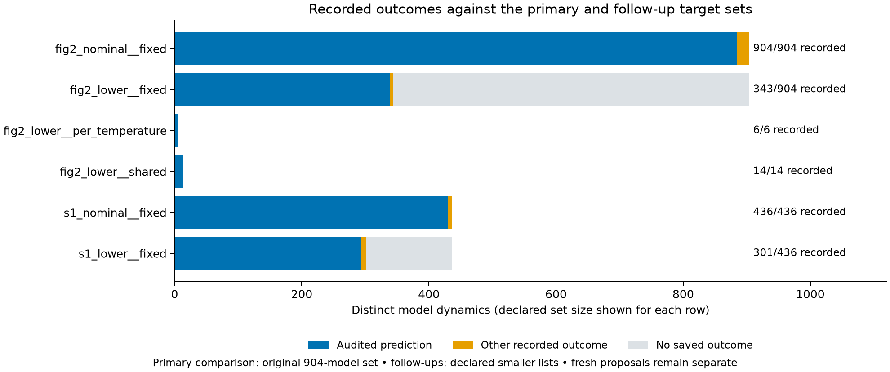
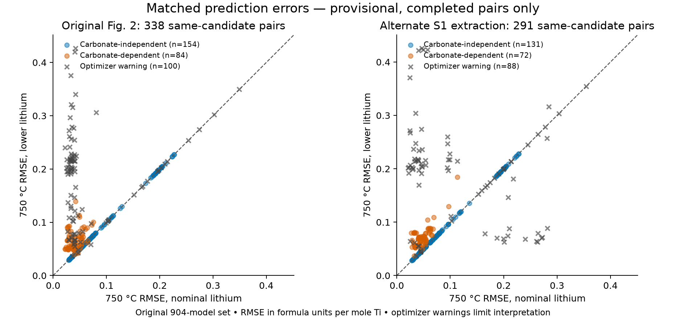
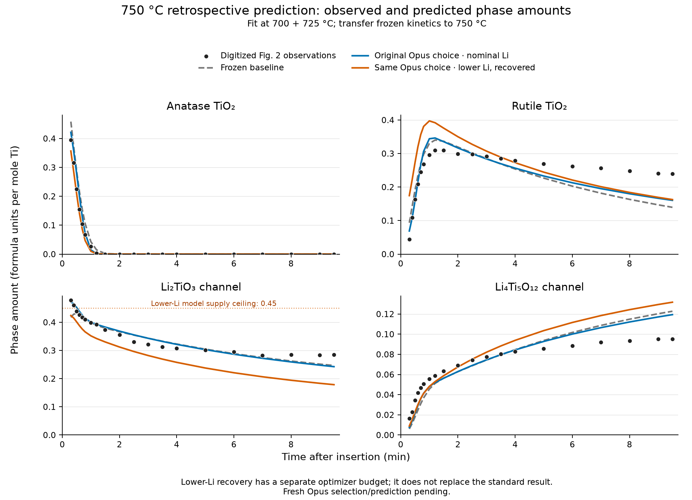

# Chapman lithium sensitivity — results snapshot

Generated 2026-10-22 15:57:21 UTC.

**This is an in-progress retrospective sensitivity analysis.** Every count below comes from saved result files. A recorded outcome may be a failed fit; a missing outcome may be queued, running, or not scheduled. No full-campaign conclusion follows from a provisional winner.

The primary comparison changes only the starting Li2CO3 assumption in the original Fig. 2 inputs. Fits use 700 + 725 °C; predictions use 750 °C with frozen kinetics. The lower initial amounts are hypotheses (0.28, 0.30, 0.36 formula units per mole Ti), not new measured starting compositions. The S1 comparison changes extraction on the same time grid and uses the same published experiments.

## Coverage and failures

The declared union contains **860 originally valid dynamics** and **904 including representation repairs** (44 added dynamics). The fixed baseline has 154 members; saved Opus1 has 208 originally valid dynamics (280 with repairs). Membership is reconstructed from source-record and alias links.

| Input / initial-state mode | Recorded / 904 | Comparable recorded / 860 | Valid 750 °C predictions | Failed outcomes | Missing |
|---|---:|---:|---:|---|---:|
| fig2_nominal__fixed | 904 / 904 | 860 / 860 | 884 | nonconvergence: 19, execution_error: 2 | 0 |
| fig2_lower__fixed | 343 / 904 | 343 / 860 | 339 | execution_error: 4, nonconvergence: 3 | 561 |
| fig2_lower__per_temperature | 6 / 904 | 6 / 860 | 6 | none recorded | 898 |
| fig2_lower__shared | 14 / 904 | 14 / 860 | 14 | none recorded | 890 |
| s1_nominal__fixed | 436 / 904 | 400 / 860 | 430 | execution_error: 1, nonconvergence: 6 | 468 |
| s1_lower__fixed | 301 / 904 | 281 / 860 | 293 | nonconvergence: 6, execution_error: 2 | 603 |

For S1 and optional fitted-initial-state modes, the 904 denominator above describes coverage of the old union. Their smaller declared target lists are tracked below; a target list alone does not establish that all its work has started.

| Follow-up | Recorded / declared targets | Audited predictions | Missing |
|---|---:|---:|---:|
| [s1_nominal__fixed](../data/derived/chapman_li_sensitivity/extraction_shortlist_v1.json) | 436 / 436 | 430 | 0 |
| [s1_lower__fixed](../data/derived/chapman_li_sensitivity/extraction_shortlist_v1.json) | 301 / 436 | 293 | 135 |
| [fig2_lower__shared](../data/derived/chapman_li_sensitivity/initial_amount_shortlist_v1.json) | 14 / 14 | 14 | 0 |
| [fig2_lower__per_temperature](../data/derived/chapman_li_sensitivity/per_temperature_shortlist_v1.json) | 6 / 6 | 6 | 0 |



| Input / mode | Baseline outcomes / 154 | Baseline predictions | Saved Opus1 outcomes / 208 | Saved Opus1 predictions |
|---|---:|---:|---:|---:|
| fig2_nominal__fixed | 154 / 154 | 153 | 208 / 208 | 204 |
| fig2_lower__fixed | 154 / 154 | 154 | 47 / 208 | 47 |
| fig2_lower__per_temperature | 0 / 154 | 0 | 4 / 208 | 4 |
| fig2_lower__shared | 0 / 154 | 0 | 11 / 208 | 11 |
| s1_nominal__fixed | 154 / 154 | 153 | 208 / 208 | 206 |
| s1_lower__fixed | 154 / 154 | 154 | 108 / 208 | 100 |

### Fresh lower-lithium proposals — separate set

Exported 2026-10-22 15:56:51 UTC: 276 saved candidates, **274 unique valid dynamics**; 27 overlap the old 904 and 247 are additional dynamics. The old 860/904 denominators are unchanged. Membership uses the fresh dynamics set, even when a reused result retains an older source label. This is a snapshot of proposals submitted so far, not a claim that proposal or fitting work is complete.

| Input / mode | Fresh outcomes / exported dynamics | Valid predictions | Missing |
|---|---:|---:|---:|
| fig2_nominal__fixed | 27 / 274 | 27 | 247 |
| fig2_lower__fixed | 17 / 274 | 17 | 257 |
| fig2_lower__per_temperature | 0 / 274 | 0 | 274 |
| fig2_lower__shared | 0 / 274 | 0 | 274 |
| s1_nominal__fixed | 16 / 274 | 16 | 258 |
| s1_lower__fixed | 16 / 274 | 16 | 258 |

The fresh run froze `C1a69e5d5a6` / `fa74046fac` at 2026-10-22T15:08:41.243Z.


Independent prediction checks are recorded separately from the original runner outcome:

| Input / mode | Independent prediction statuses |
|---|---|
| fig2_nominal__fixed | predicted: 883, not_attempted_fit_failed: 19, predicted_verified_fallback: 1, numerical_disagreement: 1 |
| fig2_lower__fixed | predicted: 283, predicted_verified_fallback: 3, not_rescored: 55, not_attempted_fit_failed: 2 |
| fig2_lower__per_temperature | predicted: 6 |
| fig2_lower__shared | predicted: 14 |
| s1_nominal__fixed | predicted: 178, not_rescored: 257, not_attempted_fit_failed: 1 |
| s1_lower__fixed | not_rescored: 300, predicted: 1 |

## Selection and prediction are separate

Development selection minimizes AICc on 700 + 725 °C. Retrospective best prediction minimizes the common weighted 750 °C squared error after looking at that temperature. The latter is not a prospectively selected model. All selections are provisional until their declared set has outcomes recorded; numerical failures remain part of coverage.

The common score is `sum((prediction − observation)^2 / reference_sigma[channel]^2)`, using the original frozen reference scales for every candidate and condition. RMSE is unweighted, in formula units per mole Ti. A model's own predictive noise does not determine the rank. AICc across different extractions is not evidence for which extraction is correct.

| Input / mode; candidate set | Choice | Candidate | AICc | Common prediction score ↓ | RMSE ↓ | Baseline insertion rank |
|---|---|---|---:|---:|---:|---|
| fig2_nominal__fixed; Fixed baseline | development-selected | [`ca33a8f980`](../data/derived/chapman_li_sensitivity/results/fig2_nominal__fixed/ca33a8f980123d4f384c29150bbfaa0da8e3a027d0cd9b1560aa8f686be73045.json) | -851.5 | 1072 | 0.03174 | 11 (153/154 baseline scored) |
| fig2_nominal__fixed; Fixed baseline | retrospective best | [`801354c6aa`](../data/derived/chapman_li_sensitivity/results/fig2_nominal__fixed/801354c6aa4e48c0852d8bf027340d5c23d25ac24cbddea66bbee6a86d18d0d9.json) | -770.3 | 603.8 | 0.03056 | 1 (153/154 baseline scored) |
| fig2_nominal__fixed; Saved Opus1, originally valid | development-selected | [`b9b64bc542`](../data/derived/chapman_li_sensitivity/results/fig2_nominal__fixed/b9b64bc54266fd1a6560c5b87872976d44e93d658f41965cf579d3ff540ec220.json) | -1196.0 | 744.1 | 0.02483 | 4 (153/154 baseline scored) |
| fig2_nominal__fixed; Saved Opus1, originally valid | retrospective best | [`9c897de479`](../data/derived/chapman_li_sensitivity/results/fig2_nominal__fixed/9c897de479d10a77ade1e2f184615b4f5b97a311090df2770ed1d058c62b57c4.json) | -1119.2 | 471.6 | 0.02326 | 1 (153/154 baseline scored) |
| fig2_nominal__fixed; Originally valid union | development-selected | [`b9b64bc542`](../data/derived/chapman_li_sensitivity/results/fig2_nominal__fixed/b9b64bc54266fd1a6560c5b87872976d44e93d658f41965cf579d3ff540ec220.json) | -1196.0 | 744.1 | 0.02483 | 4 (153/154 baseline scored) |
| fig2_nominal__fixed; Originally valid union | retrospective best | [`9c897de479`](../data/derived/chapman_li_sensitivity/results/fig2_nominal__fixed/9c897de479d10a77ade1e2f184615b4f5b97a311090df2770ed1d058c62b57c4.json) | -1119.2 | 471.6 | 0.02326 | 1 (153/154 baseline scored) |
| fig2_nominal__fixed; Union including repairs | development-selected | [`b9b64bc542`](../data/derived/chapman_li_sensitivity/results/fig2_nominal__fixed/b9b64bc54266fd1a6560c5b87872976d44e93d658f41965cf579d3ff540ec220.json) | -1196.0 | 744.1 | 0.02483 | 4 (153/154 baseline scored) |
| fig2_nominal__fixed; Union including repairs | retrospective best | [`9c897de479`](../data/derived/chapman_li_sensitivity/results/fig2_nominal__fixed/9c897de479d10a77ade1e2f184615b4f5b97a311090df2770ed1d058c62b57c4.json) | -1119.2 | 471.6 | 0.02326 | 1 (153/154 baseline scored) |
| fig2_nominal__fixed; Fresh lower-Li Opus run | development-selected (provisional) | [`ca33a8f980`](../data/derived/chapman_li_sensitivity/results/fig2_nominal__fixed/ca33a8f980123d4f384c29150bbfaa0da8e3a027d0cd9b1560aa8f686be73045.json) | -851.5 | 1072 | 0.03174 | 11 (153/154 baseline scored) |
| fig2_nominal__fixed; Fresh lower-Li Opus run | retrospective best (provisional) | [`a7a944075e`](../data/derived/chapman_li_sensitivity/results/fig2_nominal__fixed/a7a944075efd6242c9fe87757a2e77a85298417a5c8c725162b08b44f880af5a.json) | -637.3 | 783.4 | 0.06303 | 4 (153/154 baseline scored) |
| fig2_lower__fixed; Fixed baseline | development-selected | [`ca33a8f980`](../data/derived/chapman_li_sensitivity/results/fig2_lower__fixed/ca33a8f980123d4f384c29150bbfaa0da8e3a027d0cd9b1560aa8f686be73045.json) | -851.5 | 1072 | 0.03174 | 11 (154/154 baseline scored) |
| fig2_lower__fixed; Fixed baseline | retrospective best | [`801354c6aa`](../data/derived/chapman_li_sensitivity/results/fig2_lower__fixed/801354c6aa4e48c0852d8bf027340d5c23d25ac24cbddea66bbee6a86d18d0d9.json) | -770.3 | 603.8 | 0.03056 | 1 (154/154 baseline scored) |
| fig2_lower__fixed; Saved Opus1, originally valid | development-selected (provisional) | [`55837a0951`](../data/derived/chapman_li_sensitivity/results/fig2_lower__fixed/55837a095104afa9ecafc1d182927c6f900456be6b80e7a018580fe6a6966564.json) | -758.8 | 1829 | 0.0552 | 55 (154/154 baseline scored) |
| fig2_lower__fixed; Saved Opus1, originally valid | retrospective best (provisional) | [`db4e2cc9e6`](../data/derived/chapman_li_sensitivity/results/fig2_lower__fixed/db4e2cc9e68828be9c782a7a4a43e15dabf10498dc50410c8f397d51546dc958.json) | -509.9 | 1047 | 0.05294 | 11 (154/154 baseline scored) |
| fig2_lower__fixed; Originally valid union | development-selected (provisional) | [`142473d689`](../data/derived/chapman_li_sensitivity/results/fig2_lower__fixed/142473d68901feb8dea6d8e9156a9b663a2ea538488fd3d49d0b933a03c82319.json) | -933.7 | 2760 | 0.05131 | 101 (154/154 baseline scored) |
| fig2_lower__fixed; Originally valid union | retrospective best (provisional) | [`801354c6aa`](../data/derived/chapman_li_sensitivity/results/fig2_lower__fixed/801354c6aa4e48c0852d8bf027340d5c23d25ac24cbddea66bbee6a86d18d0d9.json) | -770.3 | 603.8 | 0.03056 | 1 (154/154 baseline scored) |
| fig2_lower__fixed; Union including repairs | development-selected (provisional) | [`142473d689`](../data/derived/chapman_li_sensitivity/results/fig2_lower__fixed/142473d68901feb8dea6d8e9156a9b663a2ea538488fd3d49d0b933a03c82319.json) | -933.7 | 2760 | 0.05131 | 101 (154/154 baseline scored) |
| fig2_lower__fixed; Union including repairs | retrospective best (provisional) | [`801354c6aa`](../data/derived/chapman_li_sensitivity/results/fig2_lower__fixed/801354c6aa4e48c0852d8bf027340d5c23d25ac24cbddea66bbee6a86d18d0d9.json) | -770.3 | 603.8 | 0.03056 | 1 (154/154 baseline scored) |
| fig2_lower__fixed; Fresh lower-Li Opus run | development-selected (provisional) | [`ca33a8f980`](../data/derived/chapman_li_sensitivity/results/fig2_lower__fixed/ca33a8f980123d4f384c29150bbfaa0da8e3a027d0cd9b1560aa8f686be73045.json) | -851.5 | 1072 | 0.03174 | 11 (154/154 baseline scored) |
| fig2_lower__fixed; Fresh lower-Li Opus run | retrospective best (provisional) | [`a7a944075e`](../data/derived/chapman_li_sensitivity/results/fig2_lower__fixed/a7a944075efd6242c9fe87757a2e77a85298417a5c8c725162b08b44f880af5a.json) | -637.3 | 783.4 | 0.06303 | 4 (154/154 baseline scored) |
| fig2_lower__per_temperature; Saved Opus1, originally valid | development-selected (provisional) | [`b9b64bc542`](../data/derived/chapman_li_sensitivity/results/fig2_lower__per_temperature/b9b64bc54266fd1a6560c5b87872976d44e93d658f41965cf579d3ff540ec220.json) | -1202.8 | 1141 | 0.04755 | 13 (154/154 baseline scored) |
| fig2_lower__per_temperature; Saved Opus1, originally valid | retrospective best (provisional) | [`ba9112653b`](../data/derived/chapman_li_sensitivity/results/fig2_lower__per_temperature/ba9112653b25e804d1a0ccbe8b5ae9d62ccae03b210d48319a0ae7eeb64cd4bc.json) | -1066.2 | 797.5 | 0.05393 | 5 (154/154 baseline scored) |
| fig2_lower__per_temperature; Originally valid union | development-selected (provisional) | [`b9b64bc542`](../data/derived/chapman_li_sensitivity/results/fig2_lower__per_temperature/b9b64bc54266fd1a6560c5b87872976d44e93d658f41965cf579d3ff540ec220.json) | -1202.8 | 1141 | 0.04755 | 13 (154/154 baseline scored) |
| fig2_lower__per_temperature; Originally valid union | retrospective best (provisional) | [`ba9112653b`](../data/derived/chapman_li_sensitivity/results/fig2_lower__per_temperature/ba9112653b25e804d1a0ccbe8b5ae9d62ccae03b210d48319a0ae7eeb64cd4bc.json) | -1066.2 | 797.5 | 0.05393 | 5 (154/154 baseline scored) |
| fig2_lower__per_temperature; Union including repairs | development-selected (provisional) | [`b9b64bc542`](../data/derived/chapman_li_sensitivity/results/fig2_lower__per_temperature/b9b64bc54266fd1a6560c5b87872976d44e93d658f41965cf579d3ff540ec220.json) | -1202.8 | 1141 | 0.04755 | 13 (154/154 baseline scored) |
| fig2_lower__per_temperature; Union including repairs | retrospective best (provisional) | [`ba9112653b`](../data/derived/chapman_li_sensitivity/results/fig2_lower__per_temperature/ba9112653b25e804d1a0ccbe8b5ae9d62ccae03b210d48319a0ae7eeb64cd4bc.json) | -1066.2 | 797.5 | 0.05393 | 5 (154/154 baseline scored) |
| fig2_lower__shared; Saved Opus1, originally valid | development-selected (provisional) | [`b9b64bc542`](../data/derived/chapman_li_sensitivity/results/fig2_lower__shared/b9b64bc54266fd1a6560c5b87872976d44e93d658f41965cf579d3ff540ec220.json) | -1193.4 | 744.1 | 0.02483 | 4 (154/154 baseline scored) |
| fig2_lower__shared; Saved Opus1, originally valid | retrospective best (provisional) | [`9c897de479`](../data/derived/chapman_li_sensitivity/results/fig2_lower__shared/9c897de479d10a77ade1e2f184615b4f5b97a311090df2770ed1d058c62b57c4.json) | -1158.2 | 477.5 | 0.02224 | 1 (154/154 baseline scored) |
| fig2_lower__shared; Originally valid union | development-selected (provisional) | [`b9b64bc542`](../data/derived/chapman_li_sensitivity/results/fig2_lower__shared/b9b64bc54266fd1a6560c5b87872976d44e93d658f41965cf579d3ff540ec220.json) | -1193.4 | 744.1 | 0.02483 | 4 (154/154 baseline scored) |
| fig2_lower__shared; Originally valid union | retrospective best (provisional) | [`9c897de479`](../data/derived/chapman_li_sensitivity/results/fig2_lower__shared/9c897de479d10a77ade1e2f184615b4f5b97a311090df2770ed1d058c62b57c4.json) | -1158.2 | 477.5 | 0.02224 | 1 (154/154 baseline scored) |
| fig2_lower__shared; Union including repairs | development-selected (provisional) | [`b9b64bc542`](../data/derived/chapman_li_sensitivity/results/fig2_lower__shared/b9b64bc54266fd1a6560c5b87872976d44e93d658f41965cf579d3ff540ec220.json) | -1193.4 | 744.1 | 0.02483 | 4 (154/154 baseline scored) |
| fig2_lower__shared; Union including repairs | retrospective best (provisional) | [`9c897de479`](../data/derived/chapman_li_sensitivity/results/fig2_lower__shared/9c897de479d10a77ade1e2f184615b4f5b97a311090df2770ed1d058c62b57c4.json) | -1158.2 | 477.5 | 0.02224 | 1 (154/154 baseline scored) |
| s1_nominal__fixed; Fixed baseline | development-selected | [`f4912de543`](../data/derived/chapman_li_sensitivity/results/s1_nominal__fixed/f4912de54388c5cb145a12111274f52cad0e423341409b93a11cb1f209e9d26c.json) | -854.7 | 806.9 | 0.0291 | 5 (153/154 baseline scored) |
| s1_nominal__fixed; Fixed baseline | retrospective best | [`c4fa4bab6b`](../data/derived/chapman_li_sensitivity/results/s1_nominal__fixed/c4fa4bab6b5014aa8354f8837032f071ccd7d2d7858586b0b61f6cd65b181b04.json) | -766.4 | 639.4 | 0.03097 | 1 (153/154 baseline scored) |
| s1_nominal__fixed; Saved Opus1, originally valid | development-selected | [`b9b64bc542`](../data/derived/chapman_li_sensitivity/results/s1_nominal__fixed/b9b64bc54266fd1a6560c5b87872976d44e93d658f41965cf579d3ff540ec220.json) | -1182.6 | 675.7 | 0.0241 | 4 (153/154 baseline scored) |
| s1_nominal__fixed; Saved Opus1, originally valid | retrospective best | [`9c897de479`](../data/derived/chapman_li_sensitivity/results/s1_nominal__fixed/9c897de479d10a77ade1e2f184615b4f5b97a311090df2770ed1d058c62b57c4.json) | -1104.6 | 406.6 | 0.02221 | 1 (153/154 baseline scored) |
| s1_nominal__fixed; Originally valid union | development-selected (provisional) | [`b9b64bc542`](../data/derived/chapman_li_sensitivity/results/s1_nominal__fixed/b9b64bc54266fd1a6560c5b87872976d44e93d658f41965cf579d3ff540ec220.json) | -1182.6 | 675.7 | 0.0241 | 4 (153/154 baseline scored) |
| s1_nominal__fixed; Originally valid union | retrospective best (provisional) | [`9c897de479`](../data/derived/chapman_li_sensitivity/results/s1_nominal__fixed/9c897de479d10a77ade1e2f184615b4f5b97a311090df2770ed1d058c62b57c4.json) | -1104.6 | 406.6 | 0.02221 | 1 (153/154 baseline scored) |
| s1_nominal__fixed; Union including repairs | development-selected (provisional) | [`b9b64bc542`](../data/derived/chapman_li_sensitivity/results/s1_nominal__fixed/b9b64bc54266fd1a6560c5b87872976d44e93d658f41965cf579d3ff540ec220.json) | -1182.6 | 675.7 | 0.0241 | 4 (153/154 baseline scored) |
| s1_nominal__fixed; Union including repairs | retrospective best (provisional) | [`9c897de479`](../data/derived/chapman_li_sensitivity/results/s1_nominal__fixed/9c897de479d10a77ade1e2f184615b4f5b97a311090df2770ed1d058c62b57c4.json) | -1104.6 | 406.6 | 0.02221 | 1 (153/154 baseline scored) |
| s1_nominal__fixed; Fresh lower-Li Opus run | development-selected (provisional) | [`f4912de543`](../data/derived/chapman_li_sensitivity/results/s1_nominal__fixed/f4912de54388c5cb145a12111274f52cad0e423341409b93a11cb1f209e9d26c.json) | -854.7 | 806.9 | 0.0291 | 5 (153/154 baseline scored) |
| s1_nominal__fixed; Fresh lower-Li Opus run | retrospective best (provisional) | [`f4912de543`](../data/derived/chapman_li_sensitivity/results/s1_nominal__fixed/f4912de54388c5cb145a12111274f52cad0e423341409b93a11cb1f209e9d26c.json) | -854.7 | 806.9 | 0.0291 | 5 (153/154 baseline scored) |
| s1_lower__fixed; Fixed baseline | development-selected | [`f4912de543`](../data/derived/chapman_li_sensitivity/results/s1_lower__fixed/f4912de54388c5cb145a12111274f52cad0e423341409b93a11cb1f209e9d26c.json) | -854.7 | 806.9 | 0.0291 | 5 (154/154 baseline scored) |
| s1_lower__fixed; Fixed baseline | retrospective best | [`c4fa4bab6b`](../data/derived/chapman_li_sensitivity/results/s1_lower__fixed/c4fa4bab6b5014aa8354f8837032f071ccd7d2d7858586b0b61f6cd65b181b04.json) | -766.4 | 639.4 | 0.03097 | 1 (154/154 baseline scored) |
| s1_lower__fixed; Saved Opus1, originally valid | development-selected (provisional) | [`55837a0951`](../data/derived/chapman_li_sensitivity/results/s1_lower__fixed/55837a095104afa9ecafc1d182927c6f900456be6b80e7a018580fe6a6966564.json) | -753.1 | 1805 | 0.05337 | 50 (154/154 baseline scored) |
| s1_lower__fixed; Saved Opus1, originally valid | retrospective best (provisional) | [`65286a5841`](../data/derived/chapman_li_sensitivity/results/s1_lower__fixed/65286a5841fb22e409ba0fd09fe5b90cc52d725657e938c717b2e44abf43fc8a.json) | -602.9 | 701.6 | 0.05 | 4 (154/154 baseline scored) |
| s1_lower__fixed; Originally valid union | development-selected (provisional) | [`f4912de543`](../data/derived/chapman_li_sensitivity/results/s1_lower__fixed/f4912de54388c5cb145a12111274f52cad0e423341409b93a11cb1f209e9d26c.json) | -854.7 | 806.9 | 0.0291 | 5 (154/154 baseline scored) |
| s1_lower__fixed; Originally valid union | retrospective best (provisional); optimizer warning | [`5c0deed6a5`](../data/derived/chapman_li_sensitivity/results/s1_lower__fixed/5c0deed6a5a45967a35b10dee399c29d9e0a88b73613e41a1cbd4bad85c279e6.json) | -455.4 | 437.5 | 0.06139 | 1 (154/154 baseline scored) |
| s1_lower__fixed; Union including repairs | development-selected (provisional) | [`f4912de543`](../data/derived/chapman_li_sensitivity/results/s1_lower__fixed/f4912de54388c5cb145a12111274f52cad0e423341409b93a11cb1f209e9d26c.json) | -854.7 | 806.9 | 0.0291 | 5 (154/154 baseline scored) |
| s1_lower__fixed; Union including repairs | retrospective best (provisional); optimizer warning | [`5c0deed6a5`](../data/derived/chapman_li_sensitivity/results/s1_lower__fixed/5c0deed6a5a45967a35b10dee399c29d9e0a88b73613e41a1cbd4bad85c279e6.json) | -455.4 | 437.5 | 0.06139 | 1 (154/154 baseline scored) |
| s1_lower__fixed; Fresh lower-Li Opus run | development-selected (provisional) | [`f4912de543`](../data/derived/chapman_li_sensitivity/results/s1_lower__fixed/f4912de54388c5cb145a12111274f52cad0e423341409b93a11cb1f209e9d26c.json) | -854.7 | 806.9 | 0.0291 | 5 (154/154 baseline scored) |
| s1_lower__fixed; Fresh lower-Li Opus run | retrospective best (provisional) | [`f4912de543`](../data/derived/chapman_li_sensitivity/results/s1_lower__fixed/f4912de54388c5cb145a12111274f52cad0e423341409b93a11cb1f209e9d26c.json) | -854.7 | 806.9 | 0.0291 | 5 (154/154 baseline scored) |

Baseline insertion rank is one plus the number of better-scoring baseline members under the **same extraction and lithium scenario**, using fixed initial-state baseline fits even for adapter comparisons. It is withheld until all 154 baseline outcomes are recorded. The original baseline had 153 fitted outcomes; a failed fit is not assigned an artificial worst score. An outside candidate can rank 154 against 153 scored baseline candidates. Rank alone does not establish predictive accuracy.

## Frozen AI choices

The original run selected on nominal lithium. The fresh run selects on the lower-lithium development inputs. These choices are fixed by each run's saved selection file, not replaced by the best 750 °C predictor. Both can be evaluated under the same scenario once their result files are available.

| Frozen choice | Selection status | Fig. 2 nominal RMSE | Fig. 2 lower-Li RMSE |
|---|---|---:|---:|
| Original Opus1 `b9b64bc542` | [C914ebc19e9](../investigations/runs/chapman750-propose_space-opus1/frozen.json) | 0.02483 | 0.2016 (optimizer warning) |
| Fresh lower-Li Opus `fa74046fac` | [C1a69e5d5a6](../investigations/runs/chapman-li-oct22-opus1/frozen.json) | pending | pending |

The original Opus1 choice `b9b64bc542` declares **Ti-only conservation**. Its carbonate-reactant coefficient creates carbonate dependence but does not impose lithium balance. Neither that coefficient nor its fitted trajectory proves a Li1.6 phase composition. Declared element conservation and rate-law dependence are separate properties.

## Same-candidate sensitivity



Each point compares the same validated dynamics under nominal and lower lithium. Only pairs with audited predictions appear. Below the diagonal means smaller error under lower lithium; it does not establish the correct starting composition. Crosses mark optimizer warnings, including a returned fit worse than an unfinished start; those changes cannot support a physical interpretation. The Ti-only baseline is a control because carbonate is absent from its rate equations.

| Comparison | Known candidate | RMSE before → after | Common score before → after | AICc before → after | Optimizer quality |
|---|---|---:|---:|---:|---|
| primary_Li | `142473d689` (fig2_lower_comparable_current_development_selected, fig2_lower_repaired_current_development_selected) | 0.03873 → 0.05131 | 2199 → 2760 | -962.9 → -933.7 | No lower-start warning recorded |
| primary_Li | `3838e9712a` (original_gemini2_top1) | 0.0345 → 0.05468 | 1587 → 1363 | -1121.0 → -666.4 | No lower-start warning recorded |
| primary_Li | `59c64369b9` (original_opus2_top1) | 0.03588 → 0.06699 | 1567 → 2157 | -1072.8 → -735.8 | No lower-start warning recorded |
| primary_Li | `7eab3faff4` (original_gemini1_top1) | 0.02764 → 0.137 | 1040 → 3.028e+04 | -1137.1 → -263.6 | Warning; do not interpret physical parameter shifts |
| primary_Li | `b9b64bc542` (original_opus1_top1, fig2_nominal_comparable_current_development_selected, fig2_nominal_repaired_current_development_selected) | 0.02483 → 0.2016 | 744.1 → 1.74e+04 | -1196.0 → -172.9 | Warning; do not interpret physical parameter shifts |
| primary_Li | `ca33a8f980` (original_baseline_top1) | 0.03174 → 0.03174 | 1072 → 1072 | -851.5 → -851.5 | No lower-start warning recorded |
| S1_Li | `3838e9712a` (original_gemini2_top1) | 0.03458 → 0.0522 | 1574 → 1318 | -1113.6 → -664.8 | No lower-start warning recorded |
| S1_Li | `59c64369b9` (original_opus2_top1) | 0.03517 → 0.2475 | 1545 → 1.16e+04 | -1066.5 → -204.6 | Warning; do not interpret physical parameter shifts |
| S1_Li | `7eab3faff4` (original_gemini1_top1) | 0.02838 → 0.0665 | 1085 → 1441 | -1125.2 → -734.7 | No lower-start warning recorded |
| S1_Li | `b9b64bc542` (original_opus1_top1, fig2_nominal_comparable_current_development_selected, fig2_nominal_repaired_current_development_selected) | 0.0241 → 0.2716 | 675.7 → 5071 | -1182.6 → -299.4 | Warning; do not interpret physical parameter shifts |
| S1_Li | `ca33a8f980` (original_baseline_top1) | 0.02989 → 0.02989 | 866 → 866 | -852.3 → -852.3 | No lower-start warning recorded |

**Baseline invariance check:** 153 matched, audited baseline predictions. Maximum absolute changes: AICc 0, common score 0, RMSE 0. 0 pairs currently mix runner and independent prediction sources. Different integration tolerances can cause small prediction-score differences even when the carbonate-independent rate equations and fitted parameters are unchanged. This checks paired completed baseline fits; it does not imply that unpaired numerical failures are equivalent.

### Parameter changes for the original Opus1 selection

This tracks the same original candidate, not a switch between different winning mechanisms. Rate constants are at each step's declared reference condition. Bound or weakly determined estimates cannot establish a physical change in activation energy.

| Comparison | Parameter | Before | After | Bound flag before / after | Local determinacy before / after |
|---|---|---:|---:|---|---|
| primary_Li | Physical interpretation withheld: optimizer warning; raw values remain in paired JSON | — | — | — | — |
| S1_Li | Physical interpretation withheld: optimizer warning; raw values remain in paired JSON | — | — | — | — |
| extraction_nominal | `R1.Ea` (Ea) | 224.06 | 202.92 | False / False | well_determined / well_determined |
| extraction_nominal | `R1.k` (k) | 10.08 | 9.6351 | False / False | well_determined / well_determined |
| extraction_nominal | `R2.Ea` (Ea) | 284.28 | 280.09 | False / False | well_determined / well_determined |
| extraction_nominal | `R2.k` (k) | 0.39109 | 0.38634 | False / False | well_determined / well_determined |
| extraction_nominal | `R2.n_avrami` (n_avrami) | 2.9368 | 2.8961 | False / False | well_determined / well_determined |
| extraction_nominal | `R3.Ea` (Ea) | 170.83 | 132.79 | False / False | well_determined / well_determined |
| extraction_nominal | `R3.k` (k) | 0.89283 | 0.85717 | False / False | well_determined / well_determined |
| extraction_nominal | `R4.Ea` (Ea) | 242.28 | 238.04 | False / False | well_determined / well_determined |
| extraction_nominal | `R4.k` (k) | 0.27776 | 0.27426 | False / False | well_determined / well_determined |
| extraction_nominal | `R4.n_avrami` (n_avrami) | 2.4638 | 2.4378 | False / False | well_determined / well_determined |
| extraction_nominal | `R5.Ea` (Ea) | 600 | 600 | True / True | not_determined_locally / not_determined_locally |
| extraction_nominal | `R5.k` (k) | 0.0069896 | 0.0065398 | False / False | moderately_determined / moderately_determined |
| extraction_nominal | `R6.Ea` (Ea) | 17.893 | 19.599 | False / False | moderately_determined / moderately_determined |
| extraction_nominal | `R6.k` (k) | 0.0018257 | 0.0018981 | False / False | well_determined / well_determined |
| extraction_lower | Physical interpretation withheld: optimizer warning; raw values remain in paired JSON | — | — | — | — |
| fig2_shared_initial_vs_original | `R1.Ea` (Ea) | 224.06 | 224.06 | False / False | well_determined / well_determined |
| fig2_shared_initial_vs_original | `R1.k` (k) | 10.08 | 10.08 | False / False | well_determined / well_determined |
| fig2_shared_initial_vs_original | `R2.Ea` (Ea) | 284.28 | 284.28 | False / False | well_determined / well_determined |
| fig2_shared_initial_vs_original | `R2.k` (k) | 0.39109 | 0.39109 | False / False | well_determined / well_determined |
| fig2_shared_initial_vs_original | `R2.n_avrami` (n_avrami) | 2.9368 | 2.9368 | False / False | well_determined / well_determined |
| fig2_shared_initial_vs_original | `R3.Ea` (Ea) | 170.83 | 170.83 | False / False | well_determined / well_determined |
| fig2_shared_initial_vs_original | `R3.k` (k) | 0.89283 | 0.89283 | False / False | well_determined / well_determined |
| fig2_shared_initial_vs_original | `R4.Ea` (Ea) | 242.28 | 242.28 | False / False | well_determined / well_determined |
| fig2_shared_initial_vs_original | `R4.k` (k) | 0.27776 | 0.27776 | False / False | well_determined / well_determined |
| fig2_shared_initial_vs_original | `R4.n_avrami` (n_avrami) | 2.4638 | 2.4638 | False / False | well_determined / well_determined |
| fig2_shared_initial_vs_original | `R5.Ea` (Ea) | 600 | 600 | True / True | not_determined_locally / not_determined_locally |
| fig2_shared_initial_vs_original | `R5.k` (k) | 0.0069896 | 0.0069896 | False / False | moderately_determined / moderately_determined |
| fig2_shared_initial_vs_original | `R6.Ea` (Ea) | 17.893 | 17.898 | False / False | moderately_determined / moderately_determined |
| fig2_shared_initial_vs_original | `R6.k` (k) | 0.0018257 | 0.0018257 | False / False | well_determined / well_determined |
| fig2_per_temperature_initial_vs_original | `R1.Ea` (Ea) | 224.06 | 200.73 | False / False | well_determined / well_determined |
| fig2_per_temperature_initial_vs_original | `R1.k` (k) | 10.08 | 10.494 | False / False | well_determined / well_determined |
| fig2_per_temperature_initial_vs_original | `R2.Ea` (Ea) | 284.28 | 286.85 | False / False | well_determined / well_determined |
| fig2_per_temperature_initial_vs_original | `R2.k` (k) | 0.39109 | 0.38877 | False / False | well_determined / well_determined |
| fig2_per_temperature_initial_vs_original | `R2.n_avrami` (n_avrami) | 2.9368 | 2.8627 | False / False | well_determined / well_determined |
| fig2_per_temperature_initial_vs_original | `R3.Ea` (Ea) | 170.83 | 129.25 | False / False | well_determined / moderately_determined |
| fig2_per_temperature_initial_vs_original | `R3.k` (k) | 0.89283 | 0.91267 | False / False | well_determined / well_determined |
| fig2_per_temperature_initial_vs_original | `R4.Ea` (Ea) | 242.28 | 233.68 | False / False | well_determined / well_determined |
| fig2_per_temperature_initial_vs_original | `R4.k` (k) | 0.27776 | 0.27863 | False / False | well_determined / well_determined |
| fig2_per_temperature_initial_vs_original | `R4.n_avrami` (n_avrami) | 2.4638 | 2.4494 | False / False | well_determined / well_determined |
| fig2_per_temperature_initial_vs_original | `R5.Ea` (Ea) | 600 | 600 | True / True | not_determined_locally / not_determined_locally |
| fig2_per_temperature_initial_vs_original | `R5.k` (k) | 0.0069896 | 0.0071664 | False / False | moderately_determined / moderately_determined |
| fig2_per_temperature_initial_vs_original | `R6.Ea` (Ea) | 17.893 | 414.15 | False / False | moderately_determined / not_determined_locally |
| fig2_per_temperature_initial_vs_original | `R6.k` (k) | 0.0018257 | 0.001 | False / True | well_determined / moderately_determined |
| initial_amount_shared_fig2_lower | Physical interpretation withheld: optimizer warning; raw values remain in paired JSON | — | — | — | — |
| initial_amount_per_temperature_fig2_lower | Physical interpretation withheld: optimizer warning; raw values remain in paired JSON | — | — | — | — |

Full same-candidate parameter changes, including rate constants, activation energies, Avrami exponents and fitted initial amounts, are in the local [paired parameter export](../data/derived/chapman_li_sensitivity/summary/paired_candidates.json). Wald intervals and local sensitivity labels are screening diagnostics, not profile-likelihood evidence.

## Fit quality and represented networks

| Input / mode | Fitted | Poor residual adequacy | Any parameter at bound | Weak parameters | Optimizer warnings | Prediction audit failures |
|---|---:|---:|---:|---:|---:|---:|
| fig2_nominal__fixed | 885 | 885 | 674 | 755 | 104 | 0 |
| fig2_lower__fixed | 340 | 340 | 208 | 289 | 98 | 0 |
| fig2_lower__per_temperature | 6 | 6 | 6 | 5 | 0 | 0 |
| fig2_lower__shared | 14 | 14 | 14 | 13 | 0 | 0 |
| s1_nominal__fixed | 430 | 430 | 333 | 373 | 59 | 0 |
| s1_lower__fixed | 295 | 295 | 203 | 270 | 72 | 0 |

Residual adequacy is the existing heuristic for clustered signs or serial correlation. Passing it is not proof of the mechanism. Numerical failure, incomplete optimization and limited identifiability are reported separately from chemistry. Budget exhaustion alone is distinct from a lower-start warning: the existing fitter can accept a minimum replicated by independent starts even when its formal stopping criterion is unmet. Those counts remain separate in the snapshot JSON. Different chemistry/source aliases can share identical fitted dynamics, so a dynamics winner does not uniquely identify a physical mechanism.

**Optimizer warning — original_opus1_top1, fig2_lower__fixed:** returned NLL -106.882; best available start NLL -393.7901. Starts within 0.01 of the returned NLL: 1 (1 formally converged); 5 starts reached a lower NLL. Stored warning: a single unconverged start reached lower NLL (-393.7901 vs -106.8820) without replication; reported optimum may not be global. This result remains in coverage, but its parameter shifts and accuracy change are not reliable scientific evidence. Any numerical rescue must be reported separately with its changed optimization budget.

**Optimizer warning — original_opus1_top1, s1_lower__fixed:** returned NLL -170.1347; best available start NLL -390.2657. Starts within 0.01 of the returned NLL: 1 (1 formally converged); 2 starts reached a lower NLL. Stored warning: a single unconverged start reached lower NLL (-390.2657 vs -170.1347) without replication; reported optimum may not be global. This result remains in coverage, but its parameter shifts and accuracy change are not reliable scientific evidence. Any numerical rescue must be reported separately with its changed optimization budget.

**Optimizer warning — original_opus2_top1, s1_lower__fixed:** returned NLL -120.2221; best available start NLL -382.0637. Starts within 0.01 of the returned NLL: 1 (1 formally converged); 5 starts reached a lower NLL. Stored warning: a single unconverged start reached lower NLL (-382.0637 vs -120.2221) without replication; reported optimum may not be global. This result remains in coverage, but its parameter shifts and accuracy change are not reliable scientific evidence. Any numerical rescue must be reported separately with its changed optimization budget.

**Optimizer warning — original_gemini1_top1, fig2_lower__fixed:** returned NLL -146.0251; best available start NLL -384.1529. Starts within 0.01 of the returned NLL: 1 (1 formally converged); 5 starts reached a lower NLL. Stored warning: a single unconverged start reached lower NLL (-384.1529 vs -146.0251) without replication; reported optimum may not be global. This result remains in coverage, but its parameter shifts and accuracy change are not reliable scientific evidence. Any numerical rescue must be reported separately with its changed optimization budget.

**Representative `b9b64bc542`** — fig2_nominal__fixed/comparable, fig2_nominal__fixed/repaired, fig2_lower__per_temperature/comparable, fig2_lower__per_temperature/repaired, fig2_lower__shared/comparable, fig2_lower__shared/repaired, s1_nominal__fixed/comparable, s1_nominal__fixed/repaired.

Conserved elements: Ti. 6 steps. Residual adequacy: poor. Bound parameters: R5.Ea. Starts within 0.01 NLL of returned fit: 5. Optimizer warning: none recorded. Raw result: [`b9b64bc542`](../data/derived/chapman_li_sensitivity/results/fig2_nominal__fixed/b9b64bc54266fd1a6560c5b87872976d44e93d658f41965cf579d3ff540ec220.json).

- `R1: anatase + 0.8 Li2CO3 → Li2TiO3 [power_law]`
- `R2: anatase → rutile [power_law, avrami]`
- `R3: anatase + Li2CO3 → rutile + Li2CO3 [power_law]`
- `R4: 2 Li2TiO3 + 3 anatase → Li4Ti5O12 [power_law, avrami]`
- `R5: 2 Li2TiO3 + 3 rutile → Li4Ti5O12 [power_law]`
- `R6: 5 Li2TiO3 → Li4Ti5O12 + 3 Li2O [power_law]`

**Representative `142473d689`** — fig2_lower__fixed/comparable, fig2_lower__fixed/repaired.

Conserved elements: Ti. 4 steps. Residual adequacy: poor. Bound parameters: R1.n_avrami, R2.n_avrami. Starts within 0.01 NLL of returned fit: 5. Optimizer warning: none recorded. Raw result: [`142473d689`](../data/derived/chapman_li_sensitivity/results/fig2_lower__fixed/142473d68901feb8dea6d8e9156a9b663a2ea538488fd3d49d0b933a03c82319.json).

- `R1: anatase + Li2CO3 → Li2TiO3 [power_law, avrami]`
- `R2: anatase → Li2TiO3 [power_law, avrami]`
- `R3: anatase → rutile [power_law, avrami]`
- `R4: 2 Li2TiO3 + 3 anatase → Li4Ti5O12 [power_law, avrami]`

**Representative `f4912de543`** — s1_lower__fixed/comparable, s1_lower__fixed/repaired.

Conserved elements: Ti. 4 steps. Residual adequacy: poor. Bound parameters: R1.n_avrami. Starts within 0.01 NLL of returned fit: 6. Optimizer warning: none recorded. Raw result: [`f4912de543`](../data/derived/chapman_li_sensitivity/results/s1_lower__fixed/f4912de54388c5cb145a12111274f52cad0e423341409b93a11cb1f209e9d26c.json).

- `R1: anatase → Li2TiO3 [power_law, avrami]`
- `R2: 2 Li2TiO3 + 3 anatase → Li4Ti5O12 [power_law, avrami]`
- `R3: anatase → rutile [power_law, avrami]`
- `R4: 2 Li2TiO3 + 3 rutile → Li4Ti5O12 [power_law]`

## Declared conservation and carbonate dependence

These are separate properties. A Ti-only model can use carbonate in some reactions while allowing other routes to make the same intermediate without it. The table partitions the old 904 representative submissions used by the campaign; it does not count unique physical mechanisms or resolve chemistry aliases that share dynamics. Carbonate-independent means carbonate is absent from every reactant list and rate-order map. The dependent category is the conservative complement, not proof that every fitted pathway depends on carbonate.

| Declaration / carbonate use | Input | Recorded / declared | Valid predictions | Optimizer warnings | Current development selection | AICc | Common score |
|---|---|---:|---:|---:|---|---:|---:|
| Ti+Li / dependent | fig2_nominal | 459 / 459 | 449 | 58 | [`7eab3faff4`](../data/derived/chapman_li_sensitivity/results/fig2_nominal__fixed/7eab3faff42c1b01e8a463048a96faa36942f7307da6a0076abeff1da7b1781f.json) | -1137.1 | 1040.4 |
| Ti+Li / dependent | fig2_lower | 117 / 459 | 113 | 63 | [`59c64369b9`](../data/derived/chapman_li_sensitivity/results/fig2_lower__fixed/59c64369b976248aa782fe2245bd2f72104df9368f7c75485c92487dbe9bf277.json) (partial set) | -735.8 | 2157.4 |
| Ti-only / dependent | fig2_nominal | 271 / 271 | 262 | 27 | [`b9b64bc542`](../data/derived/chapman_li_sensitivity/results/fig2_nominal__fixed/b9b64bc54266fd1a6560c5b87872976d44e93d658f41965cf579d3ff540ec220.json) | -1196.0 | 744.09 |
| Ti-only / dependent | fig2_lower | 52 / 271 | 52 | 16 | [`142473d689`](../data/derived/chapman_li_sensitivity/results/fig2_lower__fixed/142473d68901feb8dea6d8e9156a9b663a2ea538488fd3d49d0b933a03c82319.json) (partial set) | -933.7 | 2759.9 |
| Ti-only / independent | fig2_nominal | 174 / 174 | 173 | 19 | [`72c5998389`](../data/derived/chapman_li_sensitivity/results/fig2_nominal__fixed/72c59983893ccc2d7ed99ed2851a67237b9c8e69a54b9cdf030cc13211a6b7e9.json) | -914.6 | 1410.7 |
| Ti-only / independent | fig2_lower | 174 / 174 | 174 | 19 | [`72c5998389`](../data/derived/chapman_li_sensitivity/results/fig2_lower__fixed/72c59983893ccc2d7ed99ed2851a67237b9c8e69a54b9cdf030cc13211a6b7e9.json) | -914.6 | 1410.7 |

The current lower-input development leader [`142473d689`](../data/derived/chapman_li_sensitivity/results/fig2_lower__fixed/142473d68901feb8dea6d8e9156a9b663a2ea538488fd3d49d0b933a03c82319.json) declares Ti-only conservation and includes carbonate-free intermediate production in R2. That route avoids the original Opus model's specific carbonate supply ceiling. Selecting this model family would not establish a lithium-conserving physical mechanism.

The lower-input set remains incomplete, and optimizer warnings stay visible. These are model-family comparisons, not established physical mechanisms. [Declaration and rate-law source](../data/derived/chapman_li_sensitivity/repaired_records.json).

## Why the lower starting amounts strain the original Opus model

This network consumes 0.8 Li2CO3 units for each unit of the Li2TiO3 channel it makes. Its equations require `Li2CO3 + 0.8 × Li2TiO3` to stay constant or decrease. With nonnegative amounts and no initial intermediate, the Li2TiO3 channel therefore cannot exceed `initial Li2CO3 / 0.8`, regardless of the fitted rate constants.

| Temperature | Lower initial carbonate | Model's Li2TiO3 ceiling | Digitized maximum | Points above ceiling |
|---|---:|---:|---:|---:|
| 700 °C | 0.28 | 0.35 | 0.46943 | 17 / 20 |
| 725 °C | 0.3 | 0.375 | 0.4861 | 13 / 20 |
| 750 °C | 0.36 | 0.45 | 0.47875 | 2 / 20 |

The 700 and 725 °C development observations already exceed this ceiling. Changing activation energies cannot remove that incompatibility while retaining the same network and initial amounts. This is a property of the model's supply rule, **not elemental lithium conservation**: the model declares Ti-only conservation, and its nominal R1 formulas create 0.4 Li atoms per reaction extent. The diagnostic does not establish which starting composition, extraction or physical mechanism is correct. [Source and stoichiometric certificate](../data/derived/chapman_li_sensitivity/numerics/opus1_carbonate_feasibility.json).

## Fitted initial amounts

Shared mode adds one development-fitted initial Li2CO3 amount and transfers it unchanged to 750 °C. Per-temperature mode adds separate amounts at 700 and 725 °C; its 750 °C prediction uses the externally specified amount and does not infer that starting state. Added parameters must be included in AICc. Effective amounts are nuisance parameters, not measurements of weighed composition.

| Input / mode; current repaired-union development selection | Fitted amounts | 750 °C input → used | Added initial parameters | Total parameters |
|---|---|---|---:|---:|
| fig2_lower__per_temperature; [`b9b64bc542`](../data/derived/chapman_li_sensitivity/results/fig2_lower__per_temperature/b9b64bc54266fd1a6560c5b87872976d44e93d658f41965cf579d3ff540ec220.json) | c0.Li2CO3.700C=0.3911, c0.Li2CO3.725C=0.4 | 0.36 → 0.36 | 2 | 20 |
| fig2_lower__shared; [`b9b64bc542`](../data/derived/chapman_li_sensitivity/results/fig2_lower__shared/b9b64bc54266fd1a6560c5b87872976d44e93d658f41965cf579d3ff540ec220.json) | c0.Li2CO3=0.4 | 0.36 → 0.4 | 1 | 19 |

The following holds the original Opus candidate fixed and compares its two fitted-start policies. The shared primary prediction transfers its fitted amount to 750 °C; the per-temperature fit uses the externally specified 0.36 there. Their primary prediction errors therefore include different 750 °C starting states.

| Original Opus fit / prediction policy | Fitted c0 at 700 °C | Fitted c0 at 725 °C | c0 used at 750 °C | Development AICc | Common score | RMSE |
|---|---:|---:|---:|---:|---:|---:|
| Shared start; transfer fitted amount | 0.4 | 0.4 | 0.4 | -1193.4 | 744.096 | 0.024826 |
| Shared kinetics unchanged; external 750 °C amount | 0.4 | 0.4 | 0.36 | same shared fit | 813.732 | 0.0398021 |
| Separate starts; external 750 °C amount | 0.391122 | 0.4 | 0.36 | -1202.8 | 1140.59 | 0.0475539 |

The 0.4 estimates reach the imposed upper fit bound. They are effective fitting parameters, not measurements of lithium present in the sample. Use the external-0.36 row when comparing shared and separate-start predictions under that same 750 °C assumption.

## Conditional uncertainty profiles

Each range reoptimizes the other parameters and noise scales while fixing one parameter; the nominal 95% cutoff is ΔNLL = 1.92. These ranges condition on this network, extraction, noise model and initial-state policy. They do not measure physical starting composition or include model error. Residual adequacy is poor. A protocol-bound endpoint is not a likelihood-derived upper bound.

| Fit | Parameter | Estimate | Approximate conditional 95% range | Interpretation |
|---|---|---:|---|---|
| [Lower Li, recovered fixed start](../data/derived/chapman_li_sensitivity/profiles/fig2_lower__fixed_rescue/b9b64bc54266fd1a6560c5b87872976d44e93d658f41965cf579d3ff540ec220__2f030ae0747e.json) | `R1.Ea` | 222.191 | 137.709 – 345.564 | both ends bounded by likelihood |
| [Lower Li, recovered fixed start](../data/derived/chapman_li_sensitivity/profiles/fig2_lower__fixed_rescue/b9b64bc54266fd1a6560c5b87872976d44e93d658f41965cf579d3ff540ec220__2f030ae0747e.json) | `R2.Ea` | 301.347 | 285.017 – 316.208 | both ends bounded by likelihood |
| [Lower Li, recovered fixed start](../data/derived/chapman_li_sensitivity/profiles/fig2_lower__fixed_rescue/b9b64bc54266fd1a6560c5b87872976d44e93d658f41965cf579d3ff540ec220__2f030ae0747e.json) | `R4.Ea` | 230.057 | 219.29 – 239.945 | both ends bounded by likelihood |
| [Separate fitted starts](../data/derived/chapman_li_sensitivity/profiles/fig2_lower__per_temperature/b9b64bc54266fd1a6560c5b87872976d44e93d658f41965cf579d3ff540ec220__7a342d7442b9.json) | `c0.Li2CO3.700C` | 0.391122 | 0.388717 – 0.395573 | both ends bounded by likelihood |
| [Separate fitted starts](../data/derived/chapman_li_sensitivity/profiles/fig2_lower__per_temperature/b9b64bc54266fd1a6560c5b87872976d44e93d658f41965cf579d3ff540ec220__7a342d7442b9.json) | `c0.Li2CO3.725C` | 0.4 | 0.399279 – 0.4 | one-sided; unbounded end stops at imposed parameter bound |
| [Separate fitted starts](../data/derived/chapman_li_sensitivity/profiles/fig2_lower__per_temperature/b9b64bc54266fd1a6560c5b87872976d44e93d658f41965cf579d3ff540ec220__7a342d7442b9.json) | `R2.Ea` | 286.846 | 278.556 – 295.099 | both ends bounded by likelihood |
| [Shared fitted start](../data/derived/chapman_li_sensitivity/profiles/fig2_lower__shared/b9b64bc54266fd1a6560c5b87872976d44e93d658f41965cf579d3ff540ec220__00e4d1a4cf97.json) | `c0.Li2CO3` | 0.4 | 0.39858 – 0.4 | one-sided; unbounded end stops at imposed parameter bound |
| [Shared fitted start](../data/derived/chapman_li_sensitivity/profiles/fig2_lower__shared/b9b64bc54266fd1a6560c5b87872976d44e93d658f41965cf579d3ff540ec220__00e4d1a4cf97.json) | `R1.Ea` | 224.063 | 192.682 – 258.024 | both ends bounded by likelihood |
| [Shared fitted start](../data/derived/chapman_li_sensitivity/profiles/fig2_lower__shared/b9b64bc54266fd1a6560c5b87872976d44e93d658f41965cf579d3ff540ec220__00e4d1a4cf97.json) | `R2.Ea` | 284.284 | 275.955 – 292.449 | both ends bounded by likelihood |
| [Shared fitted start](../data/derived/chapman_li_sensitivity/profiles/fig2_lower__shared/b9b64bc54266fd1a6560c5b87872976d44e93d658f41965cf579d3ff540ec220__00e4d1a4cf97.json) | `R4.Ea` | 242.276 | 232.545 – 251.211 | both ends bounded by likelihood |

Earlier numerical failures remain in the local provenance export (5 parameter attempts); their equal-endpoint placeholders are suppressed. The validated lower-Li recovery profiles initialize noise scales from the recovered fit, then fully update them at every constrained fit. This is a convergence aid, not fixed-noise fitting. Activation energies are in kJ/mol; initial amounts are formula units per mole Ti. The recovered lower-Li and shared-start activation-energy ranges overlap.

## Numerical recovery — separate from the standard campaign

These checks keep the same objective, observations, noise model, parameter bounds and integration settings, with larger optimizer budgets. They are excluded from standard campaign coverage, selections and ranks. A recovered prediction's diagnostic insertion rank compares its score with the saved baseline; it does not replace any primary result.

| Candidate / purpose | Input | Standard → recovered NLL | Recovered AICc | Agreeing starts at best NLL | Common score | RMSE | Diagnostic baseline rank |
|---|---|---:|---:|---:|---:|---:|---|
| [`2325e45fab`](../data/derived/chapman_li_sensitivity/numerics/rescue/2325e45fabc72bb5cffadee0f18663767a90b91e28237a08be94d16aae4e7d91__017830aca7d1.json); carbonate-independent numerical control | fig2_nominal | -221.4325 → -396.4669 | -762.0 | 2 | 3589.23 | 0.05211 | 106 (153 baseline scored) |
| [`7eab3faff4`](../data/derived/chapman_li_sensitivity/numerics/rescue/7eab3faff42c1b01e8a463048a96faa36942f7307da6a0076abeff1da7b1781f__fbcaf4d7212e.json); original_gemini1_top1 | fig2_lower | -146.0251 → -384.1529 | -739.8 | 2 | 1430.56 | 0.0667726 | 20 (154 baseline scored) |
| [`b0d4f79c3e`](../data/derived/chapman_li_sensitivity/numerics/rescue/b0d4f79c3e1e2c226e98c854b3c052ec8a9516968382fd7d959db53526a2f36f__2a11027dd1da.json); carbonate-independent numerical control | fig2_nominal | -136.9798 → -405.8471 | -778.4 | 2 | 12203.2 | 0.0948826 | 150 (153 baseline scored) |
| [`b9b64bc542`](../data/derived/chapman_li_sensitivity/numerics/rescue/b9b64bc54266fd1a6560c5b87872976d44e93d658f41965cf579d3ff540ec220__444dd81460a2.json); original_opus1_top1 | fig2_lower | -106.882 → -393.8374 | -746.8 | 3 | 1728.52 | 0.0509245 | 48 (154 baseline scored) |
| [`f4912de543`](../data/derived/chapman_li_sensitivity/numerics/rescue/f4912de54388c5cb145a12111274f52cad0e423341409b93a11cb1f209e9d26c__e984e0a0e46a.json); carbonate-independent numerical control | fig2_nominal | -204.691 → -443.5774 | -853.8 | 1 (best not replicated) | 931.099 | 0.0301617 | 10 (153 baseline scored); unreplicated best |

The three carbonate-independent checks are numerical controls, not AI-selected discoveries. Their nominal-data recoveries are not transferred to lower inputs without a separate invariance check. A formally converged best fit reached only once remains unreplicated. Poor residual adequacy and model uncertainty remain after numerical recovery.

**Original Opus selection:** 3 formally converged starts agree. Maximum trajectory disagreement is 1.75e-07 formula units per mole Ti. Budget changes: `max_nfev` 300 → 1000, `max_outer` 8 → 40, `max_ode_solves_per_fit` 200000 → 500000. The recovered lower-Li RMSE is 0.0509245; the nominal result is 0.024826. Residual adequacy remains **poor**. This is conditional on the submitted network and assumed inputs.

| Parameter | Nominal fit | Recovered lower-Li fit | Bound flag, recovered |
|---|---:|---:|---|
| `R1.Ea` (kJ/mol) | 224.06 | 222.19 | False |
| `R2.Ea` (kJ/mol) | 284.28 | 301.35 | False |
| `R2.n_avrami` (dimensionless) | 2.9368 | 2.431 | False |
| `R3.Ea` (kJ/mol) | 170.83 | 120.98 | False |
| `R4.Ea` (kJ/mol) | 242.28 | 230.06 | False |
| `R4.n_avrami` (dimensionless) | 2.4638 | 2.4491 | False |
| `R5.Ea` (kJ/mol) | 600 | 600 | True |
| `R6.Ea` (kJ/mol) | 17.893 | 8.0216e-17 | True |

## 750 °C phase predictions



Points are the digitized Fig. 2 observations. Lines join saved predictions at those times; kinetics were fitted at 700 + 725 °C and transferred without refitting to 750 °C. The baseline and AI candidates come from frozen development selections; the lower-Li recovery is the same original AI candidate with a separate optimizer budget. Phase amounts are formula units per mole Ti, **not weight fractions**. Li4Ti5O12 contains five Ti atoms per formula unit and therefore has a different numerical scale from the other phases. This remains retrospective prediction, not new blind validation.

| Curve | Initial Li2CO3 at 750 °C | Common score | RMSE | Saved prediction |
|---|---:|---:|---:|---|
| Frozen baseline | 0.4 | 1071.71 | 0.0317416 | [source](../data/derived/chapman_li_sensitivity/scores/fig2_nominal__fixed/ca33a8f980123d4f384c29150bbfaa0da8e3a027d0cd9b1560aa8f686be73045.json) |
| Original Opus choice · nominal Li | 0.4 | 744.094 | 0.024826 | [source](../data/derived/chapman_li_sensitivity/scores/fig2_nominal__fixed/b9b64bc54266fd1a6560c5b87872976d44e93d658f41965cf579d3ff540ec220.json) |
| Same Opus choice · lower Li, recovered | 0.36 | 1728.52 | 0.0509245 | [source](../data/derived/chapman_li_sensitivity/numerics/rescue/b9b64bc54266fd1a6560c5b87872976d44e93d658f41965cf579d3ff540ec220__444dd81460a2.json) |

The fresh Opus curve will be added after its choice is frozen and its prediction passes the audit.

## Provenance and interpretation limits

Prediction checks: **0 problems** across 2004 saved files. The summary independently recomputes weighted scores and RMSE, checks the expected 750 °C observations, and rejects mixed input/evaluator identities within a scenario. Prediction audit failures are excluded from prediction ranking, not silently repaired. They do not replace the model selected by development AICc; its missing prediction remains visible. Where a hash-matched independent score file exists, it takes precedence: only `predicted` or `predicted_verified_fallback` outcomes enter prediction rankings. Numerical disagreement or scoring failure is not replaced with an older prediction. Files not independently rescored still use audited runner predictions. A successful independent prediction can rescue a runner prediction error without converting a failed fit into a successful fit.

Separate checks: recovery 0 problems; profiles 0; supply-rule evidence 0. These do not change any primary result or ranking.

Read the local [snapshot JSON](../data/derived/chapman_li_sensitivity/summary/campaign_summary.json), [candidate summaries](../data/derived/chapman_li_sensitivity/summary/candidate_summary.json) and [source-file hashes](../data/derived/chapman_li_sensitivity/summary/source_hashes.json) for all counts, failures, aliases and raw-result paths. Candidate-level files remain ignored; these aggregate figures and this report are review artifacts.

The old finite candidate set was proposed on the original extraction; fresh lower-lithium proposals remain a separate set. S1 is an alternate extraction of the same experiment, not independent evidence. Starting composition, crystalline normalization, lithium deficiency, initial rutile and the heating ramp remain distinct uncertainties. A retrospective rank improvement cannot by itself identify a mechanism or validate an initial-state assumption. The fresh run is retrospective at team level even though its proposer does not receive 750 °C observations.

## Context for the Daniel discussion

The [October 21 catch-up](https://notes.granola.ai/d/eec92642-6e39-4305-b5c0-8d5b437c5deb) frames the comparisons as directional calibration with candid feedback, followed by visualization. The [October 12 discussion](https://notes.granola.ai/d/dac924f7-c3f6-4ad2-995f-2e11f47ad6a4) emphasizes reducing redundant experiments and using virtual experiments to resolve competing pathways and guide physical measurements. The supported demonstration is: change an assumption, compare the resulting explanations, expose what remains uncertain, and identify the next useful measurement. These meeting notes explain the intended use; they are not evidence for the scientific results above.

Regenerate this snapshot without launching any fits:

```bash
.venv/bin/python scripts/summarize_chapman_li_sensitivity.py
```
