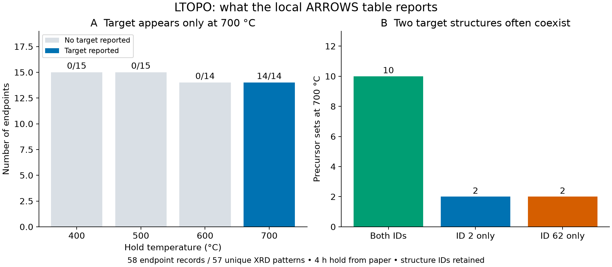
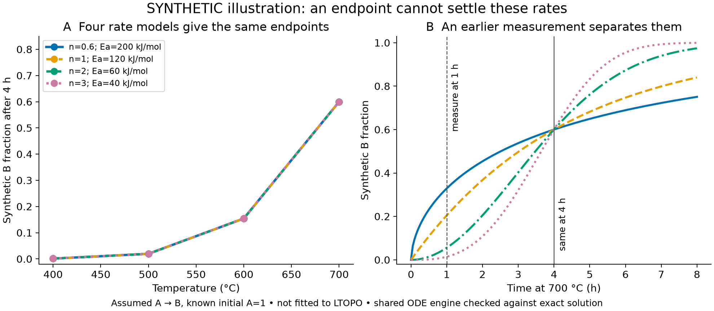

# LTOPO evidence and the next useful measurement

Checked October 22, 2026 against the local ARROWS files and the source paper and supplement. No LTOPO kinetic model was fitted. This is a descriptive audit and a separate synthetic demonstration of an inference limit.

**Decision:** keep LTOPO as the measured example of competing product structures. Use time-resolved data for the next real kinetic fit. The four-hour endpoint table can constrain outcomes and rule out some proposals, but it cannot uniquely determine a flexible reaction pathway and its rates.

## What the local table supports

`literature/04_synthesis/ExpLTOPO.json` contains 58 entries from 15 precursor sets. All 58 are marked experimentally verified and contain nonempty XRD arrays of matching length, but only **57 XRD patterns are unique**; the duplicate is described below. Counts here are source records, not established independent experiments. None supplies precursor stoichiometry in JSON. The published supplement supplies recipe ratios for all 15 sets, with the mapping checked below.

| Temperature | Endpoints | Target formula reported |
|---|---:|---:|
| 400 °C | 15 | 0 |
| 500 °C | 15 | 0 |
| 600 °C | 14 | 0 |
| 700 °C | 14 | 14 |

At 700 °C, 10 sets report both `LiTiPO5_2` and `LiTiPO5_62`; two report only ID 2 and two only ID 62. All 14 still report `LiTi2(PO4)3`. This is coexistence of target structures with an impurity/intermediate, not pure target synthesis. `LiTiPO5` and the paper's `LiTiOPO4` have the same elemental composition.



There are eight distinct phase labels after stripping `.cif`: `LiTiPO5_2`, `LiTiPO5_62`, `LiTi2(PO4)3_167`, `TiO2_141`, `Li3PO4_62`, `Li4P2O7_2`, `TiP2O7_205` and `LiPO3_13`. The last appears in one 600 °C entry and should not disappear from a proposed model merely because it is rare. The suffix-free and `.cif` forms of `TiP2O7_205` are the same source label.

The paper identifies triclinic and orthorhombic LTOPO. This audit preserves the repository's IDs; it does not independently establish the ID-to-crystal-name mapping. Formula-level aggregation hides that distinction and is insufficient for a polymorph-selection demo.

The four-hour hold is stated in the paper's LTOPO Methods, not stored per entry. The table gives heating at 20 °C/min, natural cooling, and air. The reported weight fractions sum to 99–101%; they are approximate fractions from relative XRD peak intensities, not precise Rietveld measurements. They do not measure amorphous or unidentified material. An unlisted phase is not a measured zero with a known detection limit. There are no replicate IDs, so the precursor sets must not be treated as replicate measurements or used to manufacture error bars. The adaptive selection of these sets also prevents general success-rate claims.

Source: [Szymanski et al., Nature Communications 14, 6956 (2023)](https://doi.org/10.1038/s41467-023-42329-9), LTOPO Methods and phase analysis Methods; local PDF `literature/04_synthesis/s41467-023-42329-9.pdf`.

## Recipes are available, but the hold-start state is not

Supplementary Table 3, PDF pages 14–15, gives ordered precursor ratios. The script explicitly transcribes and matches the 15 recipes present in this local table. It preserves raw names and applies only these formula aliases:

| Raw name | Canonical formula |
|---|---|
| `LiHO` | `LiOH` |
| `PH6NO4` | `NH4H2PO4` |
| `PH9(NO2)2`, `N2H8HPO4` | `(NH4)2HPO4` |

Every matched recipe has Li:Ti:P = 1:1:1. For example, the published Li2O:TiO2:P2O5 ratio is 1:2:1. These ratios support nominal weighed input amounts on a per-mole-Ti basis. They do **not** supply measured starting phase fractions at 700 °C: the mixture has already reacted during heating, and decomposition can release gases. A 600 °C endpoint after its own four-hour hold is also not the starting state of a separate 700 °C experiment.

The full ordered mapping is in ignored `data/arrows3/ltopo_oct22/audit.json`, with coefficients explicitly attributed to SI Table 3. The source supplement is `literature/04_synthesis/41467_2023_42329_MOESM1_ESM.pdf`.

## Source inconsistencies to resolve before quoting yields

Two 700 °C records have identical complete XRD x/y arrays but different phase fractions: Li2TiO3 + TiO2 with either NH4H2PO4 or (NH4)2HPO4. Both are marked verified. The duplicate cannot establish two independent measurements, and the file alone does not tell us which attribution or fraction list is correct. No copy was silently selected as the truth. As a conservative sensitivity check, excluding both records leaves 12 entries at 700 °C: eight report both target structures and two report each structure alone. No remaining lower-temperature entry reports the target. The qualitative coexistence observation survives, but a quantitative fit needs this provenance issue resolved.

The paper's page 7 states a 54% target yield for Li2O + TiO2 + P2O5 at 700 °C. The local repository table reports 40% `LiTiPO5_2` for that same named condition. The paper separately describes a ball-milled follow-up with no detectable impurities; that is another experiment and does not resolve the 54-versus-40 mismatch.

Use the local table for the endpoint counts above, and the paper for its own reported findings. Do not combine their numerical yields or claim a reproduction of Fig. 6. The file-to-figure difference remains unresolved; it could require source-version or experiment-identity clarification.

## What one fixed hold can identify

Temperature variation is useful evidence. With a known initial state, a fixed mechanism, a fixed kinetic form and informative quantitative measurements, a single hold at several temperatures can sometimes identify rate parameters. The blanket claim that endpoints can never inform kinetics would be too strong.

The problem here is the flexibility being proposed. Even a single idealized A → B step with known initial A = 1 has an exact ambiguity if both an Arrhenius activation energy and an Avrami exponent are free:

```text
f(t,T) = 1 - exp[-(k(T) t)^n]
k(T)   = k_ref exp[-Ea/R (1/T - 1/T_ref)]

At the fixed hold h:
log[-log(1-f)] = n log(k_ref h) - n Ea/R (1/T - 1/T_ref).
```

Only `n log(k_ref h)` and `n Ea` occur. Changing `n` while compensating `k_ref` and `Ea` preserves the entire endpoint-versus-temperature curve. Adding more temperatures at the same hold does not break this particular ambiguity. Fixing `n` could remove it, but then the kinetic-form assumption must be explicit and defended. Unknown initial states, missing phases and alternative pathways create additional uncertainty.



The example above is entirely synthetic and is not fitted to LTOPO. All four models give 60% B at 700 °C after four hours and identical endpoints at 400, 500 and 600 °C. Their one-hour predictions at 700 °C are 32.9%, 20.5%, 5.6% and 1.4%. The exact endpoint spread is below `2e-16`; the shared ODE implementation agrees with the analytic solution within `3.3e-6` in fractional amount. The sensitivity matrix has rank 2 for three free parameters using the four fixed-hold points, and rank 3 after adding one one-hour point at 700 °C. That is a local result for this idealized single-step model, not proof that one extra real measurement identifies a full LTOPO network.

The useful next measurement is therefore **time variation on the same recipe at the same temperature**, with a measured state at the start of the hold and phase tracking through it. An earlier time distinguishes the example models; actual timing should be chosen after inspecting the relevant trajectories and detection limits.

## A safe route into the shared fitter

The current shared engine already supports separate experiments with their own conditions and starting amounts, joint temperature fits, elemental bookkeeping, Arrhenius terms and Avrami terms. It can numerically evaluate a channel at `t_min = 240`. Its existence does not make the endpoint input scientifically complete.

Before using real LTOPO endpoints in that engine:

1. **Define the time origin and initial state.** Use a measured state after the heating ramp, or model the recorded ramp from the weighed recipe. The current condition is a single constant temperature; a four-hour isothermal solve from unreacted room-temperature precursors would add an unverified assumption. Cooling can also change the measured final phases.
2. **Define what the model predicts and what XRD measures.** The fitter currently compares direct amounts, or sums of species amounts, with observed channels. Reported normalized crystalline weight fractions are a different observation. Conditional conversion to formula units per mole of Ti would be `(w_i/M_i) / sum_j(Ti_j*w_j/M_j)`, where `M_i` is phase molar mass and `Ti_j` counts Ti atoms. This assumes all relevant Ti-bearing material is detected and the approximate weight fractions are usable. It cannot establish absolute Ti closure or reveal amorphous Ti. Alternatively, a normalized crystalline-mass observation operator would be needed.
3. **Keep the two target structures separate.** Include measured intermediates and acknowledge unlisted phases as detection-limited evidence. A common recipe does not justify common initial phase fractions after heating.
4. **Restrict and test the model assumptions.** Use literature-supported, element-balanced candidates and stated parameter sharing. Report the exact fixed-time ambiguity rather than selecting a single rate model because an optimizer returns a number. Additional nuisance parameters cannot be omitted from complexity accounting.
5. **Use held-out conditions for the intended claim.** Holding out one recipe tests transfer across recipes; holding out time tests kinetics. A temperature hold-out with no detected target in the training temperatures provides very little direct information about the 700 °C polymorph split.

No endpoint adapter, core fitter change or altered schema was added in this work. The result is a clear data contract for a future fit, not an endpoint model disguised as a time series.

## Better candidate for a real LTOPO kinetic follow-up

[Zeng et al., Science Advances (2024), eadj5431](https://doi.org/10.1126/sciadv.adj5431) is already in Daniel's local literature package (`sciadv.adj5431.pdf` and `sciadv.adj5431_sm.pdf`). Fig. 3B/D follows phase evolution for two recipes: Li2CO3 + TiO2 + P2O5, and Li2CO3 + TiO2 + NH4H2PO4. The experiment heats at 25 °C/min to 700 °C, then holds for three hours, with XRD acquisition every 15 seconds. This is different evidence from the ARROWS endpoint table and could address transformation between the two LTOPO structures.

Two issues prevent calling it a fit-ready dataset. First, the rendered figure labels the heating temperature and repeats 700 °C through the hold, but does not label elapsed hold time. The stated acquisition cadence and total hold do not by themselves establish a reliable pixel-to-time calibration; underlying scan/time data or explicit mapping is needed. No numeric phase-curve table was located in this inspection. Second, both mixtures were ball-milled for 20 hours. The first starts mostly amorphous, and the second has already formed some Li3PO4. Their nominal recipes cannot be substituted for measured crystalline initial conditions. The caption describes peak-intensity estimates, while the Methods mention Rietveld analysis; the observation basis must be established for the specific plotted curves.

Next useful work: obtain or establish the scan/time mapping, identify the phase-fraction method and initial-state evidence, then extract and independently check the curves. This is a promising second real kinetic case, not a completed extraction or fit. It is also a stronger direction than forcing the ARROWS four-hour table into a kinetic benchmark.

## Demo wording

“LTOPO shows why the next experiment matters. The table reports two competing product structures, often together. Those final measurements tell us what formed, but several different rate models can explain the same endpoint. A time series can separate explanations that temperature endpoints alone cannot.”

Show the measured endpoint counts first, then the prominently labelled synthetic ambiguity. Keep Chapman as the real time-resolved fitting result until a second time-resolved dataset has been extracted and checked. Do not claim to have inferred the real LTOPO reaction mechanism.

## Reproduction and checks

```bash
.venv/bin/python scripts/analyze_ltopo_endpoints.py
.venv/bin/python -m pytest -q tests/test_arrows3_converter.py tests/test_synthesis.py::test_avrami_single_step_is_jmak_and_matches_reference_simulator
```

The script validates the existing endpoint schema, checks source array lengths and duplicate patterns, checks all 15 published recipe ratios, validates the synthetic mechanism schema and verifies the analytic ambiguity against the existing ODE implementation. Four relevant existing tests passed. Both generated figures were inspected after rendering. These checks do not validate the source phase assignments or resolve the duplicate-record and paper/table mismatches.

Row-level experimental data and recipe mappings remain under ignored `data/arrows3/ltopo_oct22/`. Only aggregate count figures and the explicitly synthetic example are in `docs/examples/ltopo_oct22/`; source files remain local. Source SHA-256 values:

```text
ExpLTOPO.json       2fd8f33c853fbca86081eb7a747a02ee51b4a8cfd1cfe598bef72786e971410a
SettingsLTOPO.json  9b8aee711737e4f1257c19c21cb84d023a9f7db2f5f2f227950020da07fbc321
```
