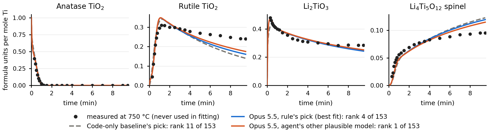

# NernstWork: an AI loop for solid-state reaction pathways

Daniel Naumov and Jarrod Barnes · Open Scientific Intelligence Hackathon, Oct 21–22, 2026 · <https://github.com/dnauminator/nernstwork>

**Question.** Can a language-model agent infer a solid-state reaction pathway from time-resolved phase data? (1) Does the pathway space it proposes contain a model that predicts an unseen temperature? (2) Can that model be selected from the training runs alone?

**Method.** The AI proposes the parts of a reaction network (phases, possible steps, rate-law forms), each with a reason. Code checks every combination for element balance and fits all of them jointly. The picks are frozen, a reserved temperature tests them, and the AI then reports what the data cannot settle and which experiment would. Test case: TiO₂ + Li₂CO₃ → Li₂TiO₃ → Li₄Ti₅O₁₂, a battery anode material, followed by in situ X-ray scattering (Hu et al. [1]). We fit 700 and 725 °C, predict 750 °C without refitting, and rank each prediction against 153 reference models built by code.

*Figure. Three frozen models predict the 750 °C phase amounts without being fitted to them (dots: measurements digitized from Hu et al. [1], Fig. 2; the first points carry extraction error). Ranks among the 153 reference models are by held-out score; the RMSE over all phases and times is 0.032, 0.025 and 0.022 formula units per mole Ti for the baseline's pick, the rule's pick and the agent's other plausible model. The predictions are close; the best fit at 700 and 725 °C is not the best predictor at 750 °C.*

**Results: solid-state synthesis** (one chemistry; two runs each of Claude Opus 5.5 and Gemini 4 Argon).

- **Q1, yes.** Every AI-proposed search space contained a model ranking 1st to 4th of the 153 reference models at 750 °C; one Opus model beat all of them. We only know which one after seeing 750 °C.
- **Q2, not reliably.** Picking by best fit chose models ranking 4th and 36th (Opus) and 11th and 36th (Gemini); the code-only baseline's pick ranked 11th. On the cleaner extraction from the paper's SI Fig. S1, the rule's pick still ranks 4th, the agent's other plausible model 1st, and the baseline's pick moves to 5th.
- **The chemistry agrees across runs:** lithiation limited by Li₂CO₃, anatase to rutile, and a Li₂TiO₃ + anatase route to the spinel.
- **Next experiment (suggested, not run):** half the Li₂CO₃ at 725 °C, sampled for 30 min. It separates the selection rule's pick from the agent's own rival explanation (rutile formation coupled to the spinel) by about 7σ of the fitted noise at 2 min.
- **Endpoint data (LTOPO, ARROWS3 tables [2]):** a measured table of competing product structures plus a labelled synthetic example showing that fixed-hold endpoints cannot fix a rate model. Not fitted.

**Test bed: nitrate reduction.** The same loop ran on electrochemical nitrate reduction (Liao et al. [6] time courses; development on Fig. 50b, held out on Fig. 50a, 731 reference structures). The agents widened the hypothesis space beyond our pre-declared enumeration (a direct nitrate-to-ammonia route; a nitrogen loss with its own shut-off), and their best development fits beat it. Their frozen selections transferred unevenly: rank 54–121 of 731 (Opus) and 6–16 (Gemini), while a systematic enumeration over the agents' ideas ranked 1st. What the lost nitrogen (about 25 mM-N) is stayed unresolved. An illustrative link to catalysis: Wang et al. [7], found with Valency, report rutile TiO₂/Cu₂O as the better nitrate catalyst; we fitted its published nitrate time course. One study, not a synthesis-to-rate link.

**Relation to prior work.** Selecting among kinetic models of time-resolved XRD with a Bayesian criterion is established: Kosuge et al. [3] compare nine textbook rate laws for a fast SrCrO₃ oxidation and state that the researcher must propose the candidate set. LLM proposers paired with identifiability checks exist (LLM-IDEA [4]), tested on simulated and textbook systems. What we combine, on published XRD of a precursor synthesis: model-proposed parts, a joint fit across temperatures, a reserved-temperature test, an identifiability report and a next-experiment suggestion. We found no prior work combining all five in the sources we searched; each exists elsewhere, and information-gain design (Murphy et al. [5]) is not ours to claim.

**Limitations.** One chemistry, two runs per model, and a retrospective test (published data; the models may have seen the paper). The scoring rule was changed after the baseline result and before the AI runs were scored. XRD weight fractions are semi-quantitative and normalised to about 100; the first frame is not the weighed mixture (starting Li₂CO₃ is 20.5, 21.3 and 24.9 wt % in three runs of one 5:2 mix, against 27.0) and the first 6–10 s are not isothermal. Fitting the starting carbonate returned it to the nominal 0.4 per Ti, so we kept that and do not claim lithium is conserved. The models are overconfident about their own errors. We have not measured how many experiments this saves, and the planner's suggestions are untested.

**Conclusion.** An AI agent can narrow a large space of possible reaction pathways to a short list of good candidates and suggest what to measure next. Choosing among them still takes data. The implication is more targeted experiments in physical labs, chosen because they tell rival explanations apart.

## References

1. D. Hu, M. L. Beauvais, G. E. Kamm, B. G. Mullens, B. A. Sanchez Monserrate, S. M. Vornholt, P. J. Chupas, K. W. Chapman. Resolving fast relative kinetics in inorganic solid-state synthesis. *J. Am. Chem. Soc.* **145**, 26545–26549 (2023). doi:10.1021/jacs.3c10916.
2. N. J. Szymanski, P. Nevatia, C. J. Bartel, Y. Zeng, G. Ceder. Autonomous and dynamic precursor selection for solid-state materials synthesis. *Nat. Commun.* **14**, 6956 (2023). doi:10.1038/s41467-023-42329-9.
3. T. Kosuge, S. Kawaguchi, T. Nishikubo, S. Kobayashi, Y. Yokoyama, M. Mizumaki, S. Hosokawa, M. Azuma, T. Yamamoto. Reaction modeling of the rapid two-step oxidation process assisted by Bayesian inference with isothermal time-resolved X-ray diffraction measurements. *J. Phys. Chem. C* **130**, 10245–10250 (2026). doi:10.1021/acs.jpcc.6c02717.
4. Shetty and Braga-Neto. LLM-IDEA: an identifiability engine inside a closed-loop LLM discovery agent. arXiv:2610.11253 (2026).
5. Murphy et al. Model Discovery Agent: LLM-assisted Bayesian experiment design for data-efficient discovery of mechanistic world models. arXiv:2608.09696 (2026).
6. W. Liao, J. Wang, et al. Near-unity nitrate to ammonia conversion via reactant enrichment at the solid-liquid interface. *Nat. Commun.* (2025). doi:10.1038/s41467-025-60671-y.
7. J. Wang, W. Dong, Q. Song, S. Zhang, M. Li, J. Chen, S. Zhang, J. Lu. Unveiling heterointerface activation effects with different titanium dioxide crystal phases for electrocatalytic nitrate-to-ammonia reduction. *J. Hazard. Mater.* **488**, 137174 (2025). doi:10.1016/j.jhazmat.2025.137174.
