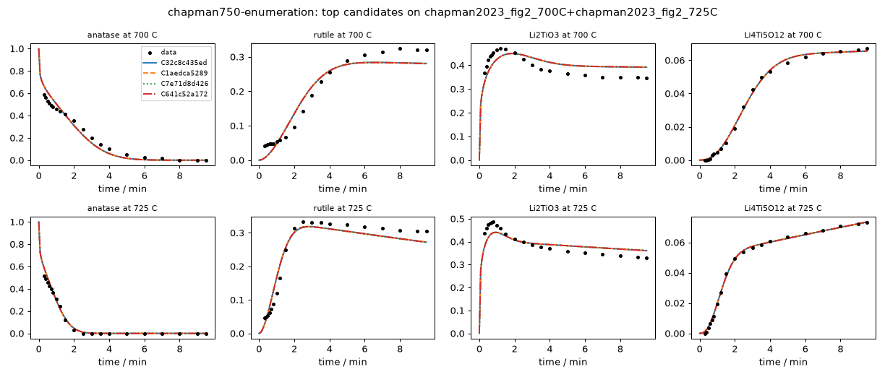

# Investigation report: chapman750-enumeration

- Investigation: `chapman750`; arm: `enumeration`; phase: `final_evaluated`
- Protocol: `synthesis-mle-v1` (sha256 `c7b943a32f2c32b1`); manifest sha256 `1a596bdc5114f7b3`; evaluator code sha256 `4935f45a7126e490` ({'python': '3.12.13', 'numpy': '2.5.4', 'scipy': '1.18.1'})
- Development data: `chapman2023_fig2_700C+chapman2023_fig2_725C` (sha256 `c44c61ed445348bb`, digitized); 160 observations (joint fit of 2 experiments at T = [700.0, 725.0] C with one parameter vector)

## Question
Which reaction pathways and rate laws are supported by the in situ phase-fraction time courses of anatase TiO2 + Li2CO3 at 700 and 725 C (Hu, ..., Chapman, JACS 2023), what do these data leave ambiguous, and which feasible experiment would best separate the surviving pathways? Candidates are judged afterwards by how well they predict a reserved temperature without refitting.

## System boundary
A pellet of a 5:2 molar anatase TiO2 : Li2CO3 mix moved into a pre-heated hot zone (heating in under 10 s; t = 0 is insertion). Measured: anatase, rutile, Li2TiO3 and Li4Ti5O12, as Rietveld weight fractions of the crystalline solid from in situ X-ray scattering, converted here to mol of each phase per mol of total Ti. Not measured: Li2CO3 after about 30 s, CO2, amorphous or poorly crystalline material, and the Li content of the Li-Ti-O phases. The Ti fractions sum to 1 by construction (a normalised stack), so they cannot reveal unobserved Ti; lithium is not observed directly. Every model must conserve the elements it declares in mechanism.conservation, and every dataset initial species (anatase, Li2CO3) must appear in the model.

## Evidence status
- Partition: The 750 C panel of Fig. 2 is reserved. Development fits use 700 and 725 C jointly with one parameter vector (Arrhenius temperature dependence). The final evaluation is parameter transfer: each frozen candidate and every member of the declared reference space is fitted once on 700 + 725 C, then 750 C is predicted with those parameters (no refitting) and scored by its log-likelihood under the development noise estimate. No development-phase command, tool or evidence file reads the 750 C data; the authors' Avrami analysis, which used all temperatures, is withheld from the evidence and kept as an outside check on fitted exponents.
- Contamination: Retrospective analysis with literature-informed priors, not blind discovery: the proposer sees the 700 and 725 C runs and curated notes, and its pretraining may include this paper and general Li4Ti5O12 synthesis knowledge.

## Ranked candidates (development data, computed in code)

Delta aicc <= 2.0: not distinguished by these data; <= 4.0: still supported. Akaike weights are relative support within this candidate set (one weight per distinct dynamics) under the stated noise model, not probabilities that a mechanism is true. Residual correlation from misspecification makes these differences optimistic.

| candidate | name | source | v | k | AICc | dAICc | weight | band | adequacy | RMSE chapman2023_fig2_700C:Li2TiO3 | RMSE chapman2023_fig2_700C:Li4Ti5O12 | RMSE chapman2023_fig2_700C:anatase | RMSE chapman2023_fig2_700C:rutile | RMSE chapman2023_fig2_725C:Li2TiO3 | RMSE chapman2023_fig2_725C:Li4Ti5O12 | RMSE chapman2023_fig2_725C:anatase | RMSE chapman2023_fig2_725C:rutile | unobserved N end | in declared space | flags |
|---|---|---|---|---|---|---|---|---|---|---|---|---|---|---|---|---|---|---|---|
| C32c8c435ed | enum-ef52513024 | enumerator | 1 | 16 | -851.48 | 0.00 | 0.836 | indistinguishable_from_best | poor | 0.0389 | 0.00118 | 0.0485 | 0.0276 | 0.0345 | 0.000998 | 0.0259 | 0.0242 | 0 | chapman-core-v1 | R1.n_avrami at a protocol bound (0.3) |
| C1aedca5289 | enum-0157df15bc | enumerator | 1 | 17 | -846.67 | 4.81 | 0.076 | less_supported | poor | 0.0396 | 0.00118 | 0.0493 | 0.0278 | 0.0345 | 0.000987 | 0.0262 | 0.0243 | 0 | chapman-core-v1 | R1.n_avrami at a protocol bound (0.3); R5.k at a protocol bound (0.001) |
| C7e71d8d426 | enum-1d2d84001e | enumerator | 1 | 17 | -845.86 | 5.62 | 0.050 | less_supported | poor | 0.0395 | 0.00117 | 0.0493 | 0.0278 | 0.0352 | 0.000973 | 0.0265 | 0.0245 | 0 | chapman-core-v1 | R1.n_avrami at a protocol bound (0.3); R5.k at a protocol bound (0.001); R5.Ea at a protocol bound (1.23e-09) |
| C641c52a172 | enum-e1f9995047 | enumerator | 1 | 18 | -844.28 | 7.20 | 0.023 | less_supported | poor | 0.0395 | 0.00119 | 0.0488 | 0.0278 | 0.0346 | 0.00101 | 0.0259 | 0.0244 | 0 | chapman-core-v1 | R1.n_avrami at a protocol bound (0.3); R5.k at a protocol bound (0.001) |
| Cdd38d3e11e | enum-68a954c148 | enumerator | 1 | 18 | -843.47 | 8.01 | 0.015 | less_supported | poor | 0.0394 | 0.00119 | 0.0486 | 0.028 | 0.0352 | 0.001 | 0.026 | 0.0249 | 0 | chapman-core-v1 | R1.n_avrami at a protocol bound (0.3); R5.k at a protocol bound (0.001); R5.Ea at a protocol bound (9.99e-11) |
| C512beb96c1 | enum-220e6e6a6f | enumerator | 1 | 13 | -793.96 | 57.52 | 0.000 | less_supported | poor | 0.0383 | 0.00163 | 0.0391 | 0.0312 | 0.0393 | 0.00403 | 0.0238 | 0.0297 | 0 | chapman-core-v1 | R1.n_avrami at a protocol bound (0.3) |
| Cb1f620c488 | enum-eac0106235 | enumerator | 1 | 15 | -787.33 | 64.15 | 0.000 | less_supported | poor | 0.0391 | 0.00165 | 0.0394 | 0.0311 | 0.0396 | 0.00407 | 0.0238 | 0.0293 | 0 | chapman-core-v1 | R1.n_avrami at a protocol bound (0.3); R4.k at a protocol bound (0.001) |
| C5165aba0cd | enum-a92931578f | enumerator | 1 | 15 | -786.76 | 64.72 | 0.000 | less_supported | poor | 0.0387 | 0.00163 | 0.0391 | 0.0317 | 0.0401 | 0.00402 | 0.0239 | 0.03 | 0 | chapman-core-v1 | R1.n_avrami at a protocol bound (0.3); R4.k at a protocol bound (0.001) |
| Cdaf78aa937 | enum-c361b9ed64 | enumerator | 1 | 17 | -779.95 | 71.53 | 0.000 | less_supported | poor | 0.0394 | 0.00163 | 0.0398 | 0.0313 | 0.0406 | 0.00408 | 0.0243 | 0.0292 | 0 | chapman-core-v1 | R1.n_avrami at a protocol bound (0.3); R4.k at a protocol bound (0.001); R5.k at a protocol bound (0.001) |
| C5e99b61286 | enum-7c24a4189c | enumerator | 1 | 17 | -771.61 | 79.87 | 0.000 | less_supported | poor | 0.0367 | 0.00246 | 0.035 | 0.0494 | 0.0358 | 0.00221 | 0.0278 | 0.0534 | 0 | chapman-core-v1 | R1.n_avrami at a protocol bound (0.3); R4.Ea at a protocol bound (600); R5.k at a protocol bound (0.001); R5.Ea at a protocol bound (1.57e-15) |
| Cb68b238599 | enum-15288176f1 | enumerator | 1 | 17 | -771.05 | 80.43 | 0.000 | less_supported | poor | 0.0368 | 0.00253 | 0.0346 | 0.0488 | 0.0356 | 0.00225 | 0.0277 | 0.053 | 0 | chapman-core-v1 | R1.n_avrami at a protocol bound (0.3); R4.Ea at a protocol bound (600); R5.k at a protocol bound (0.001) |
| Caefe0c1626 | enum-9db30b59d8 | enumerator | 1 | 14 | -770.26 | 81.22 | 0.000 | less_supported | poor | 0.0372 | 0.00279 | 0.0323 | 0.0479 | 0.0364 | 0.00268 | 0.028 | 0.0527 | 0 | chapman-core-v1 | R1.n_avrami at a protocol bound (0.3); R4.Ea at a protocol bound (600) |
| C45e18d6500 | enum-b749b59412 | enumerator | 1 | 12 | -768.74 | 82.74 | 0.000 | less_supported | poor | 0.0378 | 0.00298 | 0.0297 | 0.0462 | 0.0386 | 0.0035 | 0.0262 | 0.0491 | 0 | chapman-core-v1 | R1.n_avrami at a protocol bound (0.3) |
| C22e054013a | enum-0d02fc61ca | enumerator | 1 | 16 | -763.64 | 87.84 | 0.000 | less_supported | poor | 0.0377 | 0.0028 | 0.0322 | 0.0482 | 0.0371 | 0.00269 | 0.0279 | 0.053 | 0 | chapman-core-v1 | R1.n_avrami at a protocol bound (0.3); R4.Ea at a protocol bound (600); R5.k at a protocol bound (0.001); R5.Ea at a protocol bound (1e-10) |
| C6085779be4 | enum-c0459e266c | enumerator | 1 | 16 | -763.30 | 88.18 | 0.000 | less_supported | poor | 0.0378 | 0.00285 | 0.0321 | 0.0478 | 0.0368 | 0.00273 | 0.0278 | 0.0527 | 0 | chapman-core-v1 | R1.n_avrami at a protocol bound (0.3); R4.Ea at a protocol bound (600); R5.k at a protocol bound (0.001) |
| C242cff682e | enum-f62df3a16b | enumerator | 1 | 14 | -762.24 | 89.24 | 0.000 | less_supported | poor | 0.0383 | 0.00297 | 0.0298 | 0.0466 | 0.0393 | 0.0035 | 0.0262 | 0.0493 | 0 | chapman-core-v1 | R1.n_avrami at a protocol bound (0.3); R4.k at a protocol bound (0.001); R4.Ea at a protocol bound (1.26e-13) |
| C5eed5d9565 | enum-03ecc3ddee | enumerator | 1 | 14 | -762.17 | 89.31 | 0.000 | less_supported | poor | 0.0386 | 0.00303 | 0.0297 | 0.0463 | 0.0389 | 0.00353 | 0.026 | 0.0492 | 0 | chapman-core-v1 | R1.n_avrami at a protocol bound (0.3); R4.k at a protocol bound (0.001) |
| Cd625471613 | enum-434867d87c | enumerator | 1 | 16 | -755.55 | 95.93 | 0.000 | less_supported | poor | 0.039 | 0.00302 | 0.0297 | 0.0467 | 0.0396 | 0.00353 | 0.026 | 0.0494 | 0 | chapman-core-v1 | R1.n_avrami at a protocol bound (0.3); R4.k at a protocol bound (0.001); R4.Ea at a protocol bound (0.00575); R5.k at a protocol bound (0.001) |
| Ce0cb4d2af7 | enum-9e4bf653cd | enumerator | 1 | 15 | -743.17 | 108.31 | 0.000 | less_supported | poor | 0.0513 | 0.00653 | 0.0363 | 0.0248 | 0.0453 | 0.0062 | 0.0222 | 0.02 | 0 | chapman-core-v1 | R1.n_avrami at a protocol bound (0.3); R4.Ea at a protocol bound (0.6); R4.n_avrami at a protocol bound (0.3) |
| Ceed1e9d5b9 | enum-0019e80da4 | enumerator | 1 | 17 | -736.34 | 115.14 | 0.000 | less_supported | poor | 0.0515 | 0.00652 | 0.0363 | 0.0252 | 0.0456 | 0.00618 | 0.0222 | 0.0205 | 0 | chapman-core-v1 | R1.n_avrami at a protocol bound (0.3); R4.Ea at a protocol bound (4.41e-06); R4.n_avrami at a protocol bound (0.3); R5.k at a protocol bound (0.001) |
| Cf48004e8af | enum-84cf2b75a3 | enumerator | 1 | 14 | -734.81 | 116.67 | 0.000 | less_supported | poor | 0.0553 | 0.00846 | 0.0345 | 0.0208 | 0.0506 | 0.00841 | 0.0215 | 0.0161 | 0 | chapman-core-v1 | R1.n_avrami at a protocol bound (0.3) |
| C6ca4805e2a | enum-7a60066bd2 | enumerator | 1 | 17 | -733.98 | 117.50 | 0.000 | less_supported | poor | 0.0516 | 0.00667 | 0.0363 | 0.025 | 0.0459 | 0.00598 | 0.0236 | 0.0214 | 0 | chapman-core-v1 | R1.n_avrami at a protocol bound (0.3); R4.n_avrami at a protocol bound (0.301) |
| C5a9e4d1378 | enum-1c69d5f4cd | enumerator | 1 | 16 | -727.24 | 124.24 | 0.000 | less_supported | poor | 0.056 | 0.00853 | 0.0346 | 0.0209 | 0.0515 | 0.00848 | 0.0217 | 0.0162 | 0 | chapman-core-v1 | R1.n_avrami at a protocol bound (0.3); R5.k at a protocol bound (0.001) |
| C5f3863b1bf | enum-be7e8b98d7 | enumerator | 1 | 12 | -702.23 | 149.25 | 0.000 | less_supported | poor | 0.0591 | 0.0108 | 0.0326 | 0.0185 | 0.0607 | 0.014 | 0.0211 | 0.0185 | 0 | chapman-core-v1 | R1.n_avrami at a protocol bound (0.3) |
| Ceb3270c404 | enum-26d67e9ab3 | enumerator | 1 | 14 | -698.75 | 152.73 | 0.000 | less_supported | poor | 0.06 | 0.0109 | 0.0328 | 0.0185 | 0.0661 | 0.014 | 0.0208 | 0.0159 | 0 | chapman-core-v1 | R1.n_avrami at a protocol bound (0.3); R4.Ea at a protocol bound (600) |

128 lower-ranked fitted candidates omitted here; `python -m nernstwork.cli compare --run chapman750-enumeration` lists all of them.

## Candidates that were not fitted (recorded, with status)

- C041b28f49d `enum-fad9c216ab` (enumerator): **nonconvergence** -- {"n_starts": 8, "n_starts_planned": 8, "n_finite": 8, "seed": 419668431614385875, "budget_exhausted": false, "max_ode_solves_per_fit": 200000, "max_rhs_evals": 20000, "nll_by_start": [-200.565029, -200.565064, -202.433596, -200.565086, -202.404535, -200.565105, -202.404498, -60.009954], "converged_b

## Top candidates in detail

### C32c8c435ed `enum-ef52513024` (source enumerator, version 1)

Rationale (proposer): enumerated: A1:avrami,A2:avrami,A3:avrami,A4:avrami | space chapman-core-v1

    R1: anatase -> Li2TiO3 [power_law, avrami(n), Arrhenius(T_ref 712 C)]; R1.k=0.229 (95% Wald 0.185-0.285, well_determined); R1.Ea=201 (95% Wald 148-255, well_determined); R1.n_avrami=0.3 (95% Wald 0.3-0.351, well_determined)
    R2: 2 Li2TiO3 + 3 anatase -> Li4Ti5O12 [power_law, avrami(n), Arrhenius(T_ref 712 C)]; R2.k=0.293 (95% Wald 0.275-0.313, well_determined); R2.Ea=220 (95% Wald 203-237, well_determined); R2.n_avrami=2.47 (95% Wald 2.27-2.68, well_determined)
    R3: anatase -> rutile [power_law, avrami(n), Arrhenius(T_ref 712 C)]; R3.k=0.401 (95% Wald 0.373-0.432, well_determined); R3.Ea=263 (95% Wald 234-291, well_determined); R3.n_avrami=1.88 (95% Wald 1.66-2.11, well_determined)
    R4: 2 Li2TiO3 + 3 rutile -> Li4Ti5O12 [power_law, avrami(n), Arrhenius(T_ref 712 C)]; R4.k=0.0121 (95% Wald 0.00214-0.0683, moderately_determined); R4.Ea=503 (95% Wald 0-600, not_determined_locally); R4.n_avrami=1.19 (95% Wald 0.3-2.36, moderately_determined)

- Support entries: {'literature': 0, 'data': 0, 'speculative': 4}; reactions without support: []
  - R1: speculative --  baseline: lithiation of anatase to Li2TiO3, Li source implicit
  - R2: speculative --  baseline: Li2TiO3 + anatase to spinel
  - R3: speculative --  baseline: anatase to rutile transformation
  - R4: speculative --  baseline: Li2TiO3 + rutile to spinel
- sigma (profiled): anatase=0.0389, rutile=0.0259, Li2TiO3=0.0368, Li4Ti5O12=0.002; adequacy: poor ['chapman2023_fig2_700C:anatase: residual signs cluster (runs test p=0.000)', 'chapman2023_fig2_700C:anatase: residuals are serially correlated (lag-1 r=0.96)', 'chapman2023_fig2_700C:rutile: residual signs cluster (runs test p=0.000)', 'chapman2023_fig2_700C:rutile: residuals are serially correlated (lag-1 r=0.93)', 'chapman2023_fig2_700C:Li2TiO3: residual signs cluster (runs test p=0.000)', 'chapman2023_fig2_700C:Li2TiO3: residuals are serially correlated (lag-1 r=0.98)', 'chapman2023_fig2_700C:Li4Ti5O12: residual signs cluster (runs test p=0.023)', 'chapman2023_fig2_700C:Li4Ti5O12: residuals are serially correlated (lag-1 r=0.51)', 'chapman2023_fig2_725C:anatase: residual signs cluster (runs test p=0.003)', 'chapman2023_fig2_725C:anatase: residuals are serially correlated (lag-1 r=0.87)', 'chapman2023_fig2_725C:rutile: residual signs cluster (runs test p=0.000)', 'chapman2023_fig2_725C:rutile: residuals are serially correlated (lag-1 r=0.88)', 'chapman2023_fig2_725C:Li2TiO3: residual signs cluster (runs test p=0.000)', 'chapman2023_fig2_725C:Li2TiO3: residuals are serially correlated (lag-1 r=0.99)', 'chapman2023_fig2_725C:Li4Ti5O12: residual signs cluster (runs test p=0.006)', 'chapman2023_fig2_725C:Li4Ti5O12: residuals are serially correlated (lag-1 r=0.52)']
- Locally unidentifiable combinations: [{'eigenvalue_rel': 3.308300523312948e-11, 'combination': {'R4.Ea': 0.999}}, {'eigenvalue_rel': 5.300196734618203e-09, 'combination': {'R1.Ea': -0.99}}, {'eigenvalue_rel': 2.4480601500297057e-08, 'combination': {'R2.Ea': 0.577, 'R3.Ea': 0.806}}, {'eigenvalue_rel': 1.550943949562481e-07, 'combination': {'R2.Ea': 0.809, 'R3.Ea': -0.582}}]
- Profile likelihood: not computed (identifiability beyond the local Fisher screen is unassessed)

### C1aedca5289 `enum-0157df15bc` (source enumerator, version 1)

Rationale (proposer): enumerated: A1:avrami,A2:avrami,A3:avrami,A4:first_order,A6:first_order | space chapman-core-v1

    R1: anatase -> Li2TiO3 [power_law, avrami(n), Arrhenius(T_ref 712 C)]; R1.k=0.227 (95% Wald 0.177-0.291, well_determined); R1.Ea=204 (95% Wald 141-267, moderately_determined); R1.n_avrami=0.3 (95% Wald 0.3-0.353, well_determined)
    R2: 2 Li2TiO3 + 3 anatase -> Li4Ti5O12 [power_law, avrami(n), Arrhenius(T_ref 712 C)]; R2.k=0.293 (95% Wald 0.274-0.314, well_determined); R2.Ea=220 (95% Wald 191-249, well_determined); R2.n_avrami=2.53 (95% Wald 2.09-2.97, moderately_determined)
    R3: anatase -> rutile [power_law, avrami(n), Arrhenius(T_ref 712 C)]; R3.k=0.406 (95% Wald 0.381-0.434, well_determined); R3.Ea=265 (95% Wald 237-292, well_determined); R3.n_avrami=1.92 (95% Wald 1.71-2.14, well_determined)
    R4: 2 Li2TiO3 + 3 rutile -> Li4Ti5O12 [power_law, Arrhenius(T_ref 712 C)]; R4.k=0.00938 (95% Wald 0.00346-0.0254, moderately_determined); R4.Ea=544 (95% Wald 0-600, not_determined_locally)
    R5: 5 anatase -> Li4Ti5O12 [power_law, Arrhenius(T_ref 712 C)]; R5.k=0.001 (95% Wald 0.001-1.19, not_determined_locally); R5.Ea=105 (95% Wald 0-600, not_determined_locally)

- Support entries: {'literature': 0, 'data': 0, 'speculative': 5}; reactions without support: []
  - R1: speculative --  baseline: lithiation of anatase to Li2TiO3, Li source implicit
  - R2: speculative --  baseline: Li2TiO3 + anatase to spinel
  - R3: speculative --  baseline: anatase to rutile transformation
  - R4: speculative --  baseline: Li2TiO3 + rutile to spinel
  - R5: speculative --  baseline: direct spinel formation from anatase
- sigma (profiled): anatase=0.0395, rutile=0.0261, Li2TiO3=0.0372, Li4Ti5O12=0.002; adequacy: poor ['chapman2023_fig2_700C:anatase: residual signs cluster (runs test p=0.000)', 'chapman2023_fig2_700C:anatase: residuals are serially correlated (lag-1 r=0.96)', 'chapman2023_fig2_700C:rutile: residual signs cluster (runs test p=0.000)', 'chapman2023_fig2_700C:rutile: residuals are serially correlated (lag-1 r=0.93)', 'chapman2023_fig2_700C:Li2TiO3: residual signs cluster (runs test p=0.000)', 'chapman2023_fig2_700C:Li2TiO3: residuals are serially correlated (lag-1 r=0.98)', 'chapman2023_fig2_700C:Li4Ti5O12: residual signs cluster (runs test p=0.027)', 'chapman2023_fig2_700C:Li4Ti5O12: residuals are serially correlated (lag-1 r=0.51)', 'chapman2023_fig2_725C:anatase: residual signs cluster (runs test p=0.003)', 'chapman2023_fig2_725C:anatase: residuals are serially correlated (lag-1 r=0.88)', 'chapman2023_fig2_725C:rutile: residual signs cluster (runs test p=0.000)', 'chapman2023_fig2_725C:rutile: residuals are serially correlated (lag-1 r=0.88)', 'chapman2023_fig2_725C:Li2TiO3: residual signs cluster (runs test p=0.000)', 'chapman2023_fig2_725C:Li2TiO3: residuals are serially correlated (lag-1 r=0.99)', 'chapman2023_fig2_725C:Li4Ti5O12: residual signs cluster (runs test p=0.001)', 'chapman2023_fig2_725C:Li4Ti5O12: residuals are serially correlated (lag-1 r=0.52)']
- Locally unidentifiable combinations: [{'eigenvalue_rel': 2.5603074740415535e-12, 'combination': {'R5.Ea': 0.999}}, {'eigenvalue_rel': 3.707207057367095e-11, 'combination': {'R4.Ea': -0.999}}, {'eigenvalue_rel': 4.970747684857052e-09, 'combination': {'R1.Ea': -0.984}}, {'eigenvalue_rel': 2.3311241925967203e-08, 'combination': {'R2.Ea': -0.618, 'R3.Ea': -0.767}}, {'eigenvalue_rel': 1.662355736934005e-07, 'combination': {'R2.Ea': 0.763, 'R3.Ea': -0.627}}]
- Profile likelihood: not computed (identifiability beyond the local Fisher screen is unassessed)

### C7e71d8d426 `enum-1d2d84001e` (source enumerator, version 1)

Rationale (proposer): enumerated: A1:avrami,A2:avrami,A3:avrami,A4:first_order,A5:first_order | space chapman-core-v1

    R1: anatase -> Li2TiO3 [power_law, avrami(n), Arrhenius(T_ref 712 C)]; R1.k=0.227 (95% Wald 0.164-0.314, well_determined); R1.Ea=203 (95% Wald 149-256, well_determined); R1.n_avrami=0.3 (95% Wald 0.3-0.363, well_determined)
    R2: 2 Li2TiO3 + 3 anatase -> Li4Ti5O12 [power_law, avrami(n), Arrhenius(T_ref 712 C)]; R2.k=0.292 (95% Wald 0.274-0.311, well_determined); R2.Ea=219 (95% Wald 202-235, well_determined); R2.n_avrami=2.47 (95% Wald 2.26-2.67, well_determined)
    R3: anatase -> rutile [power_law, avrami(n), Arrhenius(T_ref 712 C)]; R3.k=0.405 (95% Wald 0.381-0.43, well_determined); R3.Ea=265 (95% Wald 238-291, well_determined); R3.n_avrami=1.91 (95% Wald 1.71-2.12, well_determined)
    R4: 2 Li2TiO3 + 3 rutile -> Li4Ti5O12 [power_law, Arrhenius(T_ref 712 C)]; R4.k=0.00916 (95% Wald 0.0032-0.0262, moderately_determined); R4.Ea=558 (95% Wald 0-600, not_determined_locally)
    R5: rutile -> Li2TiO3 [power_law, Arrhenius(T_ref 712 C)]; R5.k=0.001 (95% Wald 0.001-167, not_determined_locally); R5.Ea=1.23e-09 (95% Wald 0-4, well_determined)

- Support entries: {'literature': 0, 'data': 0, 'speculative': 5}; reactions without support: []
  - R1: speculative --  baseline: lithiation of anatase to Li2TiO3, Li source implicit
  - R2: speculative --  baseline: Li2TiO3 + anatase to spinel
  - R3: speculative --  baseline: anatase to rutile transformation
  - R4: speculative --  baseline: Li2TiO3 + rutile to spinel
  - R5: speculative --  baseline: lithiation of rutile
- sigma (profiled): anatase=0.0396, rutile=0.0262, Li2TiO3=0.0374, Li4Ti5O12=0.002; adequacy: poor ['chapman2023_fig2_700C:anatase: residual signs cluster (runs test p=0.000)', 'chapman2023_fig2_700C:anatase: residuals are serially correlated (lag-1 r=0.96)', 'chapman2023_fig2_700C:rutile: residual signs cluster (runs test p=0.000)', 'chapman2023_fig2_700C:rutile: residuals are serially correlated (lag-1 r=0.93)', 'chapman2023_fig2_700C:Li2TiO3: residual signs cluster (runs test p=0.000)', 'chapman2023_fig2_700C:Li2TiO3: residuals are serially correlated (lag-1 r=0.98)', 'chapman2023_fig2_700C:Li4Ti5O12: residual signs cluster (runs test p=0.023)', 'chapman2023_fig2_700C:Li4Ti5O12: residuals are serially correlated (lag-1 r=0.51)', 'chapman2023_fig2_725C:anatase: residual signs cluster (runs test p=0.003)', 'chapman2023_fig2_725C:anatase: residuals are serially correlated (lag-1 r=0.88)', 'chapman2023_fig2_725C:rutile: residual signs cluster (runs test p=0.000)', 'chapman2023_fig2_725C:rutile: residuals are serially correlated (lag-1 r=0.89)', 'chapman2023_fig2_725C:Li2TiO3: residual signs cluster (runs test p=0.000)', 'chapman2023_fig2_725C:Li2TiO3: residuals are serially correlated (lag-1 r=0.99)', 'chapman2023_fig2_725C:Li4Ti5O12: residual signs cluster (runs test p=0.001)', 'chapman2023_fig2_725C:Li4Ti5O12: residuals are serially correlated (lag-1 r=0.51)']
- Locally unidentifiable combinations: [{'eigenvalue_rel': 3.034962053576155e-13, 'combination': {'R5.Ea': 1.0}}, {'eigenvalue_rel': 3.320075707703386e-11, 'combination': {'R4.Ea': -1.0}}, {'eigenvalue_rel': 5.155203673049896e-09, 'combination': {'R1.Ea': -0.99}}, {'eigenvalue_rel': 2.4556885874322965e-08, 'combination': {'R2.Ea': -0.575, 'R3.Ea': -0.807}}, {'eigenvalue_rel': 2.2305634071336442e-07, 'combination': {'R2.Ea': -0.799, 'R3.Ea': 0.57}}, {'eigenvalue_rel': 5.771199737955047e-07, 'combination': {'R5.k': -0.981}}]
- Profile likelihood: not computed (identifiability beyond the local Fisher screen is unassessed)

### C641c52a172 `enum-e1f9995047` (source enumerator, version 1)

Rationale (proposer): enumerated: A1:avrami,A2:avrami,A3:avrami,A4:avrami,A6:first_order | space chapman-core-v1

    R1: anatase -> Li2TiO3 [power_law, avrami(n), Arrhenius(T_ref 712 C)]; R1.k=0.227 (95% Wald 0.177-0.292, well_determined); R1.Ea=203 (95% Wald 140-266, moderately_determined); R1.n_avrami=0.3 (95% Wald 0.3-0.353, well_determined)
    R2: 2 Li2TiO3 + 3 anatase -> Li4Ti5O12 [power_law, avrami(n), Arrhenius(T_ref 712 C)]; R2.k=0.295 (95% Wald 0.274-0.316, well_determined); R2.Ea=221 (95% Wald 192-251, well_determined); R2.n_avrami=2.53 (95% Wald 2.09-2.97, moderately_determined)
    R3: anatase -> rutile [power_law, avrami(n), Arrhenius(T_ref 712 C)]; R3.k=0.403 (95% Wald 0.373-0.435, well_determined); R3.Ea=263 (95% Wald 234-292, well_determined); R3.n_avrami=1.89 (95% Wald 1.66-2.13, well_determined)
    R4: 2 Li2TiO3 + 3 rutile -> Li4Ti5O12 [power_law, avrami(n), Arrhenius(T_ref 712 C)]; R4.k=0.0124 (95% Wald 0.00225-0.0686, moderately_determined); R4.Ea=491 (95% Wald 0-600, not_determined_locally); R4.n_avrami=1.2 (95% Wald 0.3-2.37, moderately_determined)
    R5: 5 anatase -> Li4Ti5O12 [power_law, Arrhenius(T_ref 712 C)]; R5.k=0.001 (95% Wald 0.001-1.31, not_determined_locally); R5.Ea=86.2 (95% Wald 0-600, not_determined_locally)

- Support entries: {'literature': 0, 'data': 0, 'speculative': 5}; reactions without support: []
  - R1: speculative --  baseline: lithiation of anatase to Li2TiO3, Li source implicit
  - R2: speculative --  baseline: Li2TiO3 + anatase to spinel
  - R3: speculative --  baseline: anatase to rutile transformation
  - R4: speculative --  baseline: Li2TiO3 + rutile to spinel
  - R5: speculative --  baseline: direct spinel formation from anatase
- sigma (profiled): anatase=0.0391, rutile=0.0262, Li2TiO3=0.0372, Li4Ti5O12=0.002; adequacy: poor ['chapman2023_fig2_700C:anatase: residual signs cluster (runs test p=0.000)', 'chapman2023_fig2_700C:anatase: residuals are serially correlated (lag-1 r=0.96)', 'chapman2023_fig2_700C:rutile: residual signs cluster (runs test p=0.000)', 'chapman2023_fig2_700C:rutile: residuals are serially correlated (lag-1 r=0.93)', 'chapman2023_fig2_700C:Li2TiO3: residual signs cluster (runs test p=0.000)', 'chapman2023_fig2_700C:Li2TiO3: residuals are serially correlated (lag-1 r=0.98)', 'chapman2023_fig2_700C:Li4Ti5O12: residual signs cluster (runs test p=0.027)', 'chapman2023_fig2_700C:Li4Ti5O12: residuals are serially correlated (lag-1 r=0.52)', 'chapman2023_fig2_725C:anatase: residual signs cluster (runs test p=0.003)', 'chapman2023_fig2_725C:anatase: residuals are serially correlated (lag-1 r=0.88)', 'chapman2023_fig2_725C:rutile: residual signs cluster (runs test p=0.000)', 'chapman2023_fig2_725C:rutile: residuals are serially correlated (lag-1 r=0.88)', 'chapman2023_fig2_725C:Li2TiO3: residual signs cluster (runs test p=0.000)', 'chapman2023_fig2_725C:Li2TiO3: residuals are serially correlated (lag-1 r=0.99)', 'chapman2023_fig2_725C:Li4Ti5O12: residual signs cluster (runs test p=0.006)', 'chapman2023_fig2_725C:Li4Ti5O12: residuals are serially correlated (lag-1 r=0.53)']
- Locally unidentifiable combinations: [{'eigenvalue_rel': 2.333207956789604e-12, 'combination': {'R5.Ea': 0.999}}, {'eigenvalue_rel': 3.565544569756463e-11, 'combination': {'R4.Ea': 0.999}}, {'eigenvalue_rel': 4.8635229537087915e-09, 'combination': {'R1.Ea': -0.984}}, {'eigenvalue_rel': 2.2532482622195107e-08, 'combination': {'R2.Ea': 0.632, 'R3.Ea': 0.754}}, {'eigenvalue_rel': 1.187098065440875e-07, 'combination': {'R2.Ea': -0.753, 'R3.Ea': 0.644}}]
- Profile likelihood: not computed (identifiability beyond the local Fisher screen is unassessed)

## Frozen selection

- Rule: lowest AICc among fitted candidates without a hidden-pool plausibility violation, plus every such candidate within delta AICc <= 2.0
- Selected: ['C32c8c435ed']
- Agent-concluded plausible: []
- Frozen at 2026-10-21T16:46:08.556Z

## Final held-out evaluation: chapman2023_fig2_750C (predicted without refitting)

Version: current evaluator code.

Parameter transfer: every candidate is fitted once on the development runs, then the held-out run is simulated with those parameters (no refitting). Primary score: squared prediction error weighted by one noise scale per phase shared by all models (the development sigma of the reference member with the lowest development AICc); lower is better, and rank is among all reference-space members. Also reported: rank by RMSE, and the model-specific predictive log-likelihood (each model's own development sigma), which measures calibration and penalizes overconfident extrapolation.

Common noise scale per phase (development sigma of S:enum-ef52513024): {'anatase': 0.0389, 'rutile': 0.0259, 'Li2TiO3': 0.0368, 'Li4Ti5O12': 0.002}

- C32c8c435ed (selected): fitted; held-out score 1072, rank 11/153 (by RMSE 7, by own-sigma log-likelihood 124); RMSE {'anatase': 0.03, 'rutile': 0.05, 'Li2TiO3': 0.02, 'Li4Ti5O12': 0.01} (all 0.0317); development AICc -851.48
- This run's own candidates (153 scored): best predictor Caefe0c1626 ranks 1; the run's best development-AICc member C32c8c435ed ranks 11
- Best reference-space members on the held-out run: enum-9db30b59d8 (score 603.8, RMSE 0.0306), enum-0d02fc61ca (score 604.2, RMSE 0.0307), enum-c0459e266c (score 606, RMSE 0.0305)
- The reference member with the best development AICc, enum-ef52513024, ranks 11 (by own-sigma log-likelihood 124)

## Cost and runtime

- Numerics: 154 fits run, 0 reused from the shared cache, 15842 CPU s fitting, 0 s profiles (current evaluator code only; earlier code versions' records are excluded)
- LLM: none recorded

## Unresolved assumptions and metadata

- chapman2023_fig2_700C: verified_against_figure=False
- chapman2023_fig2_725C: verified_against_figure=False
- [C2] conditions and preparation: recorded by D. Naumov; not re-checked against the full text
- [C3] phases observed: recorded by D. Naumov; not re-checked against the full text
- [C4] temperatures studied: stated (abstract: 700-750 and 482 C); panel list and figure contents recorded by D. Naumov, not re-checked
- [C5] Li2CO3 consumption: recorded by D. Naumov; not re-checked against the full text
- [C6] Li2TiO3 stoichiometry: recorded by D. Naumov; not re-checked against the full text
- [C9] Avrami analysis (authors): recorded by D. Naumov; not re-checked against the full text
- [C10] Avrami analysis (authors): recorded by D. Naumov; not re-checked against the full text
- Noise model: independent Gaussian errors per channel (profiled sigma); no replicate information exists for these runs, so sigma is estimated from misfit and includes model error.
- AICc differences assume independent errors; clustered residual signs (adequacy 'poor') make them optimistic.

