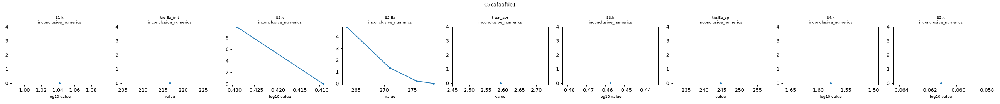
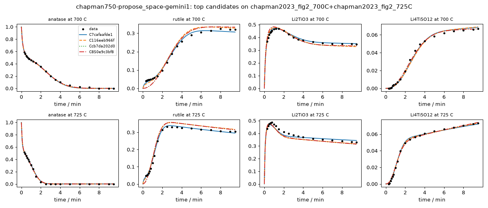

# Investigation report: chapman750-propose_space-gemini1

- Investigation: `chapman750`; arm: `propose_space`; phase: `final_evaluated`
- Protocol: `synthesis-mle-v1` (sha256 `c7b943a32f2c32b1`); manifest sha256 `1a596bdc5114f7b3`; evaluator code sha256 `4935f45a7126e490` ({'python': '3.12.13', 'numpy': '2.5.4', 'scipy': '1.18.1'})
- Development data: `chapman2023_fig2_700C+chapman2023_fig2_725C` (sha256 `c44c61ed445348bb`, digitized); 160 observations (joint fit of 2 experiments at T = [700.0, 725.0] C with one parameter vector)

## Question
Which reaction pathways and rate laws are supported by the in situ phase-fraction time courses of anatase TiO2 + Li2CO3 at 700 and 725 C (Hu, ..., Chapman, JACS 2023), what do these data leave ambiguous, and which feasible experiment would best separate the surviving pathways? Candidates are judged afterwards by how well they predict a reserved temperature without refitting.

## System boundary
A pellet of a 5:2 molar anatase TiO2 : Li2CO3 mix moved into a pre-heated hot zone (heating in under 10 s; t = 0 is insertion). Measured: anatase, rutile, Li2TiO3 and Li4Ti5O12, as Rietveld weight fractions of the crystalline solid from in situ X-ray scattering, converted here to mol of each phase per mol of total Ti. Not measured: Li2CO3 after about 30 s, CO2, amorphous or poorly crystalline material, and the Li content of the Li-Ti-O phases. The Ti fractions sum to 1 by construction (a normalised stack), so they cannot reveal unobserved Ti; lithium is not observed directly. Every model must conserve the elements it declares in mechanism.conservation, and every dataset initial species (anatase, Li2CO3) must appear in the model.

## Evidence status
- Partition: The 750 C panel of Fig. 2 is reserved. Development fits use 700 and 725 C jointly with one parameter vector (Arrhenius temperature dependence). The final evaluation is parameter transfer: each frozen candidate and every member of the declared reference space is fitted once on 700 + 725 C, then 750 C is predicted with those parameters (no refitting) and scored by its log-likelihood under the development noise estimate. No development-phase command, tool or evidence file reads the 750 C data; the authors' Avrami analysis, which used all temperatures, is withheld from the evidence and kept as an outside check on fitted exponents.
- Contamination: Retrospective analysis with literature-informed priors, not blind discovery: the proposer sees the 700 and 725 C runs and curated notes, and its pretraining may include this paper and general Li4Ti5O12 synthesis knowledge.

## Ranked candidates (development data, computed in code)

Delta aicc <= 2.0: not distinguished by these data; <= 4.0: still supported. Akaike weights are relative support within this candidate set (one weight per distinct dynamics) under the stated noise model, not probabilities that a mechanism is true. Residual correlation from misspecification makes these differences optimistic.

| candidate | name | source | v | k | AICc | dAICc | weight | band | adequacy | RMSE chapman2023_fig2_700C:Li2TiO3 | RMSE chapman2023_fig2_700C:Li4Ti5O12 | RMSE chapman2023_fig2_700C:anatase | RMSE chapman2023_fig2_700C:rutile | RMSE chapman2023_fig2_725C:Li2TiO3 | RMSE chapman2023_fig2_725C:Li4Ti5O12 | RMSE chapman2023_fig2_725C:anatase | RMSE chapman2023_fig2_725C:rutile | unobserved N end | in declared space | flags |
|---|---|---|---|---|---|---|---|---|---|---|---|---|---|---|---|---|---|---|---|
| C7cafaafde1 | tili_dual_LTO_mineralized_rutile | agent | 1 | 13 | -1137.10 | 0.00 | 1.000 | indistinguishable_from_best | poor | 0.00686 | 0.00207 | 0.00942 | 0.00839 | 0.0161 | 0.00109 | 0.00857 | 0.00857 | 0 | no |  |
| C116eeb966f | tili_def16_mineralized_rutile_tied | agent | 1 | 13 | -1056.56 | 80.54 | 0.000 | less_supported | poor | 0.0136 | 0.00228 | 0.00904 | 0.0157 | 0.0211 | 0.000948 | 0.00742 | 0.0181 | 0 | no |  |
| Ccb7da202d0 | enum-b0d2eb28dc | agent_space | 1 | 14 | -1030.89 | 106.21 | 0.000 | less_supported | poor | 0.0189 | 0.00154 | 0.0086 | 0.0242 | 0.0207 | 0.00128 | 0.00865 | 0.02 | 0 | no | R4.Ea at a protocol bound (600) |
| C850e9c3bf8 | enum-93651a99b2 | agent_space | 1 | 15 | -1029.04 | 108.06 | 0.000 | less_supported | poor | 0.0195 | 0.00152 | 0.00845 | 0.0243 | 0.0205 | 0.00127 | 0.00849 | 0.02 | 0 | no | R4.Ea at a protocol bound (600) |
| C2e8725331b | tili_def16_free_order_tied_ea | agent | 1 | 14 | -1024.47 | 112.63 | 0.000 | less_supported | poor | 0.0176 | 0.00171 | 0.0105 | 0.0234 | 0.0209 | 0.0013 | 0.00831 | 0.0196 | 0 | no |  |
| C84d35c81fb | enum-768b22e72a | agent_space | 1 | 15 | -961.53 | 175.57 | 0.000 | less_supported | poor | 0.0126 | 0.00251 | 0.0112 | 0.0195 | 0.0217 | 0.00453 | 0.0117 | 0.0172 | 0 | no | R2.k at a protocol bound (0.001) |
| C04a23ba638 | enum-e526315b96 | agent_space | 1 | 14 | -951.73 | 185.37 | 0.000 | less_supported | poor | 0.0142 | 0.00324 | 0.00804 | 0.0231 | 0.0264 | 0.00491 | 0.00808 | 0.0215 | 0 | no | R4.Ea at a protocol bound (5.47e-24) |
| C840017135f | enum-86c51f74d3 | agent_space | 1 | 15 | -949.33 | 187.77 | 0.000 | less_supported | poor | 0.0141 | 0.00326 | 0.00803 | 0.023 | 0.0265 | 0.0049 | 0.0081 | 0.0216 | 0 | no | R4.Ea at a protocol bound (1.21e-23) |
| Ccaf5b8621e | enum-7aa7df5ca0 | agent_space | 1 | 12 | -947.83 | 189.27 | 0.000 | less_supported | poor | 0.0205 | 0.00258 | 0.00781 | 0.022 | 0.0271 | 0.00479 | 0.00996 | 0.0208 | 0 | no |  |
| C33ea5ec06a | enum-966a7696b8 | agent_space | 1 | 13 | -945.57 | 191.53 | 0.000 | less_supported | poor | 0.0207 | 0.00258 | 0.00777 | 0.022 | 0.027 | 0.0048 | 0.00989 | 0.0207 | 0 | no |  |
| C760c9c222e | enum-eeba7c417c | agent_space | 1 | 14 | -944.31 | 192.79 | 0.000 | less_supported | poor | 0.0207 | 0.0027 | 0.00759 | 0.0217 | 0.0269 | 0.00482 | 0.00969 | 0.0209 | 0 | no | R4.Ea at a protocol bound (600) |
| C2d26d5e8e4 | tili_dual_LTO_exsolution | agent | 1 | 12 | -928.83 | 208.26 | 0.000 | less_supported | poor | 0.0197 | 0.00148 | 0.00812 | 0.0248 | 0.0293 | 0.00594 | 0.00889 | 0.024 | 0 | no |  |
| C93ae8bbe75 | enum-45630287e9 | agent_space | 1 | 15 | -914.62 | 222.48 | 0.000 | less_supported | poor | 0.0269 | 0.00151 | 0.0448 | 0.0252 | 0.0171 | 0.00105 | 0.0192 | 0.0158 | 0 | no | R1.n_avrami at a protocol bound (0.3) |
| Cbf3e2c2856 | enum-96392dd30b | agent_space | 1 | 14 | -908.73 | 228.37 | 0.000 | less_supported | poor | 0.0112 | 0.00335 | 0.0193 | 0.019 | 0.0196 | 0.00353 | 0.0285 | 0.0217 | 0 | no | R1.n_avrami at a protocol bound (0.3) |
| Ca04cda534b | enum-84d53699b1 | agent_space | 1 | 13 | -899.45 | 237.65 | 0.000 | less_supported | poor | 0.013 | 0.00682 | 0.00927 | 0.0322 | 0.0173 | 0.00856 | 0.00576 | 0.0364 | 0 | no |  |
| Cf34a7ef207 | enum-5545662c51 | agent_space | 1 | 14 | -896.69 | 240.41 | 0.000 | less_supported | poor | 0.0127 | 0.00679 | 0.00946 | 0.032 | 0.0173 | 0.00846 | 0.0062 | 0.0357 | 0 | no |  |
| Ca302396983 | enum-ad2955b173 | agent_space | 1 | 13 | -885.62 | 251.48 | 0.000 | less_supported | poor | 0.0132 | 0.00341 | 0.0258 | 0.023 | 0.0191 | 0.00354 | 0.0314 | 0.0227 | 0 | no |  |
| Cabe329f3bb | enum-3a8ba27fdf | agent_space | 1 | 14 | -881.35 | 255.75 | 0.000 | less_supported | poor | 0.0208 | 0.00235 | 0.0183 | 0.0241 | 0.0319 | 0.00429 | 0.0147 | 0.0253 | 0 | no |  |
| Ced98ed546e | enum-7a3777844a | agent_space | 1 | 12 | -838.19 | 298.90 | 0.000 | less_supported | poor | 0.014 | 0.00401 | 0.0375 | 0.0317 | 0.0146 | 0.00418 | 0.0425 | 0.0274 | 0 | no |  |
| Ce047054eed | enum-b26d1e6129 | agent_space | 1 | 14 | -833.22 | 303.87 | 0.000 | less_supported | poor | 0.0141 | 0.00401 | 0.0379 | 0.032 | 0.0143 | 0.00422 | 0.0424 | 0.0273 | 0 | no | R3.k at a protocol bound (0.001); R3.Ea at a protocol bound (600) |
| C40f96bdd3b | enum-3271ee6795 | agent_space | 1 | 14 | -833.22 | 303.88 | 0.000 | less_supported | poor | 0.014 | 0.00403 | 0.0375 | 0.0317 | 0.0146 | 0.00419 | 0.0425 | 0.0274 | 0 | no | R3.k at a protocol bound (0.001) |
| C8e89ff52d4 | enum-41156d4570 | agent_space | 1 | 14 | -822.67 | 314.43 | 0.000 | less_supported | poor | 0.0363 | 0.00788 | 0.0122 | 0.0183 | 0.0527 | 0.00942 | 0.011 | 0.0166 | 0 | no | R1.Ea at a protocol bound (600); R3.n_avrami at a protocol bound (4) |
| Cc08d1a892d | enum-97713ad537 | agent_space | 1 | 14 | -817.27 | 319.83 | 0.000 | less_supported | poor | 0.0304 | 0.00644 | 0.0197 | 0.0231 | 0.0297 | 0.00758 | 0.0174 | 0.0201 | 0 | no | R1.n_avrami at a protocol bound (0.3); R4.Ea at a protocol bound (1e-10) |
| Ccc0292bfa9 | enum-2850eea2c9 | agent_space | 1 | 13 | -816.47 | 320.62 | 0.000 | less_supported | poor | 0.0376 | 0.00876 | 0.0124 | 0.0208 | 0.0464 | 0.0094 | 0.0133 | 0.0146 | 0 | no | R1.Ea at a protocol bound (600) |
| C76b305e5ee | enum-4b82b6956b | agent_space | 1 | 13 | -806.80 | 330.30 | 0.000 | less_supported | poor | 0.0232 | 0.00399 | 0.0183 | 0.0397 | 0.0313 | 0.00364 | 0.0262 | 0.0445 | 0 | no | R1.k at a protocol bound (1e+04) |

150 lower-ranked fitted candidates omitted here; `python -m nernstwork.cli compare --run chapman750-propose_space-gemini1` lists all of them.

## Candidates that were not fitted (recorded, with status)

- C53cf32444d `enum-f5f90448a0` (agent_space): **nonconvergence** -- {"n_starts": 8, "n_starts_planned": 8, "n_finite": 8, "seed": 340074265161306095, "budget_exhausted": false, "max_ode_solves_per_fit": 200000, "max_rhs_evals": 20000, "nll_by_start": [-385.633138, -385.633669, -388.16905, -385.632859, -385.632608, -385.63344, -385.633062, -385.633362], "converged_by
- Cf0fab20e86 `enum-6cd3afb44e` (agent_space): **nonconvergence** -- {"n_starts": 8, "n_starts_planned": 8, "n_finite": 8, "seed": 288084423230352118, "budget_exhausted": false, "max_ode_solves_per_fit": 200000, "max_rhs_evals": 20000, "nll_by_start": [-392.413512, -392.41276, -392.413333, -392.413364, -392.413464, -144.721295, -394.516792, -392.413524], "converged_b
- C0140e6776e `enum-68dcc5bf97` (agent_space): **nonconvergence** -- {"n_starts": 8, "n_starts_planned": 8, "n_finite": 8, "seed": 265038743252419795, "budget_exhausted": false, "max_ode_solves_per_fit": 200000, "max_rhs_evals": 20000, "nll_by_start": [-392.294416, -392.294948, -392.292339, -146.622281, -146.62228, -392.295053, -394.620154, -392.294484], "converged_b

## Top candidates in detail

### C7cafaafde1 `tili_dual_LTO_mineralized_rutile` (source agent, version 1)

Rationale (proposer): Tests a two-component representation of the Li2-xTiO3 phase (stoichiometric Li2TiO3 and Li-deficient LiTiO2.5 lumped into the Li2TiO3 XRD channel via observation_map) under exact Ti and Li conservation, combined with Li2CO3-mineralized initial rutile formation (S5: anatase + Li2CO3 -> rutile + Li2CO3) that accounts for the initial ~0.045 mol/mol Ti rutile plateau at t = 0.3-0.8 min before sigmoidal JMAK rutile growth (S2). Pairwise tied activation energies (Ea_init on Li2CO3-driven steps S1 and S5; Ea_sp on spinel-forming steps S3 and S4) and shared Avrami exponent (n_avr on S2 and S3) prevent overparameterization.

    S1: anatase + 0.82 Li2CO3 -> 0.64 Li2TiO3 + 0.36 Li2TiO3_def [power_law, Arrhenius(T_ref 712 C)]; S1.k=11 (95% Wald 10.2-11.9, well_determined)
    S2: anatase -> rutile [power_law, avrami(n tie=n_avr), Arrhenius(T_ref 712 C)]; S2.k=0.39 (95% Wald 0.383-0.397, well_determined); S2.Ea=279 (95% Wald 271-287, well_determined)
    S3: 2 Li2TiO3 + 3 anatase -> Li4Ti5O12 [power_law, avrami(n tie=n_avr), Arrhenius(T_ref 712 C)]; S3.k=0.349 (95% Wald 0.341-0.357, well_determined)
    S4: 2 Li2TiO3 + 3 rutile -> Li4Ti5O12 [power_law, Arrhenius(T_ref 712 C)]; S4.k=0.0267 (95% Wald 0.0229-0.0311, well_determined)
    S5: anatase + Li2CO3 -> rutile + Li2CO3 [power_law, Arrhenius(T_ref 712 C)]; S5.k=0.869 (95% Wald 0.759-0.995, well_determined)
    shared: tie:Ea_init=217 (95% Wald 173-261, well_determined); tie:n_avr=2.59 (95% Wald 2.48-2.71, well_determined); tie:Ea_sp=245 (95% Wald 236-253, well_determined)

- Support entries: {'literature': 3, 'data': 2, 'speculative': 0}; reactions without support: []
  - S1: literature -- Hu et al., J. Am. Chem. Soc. 145 (2023) 26545-26549, main text [C5, C6] Rapid Li2CO3 consumption within ~30 s forming non-stoichiometric Li2-xTiO3 peaking above 48 wt%.
  - S2: literature -- Hu et al., J. Am. Chem. Soc. 145 (2023) 26545-26549, Fig. 2 [C3] Parallel sigmoidal anatase -> rutile transformation.
  - S3: literature -- Shen et al., Chem. Mater. 26 (2014) 3679-3686, abstract [S1]; Hu et al. (2023) [C3] Stoichiometric 2 Li2TiO3 + 3 anatase -> Li4Ti5O12 reaction.
  - S4: data -- chapman2023_fig2_725C, series rutile, Li2TiO3, Li4Ti5O12 (t = 2.5-9.5 min) Continued Li4Ti5O12 growth and rutile/Li2TiO3 consumption after anatase reaches 0 at 2.5 min.
  - S5: data -- chapman2023_fig2_700C and chapman2023_fig2_725C, series rutile and Li2TiO3 (t = 0.3-0.8 min) Rutile is already 0.041-0.048 mol/mol Ti (~11% of Li2TiO3) at t = 0.3 min and plateaus until sigmoidal JMAK conversion begins.
- Assumptions (proposer): ['Both Ti and Li are strictly conserved across all steps.', 'The Rietveld Li2TiO3 channel sums stoichiometric Li2TiO3 (Li/Ti = 2) and Li-deficient LiTiO2.5 (Li/Ti = 1) formed in fixed proportion (average Li/Ti = 1.64) during rapid Li2CO3 reaction.', 'Molten/reactive Li2CO3 catalyzes fast initial conversion of ~4-5% anatase to rutile (S5) until Li2CO3 is consumed at ~30 s.', 'Spinel formation from anatase (S3) and from rutile (S4) share the same Arrhenius activation energy (Ea_sp).']
- sigma (profiled): anatase=0.009, rutile=0.00848, Li2TiO3=0.0124, Li4Ti5O12=0.002; adequacy: poor ['chapman2023_fig2_700C:anatase: residuals are serially correlated (lag-1 r=0.70)', 'chapman2023_fig2_700C:rutile: residual signs cluster (runs test p=0.000)', 'chapman2023_fig2_700C:rutile: residuals are serially correlated (lag-1 r=0.84)', 'chapman2023_fig2_700C:Li2TiO3: residual signs cluster (runs test p=0.023)', 'chapman2023_fig2_700C:Li4Ti5O12: residual signs cluster (runs test p=0.000)', 'chapman2023_fig2_700C:Li4Ti5O12: residuals are serially correlated (lag-1 r=0.79)', 'chapman2023_fig2_725C:anatase: residual signs cluster (runs test p=0.000)', 'chapman2023_fig2_725C:anatase: residuals are serially correlated (lag-1 r=0.53)', 'chapman2023_fig2_725C:rutile: residual signs cluster (runs test p=0.010)', 'chapman2023_fig2_725C:rutile: residuals are serially correlated (lag-1 r=0.66)', 'chapman2023_fig2_725C:Li2TiO3: residual signs cluster (runs test p=0.000)', 'chapman2023_fig2_725C:Li2TiO3: residuals are serially correlated (lag-1 r=0.94)', 'chapman2023_fig2_725C:Li4Ti5O12: residual signs cluster (runs test p=0.002)', 'chapman2023_fig2_725C:Li4Ti5O12: residuals are serially correlated (lag-1 r=0.70)']
- Locally unidentifiable combinations: [{'eigenvalue_rel': 4.70015456460288e-09, 'combination': {'tie:Ea_init': 1.0}}, {'eigenvalue_rel': 8.445218669774488e-08, 'combination': {'S2.Ea': -0.665, 'tie:Ea_sp': -0.747}}, {'eigenvalue_rel': 3.650763758910259e-07, 'combination': {'S2.Ea': -0.747, 'tie:Ea_sp': 0.665}}]
- Profile likelihood: S1.k: inconclusive_numerics (95% 11-11); tie:Ea_init: inconclusive_numerics (95% 217-217); S2.k: inconclusive_numerics (95% 0.386-0.39); S2.Ea: inconclusive_numerics (95% 270-279); tie:n_avr: inconclusive_numerics (95% 2.59-2.59); S3.k: inconclusive_numerics (95% 0.349-0.349); tie:Ea_sp: inconclusive_numerics (95% 245-245); S4.k: inconclusive_numerics (95% 0.0267-0.0267); S5.k: inconclusive_numerics (95% 0.869-0.869)
  

### C116eeb966f `tili_def16_mineralized_rutile_tied` (source agent, version 1)

Rationale (proposer): Tests single-phase Li-deficient Li1.6TiO2.8 (Li/Ti = 1.6) under strict Ti and Li conservation, combined with Li2CO3-catalyzed fast initial rutile formation (S5: anatase + Li2CO3 -> rutile + Li2CO3), pairwise tied activation energies (Ea_init for S1, S5; Ea_sp for S3, S4) and shared Avrami exponent (n_avr for S2, S3). Cannot be expressed in a hypothesis space because S5 has Li2CO3 as a catalyst on both sides and Ea is tied pairwise.

    S1: anatase + 0.8 Li2CO3 -> Li2TiO3 [power_law, Arrhenius(T_ref 712 C)]; S1.k=10.5 (95% Wald 9.75-11.4, well_determined)
    S2: anatase -> rutile [power_law, avrami(n tie=n_avr), Arrhenius(T_ref 712 C)]; S2.k=0.404 (95% Wald 0.396-0.412, well_determined); S2.Ea=281 (95% Wald 272-290, well_determined)
    S3: 2.5 Li2TiO3 + 2.5 anatase -> Li4Ti5O12 [power_law, avrami(n tie=n_avr), Arrhenius(T_ref 712 C)]; S3.k=0.28 (95% Wald 0.271-0.29, well_determined)
    S4: 2.5 Li2TiO3 + 2.5 rutile -> Li4Ti5O12 [power_law, Arrhenius(T_ref 712 C)]; S4.k=0.0149 (95% Wald 0.0127-0.0176, well_determined)
    S5: anatase + Li2CO3 -> rutile + Li2CO3 [power_law, Arrhenius(T_ref 712 C)]; S5.k=0.601 (95% Wald 0.463-0.78, well_determined)
    shared: tie:Ea_init=191 (95% Wald 151-231, well_determined); tie:n_avr=2.49 (95% Wald 2.36-2.61, well_determined); tie:Ea_sp=247 (95% Wald 239-256, well_determined)

- Support entries: {'literature': 3, 'data': 2, 'speculative': 0}; reactions without support: []
  - S1: literature -- Hu et al., J. Am. Chem. Soc. 145 (2023) 26545-26549, main text [C5, C6] Fast reaction of anatase and Li2CO3 to Li-deficient Li2-xTiO3.
  - S2: literature -- Hu et al., J. Am. Chem. Soc. 145 (2023) 26545-26549, Fig. 2 [C3] Parallel sigmoidal anatase -> rutile transformation.
  - S3: literature -- Shen et al., Chem. Mater. 26 (2014) 3679-3686, abstract [S1]; Hu et al. (2023) [C3] Reaction of Li1.6TiO2.8 with anatase to form Li4Ti5O12.
  - S4: data -- chapman2023_fig2_725C, series rutile, Li2TiO3, Li4Ti5O12 (t = 2.5-9.5 min) Continued Li4Ti5O12 formation from Li2TiO3 and rutile after anatase exhaustion.
  - S5: data -- chapman2023_fig2_700C and chapman2023_fig2_725C, series rutile (t = 0.3-0.8 min) Initial rutile fraction of 0.041-0.048 mol/mol Ti present at t = 0.3 min.
- Assumptions (proposer): ['Both Ti and Li are conserved with a single homogeneous Li-deficient Li1.6TiO2.8 intermediate.', 'Li2CO3 acts as a flux/mineralizer catalyzing fast initial anatase -> rutile conversion (S5) while Li2CO3 is present.', 'Spinel formation from anatase (S3) and from rutile (S4) share activation energy Ea_sp.']
- sigma (profiled): anatase=0.00827, rutile=0.0169, Li2TiO3=0.0178, Li4Ti5O12=0.002; adequacy: poor ['chapman2023_fig2_700C:anatase: residuals are serially correlated (lag-1 r=0.64)', 'chapman2023_fig2_700C:rutile: residual signs cluster (runs test p=0.000)', 'chapman2023_fig2_700C:rutile: residuals are serially correlated (lag-1 r=0.95)', 'chapman2023_fig2_700C:Li2TiO3: residual signs cluster (runs test p=0.000)', 'chapman2023_fig2_700C:Li2TiO3: residuals are serially correlated (lag-1 r=0.94)', 'chapman2023_fig2_700C:Li4Ti5O12: residual signs cluster (runs test p=0.000)', 'chapman2023_fig2_700C:Li4Ti5O12: residuals are serially correlated (lag-1 r=0.80)', 'chapman2023_fig2_725C:anatase: residual signs cluster (runs test p=0.015)', 'chapman2023_fig2_725C:rutile: residual signs cluster (runs test p=0.000)', 'chapman2023_fig2_725C:rutile: residuals are serially correlated (lag-1 r=0.81)', 'chapman2023_fig2_725C:Li2TiO3: residual signs cluster (runs test p=0.000)', 'chapman2023_fig2_725C:Li2TiO3: residuals are serially correlated (lag-1 r=0.93)', 'chapman2023_fig2_725C:Li4Ti5O12: residual signs cluster (runs test p=0.002)', 'chapman2023_fig2_725C:Li4Ti5O12: residuals are serially correlated (lag-1 r=0.59)']
- Locally unidentifiable combinations: [{'eigenvalue_rel': 6.8065298325879466e-09, 'combination': {'tie:Ea_init': 1.0}}, {'eigenvalue_rel': 9.014648324114445e-08, 'combination': {'S2.Ea': -0.709, 'tie:Ea_sp': -0.705}}, {'eigenvalue_rel': 3.5433526851134386e-07, 'combination': {'S2.Ea': -0.705, 'tie:Ea_sp': 0.709}}]
- Profile likelihood: not computed (identifiability beyond the local Fisher screen is unassessed)

### Ccb7da202d0 `enum-b0d2eb28dc` (source agent_space, version 1)

Rationale (proposer): enumerated: S1:first_order,S2:avrami,S3:avrami,S4:first_order | space tili-nonstoich-pathways-v1

    R1: anatase + 0.8 Li2CO3 -> Li2TiO3 [power_law, Arrhenius(T_ref 712 C)]; R1.k=12.2 (95% Wald 11.1-13.3, well_determined); R1.Ea=188 (95% Wald 132-244, well_determined)
    R2: anatase -> rutile [power_law, avrami(n), Arrhenius(T_ref 712 C)]; R2.k=0.412 (95% Wald 0.404-0.421, well_determined); R2.Ea=286 (95% Wald 276-297, well_determined); R2.n_avrami=2.19 (95% Wald 2.08-2.3, well_determined)
    R3: 2.5 Li2TiO3 + 2.5 anatase -> Li4Ti5O12 [power_law, avrami(n), Arrhenius(T_ref 712 C)]; R3.k=0.271 (95% Wald 0.259-0.283, well_determined); R3.Ea=235 (95% Wald 223-247, well_determined); R3.n_avrami=2.33 (95% Wald 2.19-2.47, well_determined)
    R4: 2.5 Li2TiO3 + 2.5 rutile -> Li4Ti5O12 [power_law, Arrhenius(T_ref 712 C)]; R4.k=0.00961 (95% Wald 0.00359-0.0257, moderately_determined); R4.Ea=600 (95% Wald 0-600, not_determined_locally)

- Support entries: {'literature': 3, 'data': 4, 'speculative': 0}; reactions without support: []
  - R1: literature -- Hu et al., J. Am. Chem. Soc. 145 (2023) 26545-26549, abstract, Fig. 2 and main text [C3, C5, C6]; Shen et al., Chem. Mater. 26 (2014) 3679-3686, abstract [S1] Initial reaction of anatase TiO2 with Li2CO3 (consumed within ~30 s) forms a Li-deficient Li2-xTiO3 intermediate above the 48 wt% (0.40 mol/mol Ti) stoichiometric limit.
  - R1: data -- chapman2023_fig2_700C and chapman2023_fig2_725C, series Li2TiO3 (t = 0.3-1.2 min) Li2TiO3 reaches 0.469 (700 C) and 0.486 (725 C) mol/mol Ti from 0.40 mol Li2CO3 (0.80 mol Li), consistent with ~1.6 Li per Ti in Li2-xTiO3.
  - R2: literature -- Hu et al., J. Am. Chem. Soc. 145 (2023) 26545-26549, Fig. 2 and main text [C3]; Shen et al., Chem. Mater. 26 (2014) 3679-3686, abstract [S2] Parallel polymorphic transformation of anatase TiO2 to rutile TiO2.
  - R2: data -- chapman2023_fig2_700C and chapman2023_fig2_725C, series rutile Sigmoidal rise of rutile to ~0.32-0.33 mol/mol Ti as anatase is consumed.
  - R3: literature -- Hu et al., J. Am. Chem. Soc. 145 (2023) 26545-26549, Fig. 2 and main text [C3]; Shen et al., Chem. Mater. 26 (2014) 3679-3686, abstract [S1] Second-stage reaction of the Li2-xTiO3 intermediate with remaining anatase TiO2 to form spinel Li4Ti5O12.
  - R3: data -- chapman2023_fig2_700C and chapman2023_fig2_725C, series Li2TiO3, anatase, Li4Ti5O12 (t = 0.5-7.0 min) Concurrent consumption of Li2TiO3 and anatase during the sigmoidal growth of Li4Ti5O12.
  - R4: data -- chapman2023_fig2_725C, series anatase, rutile, Li2TiO3, Li4Ti5O12 (t = 2.5-9.5 min) After anatase is completely exhausted at t = 2.5 min at 725 C, Li4Ti5O12 continues to grow (0.0535 to 0.0732) while both rutile (0.3327 to 0.3046) and Li2TiO3 (0.3998 to 0.3292) decrease.
- sigma (profiled): anatase=0.00863, rutile=0.0222, Li2TiO3=0.0198, Li4Ti5O12=0.002; adequacy: poor ['chapman2023_fig2_700C:anatase: residual signs cluster (runs test p=0.010)', 'chapman2023_fig2_700C:anatase: residuals are serially correlated (lag-1 r=0.71)', 'chapman2023_fig2_700C:rutile: residual signs cluster (runs test p=0.000)', 'chapman2023_fig2_700C:rutile: residuals are serially correlated (lag-1 r=0.98)', 'chapman2023_fig2_700C:Li2TiO3: residual signs cluster (runs test p=0.002)', 'chapman2023_fig2_700C:Li2TiO3: residuals are serially correlated (lag-1 r=0.96)', 'chapman2023_fig2_700C:Li4Ti5O12: residual signs cluster (runs test p=0.037)', 'chapman2023_fig2_700C:Li4Ti5O12: residuals are serially correlated (lag-1 r=0.64)', 'chapman2023_fig2_725C:anatase: residual signs cluster (runs test p=0.023)', 'chapman2023_fig2_725C:rutile: residual signs cluster (runs test p=0.000)', 'chapman2023_fig2_725C:rutile: residuals are serially correlated (lag-1 r=0.89)', 'chapman2023_fig2_725C:Li2TiO3: residual signs cluster (runs test p=0.000)', 'chapman2023_fig2_725C:Li2TiO3: residuals are serially correlated (lag-1 r=0.95)', 'chapman2023_fig2_725C:Li4Ti5O12: residual signs cluster (runs test p=0.006)', 'chapman2023_fig2_725C:Li4Ti5O12: residuals are serially correlated (lag-1 r=0.72)']
- Locally unidentifiable combinations: [{'eigenvalue_rel': 3.183023321195435e-11, 'combination': {'R4.Ea': 1.0}}, {'eigenvalue_rel': 4.017785740195155e-09, 'combination': {'R1.Ea': -1.0}}, {'eigenvalue_rel': 9.145809861658868e-08, 'combination': {'R2.Ea': -0.653, 'R3.Ea': -0.757}}, {'eigenvalue_rel': 2.34543171302279e-07, 'combination': {'R2.Ea': 0.757, 'R3.Ea': -0.653}}]
- Profile likelihood: not computed (identifiability beyond the local Fisher screen is unassessed)

### C850e9c3bf8 `enum-93651a99b2` (source agent_space, version 1)

Rationale (proposer): enumerated: S1:avrami,S2:avrami,S3:avrami,S4:first_order | space tili-nonstoich-pathways-v1

    R1: anatase + 0.8 Li2CO3 -> Li2TiO3 [power_law, avrami(n), Arrhenius(T_ref 712 C)]; R1.k=10.9 (95% Wald 8.06-14.7, well_determined); R1.Ea=178 (95% Wald 121-234, well_determined); R1.n_avrami=1.08 (95% Wald 0.852-1.31, well_determined)
    R2: anatase -> rutile [power_law, avrami(n), Arrhenius(T_ref 712 C)]; R2.k=0.413 (95% Wald 0.404-0.422, well_determined); R2.Ea=287 (95% Wald 276-297, well_determined); R2.n_avrami=2.2 (95% Wald 2.09-2.32, well_determined)
    R3: 2.5 Li2TiO3 + 2.5 anatase -> Li4Ti5O12 [power_law, avrami(n), Arrhenius(T_ref 712 C)]; R3.k=0.271 (95% Wald 0.26-0.283, well_determined); R3.Ea=235 (95% Wald 224-247, well_determined); R3.n_avrami=2.33 (95% Wald 2.19-2.48, well_determined)
    R4: 2.5 Li2TiO3 + 2.5 rutile -> Li4Ti5O12 [power_law, Arrhenius(T_ref 712 C)]; R4.k=0.00965 (95% Wald 0.00362-0.0257, moderately_determined); R4.Ea=600 (95% Wald 0-600, not_determined_locally)

- Support entries: {'literature': 3, 'data': 4, 'speculative': 0}; reactions without support: []
  - R1: literature -- Hu et al., J. Am. Chem. Soc. 145 (2023) 26545-26549, abstract, Fig. 2 and main text [C3, C5, C6]; Shen et al., Chem. Mater. 26 (2014) 3679-3686, abstract [S1] Initial reaction of anatase TiO2 with Li2CO3 (consumed within ~30 s) forms a Li-deficient Li2-xTiO3 intermediate above the 48 wt% (0.40 mol/mol Ti) stoichiometric limit.
  - R1: data -- chapman2023_fig2_700C and chapman2023_fig2_725C, series Li2TiO3 (t = 0.3-1.2 min) Li2TiO3 reaches 0.469 (700 C) and 0.486 (725 C) mol/mol Ti from 0.40 mol Li2CO3 (0.80 mol Li), consistent with ~1.6 Li per Ti in Li2-xTiO3.
  - R2: literature -- Hu et al., J. Am. Chem. Soc. 145 (2023) 26545-26549, Fig. 2 and main text [C3]; Shen et al., Chem. Mater. 26 (2014) 3679-3686, abstract [S2] Parallel polymorphic transformation of anatase TiO2 to rutile TiO2.
  - R2: data -- chapman2023_fig2_700C and chapman2023_fig2_725C, series rutile Sigmoidal rise of rutile to ~0.32-0.33 mol/mol Ti as anatase is consumed.
  - R3: literature -- Hu et al., J. Am. Chem. Soc. 145 (2023) 26545-26549, Fig. 2 and main text [C3]; Shen et al., Chem. Mater. 26 (2014) 3679-3686, abstract [S1] Second-stage reaction of the Li2-xTiO3 intermediate with remaining anatase TiO2 to form spinel Li4Ti5O12.
  - R3: data -- chapman2023_fig2_700C and chapman2023_fig2_725C, series Li2TiO3, anatase, Li4Ti5O12 (t = 0.5-7.0 min) Concurrent consumption of Li2TiO3 and anatase during the sigmoidal growth of Li4Ti5O12.
  - R4: data -- chapman2023_fig2_725C, series anatase, rutile, Li2TiO3, Li4Ti5O12 (t = 2.5-9.5 min) After anatase is completely exhausted at t = 2.5 min at 725 C, Li4Ti5O12 continues to grow (0.0535 to 0.0732) while both rutile (0.3327 to 0.3046) and Li2TiO3 (0.3998 to 0.3292) decrease.
- sigma (profiled): anatase=0.00847, rutile=0.0223, Li2TiO3=0.02, Li4Ti5O12=0.002; adequacy: poor ['chapman2023_fig2_700C:anatase: residual signs cluster (runs test p=0.010)', 'chapman2023_fig2_700C:anatase: residuals are serially correlated (lag-1 r=0.68)', 'chapman2023_fig2_700C:rutile: residual signs cluster (runs test p=0.000)', 'chapman2023_fig2_700C:rutile: residuals are serially correlated (lag-1 r=0.98)', 'chapman2023_fig2_700C:Li2TiO3: residual signs cluster (runs test p=0.002)', 'chapman2023_fig2_700C:Li2TiO3: residuals are serially correlated (lag-1 r=0.96)', 'chapman2023_fig2_700C:Li4Ti5O12: residual signs cluster (runs test p=0.037)', 'chapman2023_fig2_700C:Li4Ti5O12: residuals are serially correlated (lag-1 r=0.63)', 'chapman2023_fig2_725C:anatase: residual signs cluster (runs test p=0.022)', 'chapman2023_fig2_725C:rutile: residual signs cluster (runs test p=0.000)', 'chapman2023_fig2_725C:rutile: residuals are serially correlated (lag-1 r=0.89)', 'chapman2023_fig2_725C:Li2TiO3: residual signs cluster (runs test p=0.000)', 'chapman2023_fig2_725C:Li2TiO3: residuals are serially correlated (lag-1 r=0.95)', 'chapman2023_fig2_725C:Li4Ti5O12: residual signs cluster (runs test p=0.006)', 'chapman2023_fig2_725C:Li4Ti5O12: residuals are serially correlated (lag-1 r=0.72)']
- Locally unidentifiable combinations: [{'eigenvalue_rel': 3.1962263871804996e-11, 'combination': {'R4.Ea': 1.0}}, {'eigenvalue_rel': 3.879020191322293e-09, 'combination': {'R1.Ea': 1.0}}, {'eigenvalue_rel': 9.371643425761558e-08, 'combination': {'R2.Ea': -0.645, 'R3.Ea': -0.764}}, {'eigenvalue_rel': 2.3531790219335052e-07, 'combination': {'R2.Ea': -0.764, 'R3.Ea': 0.645}}]
- Profile likelihood: not computed (identifiability beyond the local Fisher screen is unassessed)

## Experiment plan (plan-3.json, the last of 3)

For every candidate design (temperature, initial amounts, sampling times, measured phases) each surviving model predicts the measured channels with its development MLE. Designs are scored by the pairwise discrimination criterion of Buzzi-Ferraris and Forzatti (1983), weighted by the models' Akaike weights:

Models (equal (models chosen by hand)): C7cafaafde1 (AICc -1137.1, w 0.125), C116eeb966f (AICc -1056.56, w 0.125), Ccb7da202d0 (AICc -1030.89, w 0.125), C2e8725331b (AICc -1024.47, w 0.125), C84d35c81fb (AICc -961.527, w 0.125), C04a23ba638 (AICc -951.732, w 0.125), Ccaf5b8621e (AICc -947.83, w 0.125), C2d26d5e8e4 (AICc -928.833, w 0.125)

| design | U | bounded score | separable pairs |
|---|---|---|---|
| T800C_standard | 233 | 9.56 | 19/28 |
| T775C_standard | 204 | 8.49 | 19/28 |
| LTO_plus_rutile_T750C | 135 | 5.88 | 18/28 |
| T750C_standard | 47.9 | 6.62 | 19/28 |
| LTO_plus_rutile_T725C | 47.8 | 3.56 | 16/28 |
| Li2CO3_x0.5_T725C | 27.3 | 6.23 | 7/28 |
| Li2CO3_x1.5_T725C | 14.7 | 4.82 | 3/28 |

## Discrimination analysis (discrimination-1.json)

A design is {"name", "c0" (or "c0_mM_N"): {...}, "t_end_min", optional "temperature_C", optional "observe": [species
    ids to measure]}. Predictions use each candidate's development MLE; parameter uncertainty is not propagated, so large
    disagreement is a lead for an experiment, not a quantified expected information gain (see plan_experiments).

- Design `T750C_standard` {"name": "T750C_standard", "t_end_min": 9.5, "c0": {"anatase": 1, "Li2CO3": 0.4}, "temperature_C": 750}:
  - Li2TiO3: max spread 0.204 at 9.5 min (16.5 dev sigma); {'C7cafaafde1': 0.32, 'C116eeb966f': 0.28, 'Ccb7da202d0': 0.18, 'C2e8725331b': 0.27, 'C84d35c81fb': 0.38, 'Ccaf5b8621e': 0.35}
  - rutile: max spread 0.174 at 9.5 min (20.5 dev sigma); {'C7cafaafde1': 0.26, 'C116eeb966f': 0.28, 'Ccb7da202d0': 0.18, 'C2e8725331b': 0.28, 'C84d35c81fb': 0.32, 'Ccaf5b8621e': 0.35}
  - Li4Ti5O12: max spread 0.0695 at 9.5 min (34.8 dev sigma); {'C7cafaafde1': 0.08, 'C116eeb966f': 0.09, 'Ccb7da202d0': 0.13, 'C2e8725331b': 0.09, 'C84d35c81fb': 0.06, 'Ccaf5b8621e': 0.06}
  - anatase: max spread 0.0432 at 0.0477 min (4.8 dev sigma); {'C7cafaafde1': 0.68, 'C116eeb966f': 0.71, 'Ccb7da202d0': 0.7, 'C2e8725331b': 0.71, 'C84d35c81fb': 0.67, 'Ccaf5b8621e': 0.71}
  - unmeasured_Ti_total: max spread 0 at 0 min (- dev sigma); {'C7cafaafde1': 0.0, 'C116eeb966f': 0.0, 'Ccb7da202d0': 0.0, 'C2e8725331b': 0.0, 'C84d35c81fb': 0.0, 'Ccaf5b8621e': 0.0}
- Design `T800C_standard` {"t_end_min": 9.5, "name": "T800C_standard", "temperature_C": 800, "c0": {"Li2CO3": 0.4, "anatase": 1}}:
  - Li2TiO3: max spread 0.399 at 9.5 min (32.3 dev sigma); {'C7cafaafde1': 0.24, 'C116eeb966f': 0.15, 'Ccb7da202d0': 0.01, 'C2e8725331b': 0.14, 'C84d35c81fb': 0.4, 'Ccaf5b8621e': 0.36}
  - rutile: max spread 0.359 at 9.5 min (42.4 dev sigma); {'C7cafaafde1': 0.15, 'C116eeb966f': 0.16, 'Ccb7da202d0': 0.02, 'C2e8725331b': 0.16, 'C84d35c81fb': 0.33, 'Ccaf5b8621e': 0.38}
  - Li4Ti5O12: max spread 0.143 at 9.5 min (71.5 dev sigma); {'C7cafaafde1': 0.12, 'C116eeb966f': 0.14, 'Ccb7da202d0': 0.2, 'C2e8725331b': 0.14, 'C84d35c81fb': 0.05, 'Ccaf5b8621e': 0.05}
  - anatase: max spread 0.0425 at 0.143 min (4.73 dev sigma); {'C7cafaafde1': 0.18, 'C116eeb966f': 0.16, 'Ccb7da202d0': 0.15, 'C2e8725331b': 0.17, 'C84d35c81fb': 0.19, 'Ccaf5b8621e': 0.17}
  - unmeasured_Ti_total: max spread 0 at 0 min (- dev sigma); {'C7cafaafde1': 0.0, 'C116eeb966f': 0.0, 'Ccb7da202d0': 0.0, 'C2e8725331b': 0.0, 'C84d35c81fb': 0.0, 'Ccaf5b8621e': 0.0}
- Design `Li2CO3_x0.5_T725C` {"temperature_C": 725, "name": "Li2CO3_x0.5_T725C", "t_end_min": 9.5, "c0": {"Li2CO3": 0.2, "anatase": 1}}:
  - rutile: max spread 0.145 at 2.58 min (17.1 dev sigma); {'C7cafaafde1': 0.6, 'C116eeb966f': 0.62, 'Ccb7da202d0': 0.62, 'C2e8725331b': 0.61, 'C84d35c81fb': 0.48, 'Ccaf5b8621e': 0.59}
  - anatase: max spread 0.0934 at 0.859 min (10.4 dev sigma); {'C7cafaafde1': 0.59, 'C116eeb966f': 0.57, 'Ccb7da202d0': 0.55, 'C2e8725331b': 0.57, 'C84d35c81fb': 0.49, 'Ccaf5b8621e': 0.55}
  - Li2TiO3: max spread 0.0868 at 9.5 min (7.02 dev sigma); {'C7cafaafde1': 0.14, 'C116eeb966f': 0.11, 'Ccb7da202d0': 0.11, 'C2e8725331b': 0.1, 'C84d35c81fb': 0.19, 'Ccaf5b8621e': 0.12}
  - Li4Ti5O12: max spread 0.0166 at 3.29 min (8.28 dev sigma); {'C7cafaafde1': 0.05, 'C116eeb966f': 0.05, 'Ccb7da202d0': 0.04, 'C2e8725331b': 0.05, 'C84d35c81fb': 0.06, 'Ccaf5b8621e': 0.05}
  - unmeasured_Ti_total: max spread 0 at 0 min (- dev sigma); {'C7cafaafde1': 0.0, 'C116eeb966f': 0.0, 'Ccb7da202d0': 0.0, 'C2e8725331b': 0.0, 'C84d35c81fb': 0.0, 'Ccaf5b8621e': 0.0}
- Design `Li2CO3_x1.5_T725C` {"c0": {"Li2CO3": 0.6, "anatase": 1}, "t_end_min": 9.5, "name": "Li2CO3_x1.5_T725C", "temperature_C": 725}:
  - Li2TiO3: max spread 0.0715 at 2.53 min (5.79 dev sigma); {'C7cafaafde1': 0.65, 'C116eeb966f': 0.65, 'Ccb7da202d0': 0.65, 'C2e8725331b': 0.66, 'C84d35c81fb': 0.58, 'Ccaf5b8621e': 0.64}
  - rutile: max spread 0.0558 at 9.5 min (6.58 dev sigma); {'C7cafaafde1': 0.12, 'C116eeb966f': 0.13, 'Ccb7da202d0': 0.12, 'C2e8725331b': 0.13, 'C84d35c81fb': 0.18, 'Ccaf5b8621e': 0.15}
  - anatase: max spread 0.0494 at 0.573 min (5.49 dev sigma); {'C7cafaafde1': 0.23, 'C116eeb966f': 0.23, 'Ccb7da202d0': 0.24, 'C2e8725331b': 0.23, 'C84d35c81fb': 0.28, 'Ccaf5b8621e': 0.24}
  - Li4Ti5O12: max spread 0.0128 at 2.63 min (6.42 dev sigma); {'C7cafaafde1': 0.04, 'C116eeb966f': 0.04, 'Ccb7da202d0': 0.04, 'C2e8725331b': 0.03, 'C84d35c81fb': 0.05, 'Ccaf5b8621e': 0.04}
  - unmeasured_Ti_total: max spread 0 at 0 min (- dev sigma); {'C7cafaafde1': 0.0, 'C116eeb966f': 0.0, 'Ccb7da202d0': 0.0, 'C2e8725331b': 0.0, 'C84d35c81fb': 0.0, 'Ccaf5b8621e': 0.0}
- Design `LTO_plus_rutile_T750C` {"temperature_C": 750, "t_end_min": 9.5, "name": "LTO_plus_rutile_T750C", "c0": {"Li2TiO3": 0.4, "rutile": 0.6}}:
  - rutile: max spread 0.296 at 9.5 min (34.9 dev sigma); {'C7cafaafde1': 0.31, 'C116eeb966f': 0.43, 'Ccb7da202d0': 0.3, 'C2e8725331b': 0.42, 'C84d35c81fb': 0.6, 'Ccaf5b8621e': 0.6}
  - Li2TiO3: max spread 0.296 at 9.5 min (24 dev sigma); {'C7cafaafde1': 0.21, 'C116eeb966f': 0.23, 'Ccb7da202d0': 0.1, 'C2e8725331b': 0.22, 'C84d35c81fb': 0.4, 'Ccaf5b8621e': 0.4}
  - Li4Ti5O12: max spread 0.118 at 9.5 min (59.2 dev sigma); {'C7cafaafde1': 0.1, 'C116eeb966f': 0.07, 'Ccb7da202d0': 0.12, 'C2e8725331b': 0.07, 'C84d35c81fb': 0.0, 'Ccaf5b8621e': 0.0}
  - anatase: max spread 0 at 0 min (0 dev sigma); {'C7cafaafde1': 0.0, 'C116eeb966f': 0.0, 'Ccb7da202d0': 0.0, 'C2e8725331b': 0.0, 'C84d35c81fb': 0.0, 'Ccaf5b8621e': 0.0}
  - unmeasured_Ti_total: max spread 0 at 0 min (- dev sigma); {'C7cafaafde1': 0.0, 'C116eeb966f': 0.0, 'Ccb7da202d0': 0.0, 'C2e8725331b': 0.0, 'C84d35c81fb': 0.0, 'Ccaf5b8621e': 0.0}

## Investigator conclusion (conclusion-1.json; an interpretation, numbers above are authoritative)

Joint maximum-likelihood evaluation of 178 candidates (70 in Space 1 'tili-nonstoich-pathways-v1', 104 in Space 2 'ti-stoich-vs-unlim-pathways-v1', and 4 individual candidates; 175 fitted, 3 nonconvergent) at 700 and 725 C establishes five core findings:

1. Supported reaction network (two-stage synthesis + parallel rutile formation + secondary rutile consumption):
   - Fast initial lithiation of anatase by Li2CO3 (S1: k = 10.5-12.2 min^-1 at 712.5 C, Ea = 178-217 kJ/mol) rapidly forms the Li2-xTiO3 intermediate within ~0.5 min as Li2CO3 is exhausted.
   - Parallel polymorphic transformation of anatase to rutile (S2: k = 0.39-0.41 min^-1, Ea = 279-287 kJ/mol) and second-stage reaction of Li2-xTiO3 with anatase to form spinel Li4Ti5O12 (S3: k = 0.27-0.35 min^-1, Ea = 235-247 kJ/mol) both require sigmoidal JMAK Avrami kinetics (n_avrami = 2.0-2.6). Replacing Avrami with plain first-order kinetics on S3 (Ca04cda534b, AICc = -899.45) or on all steps (C773e13369c, AICc = -738.83) degrades AICc by 131 to 292 units relative to Ccb7da202d0 (AICc = -1030.89).
   - Secondary reaction of Li2-xTiO3 with rutile to form Li4Ti5O12 (S4) is strongly supported by the post-anatase regime at 725 C (t = 2.5-9.5 min, where anatase = 0 while Li4Ti5O12 grows from 0.0535 to 0.0732 and rutile and Li2TiO3 decay): omitting S4 (3-step Ccaf5b8621e, AICc = -947.83) worsens AICc by 83.1 units compared to 4-step Ccb7da202d0 (AICc = -1030.89). Rival late-stage mechanisms—direct precursor bypass S5 (C04a23ba638, AICc = -951.73, R4.Ea at 0 bound), rutile lithiation S6 (C760c9c222e, AICc = -944.31, R4.Ea at 600 bound), and rutile-free LTO exsolution (C2d26d5e8e4, AICc = -928.83)—are all rejected by >80 AICc units.

2. Resolution of the Li mass-balance discrepancy:
   - Strictly stoichiometric Li2TiO3 (Li/Ti = 2) with c0(Li2CO3) = 0.40 mol/mol Ti (0.80 mol Li/mol Ti) caps Li2TiO3 at 0.40 mol/mol Ti, whereas the measured phase fraction peaks at 0.469 (700 C) and 0.486 (725 C). Consequently, stoichiometric Li2CO3-limited models in Space 2 (C9d5e23108b, AICc = -742.70, sigma_Li2TiO3 = 0.0833; C9b0bddc038, AICc = -704.65) suffer severe systematic underprediction of Li2TiO3 and overprediction of rutile.
   - Treating Li as unlimited on a Ti-only basis (C66fed31ded, AICc = -793.96; C93ae8bbe75, AICc = -914.62) forces R1.n_avrami to its lower protocol bound (0.30) to artificially mimic Li2CO3 exhaustion.
   - Explicitly conserving both Ti and Li with Li-deficient Li1.6TiO2.8 (Space 1, Ccb7da202d0, AICc = -1030.89) improves AICc by 288.2 units over stoichiometric C9d5e23108b.
   - Furthermore, because empirical consumption during Stage 2 follows a 2:3 LTO:TiO2 ratio (d(Li2TiO3)/d(Li4Ti5O12) = -2.07 at 700 C for t >= 1 min) rather than 2.5:2.5, modeling the intermediate as a two-component Li2TiO3 + LiTiO2.5 phase (net Li/Ti = 1.64, mapped to the Li2TiO3 channel via observation_map) plus Li2CO3-mineralized initial rutile formation in C7cafaafde1 achieves the best overall fit (AICc = -1137.10, dAICc = 80.54 ahead of single-phase C116eeb966f at AICc = -1056.56), with all 9 kinetic parameters well-determined, zero bound flags, and channel sigmas of 0.0090 (anatase), 0.0085 (rutile), 0.0124 (Li2TiO3), and 0.0020 (Li4Ti5O12, at the protocol floor).

3. Residual adequacy and experimental design:
   - Every fitted candidate (175/175) is classified as adequacy = 'poor' by the runs test and lag-1 autocorrelation heuristic because the 20-point time series are column-averaged pixel extractions of smoothed stacked-area curves with ~1-2 wt% boundary-line systematic error.
   - Buzzi-Ferraris experimental design ranking (nw_plan_experiments across the 8 leading rival models) identifies higher-temperature standard runs—T800C_standard (U = 233, bounded = 9.56, 19/28 pairs separable), T775C_standard (U = 204, bounded = 8.49, 19/28 pairs separable), and the reserved T750C_standard condition (U = 47.9, bounded = 6.62, 19/28 pairs separable)—along with a targeted binary precursor experiment starting from pre-synthesized Li2TiO3 + rutile at 750 C (LTO_plus_rutile_T750C, c0 = {'Li2TiO3': 0.4, 'rutile': 0.6}, U = 135, bounded = 5.88, 18/28 pairs separable) and a reduced-lithium mix (Li2CO3_x0.5_T725C, c0 = {'anatase': 1.0, 'Li2CO3': 0.2}, U = 27.3, bounded = 6.23, 7/28 pairs separable) as the most informative experiments to separate the surviving models.

- Plausible: ['C7cafaafde1', 'C116eeb966f', 'Ccb7da202d0', 'C850e9c3bf8', 'C2e8725331b']
- Adequacy: none_adequate
- Rejected: [{'candidate_id': 'C9d5e23108b', 'reason': 'Stoichiometric Li2CO3-limited 4-step Space 2 member (S1_lim + S2 + S3 + S4): AICc = -742.70 (dAICc = 394.40 vs best, dAICc = 288.19 vs Space 1 counterpart Ccb7da202d0). Nominal Li2TiO3 stoichiometry (2 Li/Ti) caps Li2TiO3 at 0.40 mol/mol Ti from c0(Li2CO3) = 0.40, causing severe underprediction of Li2TiO3 (sigma = 0.0833) and overprediction of rutile (sigma = 0.0828), with R4.Ea hitting the 600 kJ/mol bound.'}, {'candidate_id': 'C9b0bddc038', 'reason': 'Stoichiometric Li2CO3-limited 3-step Space 2 member (S1_lim + S2 + S3): AICc = -704.65 (dAICc = 432.45), failing both the Li2TiO3 peak ceiling (sigma_Li2TiO3 = 0.0839, sigma_rutile = 0.0804) and post-anatase spinel growth.'}, {'reason': 'Unconstrained-Li 3-step Avrami Space 2 member (S1_unlim + S2 + S3): AICc = -793.96 (dAICc = 343.14). Without Li2CO3 limiting S1, R1.n_avrami hits the lower protocol bound (0.30) to artificially decelerate Li2TiO3 formation, and omitting S4 leaves post-anatase spinel growth unmodeled (sigma_Li2TiO3 = 0.0388, sigma_anatase = 0.0324).', 'candidate_id': 'C66fed31ded'}, {'reason': 'Best Space 2 member (S1_lim + S1_unlim + S2 + S3): AICc = -961.53 (dAICc = 175.57). Hits the lower protocol bound on R2.k (0.001 min^-1) with R2.n_avrami = 0.313, and lacks S4 (Li2TiO3 + rutile -> Li4Ti5O12), causing predicted Li4Ti5O12 at 725 C to freeze at 0.0636 mol/mol Ti for t >= 3.5 min against observed growth to 0.0732 (RMSE = 0.0045).', 'candidate_id': 'C84d35c81fb'}, {'reason': '3-step Space 1 member (S1 first_order + S2 avrami + S3 avrami, omitting S4): AICc = -947.83 (dAICc = 189.27 vs best, and 83.06 AICc units worse than 4-step Ccb7da202d0). Cannot capture continued Li4Ti5O12 growth and rutile/Li2TiO3 consumption after anatase reaches zero at t = 2.5 min at 725 C (Li4Ti5O12 RMSE = 0.0048 vs 0.0013 in Ccb7da202d0).', 'candidate_id': 'Ccaf5b8621e'}, {'reason': '3-step Space 1 member with Avrami S1 (S1 avrami + S2 avrami + S3 avrami, omitting S4): AICc = -945.57 (dAICc = 191.53), penalised for omitting S4 and adding an redundant Avrami parameter on S1 (R1.n_avrami = 1.033).', 'candidate_id': 'C33ea5ec06a'}, {'candidate_id': 'C04a23ba638', 'reason': '4-step Space 1 member replacing S4 with direct precursor bypass S5 (5 anatase + 2 Li2CO3 -> Li4Ti5O12): AICc = -951.73 (dAICc = 185.37), R4.Ea hits the lower protocol bound (5.47e-24 kJ/mol) and direct synthesis from precursors cannot explain spinel growth after Li2CO3 and anatase depletion.'}, {'candidate_id': 'C760c9c222e', 'reason': '4-step Space 1 member replacing S4 with rutile lithiation S6 (rutile + 0.8 Li2CO3 -> Li2TiO3): AICc = -944.31 (dAICc = 192.79), R4.Ea hits the upper bound (600 kJ/mol) and R4.k is locally undetermined because Li2CO3 is exhausted before significant rutile forms.'}, {'candidate_id': 'C2d26d5e8e4', 'reason': 'Dual-LTO exsolution candidate (S4: 3 Li2TiO3_def -> 2 Li2TiO3 + 0.2 Li4Ti5O12 without consuming rutile): AICc = -928.83 (dAICc = 208.26), S4.k is poorly determined (0.00159 min^-1) and fails to capture the post-anatase decrease in rutile (RMSE_rutile = 0.0240) and rise in Li4Ti5O12 (RMSE = 0.0059) at 725 C.'}, {'candidate_id': 'C93ae8bbe75', 'reason': 'Space 2 member with Ti-conserving LTO conversion S6 (5 Li2TiO3 -> Li4Ti5O12): AICc = -914.62 (dAICc = 222.48), R1.n_avrami hits the lower bound (0.30) and sigma_anatase degrades to 0.0344.'}, {'candidate_id': 'Ca04cda534b', 'reason': 'Space 1 member with first-order S3 instead of Avrami S3 (S1 first_order + S2 avrami + S3 first_order + S4 first_order): AICc = -899.45 (dAICc = 237.65, and 131.43 units worse than Ccb7da202d0), failing to capture the sigmoidal induction period of Li4Ti5O12 (sigma_Li4Ti5O12 = 0.0077 vs 0.0020).'}, {'reason': 'Space 1 member with first-order S2 instead of Avrami S2: AICc = -885.62 (dAICc = 251.48), failing to capture sigmoidal JMAK nucleation-and-growth of rutile (sigma_anatase = 0.0287).', 'candidate_id': 'Ca302396983'}, {'reason': 'Space 1 member with all first-order rate laws (S1, S2, S3, S4 all first_order): AICc = -738.83 (dAICc = 398.26, and 292.05 units worse than Ccb7da202d0), demonstrating that plain power-law kinetics without JMAK Avrami time modulation on S2 and S3 cannot reproduce the trajectories (sigma_anatase = 0.0652, sigma_rutile = 0.0362).', 'candidate_id': 'C773e13369c'}, {'candidate_id': 'Ced98ed546e', 'reason': 'Space 1 member forming Li2TiO3 solely via rutile + 0.8 Li2CO3 -> Li2TiO3 (S6) without anatase lithiation (S1): AICc = -838.19 (dAICc = 298.90), incompatible with rapid initial Li2TiO3 formation prior to rutile growth (sigma_anatase = 0.0401).'}]
- Ambiguities: ['Rate law of fast initial Li2TiO3 formation (S1: anatase + Li2CO3 -> Li2-xTiO3): first-order (Ccb7da202d0, AICc = -1030.89) and JMAK Avrami (C850e9c3bf8, AICc = -1029.04, R1.n_avrami = 1.081, 95% Wald CI [0.852, 1.310]) differ by only dAICc = 1.84 because 75-85% of S1 occurs before the first data point at t = 0.3 min (heating strip < 0.17 min) and S1 is terminated by Li2CO3 exhaustion around 0.5 min.', 'Exact Li stoichiometry and phase homogeneity of the Li2-xTiO3 intermediate: XRD phase fractions normalized to total Ti cannot directly measure Li content, leaving unresolved whether the ~0.47-0.49 mol/mol Ti peak reflects a two-component/intergrown Li2TiO3 + LiTiO2.5 phase (C7cafaafde1, AICc = -1137.10, consuming 2 LTO : 3 TiO2 in spinel formation), a homogeneous Li-deficient Li1.6TiO2.8 phase (C116eeb966f, AICc = -1056.56; Ccb7da202d0, AICc = -1030.89, consuming 2.5 LTO : 2.5 TiO2), or ~2 wt% raster extraction bias on the Li2TiO3 band.', 'Activation energy of the slow secondary rutile + Li2TiO3 -> Li4Ti5O12 pathway (S4/R4): when untied in Space 1 (Ccb7da202d0, C850e9c3bf8), R4.Ea hits the upper protocol bound (600 kJ/mol, se_theta = 318.2, not_determined_locally, r(R4.k, R4.Ea) = -0.986) because anatase persists until ~7 min at 700 C so S4 is only isolated in the post-anatase tail (t >= 2.5 min) at 725 C; tying S4.Ea to S3.Ea (tie:Ea_sp = 244.7-247.4 kJ/mol in C7cafaafde1, C116eeb966f, C2e8725331b) resolves the bound violation.', 'Collinearity of Arrhenius activation energies across the narrow 25 C development window (700 vs 725 C): local Fisher information shows sloppy directions in (Ea_init) and in combinations of (S2.Ea, Ea_sp) with relative eigenvalues 4.7e-9 to 3.7e-7, and profile likelihoods on C7cafaafde1 are flagged inconclusive_numerics (S2.Ea lower-bounded at 269.7 kJ/mol) because inner IRLS refits stop on the evaluation/sigma tolerance budget.', 'Origin of the early-time rutile fraction (~0.041-0.048 mol/mol Ti at t = 0.3-0.8 min): captured well by a Li2CO3-mineralized initial conversion step (S5 in C7cafaafde1 and C116eeb966f) or partially by a sub-unity anatase reaction order (S2.order.anatase = 0.703 in C2e8725331b), but confounded with non-isothermal ramp effects during the first 0.17 min heating strip.']
- Experiment: T800C_standard (5:2 anatase:Li2CO3 mix, c0 = {'anatase': 1.0, 'Li2CO3': 0.4}, T = 800 C, t_end = 9.5 min) -- discriminates ['C7cafaafde1', 'C116eeb966f', 'Ccb7da202d0', 'C2e8725331b', 'C84d35c81fb', 'C04a23ba638', 'Ccaf5b8621e', 'C2d26d5e8e4']: Top-ranked design in nw_plan_experiments (U = 233, bounded score = 9.56, separating 19/28 model pairs across 8 models; U = 300, bounded = 9.90, 11/15 pairs for the top 6 models). At 800 C, anatase is exhausted within ~0.3 min, strongly amplifying differences in the post-anatase rutile + Li2TiO3 -> Li4Ti5O12 pathway (S4) and its activation energy: D = 1660 between C7cafaafde1 and Ccb7da202d0 (36.3 sigma gap on Li4Ti5O12 at 1.5 min), D = 1440 between Ccb7da202d0 and C84d35c81fb (47.5 sigma gap on Li4Ti5O12 at 9.5 min), and D = 1180 between C116eeb966f and Ccb7da202d0 (36.3 sigma gap at 1.2 min). In nw_discriminate, predicted Li4Ti5O12 at 9.5 min spans 0.0521 (Ccaf5b8621e) to 0.1225 (C7cafaafde1), 0.1381 (C116eeb966f), and 0.1951 (Ccb7da202d0), a 71.5 sigma spread.
- Experiment: T775C_standard and T750C_standard (5:2 anatase:Li2CO3 mix, c0 = {'anatase': 1.0, 'Li2CO3': 0.4}, T = 775 C or 750 C, t_end = 9.5 min) -- discriminates ['C7cafaafde1', 'C116eeb966f', 'Ccb7da202d0', 'C2e8725331b', 'C84d35c81fb', 'C04a23ba638', 'Ccaf5b8621e', 'C2d26d5e8e4']: Ranked #2 (T775C_standard: U = 204, bounded = 8.49, 19/28 pairs separable) and #4 (T750C_standard: U = 47.9, bounded = 6.62, 19/28 pairs separable) in nw_plan_experiments. At 750 C, C7cafaafde1 vs Ccb7da202d0 gives D = 157 (14.8 sigma gap on Li4Ti5O12 at 9.5 min: 0.0847 vs 0.1291 mol/mol Ti), Ccb7da202d0 vs C84d35c81fb gives D = 342 (23.1 sigma gap), and C7cafaafde1 vs C116eeb966f separates dual-LTO (2:3 stoichiometry, final Li2TiO3 = 0.3180, rutile = 0.2585) from single-phase Li1.6TiO2.8 (2.5:2.5 stoichiometry, final Li2TiO3 = 0.2786, rutile = 0.2812).
- Experiment: LTO_plus_rutile_T750C (binary pre-synthesized Li2TiO3 + rutile mix, c0 = {'Li2TiO3': 0.4, 'rutile': 0.6}, T = 750 C, t_end = 9.5 min) -- discriminates ['C7cafaafde1', 'C116eeb966f', 'Ccb7da202d0', 'C2e8725331b', 'C84d35c81fb', 'C04a23ba638', 'Ccaf5b8621e', 'C2d26d5e8e4']: Ranked #3 overall in nw_plan_experiments (U = 135, bounded = 5.88, 18/28 pairs separable; at 725 C, U = 47.8, bounded = 3.56, 16/28 pairs separable). By eliminating anatase and Li2CO3, this experiment isolates step S4 (Li2TiO3 + rutile -> Li4Ti5O12): models without S4 (C84d35c81fb, C04a23ba638, Ccaf5b8621e, C2d26d5e8e4) predict zero Li4Ti5O12 formation (D = 509 vs C7cafaafde1, 31.7 sigma gap; D = 988 vs Ccb7da202d0, 39.5 sigma gap), while directly measuring the consumption ratio d(Li2TiO3)/d(rutile) (2:3 in C7cafaafde1 vs 1:1 in C116eeb966f/Ccb7da202d0) and the true rate constant and Ea of S4.
- Experiment: Li2CO3_x0.5_T725C (Li-lean 10:2 anatase:Li2CO3 mix, c0 = {'anatase': 1.0, 'Li2CO3': 0.2}, T = 725 C, t_end = 9.5 min) -- discriminates ['C7cafaafde1', 'C116eeb966f', 'Ccb7da202d0', 'C2e8725331b', 'C84d35c81fb']: Ranked #5 in nw_plan_experiments (U = 27.3, bounded = 6.23, 7/28 pairs separable; U = 34.3, bounded = 6.14, 5/15 pairs for top 6). Halving initial Li2CO3 to 0.20 mol/mol Ti tests how the peak Li2-xTiO3 fraction and initial mineralized rutile plateau scale with Li2CO3 loading, producing a 17.1 sigma spread in rutile at t = 2.58 min (0.4754 in C84d35c81fb vs 0.6033-0.6206 in C7cafaafde1/C116eeb966f) and a 7.0 sigma spread in final Li2TiO3 (0.1018-0.1357 vs 0.1886).

## Frozen selection

- Rule: lowest AICc among fitted candidates without a hidden-pool plausibility violation, plus every such candidate within delta AICc <= 2.0
- Selected: ['C7cafaafde1']
- Agent-concluded plausible: ['C7cafaafde1', 'C116eeb966f', 'Ccb7da202d0', 'C850e9c3bf8', 'C2e8725331b']
- Frozen at 2026-10-22T00:20:20.026Z

## Final held-out evaluation: chapman2023_fig2_750C (predicted without refitting)

Version: current evaluator code.

Parameter transfer: every candidate is fitted once on the development runs, then the held-out run is simulated with those parameters (no refitting). Primary score: squared prediction error weighted by one noise scale per phase shared by all models (the development sigma of the reference member with the lowest development AICc); lower is better, and rank is among all reference-space members. Also reported: rank by RMSE, and the model-specific predictive log-likelihood (each model's own development sigma), which measures calibration and penalizes overconfident extrapolation.

Common noise scale per phase (development sigma of S:enum-ef52513024): {'anatase': 0.0389, 'rutile': 0.0259, 'Li2TiO3': 0.0368, 'Li4Ti5O12': 0.002}

- C116eeb966f (agent-plausible): fitted; held-out score 1026, rank 11/153 (by RMSE 2, by own-sigma log-likelihood 130); RMSE {'anatase': 0.02, 'rutile': 0.05, 'Li2TiO3': 0.02, 'Li4Ti5O12': 0.01} (all 0.0299); development AICc -1056.6
- C2e8725331b (agent-plausible): fitted; held-out score 1005, rank 10/153 (by RMSE 2, by own-sigma log-likelihood 120); RMSE {'anatase': 0.02, 'rutile': 0.05, 'Li2TiO3': 0.02, 'Li4Ti5O12': 0.01} (all 0.0295); development AICc -1024.5
- Ccb7da202d0 (agent-plausible): fitted; held-out score 1421, rank 20/153 (by RMSE 9, by own-sigma log-likelihood 147); RMSE {'anatase': 0.01, 'rutile': 0.04, 'Li2TiO3': 0.05, 'Li4Ti5O12': 0.02} (all 0.0336); development AICc -1030.9
- C7cafaafde1 (selected+agent-plausible): fitted; held-out score 1040, rank 11/153 (by RMSE 1, by own-sigma log-likelihood 147); RMSE {'anatase': 0.02, 'rutile': 0.04, 'Li2TiO3': 0.03, 'Li4Ti5O12': 0.01} (all 0.0276); development AICc -1137.1
- C850e9c3bf8 (agent-plausible): fitted; held-out score 1430, rank 20/153 (by RMSE 9, by own-sigma log-likelihood 147); RMSE {'anatase': 0.01, 'rutile': 0.04, 'Li2TiO3': 0.05, 'Li4Ti5O12': 0.02} (all 0.0337); development AICc -1029
- This run's own candidates (175 scored): best predictor C8844d22842 ranks 1; the run's best development-AICc member C7cafaafde1 ranks 11
- Best reference-space members on the held-out run: enum-9db30b59d8 (score 603.8, RMSE 0.0306), enum-0d02fc61ca (score 604.2, RMSE 0.0307), enum-c0459e266c (score 606, RMSE 0.0305)
- The reference member with the best development AICc, enum-ef52513024, ranks 11 (by own-sigma log-likelihood 124)

## Cost and runtime

- Numerics: 2 fits run, 176 reused from the shared cache, 1443 CPU s fitting, 49 s profiles (current evaluator code only; earlier code versions' records are excluded)
- LLM: openrouter/google/gemini-4-argon; sessions: 1 investigator; tokens in 2,064,531, out 123,532, cache read 11,307,926, cache write 0; $6.50 (list prices from the Pi model table); 4139 s wall; 96 tool calls

## Unresolved assumptions and metadata

- chapman2023_fig2_700C: verified_against_figure=False
- chapman2023_fig2_725C: verified_against_figure=False
- [C2] conditions and preparation: recorded by D. Naumov; not re-checked against the full text
- [C3] phases observed: recorded by D. Naumov; not re-checked against the full text
- [C4] temperatures studied: stated (abstract: 700-750 and 482 C); panel list and figure contents recorded by D. Naumov, not re-checked
- [C5] Li2CO3 consumption: recorded by D. Naumov; not re-checked against the full text
- [C6] Li2TiO3 stoichiometry: recorded by D. Naumov; not re-checked against the full text
- [C9] Avrami analysis (authors): recorded by D. Naumov; not re-checked against the full text
- [C10] Avrami analysis (authors): recorded by D. Naumov; not re-checked against the full text
- Noise model: independent Gaussian errors per channel (profiled sigma); no replicate information exists for these runs, so sigma is estimated from misfit and includes model error.
- AICc differences assume independent errors; clustered residual signs (adequacy 'poor') make them optimistic.

