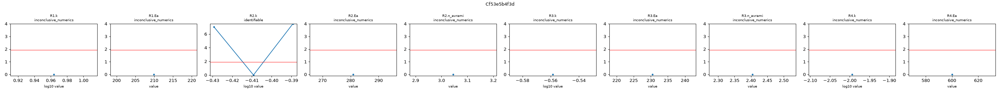
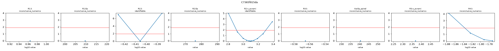
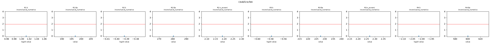
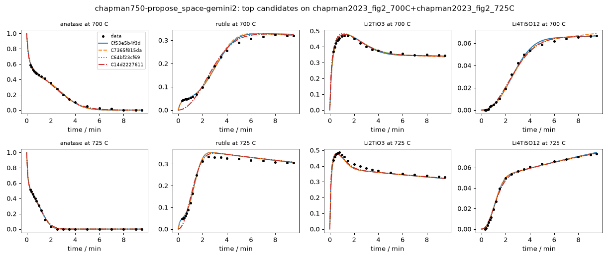

# Investigation report: chapman750-propose_space-gemini2

- Investigation: `chapman750`; arm: `propose_space`; phase: `final_evaluated`
- Protocol: `synthesis-mle-v1` (sha256 `c7b943a32f2c32b1`); manifest sha256 `1a596bdc5114f7b3`; evaluator code sha256 `4935f45a7126e490` ({'python': '3.12.13', 'numpy': '2.5.4', 'scipy': '1.18.1'})
- Development data: `chapman2023_fig2_700C+chapman2023_fig2_725C` (sha256 `c44c61ed445348bb`, digitized); 160 observations (joint fit of 2 experiments at T = [700.0, 725.0] C with one parameter vector)

## Question
Which reaction pathways and rate laws are supported by the in situ phase-fraction time courses of anatase TiO2 + Li2CO3 at 700 and 725 C (Hu, ..., Chapman, JACS 2023), what do these data leave ambiguous, and which feasible experiment would best separate the surviving pathways? Candidates are judged afterwards by how well they predict a reserved temperature without refitting.

## System boundary
A pellet of a 5:2 molar anatase TiO2 : Li2CO3 mix moved into a pre-heated hot zone (heating in under 10 s; t = 0 is insertion). Measured: anatase, rutile, Li2TiO3 and Li4Ti5O12, as Rietveld weight fractions of the crystalline solid from in situ X-ray scattering, converted here to mol of each phase per mol of total Ti. Not measured: Li2CO3 after about 30 s, CO2, amorphous or poorly crystalline material, and the Li content of the Li-Ti-O phases. The Ti fractions sum to 1 by construction (a normalised stack), so they cannot reveal unobserved Ti; lithium is not observed directly. Every model must conserve the elements it declares in mechanism.conservation, and every dataset initial species (anatase, Li2CO3) must appear in the model.

## Evidence status
- Partition: The 750 C panel of Fig. 2 is reserved. Development fits use 700 and 725 C jointly with one parameter vector (Arrhenius temperature dependence). The final evaluation is parameter transfer: each frozen candidate and every member of the declared reference space is fitted once on 700 + 725 C, then 750 C is predicted with those parameters (no refitting) and scored by its log-likelihood under the development noise estimate. No development-phase command, tool or evidence file reads the 750 C data; the authors' Avrami analysis, which used all temperatures, is withheld from the evidence and kept as an outside check on fitted exponents.
- Contamination: Retrospective analysis with literature-informed priors, not blind discovery: the proposer sees the 700 and 725 C runs and curated notes, and its pretraining may include this paper and general Li4Ti5O12 synthesis knowledge.

## Ranked candidates (development data, computed in code)

Delta aicc <= 2.0: not distinguished by these data; <= 4.0: still supported. Akaike weights are relative support within this candidate set (one weight per distinct dynamics) under the stated noise model, not probabilities that a mechanism is true. Residual correlation from misspecification makes these differences optimistic.

| candidate | name | source | v | k | AICc | dAICc | weight | band | adequacy | RMSE chapman2023_fig2_700C:Li2TiO3 | RMSE chapman2023_fig2_700C:Li4Ti5O12 | RMSE chapman2023_fig2_700C:anatase | RMSE chapman2023_fig2_700C:rutile | RMSE chapman2023_fig2_725C:Li2TiO3 | RMSE chapman2023_fig2_725C:Li4Ti5O12 | RMSE chapman2023_fig2_725C:anatase | RMSE chapman2023_fig2_725C:rutile | unobserved N end | in declared space | flags |
|---|---|---|---|---|---|---|---|---|---|---|---|---|---|---|---|---|---|---|---|
| Cf53e5b4f3d | c2_concomitant_rutile_per_step_Ea | agent | 1 | 14 | -1120.96 | 0.00 | 0.974 | indistinguishable_from_best | poor | 0.00877 | 0.00154 | 0.0124 | 0.00861 | 0.014 | 0.001 | 0.00964 | 0.0109 | 0 | no | R4.Ea at a protocol bound (600) |
| C7365f815da | c1_concomitant_rutile_tiedEa | agent | 1 | 13 | -1113.72 | 7.24 | 0.026 | less_supported | poor | 0.00936 | 0.00169 | 0.0126 | 0.00934 | 0.0145 | 0.00112 | 0.00946 | 0.0108 | 0 | no |  |
| C64bf23cf69 | enum-4aaa473de0 | agent_space | 1 | 14 | -1052.37 | 68.59 | 0.000 | less_supported | poor | 0.0136 | 0.00148 | 0.0125 | 0.0222 | 0.0128 | 0.0014 | 0.0105 | 0.0146 | 0 | no | R4.Ea at a protocol bound (600) |
| C14d2227611 | enum-22eb24f4e1 | agent_space | 1 | 15 | -1051.63 | 69.33 | 0.000 | less_supported | poor | 0.0119 | 0.0015 | 0.0128 | 0.0219 | 0.0133 | 0.00143 | 0.0106 | 0.0149 | 0 | no | R4.Ea at a protocol bound (600) |
| Ccfb959a619 | enum-fb981ab4df | agent_space | 1 | 15 | -1050.19 | 70.78 | 0.000 | less_supported | poor | 0.0137 | 0.00148 | 0.0124 | 0.0224 | 0.0128 | 0.0014 | 0.0102 | 0.0148 | 0 | no | R4.Ea at a protocol bound (600) |
| C319215e03e | enum-0f76a8d09c | agent_space | 1 | 16 | -1049.28 | 71.68 | 0.000 | less_supported | poor | 0.012 | 0.0015 | 0.0127 | 0.0221 | 0.0133 | 0.00143 | 0.0105 | 0.0149 | 0 | no | R4.Ea at a protocol bound (600) |
| C3a1637243d | c4_lumped_stoich_and_lidef_lto | agent | 1 | 13 | -1049.07 | 71.89 | 0.000 | less_supported | poor | 0.0159 | 0.00165 | 0.0114 | 0.0226 | 0.0135 | 0.00129 | 0.0101 | 0.0147 | 0 | no |  |
| C72c549087c | c3_tili_15625_tied_spinel_Ea | agent | 1 | 13 | -1043.91 | 77.05 | 0.000 | less_supported | poor | 0.016 | 0.00179 | 0.0114 | 0.0232 | 0.0136 | 0.00147 | 0.00952 | 0.0149 | 0 | no |  |
| C265d1dd0fc | enum-254e1aee7c | agent_space | 1 | 15 | -969.93 | 151.03 | 0.000 | less_supported | poor | 0.0122 | 0.00353 | 0.00841 | 0.0218 | 0.0217 | 0.00493 | 0.008 | 0.0177 | 0 | no | R4.Ea at a protocol bound (1.3e-26) |
| C38234656e1 | enum-6ca1cd0d0d | agent_space | 1 | 14 | -969.25 | 151.72 | 0.000 | less_supported | poor | 0.0141 | 0.00338 | 0.00874 | 0.0222 | 0.0214 | 0.00498 | 0.00789 | 0.0173 | 0 | no | R4.Ea at a protocol bound (1.14e-27) |
| Cbe3abcdfa4 | enum-1b15f2a075 | agent_space | 1 | 14 | -963.84 | 157.12 | 0.000 | less_supported | poor | 0.0097 | 0.00621 | 0.0106 | 0.0294 | 0.00868 | 0.00628 | 0.0053 | 0.0272 | 0 | no | R4.n_avrami at a protocol bound (0.3) |
| C44d8ec1fa7 | enum-2901ea63db | agent_space | 1 | 15 | -963.79 | 157.18 | 0.000 | less_supported | poor | 0.0121 | 0.00265 | 0.0131 | 0.0162 | 0.0186 | 0.0042 | 0.016 | 0.0167 | 0 | no |  |
| C1f0118b318 | enum-86d6631afc | agent_space | 1 | 16 | -962.87 | 158.10 | 0.000 | less_supported | poor | 0.0129 | 0.00249 | 0.0105 | 0.0194 | 0.0216 | 0.00456 | 0.0114 | 0.0168 | 0 | no | R2.k at a protocol bound (0.001) |
| C2632bcef61 | enum-5435f1307f | agent_space | 1 | 15 | -961.69 | 159.27 | 0.000 | less_supported | poor | 0.00989 | 0.00621 | 0.0103 | 0.0293 | 0.00886 | 0.0063 | 0.00533 | 0.0273 | 0 | no | R4.n_avrami at a protocol bound (0.3) |
| C84d35c81fb | enum-f3d003efa1 | agent_space | 1 | 15 | -961.53 | 159.44 | 0.000 | less_supported | poor | 0.0126 | 0.00251 | 0.0112 | 0.0195 | 0.0217 | 0.00453 | 0.0117 | 0.0172 | 0 | no | R2.k at a protocol bound (0.001) |
| Ccd4741f78b | enum-3dd419acf5 | agent_space | 1 | 12 | -961.49 | 159.47 | 0.000 | less_supported | poor | 0.0193 | 0.00249 | 0.00932 | 0.0204 | 0.0214 | 0.00472 | 0.0113 | 0.0169 | 0 | no |  |
| C8fed163e30 | enum-525e439ee4 | agent_space | 1 | 13 | -960.76 | 160.20 | 0.000 | less_supported | poor | 0.0173 | 0.00249 | 0.00946 | 0.02 | 0.0218 | 0.00466 | 0.0117 | 0.0172 | 0 | no |  |
| Cdcac19e196 | enum-2555230283 | agent_space | 1 | 14 | -957.26 | 163.71 | 0.000 | less_supported | poor | 0.0192 | 0.00253 | 0.00944 | 0.0202 | 0.0211 | 0.00473 | 0.0113 | 0.0168 | 0 | no | R4.Ea at a protocol bound (600) |
| C2645f99a8e | enum-88a40800fe | agent_space | 1 | 14 | -940.20 | 180.77 | 0.000 | less_supported | poor | 0.00978 | 0.00298 | 0.0215 | 0.0177 | 0.0132 | 0.0036 | 0.0285 | 0.02 | 0 | no | R1.n_avrami at a protocol bound (0.3) |
| C755e9e2358 | enum-5f1b319162 | agent_space | 1 | 13 | -918.03 | 202.93 | 0.000 | less_supported | poor | 0.011 | 0.00689 | 0.0107 | 0.031 | 0.0141 | 0.00811 | 0.00585 | 0.0296 | 0 | no |  |
| Cf2f9c7f9cf | enum-3a4135c6dc | agent_space | 1 | 14 | -915.53 | 205.44 | 0.000 | less_supported | poor | 0.011 | 0.00689 | 0.0106 | 0.0305 | 0.0142 | 0.00809 | 0.00649 | 0.029 | 0 | no |  |
| C8b4b45295e | enum-74efa798d4 | agent_space | 1 | 13 | -902.98 | 217.98 | 0.000 | less_supported | poor | 0.0137 | 0.00313 | 0.0297 | 0.0219 | 0.0133 | 0.00353 | 0.0317 | 0.0216 | 0 | no |  |
| Cc581e8bb81 | enum-30b81fcb4b | agent_space | 1 | 15 | -890.10 | 230.86 | 0.000 | less_supported | poor | 0.0198 | 0.00223 | 0.0178 | 0.0228 | 0.0304 | 0.00429 | 0.014 | 0.0246 | 0 | no | R1.n_avrami at a protocol bound (4) |
| Cabe329f3bb | enum-e3e02f8f36 | agent_space | 1 | 14 | -881.35 | 239.61 | 0.000 | less_supported | poor | 0.0208 | 0.00235 | 0.0183 | 0.0241 | 0.0319 | 0.00429 | 0.0147 | 0.0253 | 0 | no |  |
| C69563f2a7d | enum-1f2e86ac02 | agent_space | 1 | 15 | -853.97 | 266.99 | 0.000 | less_supported | poor | 0.0229 | 0.0105 | 0.0087 | 0.033 | 0.0192 | 0.00916 | 0.00637 | 0.0328 | 0 | no | R3.Ea at a protocol bound (1.49e-21); R3.n_avrami at a protocol bound (0.3) |

192 lower-ranked fitted candidates omitted here; `python -m nernstwork.cli compare --run chapman750-propose_space-gemini2` lists all of them.

## Candidates that were not fitted (recorded, with status)

- Ca1127bad47 `enum-565a8ef839` (agent_space): **nonconvergence** -- {"n_starts": 8, "n_starts_planned": 8, "n_finite": 8, "seed": 408241899819927074, "budget_exhausted": false, "max_ode_solves_per_fit": 200000, "max_rhs_evals": 20000, "nll_by_start": [-265.832099, -265.831902, -265.828451, -265.828931, -265.832203, -265.830215, -265.832076, -266.115196], "converged_
- Cc4a99fdc0d `enum-7e92792fd3` (agent_space): **nonconvergence** -- {"n_starts": 8, "n_starts_planned": 8, "n_finite": 8, "seed": 219291806147193576, "budget_exhausted": false, "max_ode_solves_per_fit": 200000, "max_rhs_evals": 20000, "nll_by_start": [-218.006335, -218.006147, -282.92917, -218.00636, -282.15418, -218.006442, -282.66525, -218.006366], "converged_by_s
- C139ec0085f `enum-2366ca3b6c` (agent_space): **nonconvergence** -- {"n_starts": 8, "n_starts_planned": 8, "n_finite": 8, "seed": 982306641649599482, "budget_exhausted": false, "max_ode_solves_per_fit": 200000, "max_rhs_evals": 20000, "nll_by_start": [-330.368824, -330.368828, -330.368831, -330.43019, -146.62228, -330.368832, -146.622277, -330.368834], "converged_by

## Top candidates in detail

### Cf53e5b4f3d `c2_concomitant_rutile_per_step_Ea` (source agent, version 1)

Rationale (proposer): Tests the same concomitant early rutile + Li-deficient Li1.5625TiO2.78125 mechanism as c1, but with untied per-step activation energies on all 4 reactions to test whether allowing distinct activation barriers for R3 (anatase + Li2-xTiO3) and R4 (rutile + Li2-xTiO3) is supported by the data.

    R1: 1.1 anatase + 0.781 Li2CO3 -> Li2TiO3 + 0.1 rutile [power_law, Arrhenius(T_ref 712 C)]; R1.k=9.2 (95% Wald 8.73-9.69, well_determined); R1.Ea=210 (95% Wald 177-243, well_determined)
    R2: anatase -> rutile [power_law, avrami(n), Arrhenius(T_ref 712 C)]; R2.k=0.39 (95% Wald 0.382-0.398, well_determined); R2.Ea=281 (95% Wald 271-291, well_determined); R2.n_avrami=3.04 (95% Wald 2.87-3.22, well_determined)
    R3: 2.56 Li2TiO3 + 2.44 anatase -> Li4Ti5O12 [power_law, avrami(n), Arrhenius(T_ref 712 C)]; R3.k=0.276 (95% Wald 0.266-0.288, well_determined); R3.Ea=231 (95% Wald 219-242, well_determined); R3.n_avrami=2.4 (95% Wald 2.26-2.55, well_determined)
    R4: 2.56 Li2TiO3 + 2.44 rutile -> Li4Ti5O12 [power_law, Arrhenius(T_ref 712 C)]; R4.k=0.0101 (95% Wald 0.00466-0.0221, moderately_determined); R4.Ea=600 (95% Wald 104-600, not_determined_locally)

- Support entries: {'literature': 3, 'data': 4, 'speculative': 0}; reactions without support: []
  - R1: literature -- Hu et al., J. Am. Chem. Soc. 145 (2023) 26545-26549, abstract, Fig. 2 and main text [C3, C5, C6, C7] Rapid initial reaction of anatase TiO2 with Li2CO3 (depleted within ~30 s) forming Li-deficient Li2-xTiO3.
  - R2: literature -- Hu et al., J. Am. Chem. Soc. 145 (2023) 26545-26549, Fig. 2 and main text [C3]; Shen et al., Chem. Mater. 26 (2014) 3679-3686, abstract [S2] Parallel anatase-to-rutile polymorphic transformation.
  - R2.time_modulation: data -- chapman2023_fig2_700C and chapman2023_fig2_725C, rutile channel Sigmoidal nucleation-and-growth trajectory of rutile between 0.6 and 5 min.
  - R3: literature -- Shen et al., Chem. Mater. 26 (2014) 3679-3686, abstract [S1]; Hu et al., J. Am. Chem. Soc. 145 (2023) 26545-26549, Fig. 2 [C3] Secondary solid-state reaction of Li2-xTiO3 with anatase TiO2 to form spinel Li4Ti5O12.
  - R3.time_modulation: data -- chapman2023_fig2_700C and chapman2023_fig2_725C, Li4Ti5O12 channel Delayed sigmoidal onset of Li4Ti5O12 formation.
  - R4: data -- chapman2023_fig2_725C, t = 2.5-9.5 min, anatase, rutile, Li2TiO3, and Li4Ti5O12 channels Continued growth of Li4Ti5O12 accompanied by simultaneous consumption of rutile and Li2TiO3 after anatase is exhausted at t = 2.5 min at 725 C.
  - R1: data -- chapman2023_fig2_700C and chapman2023_fig2_725C, t = 0.3-0.8 min, rutile and Li2TiO3 channels Concomitant ~0.045 mol/mol Ti rutile present alongside Li2TiO3 at t = 0.3-0.8 min.
- Assumptions (proposer): ['Li2-xTiO3 has effective composition Li1.5625TiO2.78125 (x = 0.4375), conserving both Ti and Li.', 'Each of the 4 steps has an independent Arrhenius activation energy Ea.']
- sigma (profiled): anatase=0.0111, rutile=0.00985, Li2TiO3=0.0117, Li4Ti5O12=0.002; adequacy: poor ['chapman2023_fig2_700C:anatase: residual signs cluster (runs test p=0.007)', 'chapman2023_fig2_700C:anatase: residuals are serially correlated (lag-1 r=0.65)', 'chapman2023_fig2_700C:rutile: residual signs cluster (runs test p=0.002)', 'chapman2023_fig2_700C:rutile: residuals are serially correlated (lag-1 r=0.75)', 'chapman2023_fig2_700C:Li2TiO3: residual signs cluster (runs test p=0.000)', 'chapman2023_fig2_700C:Li2TiO3: residuals are serially correlated (lag-1 r=0.81)', 'chapman2023_fig2_700C:Li4Ti5O12: residual signs cluster (runs test p=0.027)', 'chapman2023_fig2_700C:Li4Ti5O12: residuals are serially correlated (lag-1 r=0.65)', 'chapman2023_fig2_725C:anatase: residual signs cluster (runs test p=0.000)', 'chapman2023_fig2_725C:anatase: residuals are serially correlated (lag-1 r=0.62)', 'chapman2023_fig2_725C:rutile: residuals are serially correlated (lag-1 r=0.52)', 'chapman2023_fig2_725C:Li2TiO3: residuals are serially correlated (lag-1 r=0.90)', 'chapman2023_fig2_725C:Li4Ti5O12: residual signs cluster (runs test p=0.015)', 'chapman2023_fig2_725C:Li4Ti5O12: residuals are serially correlated (lag-1 r=0.64)']
- Locally unidentifiable combinations: [{'eigenvalue_rel': 3.449209096199582e-11, 'combination': {'R4.Ea': 1.0}}, {'eigenvalue_rel': 7.695977731945923e-09, 'combination': {'R1.Ea': 1.0}}, {'eigenvalue_rel': 5.902103170825916e-08, 'combination': {'R2.Ea': -0.636, 'R3.Ea': -0.772}}, {'eigenvalue_rel': 2.312746061379178e-07, 'combination': {'R2.Ea': -0.771, 'R3.Ea': 0.636}}]
- Profile likelihood: R1.k: inconclusive_numerics (95% 9.2-9.2); R1.Ea: inconclusive_numerics (95% 210-210); R2.k: identifiable (95% 0.385-0.394); R2.Ea: inconclusive_numerics (95% 281-281); R2.n_avrami: inconclusive_numerics (95% 3.04-3.04); R3.k: inconclusive_numerics (95% 0.276-0.276); R3.Ea: inconclusive_numerics (95% 231-231); R3.n_avrami: inconclusive_numerics (95% 2.4-2.4); R4.k: inconclusive_numerics (95% 0.0101-0.0101); R4.Ea: inconclusive_numerics (95% 600-600)
  

### C7365f815da `c1_concomitant_rutile_tiedEa` (source agent, version 1)

Rationale (proposer): Tests whether the initial ~0.041-0.048 mol/mol Ti rutile plateau at t = 0.3-0.8 min is formed concomitantly during the fast initial anatase + Li2CO3 reaction (~1:10 rutile:Li2-xTiO3), while tying Ea across the anatase and rutile spinel-forming reactions (R3 and R4) so all 9 kinetic parameters are well-determined for temperature transfer.

    R1: 1.1 anatase + 0.781 Li2CO3 -> Li2TiO3 + 0.1 rutile [power_law, Arrhenius(T_ref 712 C)]; R1.k=9.21 (95% Wald 8.73-9.72, well_determined); R1.Ea=210 (95% Wald 176-244, well_determined)
    R2: anatase -> rutile [power_law, avrami(n), Arrhenius(T_ref 712 C)]; R2.k=0.393 (95% Wald 0.386-0.401, well_determined); R2.Ea=276 (95% Wald 267-285, well_determined); R2.n_avrami=3.09 (95% Wald 2.91-3.28, well_determined)
    R3: 2.56 Li2TiO3 + 2.44 anatase -> Li4Ti5O12 [power_law, avrami(n), Arrhenius(T_ref 712 C)]; R3.k=0.272 (95% Wald 0.262-0.283, well_determined); R3.n_avrami=2.37 (95% Wald 2.23-2.51, well_determined)
    R4: 2.56 Li2TiO3 + 2.44 rutile -> Li4Ti5O12 [power_law, Arrhenius(T_ref 712 C)]; R4.k=0.0169 (95% Wald 0.0147-0.0195, well_determined)
    shared: tie:Ea_spinel=240 (95% Wald 231-250, well_determined)

- Support entries: {'literature': 3, 'data': 4, 'speculative': 0}; reactions without support: []
  - R1: literature -- Hu et al., J. Am. Chem. Soc. 145 (2023) 26545-26549, abstract, Fig. 2 and main text [C3, C5, C6, C7] Rapid initial reaction of anatase TiO2 with Li2CO3 (depleted within ~30 s) forming Li-deficient Li2-xTiO3.
  - R2: literature -- Hu et al., J. Am. Chem. Soc. 145 (2023) 26545-26549, Fig. 2 and main text [C3]; Shen et al., Chem. Mater. 26 (2014) 3679-3686, abstract [S2] Parallel anatase-to-rutile polymorphic transformation.
  - R2.time_modulation: data -- chapman2023_fig2_700C and chapman2023_fig2_725C, rutile channel Sigmoidal nucleation-and-growth trajectory of rutile between 0.6 and 5 min.
  - R3: literature -- Shen et al., Chem. Mater. 26 (2014) 3679-3686, abstract [S1]; Hu et al., J. Am. Chem. Soc. 145 (2023) 26545-26549, Fig. 2 [C3] Secondary solid-state reaction of Li2-xTiO3 with anatase TiO2 to form spinel Li4Ti5O12.
  - R3.time_modulation: data -- chapman2023_fig2_700C and chapman2023_fig2_725C, Li4Ti5O12 channel Delayed sigmoidal onset of Li4Ti5O12 formation.
  - R4: data -- chapman2023_fig2_725C, t = 2.5-9.5 min, anatase, rutile, Li2TiO3, and Li4Ti5O12 channels Continued growth of Li4Ti5O12 accompanied by simultaneous consumption of rutile and Li2TiO3 after anatase is exhausted at t = 2.5 min at 725 C.
  - R1: data -- chapman2023_fig2_700C and chapman2023_fig2_725C, t = 0.3-0.8 min, rutile and Li2TiO3 channels Rutile/Li2TiO3 ratio is ~0.108-0.111 at t = 0.3-0.8 min at both 700 and 725 C before bulk sigmoidal anatase -> rutile begins.
- Assumptions (proposer): ['Li2-xTiO3 has effective composition Li1.5625TiO2.78125 (x = 0.4375), conserving both Ti and Li across the reaction network.', 'Approximately 9% of reacting anatase transforms to rutile concomitantly during the rapid initial reaction with Li2CO3.', 'The solid-state reactions of Li2-xTiO3 with anatase (R3) and rutile (R4) share a common activation energy Ea_spinel.']
- sigma (profiled): anatase=0.0112, rutile=0.0101, Li2TiO3=0.0122, Li4Ti5O12=0.002; adequacy: poor ['chapman2023_fig2_700C:anatase: residual signs cluster (runs test p=0.007)', 'chapman2023_fig2_700C:anatase: residuals are serially correlated (lag-1 r=0.65)', 'chapman2023_fig2_700C:rutile: residual signs cluster (runs test p=0.002)', 'chapman2023_fig2_700C:rutile: residuals are serially correlated (lag-1 r=0.75)', 'chapman2023_fig2_700C:Li2TiO3: residual signs cluster (runs test p=0.000)', 'chapman2023_fig2_700C:Li2TiO3: residuals are serially correlated (lag-1 r=0.83)', 'chapman2023_fig2_700C:Li4Ti5O12: residual signs cluster (runs test p=0.010)', 'chapman2023_fig2_700C:Li4Ti5O12: residuals are serially correlated (lag-1 r=0.72)', 'chapman2023_fig2_725C:anatase: residual signs cluster (runs test p=0.000)', 'chapman2023_fig2_725C:anatase: residuals are serially correlated (lag-1 r=0.61)', 'chapman2023_fig2_725C:rutile: residuals are serially correlated (lag-1 r=0.55)', 'chapman2023_fig2_725C:Li2TiO3: residuals are serially correlated (lag-1 r=0.90)', 'chapman2023_fig2_725C:Li4Ti5O12: residual signs cluster (runs test p=0.007)', 'chapman2023_fig2_725C:Li4Ti5O12: residuals are serially correlated (lag-1 r=0.73)']
- Locally unidentifiable combinations: [{'eigenvalue_rel': 8.129081316817525e-09, 'combination': {'R1.Ea': -1.0}}, {'eigenvalue_rel': 6.593768243759074e-08, 'combination': {'R2.Ea': 0.696, 'tie:Ea_spinel': 0.718}}, {'eigenvalue_rel': 3.429672865664763e-07, 'combination': {'R2.Ea': -0.718, 'tie:Ea_spinel': 0.696}}]
- Profile likelihood: R1.k: inconclusive_numerics (95% 9.21-9.21); R1.Ea: inconclusive_numerics (95% 210-210); R2.k: identifiable (95% 0.388-0.398); R2.Ea: inconclusive_numerics (95% 276-276); R2.n_avrami: identifiable (95% 2.91-3.3); R3.k: inconclusive_numerics (95% 0.272-0.272); tie:Ea_spinel: inconclusive_numerics (95% 240-240); R3.n_avrami: inconclusive_numerics (95% 2.37-2.37); R4.k: inconclusive_numerics (95% 0.0146-0.0169)
  

### C64bf23cf69 `enum-4aaa473de0` (source agent_space, version 1)

Rationale (proposer): enumerated: S1_ana_lto:first_order,S2_ana_rut:avrami,S3_lto_ana_spinel:avrami,S4_lto_rut_spinel:first_order | space tili-nonstoich-pathways-v1

    R1: anatase + 0.781 Li2CO3 -> Li2TiO3 [power_law, Arrhenius(T_ref 712 C)]; R1.k=10.3 (95% Wald 9.57-11, well_determined); R1.Ea=197 (95% Wald 152-241, well_determined)
    R2: anatase -> rutile [power_law, avrami(n), Arrhenius(T_ref 712 C)]; R2.k=0.406 (95% Wald 0.396-0.416, well_determined); R2.Ea=280 (95% Wald 267-293, well_determined); R2.n_avrami=2.19 (95% Wald 2.06-2.32, well_determined)
    R3: 2.56 Li2TiO3 + 2.44 anatase -> Li4Ti5O12 [power_law, avrami(n), Arrhenius(T_ref 712 C)]; R3.k=0.264 (95% Wald 0.252-0.277, well_determined); R3.Ea=228 (95% Wald 215-240, well_determined); R3.n_avrami=2.27 (95% Wald 2.13-2.41, well_determined)
    R4: 2.56 Li2TiO3 + 2.44 rutile -> Li4Ti5O12 [power_law, Arrhenius(T_ref 712 C)]; R4.k=0.00968 (95% Wald 0.00372-0.0252, moderately_determined); R4.Ea=600 (95% Wald 0-600, not_determined_locally)

- Support entries: {'literature': 3, 'data': 4, 'speculative': 0}; reactions without support: []
  - R1: literature -- Hu et al., J. Am. Chem. Soc. 145 (2023) 26545-26549, abstract, Fig. 2 legend and main text [C3, C5, C6, C7]; Shen et al., Chem. Mater. 26 (2014) 3679-3686, abstract [S1] Fast initial reaction of anatase TiO2 with Li2CO3 (consumed within ~30 s) to form Li-deficient non-stoichiometric Li2-xTiO3, allowing the intermediate to reach the observed 0.47-0.49 mol/mol Ti peak from 0.40 mol Li2CO3.
  - R1: data -- chapman2023_fig2_700C and chapman2023_fig2_725C, Li2TiO3 and Li4Ti5O12 channels Conservation of 0.8 Li/Ti across Li2-xTiO3 and Li4Ti5O12 after Li2CO3 exhaustion implies Li/Ti = 1.54-1.56 in Li2-xTiO3.
  - R2: literature -- Hu et al., J. Am. Chem. Soc. 145 (2023) 26545-26549, Fig. 2 legend and main text [C3]; Shen et al., Chem. Mater. 26 (2014) 3679-3686, abstract [S2] Parallel polymorphic transformation of anatase TiO2 to rutile TiO2.
  - R2: data -- chapman2023_fig2_700C and chapman2023_fig2_725C, rutile channel Sigmoidal rise of rutile from ~0.04 to ~0.32-0.33 mol/mol Ti between 0.6 and 5 min strongly motivates testing JMAK/Avrami nucleation-and-growth alongside first-order kinetics.
  - R3: literature -- Shen et al., Chem. Mater. 26 (2014) 3679-3686, abstract [S1]; Hu et al., J. Am. Chem. Soc. 145 (2023) 26545-26549, Fig. 2 and main text [C3] Two-stage formation of spinel Li4Ti5O12 via reaction of intermediate Li2-xTiO3 with remaining anatase TiO2.
  - R3: data -- chapman2023_fig2_700C (t = 0.5-7.0 min) and chapman2023_fig2_725C (t = 0.4-2.5 min), Li2TiO3, anatase, and Li4Ti5O12 channels Simultaneous consumption of Li2TiO3 and anatase during the main sigmoidal growth phase of Li4Ti5O12.
  - R4: data -- chapman2023_fig2_725C, t = 2.5-9.5 min, anatase, rutile, Li2TiO3, and Li4Ti5O12 channels After anatase reaches 0.000 at t = 2.5 min at 725 C, Li4Ti5O12 continues growing from 0.0535 to 0.0732 mol/mol Ti (+0.0986 Ti) while rutile decreases from 0.3327 to 0.3046 (-0.0281 Ti) and Li2TiO3 decreases from 0.3998 to 0.3292 (-0.0706 Ti).
- sigma (profiled): anatase=0.0115, rutile=0.0188, Li2TiO3=0.0132, Li4Ti5O12=0.002; adequacy: poor ['chapman2023_fig2_700C:anatase: residual signs cluster (runs test p=0.010)', 'chapman2023_fig2_700C:anatase: residuals are serially correlated (lag-1 r=0.83)', 'chapman2023_fig2_700C:rutile: residual signs cluster (runs test p=0.000)', 'chapman2023_fig2_700C:rutile: residuals are serially correlated (lag-1 r=0.97)', 'chapman2023_fig2_700C:Li2TiO3: residual signs cluster (runs test p=0.000)', 'chapman2023_fig2_700C:Li2TiO3: residuals are serially correlated (lag-1 r=0.90)', 'chapman2023_fig2_700C:Li4Ti5O12: residual signs cluster (runs test p=0.037)', 'chapman2023_fig2_700C:Li4Ti5O12: residuals are serially correlated (lag-1 r=0.61)', 'chapman2023_fig2_725C:anatase: residual signs cluster (runs test p=0.001)', 'chapman2023_fig2_725C:anatase: residuals are serially correlated (lag-1 r=0.53)', 'chapman2023_fig2_725C:rutile: residual signs cluster (runs test p=0.005)', 'chapman2023_fig2_725C:rutile: residuals are serially correlated (lag-1 r=0.84)', 'chapman2023_fig2_725C:Li2TiO3: residual signs cluster (runs test p=0.000)', 'chapman2023_fig2_725C:Li2TiO3: residuals are serially correlated (lag-1 r=0.93)', 'chapman2023_fig2_725C:Li4Ti5O12: residual signs cluster (runs test p=0.000)', 'chapman2023_fig2_725C:Li4Ti5O12: residuals are serially correlated (lag-1 r=0.75)']
- Locally unidentifiable combinations: [{'eigenvalue_rel': 3.258956133590387e-11, 'combination': {'R4.Ea': 1.0}}, {'eigenvalue_rel': 6.065600348959919e-09, 'combination': {'R1.Ea': -1.0}}, {'eigenvalue_rel': 5.994221250689722e-08, 'combination': {'R2.Ea': -0.723, 'R3.Ea': -0.691}}, {'eigenvalue_rel': 2.248348561137968e-07, 'combination': {'R2.Ea': 0.691, 'R3.Ea': -0.723}}]
- Profile likelihood: R1.k: inconclusive_numerics (95% 10.3-10.3); R1.Ea: inconclusive_numerics (95% 197-197); R2.k: inconclusive_numerics (95% 0.406-0.406); R2.Ea: inconclusive_numerics (95% 280-280); R2.n_avrami: inconclusive_numerics (95% 2.19-2.19); R3.k: inconclusive_numerics (95% 0.264-0.264); R3.Ea: inconclusive_numerics (95% 228-228); R3.n_avrami: inconclusive_numerics (95% 2.27-2.27); R4.k: inconclusive_numerics (95% 0.00968-0.00968); R4.Ea: inconclusive_numerics (95% 600-600)
  

### C14d2227611 `enum-22eb24f4e1` (source agent_space, version 1)

Rationale (proposer): enumerated: S1_ana_lto:avrami,S2_ana_rut:avrami,S3_lto_ana_spinel:avrami,S4_lto_rut_spinel:first_order | space tili-nonstoich-pathways-v1

    R1: anatase + 0.781 Li2CO3 -> Li2TiO3 [power_law, avrami(n), Arrhenius(T_ref 712 C)]; R1.k=12.1 (95% Wald 9.17-16, well_determined); R1.Ea=220 (95% Wald 166-275, well_determined); R1.n_avrami=0.896 (95% Wald 0.747-1.05, well_determined)
    R2: anatase -> rutile [power_law, avrami(n), Arrhenius(T_ref 712 C)]; R2.k=0.405 (95% Wald 0.395-0.416, well_determined); R2.Ea=280 (95% Wald 267-293, well_determined); R2.n_avrami=2.16 (95% Wald 2.03-2.29, well_determined)
    R3: 2.56 Li2TiO3 + 2.44 anatase -> Li4Ti5O12 [power_law, avrami(n), Arrhenius(T_ref 712 C)]; R3.k=0.264 (95% Wald 0.252-0.276, well_determined); R3.Ea=226 (95% Wald 214-239, well_determined); R3.n_avrami=2.26 (95% Wald 2.13-2.4, well_determined)
    R4: 2.56 Li2TiO3 + 2.44 rutile -> Li4Ti5O12 [power_law, Arrhenius(T_ref 712 C)]; R4.k=0.00964 (95% Wald 0.00367-0.0253, moderately_determined); R4.Ea=600 (95% Wald 0-600, not_determined_locally)

- Support entries: {'literature': 3, 'data': 4, 'speculative': 0}; reactions without support: []
  - R1: literature -- Hu et al., J. Am. Chem. Soc. 145 (2023) 26545-26549, abstract, Fig. 2 legend and main text [C3, C5, C6, C7]; Shen et al., Chem. Mater. 26 (2014) 3679-3686, abstract [S1] Fast initial reaction of anatase TiO2 with Li2CO3 (consumed within ~30 s) to form Li-deficient non-stoichiometric Li2-xTiO3, allowing the intermediate to reach the observed 0.47-0.49 mol/mol Ti peak from 0.40 mol Li2CO3.
  - R1: data -- chapman2023_fig2_700C and chapman2023_fig2_725C, Li2TiO3 and Li4Ti5O12 channels Conservation of 0.8 Li/Ti across Li2-xTiO3 and Li4Ti5O12 after Li2CO3 exhaustion implies Li/Ti = 1.54-1.56 in Li2-xTiO3.
  - R2: literature -- Hu et al., J. Am. Chem. Soc. 145 (2023) 26545-26549, Fig. 2 legend and main text [C3]; Shen et al., Chem. Mater. 26 (2014) 3679-3686, abstract [S2] Parallel polymorphic transformation of anatase TiO2 to rutile TiO2.
  - R2: data -- chapman2023_fig2_700C and chapman2023_fig2_725C, rutile channel Sigmoidal rise of rutile from ~0.04 to ~0.32-0.33 mol/mol Ti between 0.6 and 5 min strongly motivates testing JMAK/Avrami nucleation-and-growth alongside first-order kinetics.
  - R3: literature -- Shen et al., Chem. Mater. 26 (2014) 3679-3686, abstract [S1]; Hu et al., J. Am. Chem. Soc. 145 (2023) 26545-26549, Fig. 2 and main text [C3] Two-stage formation of spinel Li4Ti5O12 via reaction of intermediate Li2-xTiO3 with remaining anatase TiO2.
  - R3: data -- chapman2023_fig2_700C (t = 0.5-7.0 min) and chapman2023_fig2_725C (t = 0.4-2.5 min), Li2TiO3, anatase, and Li4Ti5O12 channels Simultaneous consumption of Li2TiO3 and anatase during the main sigmoidal growth phase of Li4Ti5O12.
  - R4: data -- chapman2023_fig2_725C, t = 2.5-9.5 min, anatase, rutile, Li2TiO3, and Li4Ti5O12 channels After anatase reaches 0.000 at t = 2.5 min at 725 C, Li4Ti5O12 continues growing from 0.0535 to 0.0732 mol/mol Ti (+0.0986 Ti) while rutile decreases from 0.3327 to 0.3046 (-0.0281 Ti) and Li2TiO3 decreases from 0.3998 to 0.3292 (-0.0706 Ti).
- sigma (profiled): anatase=0.0118, rutile=0.0187, Li2TiO3=0.0126, Li4Ti5O12=0.002; adequacy: poor ['chapman2023_fig2_700C:anatase: residual signs cluster (runs test p=0.010)', 'chapman2023_fig2_700C:anatase: residuals are serially correlated (lag-1 r=0.84)', 'chapman2023_fig2_700C:rutile: residual signs cluster (runs test p=0.000)', 'chapman2023_fig2_700C:rutile: residuals are serially correlated (lag-1 r=0.97)', 'chapman2023_fig2_700C:Li2TiO3: residual signs cluster (runs test p=0.000)', 'chapman2023_fig2_700C:Li2TiO3: residuals are serially correlated (lag-1 r=0.91)', 'chapman2023_fig2_700C:Li4Ti5O12: residual signs cluster (runs test p=0.037)', 'chapman2023_fig2_700C:Li4Ti5O12: residuals are serially correlated (lag-1 r=0.61)', 'chapman2023_fig2_725C:anatase: residual signs cluster (runs test p=0.001)', 'chapman2023_fig2_725C:anatase: residuals are serially correlated (lag-1 r=0.55)', 'chapman2023_fig2_725C:rutile: residual signs cluster (runs test p=0.005)', 'chapman2023_fig2_725C:rutile: residuals are serially correlated (lag-1 r=0.83)', 'chapman2023_fig2_725C:Li2TiO3: residual signs cluster (runs test p=0.000)', 'chapman2023_fig2_725C:Li2TiO3: residuals are serially correlated (lag-1 r=0.93)', 'chapman2023_fig2_725C:Li4Ti5O12: residual signs cluster (runs test p=0.000)', 'chapman2023_fig2_725C:Li4Ti5O12: residuals are serially correlated (lag-1 r=0.75)']
- Locally unidentifiable combinations: [{'eigenvalue_rel': 3.2042609896615756e-11, 'combination': {'R4.Ea': 1.0}}, {'eigenvalue_rel': 4.031300259866771e-09, 'combination': {'R1.Ea': 1.0}}, {'eigenvalue_rel': 5.8370093848503396e-08, 'combination': {'R2.Ea': -0.728, 'R3.Ea': -0.686}}, {'eigenvalue_rel': 2.2364875400702937e-07, 'combination': {'R2.Ea': -0.686, 'R3.Ea': 0.727}}]
- Profile likelihood: not computed (identifiability beyond the local Fisher screen is unassessed)

## Experiment plan (plan-2.json, the last of 2)

For every candidate design (temperature, initial amounts, sampling times, measured phases) each surviving model predicts the measured channels with its development MLE. Designs are scored by the pairwise discrimination criterion of Buzzi-Ferraris and Forzatti (1983), weighted by the models' Akaike weights:

Models (equal (models chosen by hand)): Cf53e5b4f3d (AICc -1120.96, w 0.125), C7365f815da (AICc -1113.72, w 0.125), C64bf23cf69 (AICc -1052.37, w 0.125), C14d2227611 (AICc -1051.63, w 0.125), Ccfb959a619 (AICc -1050.19, w 0.125), C319215e03e (AICc -1049.28, w 0.125), C3a1637243d (AICc -1049.07, w 0.125), C72c549087c (AICc -1043.91, w 0.125)

| design | U | bounded score | separable pairs |
|---|---|---|---|
| T800C_standard | 242 | 6.94 | 15/28 |
| Li2TiO3_rutile_mix_T750C | 125 | 6.28 | 17/28 |
| T775C_standard | 99.1 | 5.46 | 9/28 |
| Li2CO3_x0.5_T725C | 52.2 | 4.28 | 7/28 |
| Li2CO3_x1.5_T725C | 27.5 | 3.92 | 7/28 |
| T750C_standard | 24.9 | 4.16 | 9/28 |
| Li2TiO3_rutile_mix_T725C | 23.7 | 3.45 | 7/28 |
| T700C_dense_early | 7.88 | 2.23 | 0/28 |

## Discrimination analysis (discrimination-1.json)

A design is {"name", "c0" (or "c0_mM_N"): {...}, "t_end_min", optional "temperature_C", optional "observe": [species
    ids to measure]}. Predictions use each candidate's development MLE; parameter uncertainty is not propagated, so large
    disagreement is a lead for an experiment, not a quantified expected information gain (see plan_experiments).

- Design `T800C_standard` {"temperature_C": 800, "t_end_min": 9.5, "c0": {"anatase": 1, "Li2CO3": 0.4}, "name": "T800C_standard"}:
  - Li2TiO3: max spread 0.285 at 1.29 min (24.4 dev sigma); {'Cf53e5b4f3d': 0.07, 'C7365f815da': 0.35, 'C64bf23cf69': 0.07, 'C14d2227611': 0.07, 'C3a1637243d': 0.35, 'C72c549087c': 0.35}
  - rutile: max spread 0.272 at 1.29 min (27.6 dev sigma); {'Cf53e5b4f3d': 0.08, 'C7365f815da': 0.35, 'C64bf23cf69': 0.08, 'C14d2227611': 0.08, 'C3a1637243d': 0.35, 'C72c549087c': 0.35}
  - Li4Ti5O12: max spread 0.111 at 1.29 min (55.6 dev sigma); {'Cf53e5b4f3d': 0.17, 'C7365f815da': 0.06, 'C64bf23cf69': 0.17, 'C14d2227611': 0.17, 'C3a1637243d': 0.06, 'C72c549087c': 0.06}
  - anatase: max spread 0.0343 at 0.0477 min (3.09 dev sigma); {'Cf53e5b4f3d': 0.51, 'C7365f815da': 0.51, 'C64bf23cf69': 0.52, 'C14d2227611': 0.49, 'C3a1637243d': 0.53, 'C72c549087c': 0.52}
  - unmeasured_Ti_total: max spread 0 at 0 min (- dev sigma); {'Cf53e5b4f3d': 0.0, 'C7365f815da': 0.0, 'C64bf23cf69': 0.0, 'C14d2227611': 0.0, 'C3a1637243d': 0.0, 'C72c549087c': 0.0}
- Design `T775C_standard` {"name": "T775C_standard", "temperature_C": 775, "c0": {"Li2CO3": 0.4, "anatase": 1}, "t_end_min": 9.5}:
  - Li2TiO3: max spread 0.209 at 4.49 min (17.9 dev sigma); {'Cf53e5b4f3d': 0.09, 'C7365f815da': 0.29, 'C64bf23cf69': 0.09, 'C14d2227611': 0.1, 'C3a1637243d': 0.3, 'C72c549087c': 0.3}
  - rutile: max spread 0.199 at 4.49 min (20.2 dev sigma); {'Cf53e5b4f3d': 0.09, 'C7365f815da': 0.29, 'C64bf23cf69': 0.1, 'C14d2227611': 0.1, 'C3a1637243d': 0.29, 'C72c549087c': 0.29}
  - Li4Ti5O12: max spread 0.0815 at 4.49 min (40.7 dev sigma); {'Cf53e5b4f3d': 0.16, 'C7365f815da': 0.08, 'C64bf23cf69': 0.16, 'C14d2227611': 0.16, 'C3a1637243d': 0.08, 'C72c549087c': 0.08}
  - anatase: max spread 0.0408 at 0.0477 min (3.67 dev sigma); {'Cf53e5b4f3d': 0.61, 'C7365f815da': 0.61, 'C64bf23cf69': 0.63, 'C14d2227611': 0.59, 'C3a1637243d': 0.63, 'C72c549087c': 0.63}
  - unmeasured_Ti_total: max spread 0 at 0 min (- dev sigma); {'Cf53e5b4f3d': 0.0, 'C7365f815da': 0.0, 'C64bf23cf69': 0.0, 'C14d2227611': 0.0, 'C3a1637243d': 0.0, 'C72c549087c': 0.0}
- Design `T750C_standard` {"c0": {"Li2CO3": 0.4, "anatase": 1}, "temperature_C": 750, "t_end_min": 9.5, "name": "T750C_standard"}:
  - Li2TiO3: max spread 0.113 at 9.5 min (9.71 dev sigma); {'Cf53e5b4f3d': 0.17, 'C7365f815da': 0.28, 'C64bf23cf69': 0.18, 'C14d2227611': 0.18, 'C3a1637243d': 0.29, 'C72c549087c': 0.28}
  - rutile: max spread 0.107 at 9.5 min (10.9 dev sigma); {'Cf53e5b4f3d': 0.17, 'C7365f815da': 0.27, 'C64bf23cf69': 0.17, 'C14d2227611': 0.17, 'C3a1637243d': 0.28, 'C72c549087c': 0.27}
  - Li4Ti5O12: max spread 0.0441 at 9.5 min (22 dev sigma); {'Cf53e5b4f3d': 0.13, 'C7365f815da': 0.09, 'C64bf23cf69': 0.13, 'C14d2227611': 0.13, 'C3a1637243d': 0.09, 'C72c549087c': 0.09}
  - anatase: max spread 0.0392 at 0.0477 min (3.52 dev sigma); {'Cf53e5b4f3d': 0.71, 'C7365f815da': 0.71, 'C64bf23cf69': 0.72, 'C14d2227611': 0.69, 'C3a1637243d': 0.73, 'C72c549087c': 0.72}
  - unmeasured_Ti_total: max spread 0 at 0 min (- dev sigma); {'Cf53e5b4f3d': 0.0, 'C7365f815da': 0.0, 'C64bf23cf69': 0.0, 'C14d2227611': 0.0, 'C3a1637243d': 0.0, 'C72c549087c': 0.0}
- Design `Li2CO3_x0.5_T725C` {"t_end_min": 9.5, "c0": {"anatase": 1, "Li2CO3": 0.2}, "temperature_C": 725, "name": "Li2CO3_x0.5_T725C"}:
  - rutile: max spread 0.0675 at 1.15 min (6.86 dev sigma); {'Cf53e5b4f3d': 0.21, 'C7365f815da': 0.21, 'C64bf23cf69': 0.27, 'C14d2227611': 0.27, 'C3a1637243d': 0.28, 'C72c549087c': 0.27}
  - anatase: max spread 0.0614 at 1.05 min (5.52 dev sigma); {'Cf53e5b4f3d': 0.53, 'C7365f815da': 0.53, 'C64bf23cf69': 0.47, 'C14d2227611': 0.47, 'C3a1637243d': 0.48, 'C72c549087c': 0.47}
  - Li2TiO3: max spread 0.0566 at 9.5 min (4.84 dev sigma); {'Cf53e5b4f3d': 0.11, 'C7365f815da': 0.11, 'C64bf23cf69': 0.11, 'C14d2227611': 0.11, 'C3a1637243d': 0.16, 'C72c549087c': 0.11}
  - Li4Ti5O12: max spread 0.0221 at 9.5 min (11 dev sigma); {'Cf53e5b4f3d': 0.06, 'C7365f815da': 0.06, 'C64bf23cf69': 0.06, 'C14d2227611': 0.06, 'C3a1637243d': 0.04, 'C72c549087c': 0.06}
  - unmeasured_Ti_total: max spread 0 at 0 min (- dev sigma); {'Cf53e5b4f3d': 0.0, 'C7365f815da': 0.0, 'C64bf23cf69': 0.0, 'C14d2227611': 0.0, 'C3a1637243d': 0.0, 'C72c549087c': 0.0}
- Design `Li2TiO3_rutile_mix_T750C` {"temperature_C": 750, "name": "Li2TiO3_rutile_mix_T750C", "c0": {"Li2TiO3": 0.5, "rutile": 0.5}, "t_end_min": 9.5}:
  - Li2TiO3: max spread 0.327 at 9.5 min (28 dev sigma); {'Cf53e5b4f3d': 0.17, 'C7365f815da': 0.31, 'C64bf23cf69': 0.18, 'C14d2227611': 0.18, 'C3a1637243d': 0.5, 'C72c549087c': 0.32}
  - rutile: max spread 0.311 at 9.5 min (31.6 dev sigma); {'Cf53e5b4f3d': 0.19, 'C7365f815da': 0.32, 'C64bf23cf69': 0.19, 'C14d2227611': 0.19, 'C3a1637243d': 0.5, 'C72c549087c': 0.33}
  - Li4Ti5O12: max spread 0.128 at 9.5 min (63.8 dev sigma); {'Cf53e5b4f3d': 0.13, 'C7365f815da': 0.07, 'C64bf23cf69': 0.13, 'C14d2227611': 0.13, 'C3a1637243d': 0.0, 'C72c549087c': 0.07}
  - anatase: max spread 0 at 0 min (0 dev sigma); {'Cf53e5b4f3d': 0.0, 'C7365f815da': 0.0, 'C64bf23cf69': 0.0, 'C14d2227611': 0.0, 'C3a1637243d': 0.0, 'C72c549087c': 0.0}
  - unmeasured_Ti_total: max spread 0 at 0 min (- dev sigma); {'Cf53e5b4f3d': 0.0, 'C7365f815da': 0.0, 'C64bf23cf69': 0.0, 'C14d2227611': 0.0, 'C3a1637243d': 0.0, 'C72c549087c': 0.0}
- Design `T700C_dense_early` {"t_end_min": 2, "temperature_C": 700, "c0": {"anatase": 1, "Li2CO3": 0.4}, "t_sample_min": [0.05, 0.1, 0.15, 0.2, 0.25, 0.3, 0.4, 0.5, 0.6, 0.7, 0.8, 1, 1.2, 1.5, 2], "name": "T700C_dense_early"}:
  - Li2TiO3: max spread 0.0408 at 0.101 min (3.49 dev sigma); {'Cf53e5b4f3d': 0.19, 'C7365f815da': 0.19, 'C64bf23cf69': 0.21, 'C14d2227611': 0.23, 'C3a1637243d': 0.21, 'C72c549087c': 0.21}
  - rutile: max spread 0.037 at 0.543 min (3.76 dev sigma); {'Cf53e5b4f3d': 0.04, 'C7365f815da': 0.04, 'C64bf23cf69': 0.01, 'C14d2227611': 0.01, 'C3a1637243d': 0.01, 'C72c549087c': 0.01}
  - anatase: max spread 0.0256 at 0.0603 min (2.3 dev sigma); {'Cf53e5b4f3d': 0.86, 'C7365f815da': 0.86, 'C64bf23cf69': 0.86, 'C14d2227611': 0.83, 'C3a1637243d': 0.85, 'C72c549087c': 0.85}
  - Li4Ti5O12: max spread 0.00157 at 1.87 min (0.786 dev sigma); {'Cf53e5b4f3d': 0.02, 'C7365f815da': 0.02, 'C64bf23cf69': 0.02, 'C14d2227611': 0.02, 'C3a1637243d': 0.02, 'C72c549087c': 0.02}
  - unmeasured_Ti_total: max spread 0 at 0 min (- dev sigma); {'Cf53e5b4f3d': 0.0, 'C7365f815da': 0.0, 'C64bf23cf69': 0.0, 'C14d2227611': 0.0, 'C3a1637243d': 0.0, 'C72c549087c': 0.0}

## Investigator conclusion (conclusion-1.json; an interpretation, numbers above are authoritative)

### 1. What the Data Support: Stoichiometry, Reaction Pathways, and Rate Laws

1. **Li-Deficient Non-Stoichiometric $\text{Li}_{2-x}\text{TiO}_3$ and $\text{Li}_2\text{CO}_3$ Exhaustion (Space 1 vs. Space 2):**
   - A central finding of the mass-balance analysis is that the observed phase fractions violate nominal $\text{Li}$ stoichiometry ($\text{Li}_2\text{TiO}_3$ with $\text{Li}=2$, $\text{Li}_4\text{Ti}_5\text{O}_{12}$ with $\text{Li}=4$) under the supplied $5:2$ $\text{TiO}_2:\text{Li}_2\text{CO}_3$ molar ratio ($0.40\text{ mol }\text{Li}_2\text{CO}_3\text{/mol Ti} = 0.80\text{ mol Li/mol Ti}$). Nominal $\text{Li}_2\text{TiO}_3$ cannot exceed $0.40\text{ mol/mol Ti}$, yet the data peak at $0.469\text{ mol/mol Ti}$ ($700\text{ }^\circ\text{C}$, $1.2\text{ min}$) and $0.486\text{ mol/mol Ti}$ ($725\text{ }^\circ\text{C}$, $0.8\text{ min}$) and retain $0.346$ and $0.329\text{ mol/mol Ti}$ at $9.5\text{ min}$ alongside $0.0669$ and $0.0732\text{ mol/mol Ti}$ of $\text{Li}_4\text{Ti}_5\text{O}_{12}$ ($0.96\text{--}1.02\text{ nominal Li/Ti}$).
   - Across both temperatures after $\text{Li}_2\text{CO}_3$ depletion ($t \ge 1.2\text{ min}$ at $700\text{ }^\circ\text{C}$, $t \ge 0.8\text{ min}$ at $725\text{ }^\circ\text{C}$), the linear combination $\text{Li}_2\text{TiO}_3(t) + 2.56\,\text{Li}_4\text{Ti}_5\text{O}_{12}(t)$ is invariant at $0.512\text{ mol/mol Ti}$, implying an effective composition of $\text{Li}_{1.5625}\text{TiO}_{2.78125}$ ($x = 0.4375$, consuming $0.78125\text{ mol }\text{Li}_2\text{CO}_3\text{/mol Ti}$).
   - Quantitatively, the 4-step Space 1 model conserving $\text{Ti}$ and $\text{Li}$ with $\text{Li}_{1.5625}\text{TiO}_{2.78125}$ (`C64bf23cf69`, $\text{AICc} = -1052.37$, $\text{Li}_2\text{TiO}_3$ $\text{RMSE} = 0.0136$ at $700\text{ }^\circ\text{C}$ and $0.0128$ at $725\text{ }^\circ\text{C}$) outperforms the identical 4-step topology in Space 2 with nominal stoichiometric $\text{Li}_2\text{TiO}_3$ (`C9d5e23108b`, $\text{AICc} = -742.70$, $\Delta\text{AICc} = +309.68$, $\text{Li}_2\text{TiO}_3$ $\text{RMSE} = 0.0725$ and $0.0928$) by more than $300\text{ AICc}$ units, and outperforms the Ti-only unlimited-Li 3-step and 4-step models (`C66fed31ded`, $\text{AICc} = -793.96$; `C922ca36d32`, $\text{AICc} = -376.05$) by $>258\text{ AICc}$ units. Even when Space 2 combines both `S1_stoich_lto` and `S1_unlim_lto` (`C1f0118b318`, $\text{AICc} = -962.87$), it trails `C64bf23cf69` by $89.5\text{ AICc}$ units.

2. **Four-Step Reaction Network ($\text{Li}_{2-x}\text{TiO}_3$ Reacting with Both Anatase and Rutile):**
   - Every surviving model requires four core reactions:
     1. Fast initial $\text{Li}_2\text{CO}_3$-limited formation of $\text{Li}_{2-x}\text{TiO}_3$ from anatase (`S1_ana_lto`: $\text{anatase} + 0.78125\,\text{Li}_2\text{CO}_3 \to \text{Li}_{2-x}\text{TiO}_3$, $k_{712.5^\circ\text{C}} \approx 9.2\text{--}10.6\text{ min}^{-1}$, $E_a \approx 193\text{--}210\text{ kJ/mol}$),
     2. Sigmoidal polymorphic transformation of remaining anatase to rutile (`S2_ana_rut`: $\text{anatase} \to \text{rutile}$, $k_{712.5^\circ\text{C}} \approx 0.39\text{--}0.41\text{ min}^{-1}$, $E_a \approx 276\text{--}281\text{ kJ/mol}$),
     3. Primary sigmoidal formation of spinel $\text{Li}_4\text{Ti}_5\text{O}_{12}$ from $\text{Li}_{2-x}\text{TiO}_3 + \text{anatase}$ (`S3_lto_ana_spinel`: $2.56\,\text{Li}_{2-x}\text{TiO}_3 + 2.44\,\text{anatase} \to \text{Li}_4\text{Ti}_5\text{O}_{12}$, $k_{712.5^\circ\text{C}} \approx 0.26\text{--}0.28\text{ min}^{-1}$, $E_a \approx 226\text{--}240\text{ kJ/mol}$), and
     4. Secondary reaction of $\text{Li}_{2-x}\text{TiO}_3 + \text{rutile} \to \text{Li}_4\text{Ti}_5\text{O}_{12}$ (`S4_lto_rut_spinel`, $k_{712.5^\circ\text{C}} \approx 0.009\text{--}0.017\text{ min}^{-1}$).
   - Omitting `S4_lto_rut_spinel` (`Ccd4741f78b`, 3-step `{S1, S2, S3}`, $\text{AICc} = -961.49$) worsens $\text{AICc}$ by $90.88$ points relative to `C64bf23cf69` ($\text{AICc} = -1052.37$) because anatase is completely exhausted by $t = 2.5\text{ min}$ at $725\text{ }^\circ\text{C}$, yet $\text{Li}_4\text{Ti}_5\text{O}_{12}$ grows from $0.0535$ to $0.0732\text{ mol/mol Ti}$ between $2.5$ and $9.5\text{ min}$ while rutile declines from $0.3327$ to $0.3046$ and $\text{Li}_2\text{TiO}_3$ declines from $0.3998$ to $0.3292$.
   - Replacing `S4_lto_rut_spinel` with direct one-step spinel synthesis `S5_direct_ana_spinel` (`C265d1dd0fc`, $\text{AICc} = -969.93$, $\Delta\text{AICc} = +82.44$ vs. `C64bf23cf69`) or with `S6_rut_lto` (`C44d8ec1fa7`, $\text{AICc} = -963.79$, $\Delta\text{AICc} = +88.59$) fails for the same reason: neither step can produce $\text{Li}_4\text{Ti}_5\text{O}_{12}$ or consume rutile once anatase and $\text{Li}_2\text{CO}_3$ are depleted.
   - Omitting `S3_lto_ana_spinel` (`Cd8c200d00e`, `{S1, S2, S4}`, $\text{AICc} = -732.93$; `C644866c736`, `{S1, S2, S5}`, $\text{AICc} = -607.13$) degrades $\text{AICc}$ by $>319$ points.

3. **JMAK/Avrami Nucleation-and-Growth Kinetics on `S2` and `S3`:**
   - Sigmoidal JMAK/Avrami time modulation ($n > 1$) is strongly supported on both `S2_ana_rut` ($n \approx 2.16\text{--}2.26$ in Space 1 models, $3.04\text{--}3.09$ with concomitant early rutile) and `S3_lto_ana_spinel` ($n \approx 2.25\text{--}2.40$). Replacing Avrami kinetics on `S2_ana_rut` with first-order kinetics drops $\text{AICc}$ by $>110$ points (e.g., `C2645f99a8e`, $\text{AICc} = -940.20$), and using first-order kinetics on all four steps (`C8980f22aff`, $\text{AICc} = -749.74$) worsens $\text{AICc}$ by $302.6$ points relative to `C64bf23cf69`.

4. **Concomitant Early Rutile Formation (`Cf53e5b4f3d` and `C7365f815da`):**
   - At both $700$ and $725\text{ }^\circ\text{C}$, rutile already stands at $0.041\text{--}0.048\text{ mol/mol Ti}$ at $t = 0.3\text{ min}$ (a constant $\sim 1:10$ ratio to $\text{Li}_2\text{TiO}_3$ from $0.3$ to $0.8\text{ min}$) before bulk sigmoidal $\text{anatase} \to \text{rutile}$ conversion accelerates. Including concomitant rutile formation in `R1` ($1.1\,\text{anatase} + 0.78125\,\text{Li}_2\text{CO}_3 \to 1.0\,\text{Li}_{2-x}\text{TiO}_3 + 0.1\,\text{rutile}$) in `Cf53e5b4f3d` ($\text{AICc} = -1120.96$) and `C7365f815da` ($\text{AICc} = -1113.72$) cuts the $700\text{ }^\circ\text{C}$ rutile $\text{RMSE}$ in half (from $0.0222$ in `C64bf23cf69` to $0.0086\text{--}0.0093\text{ mol/mol Ti}$) and achieves `Li4Ti5O12` $\text{RMSEs}$ of $0.0010\text{--}0.0017\text{ mol/mol Ti}$ (at the $0.002$ protocol noise floor).

---

### 2. Ambiguities, Identifiability, and Adequacy

- **Parameter Identifiability (`R4.Ea` Sloppy Direction vs. Tied Spinel $E_a$):**
  - In all untied 4-step models (`Cf53e5b4f3d`, `C64bf23cf69`, `C14d2227611`, `Ccfb959a619`, `C319215e03e`), `R4.Ea` hits the upper protocol bound of $600\text{ kJ/mol}$ (`not_determined_locally`, $\text{SE} \approx 253\text{--}325\text{ kJ/mol}$, FIM smallest relative eigenvalue $\sim 3 \times 10^{-11}$ aligned with `R4.Ea`, and $\text{corr}(R4.k, R4.Ea) = -0.986$). Because anatase persists until $t = 8\text{ min}$ at $700\text{ }^\circ\text{C}$, `R3` dominates spinel formation at $700\text{ }^\circ\text{C}$ while `R4` is only cleanly isolated after $t = 2.5\text{ min}$ at $725\text{ }^\circ\text{C}$.
  - Tying the activation energy of `R4` to `R3` (`tie:Ea_spinel` $= 240.4\text{ kJ/mol}$, $95\%\text{ Wald CI } [231.1, 249.7]$ in `C7365f815da`; $238.9\text{ kJ/mol}$, $[228.9, 248.9]$ in `C72c549087c`) eliminates the bound flag and renders all 9 kinetic parameters `well_determined` with no high parameter correlations ($|r| < 0.95$). Because an unphysical $600\text{ kJ/mol}$ barrier on `R4` risks severe over-extrapolation at $T \ge 750\text{ }^\circ\text{C}$, both the untied (`Cf53e5b4f3d`, `C64bf23cf69`, `C14d2227611`, `Ccfb959a619`, `C319215e03e`) and tied (`C7365f815da`, `C72c549087c`, `C3a1637243d`) candidates are retained as plausible.
- **Rate-Law Indistinguishability on `S1` and `S4`:**
  - Within Space 1, `C64bf23cf69` ($\text{AICc} = -1052.37$, `S1:first_order, S4:first_order`) and `C14d2227611` ($\text{AICc} = -1051.63$, `S1:avrami` with $n_1 = 0.90 \pm 0.08$, $\Delta\text{AICc} = 0.75 \le 2.0$) are statistically indistinguishable, and `Ccfb959a619` (`S4:avrami` with $n_4 = 0.88 \pm 0.41$, $\Delta\text{AICc} = 2.19$) and `C319215e03e` (`S1:avrami, S4:avrami`, $\Delta\text{AICc} = 3.09$) lie within $\Delta\text{AICc} \le 4.0$.
- **Residual Adequacy:**
  - Formally, all 217 fitted candidates receive `adequacy = "poor"` under the runs test and lag-1 autocorrelation heuristic ($r_1 > 0.5$), because the 20 time points per channel are dense samples of smooth digitized curves carrying a documented $\sim 1\text{--}2\text{ wt\%}$ boundary-line extraction bias and an unmodeled $\sim 10\text{ s}$ heating ramp. However, the leading models achieve channel $\text{RMSEs}$ of $0.0010\text{--}0.0017\text{ mol/mol Ti}$ on $\text{Li}_4\text{Ti}_5\text{O}_{12}$ (at the $0.002$ noise floor) and $0.0086\text{--}0.0145\text{ mol/mol Ti}$ ($\sim 1\text{ wt\%}$) on the remaining channels, matching the physical accuracy limit of the dataset.

---

### 3. Recommended Next Experiments (`nw_plan_experiments`)

Using the Buzzi-Ferraris discrimination planner (`nw_plan_experiments`) across the 8 leading candidates (`Cf53e5b4f3d`, `C7365f815da`, `C64bf23cf69`, `C14d2227611`, `Ccfb959a619`, `C319215e03e`, `C3a1637243d`, `C72c549087c`), the top experimental designs are:
1. **`T800C_standard`** ($800\text{ }^\circ\text{C}$, `c0: {"anatase": 1.0, "Li2CO3": 0.4}`, $t \in [0.3, 9.5]\text{ min}$): Ranks #1 overall with $U = 242$ (`bounded = 6.94`, $15/28$ pairs separable). It strongly separates untied $R4.E_a = 600\text{ kJ/mol}$ models (`Cf53e5b4f3d`, `C64bf23cf69`, `C14d2227611`) from tied $E_{a,\text{spinel}} \approx 240\text{ kJ/mol}$ models (`C7365f815da`, `C72c549087c`, `C3a1637243d`), with $D = 1760$ between `Cf53e5b4f3d` and `C7365f815da` (largest gap on $\text{Li}_4\text{Ti}_5\text{O}_{12}$ at $1.2\text{ min}$: $0.1709$ vs. $0.0611\text{ mol/mol Ti}$, $54.9\sigma$).
2. **`Li2TiO3_rutile_mix_T750C`** ($750\text{ }^\circ\text{C}$, binary intermediate mix `c0: {"Li2TiO3": 0.5, "rutile": 0.5}`, $t \in [0.3, 9.5]\text{ min}$): Ranks #2 overall with $U = 125$ (`bounded = 6.28`, and the highest pair separability of any design at $17/28$ pairs). By starting directly from $\text{Li}_2\text{TiO}_3 + \text{rutile}$ without anatase, it isolates step `R4` (`Li2TiO3 + rutile -> Li4Ti5O12`) and separates single-phase $\text{Li}_{1.5625}\text{TiO}_{2.78125}$ models from the two-domain lumped model `C3a1637243d` ($D = 1960$ vs. `Cf53e5b4f3d`, $63.8\sigma$ gap on $\text{Li}_4\text{Ti}_5\text{O}_{12}$ at $9.5\text{ min}$; $D = 455$ between `C7365f815da` and `C3a1637243d`, $37\sigma$) as well as separating untied vs. tied $R4.E_a$ ($\text{Li}_4\text{Ti}_5\text{O}_{12}$ at $9.5\text{ min}$: $0.1276$ in `Cf53e5b4f3d` vs. $0.0741$ in `C7365f815da`).
3. **`T775C_standard`** ($775\text{ }^\circ\text{C}$, `c0: {"anatase": 1.0, "Li2CO3": 0.4}`, $t \in [0.3, 9.5]\text{ min}$) and **`T750C_standard`** ($750\text{ }^\circ\text{C}$, standard mix): Score $U = 99.1$ (`bounded = 5.46`, $9/28$ separable pairs, $D = 756$ and $39.6\sigma$ gap on $\text{Li}_4\text{Ti}_5\text{O}_{12}$ at $4\text{ min}$ between `Cf53e5b4f3d` and `C7365f815da`) and $U = 24.9$ (`bounded = 4.16`, $9/28$ separable pairs, $22.0\sigma$ gap on $\text{Li}_4\text{Ti}_5\text{O}_{12}$ at $9.5\text{ min}$), respectively.
4. **`Li2CO3_x0.5_T725C`** ($725\text{ }^\circ\text{C}$, halved carbonate ratio `c0: {"anatase": 1.0, "Li2CO3": 0.2}`, $t \in [0.3, 9.5]\text{ min}$): Scores $U = 52.2$ (`bounded = 4.28`, $7/28$ separable pairs), separating the two-domain lumped model `C3a1637243d` from `C7365f815da` and `Cf53e5b4f3d` ($D = 526$, $11.0\sigma$ gap on $\text{Li}_4\text{Ti}_5\text{O}_{12}$ at $9.5\text{ min}$) and separating concomitant-rutile models (`C7365f815da`, `Cf53e5b4f3d`) from pure 4-step Space 1 models (`C64bf23cf69`, `C72c549087c`) via a $6.86\sigma$ spread in rutile at $1.15\text{ min}$ ($0.209\text{--}0.212$ vs. $0.269\text{--}0.273\text{ mol/mol Ti}$).

- Plausible: ['Cf53e5b4f3d', 'C7365f815da', 'C64bf23cf69', 'C14d2227611', 'Ccfb959a619', 'C319215e03e', 'C3a1637243d', 'C72c549087c']
- Adequacy: uncertain
- Rejected: [{'candidate_id': 'Ccd4741f78b', 'reason': '3-step pathway {S1_ana_lto, S2_ana_rut, S3_lto_ana_spinel} omitting S4_lto_rut_spinel (Li2-xTiO3 + rutile -> Li4Ti5O12): AICc = -961.49 (dAICc = +159.47 vs best, +90.88 vs 4-step Space 1 leader C64bf23cf69). Cannot account for continued Li4Ti5O12 growth (0.0535 to 0.0732 mol/mol Ti) and simultaneous rutile consumption (0.3327 to 0.3046) after anatase is exhausted at t = 2.5 min at 725 C (725 C Li4Ti5O12 RMSE = 0.0047 vs 0.0014 in C64bf23cf69).'}, {'reason': '4-step pathway {S1_ana_lto, S2_ana_rut, S3_lto_ana_spinel, S5_direct_ana_spinel} replacing S4_lto_rut_spinel with direct anatase + Li2CO3 -> Li4Ti5O12: AICc = -969.93 (dAICc = +151.03 vs best, +82.44 vs C64bf23cf69), with R4.Ea hitting the lower bound 0 kJ/mol. Fails to capture post-anatase spinel formation and rutile decay at 725 C (725 C Li4Ti5O12 RMSE = 0.0049, Li2TiO3 RMSE = 0.0217).', 'candidate_id': 'C265d1dd0fc'}, {'reason': '4-step pathway {S1_ana_lto, S2_ana_rut, S3_lto_ana_spinel, S6_rut_lto} replacing S4_lto_rut_spinel with rutile + Li2CO3 -> Li2-xTiO3: AICc = -963.79 (dAICc = +157.18 vs best, +88.59 vs C64bf23cf69). Because Li2CO3 is exhausted within ~0.5 min, S6 cannot consume rutile or form Li4Ti5O12 at t > 2.5 min at 725 C.', 'candidate_id': 'C44d8ec1fa7'}, {'candidate_id': 'Cd8c200d00e', 'reason': '3-step pathway {S1_ana_lto, S2_ana_rut, S4_lto_rut_spinel} omitting reaction of Li2-xTiO3 with anatase (S3_lto_ana_spinel): AICc = -732.93 (dAICc = +388.03 vs best, +319.44 vs C64bf23cf69), with Li4Ti5O12 RMSE = 0.0155-0.0176 and Li2TiO3 RMSE = 0.0383-0.0485. Spinel formation is far too slow at early times when rutile is scarce and anatase is abundant.'}, {'candidate_id': 'C644866c736', 'reason': '3-step direct-spinel pathway {S1_ana_lto, S2_ana_rut, S5_direct_ana_spinel} where Li2-xTiO3 is a dead-end side product and all Li4Ti5O12 forms directly from anatase + Li2CO3: AICc = -607.13 (dAICc = +513.84 vs best), with Li2TiO3 RMSE = 0.0664-0.0745 and Li4Ti5O12 RMSE = 0.0249-0.0250. Cannot produce the rise-and-fall intermediate trajectory of Li2TiO3 or the delayed sigmoidal growth of Li4Ti5O12 after Li2CO3 depletion.'}, {'candidate_id': 'C8980f22aff', 'reason': '4-step pathway {S1_ana_lto, S2_ana_rut, S3_lto_ana_spinel, S4_lto_rut_spinel} with plain first-order rate laws on all steps (no Avrami nucleation-and-growth): AICc = -749.74 (dAICc = +371.23 vs best, +302.64 vs C64bf23cf69), with anatase RMSE = 0.0617-0.0694 and rutile RMSE = 0.0374-0.0398. Fails to capture the sigmoidal induction and acceleration of rutile (S2) and Li4Ti5O12 (S3).'}, {'reason': '4-step pathway with first-order kinetics on S2_ana_rut (anatase -> rutile): AICc = -940.20 (dAICc = +180.77 vs best, +112.18 vs C64bf23cf69), with R1.n_avrami at the lower bound 0.3. Demonstrates that sigmoidal Avrami kinetics (n ~ 2.2-3.1) on the anatase -> rutile transformation is essential.', 'candidate_id': 'C2645f99a8e'}, {'reason': 'Nominal stoichiometric Li2TiO3 (Li=2, 2 Li2TiO3 + 3 TiO2 -> Li4Ti5O12) 4-step model in Space 2: AICc = -742.70 (dAICc = +378.27 vs best, +309.68 vs the matched Li-deficient 4-step model C64bf23cf69). Because 0.40 mol Li2CO3 caps stoichiometric Li2TiO3 at <= 0.40 mol/mol Ti (and <= 0.265 by 9.5 min as Li4Ti5O12 forms), it severely underpredicts Li2TiO3 (RMSE = 0.0725 at 700 C, 0.0928 at 725 C) and overpredicts rutile (RMSE = 0.0774 at 700 C, 0.0879 at 725 C).', 'candidate_id': 'C9d5e23108b'}, {'reason': 'Ti-only unlimited-Li 3-step model {S1_unlim_lto, S2_ana_rut, S3_lto_ana_spinel} in Space 2: AICc = -793.96 (dAICc = +327.00 vs best), with R1.n_avrami hitting the lower protocol bound (0.3) and Li2TiO3 RMSE = 0.0383-0.0393. Decelerating Avrami kinetics (n = 0.3) without Li2CO3 exhaustion cannot reproduce the sharp arrest of Li2TiO3 growth at ~0.47-0.49 mol/mol Ti.', 'candidate_id': 'C66fed31ded'}, {'candidate_id': 'C922ca36d32', 'reason': 'Ti-only unlimited-Li 4-step model {S1_unlim_lto, S2_ana_rut, S3_lto_ana_spinel, S4_lto_rut_spinel} in Space 2: AICc = -376.05 (dAICc = +744.91 vs best), with severe misfit on anatase (RMSE = 0.261-0.356) and rutile (RMSE = 0.245-0.328) due to unrestrained conversion of anatase when Li2CO3 is not a limiting reactant.'}, {'reason': 'Best candidate in Space 2 (combining S1_stoich_lto, S1_unlim_lto, S2_ana_rut, and S3_lto_ana_spinel): AICc = -962.87 (dAICc = +158.10 vs best, +89.51 vs Space 1 leader C64bf23cf69), with R2.k at the lower bound (0.001) and lacking S4_lto_rut_spinel.', 'candidate_id': 'C1f0118b318'}]
- Ambiguities: ['Rate-law form of the fast initial Li2CO3 + anatase -> Li2-xTiO3 step (S1_ana_lto) and the secondary Li2-xTiO3 + rutile -> Li4Ti5O12 step (S4_lto_rut_spinel): within Space 1 (tili-nonstoich-pathways-v1), the four rate-law combinations on the 4-step topology {S1_ana_lto, S2_ana_rut, S3_lto_ana_spinel, S4_lto_rut_spinel} that use Avrami kinetics on S2 and S3—C64bf23cf69 (S1:first_order, S4:first_order, AICc=-1052.37), C14d2227611 (S1:avrami with n=0.90, S4:first_order, AICc=-1051.63, dAICc=0.75 vs C64bf23cf69), Ccfb959a619 (S1:first_order, S4:avrami with n=0.88, AICc=-1050.19, dAICc=2.19), and C319215e03e (S1:avrami, S4:avrami, AICc=-1049.28, dAICc=3.09)—fall within a 3.09 AICc span because S1 is >75% complete before the first data point at t=0.3 min (correlating R1.k and R1.n_avrami at r=-0.96) and S4 only operates significantly after t=2.0 min at 725 C.', 'Activation energy of the secondary rutile-consuming spinel step R4 (Li2-xTiO3 + rutile -> Li4Ti5O12): in untied per-step Ea models (Cf53e5b4f3d, C64bf23cf69, C14d2227611, Ccfb959a619, C319215e03e), R4.Ea hits the upper protocol bound of 600 kJ/mol (not_determined_locally, FIM relative eigenvalue ~3e-11, correlated with R4.k at r=-0.986) because anatase persists until ~7-8 min at 700 C so R4 is poorly informed at 700 C. Tying R4.Ea to R3.Ea (tie:Ea_spinel = 240.4 kJ/mol in C7365f815da, AICc=-1113.72; 238.9 kJ/mol in C72c549087c, AICc=-1043.91) makes all 9 kinetic parameters well-determined inside bounds with only a 7.24-8.46 AICc penalty.', 'Single-phase non-stoichiometric Li1.5625TiO2.78125 vs. two-domain stoichiometric Li2TiO3 + Li-deficient titanate (observation_map lumping): C3a1637243d (c4_lumped_stoich_and_lidef_lto, AICc=-1049.07), which lumps stoichiometric Li2TiO3 (Li=2) and Li-deficient Li1.125TiO2.5625 via observation_map, achieves a fit nearly identical to the single-phase non-stoichiometric models C64bf23cf69 (AICc=-1052.37) and C72c549087c (AICc=-1043.91), because bulk phase-fraction stack data cannot separate a homogeneous solid solution from coexisting stoichiometric and Li-deficient domains without crystallographic peak-shift or local Li-stoichiometry measurements.', 'Origin of the early ~0.041-0.048 mol/mol Ti rutile shoulder at t=0.3-0.8 min: models with concomitant ~9% rutile formation during the fast initial carbonate reaction (Cf53e5b4f3d, AICc=-1120.96; C7365f815da, AICc=-1113.72) improve AICc by 61-69 points over the best pure 4-step Space 1 model (C64bf23cf69, AICc=-1052.37) by reducing the 700 C rutile RMSE from 0.0222 to 0.0086-0.0093 mol/mol Ti, but in situ XRD after t=0.3 min cannot distinguish whether this initial rutile nucleates concomitantly from local Li2CO3 flux/exothermicity during the <0.3 min heating/reaction window or pre-exists/forms during the non-isothermal ramp (t < 0.17 min).']
- Experiment: T800C_standard (T = 800 C, c0 = {anatase: 1.0, Li2CO3: 0.4}, t = 0.3-9.5 min, observe anatase, rutile, Li2TiO3, Li4Ti5O12) -- discriminates ['Cf53e5b4f3d', 'C7365f815da', 'C64bf23cf69', 'C14d2227611', 'C3a1637243d', 'C72c549087c']: Ranked #1 by nw_plan_experiments (U = 242, bounded = 6.94, 15/28 pairs separable). Strongly separates untied per-step Ea models where R4.Ea hits 600 kJ/mol (Cf53e5b4f3d, C64bf23cf69, C14d2227611) from models with tied spinel Ea ~ 240 kJ/mol (C7365f815da, C72c549087c, C3a1637243d): D = 1760 between Cf53e5b4f3d and C7365f815da (54.9 sigma gap on Li4Ti5O12 at 1.2 min: 0.1709 vs 0.0611 mol/mol Ti) and D = 1510 between C64bf23cf69 and C72c549087c (54.9 sigma gap on Li4Ti5O12 at 1.2 min).
- Experiment: Li2TiO3_rutile_mix_T750C (T = 750 C, c0 = {Li2TiO3: 0.5, rutile: 0.5}, t = 0.3-9.5 min, observe anatase, rutile, Li2TiO3, Li4Ti5O12) -- discriminates ['Cf53e5b4f3d', 'C7365f815da', 'C64bf23cf69', 'C14d2227611', 'Ccfb959a619', 'C319215e03e', 'C3a1637243d', 'C72c549087c']: Ranked #2 by nw_plan_experiments (U = 125, bounded = 6.28, 17/28 pairs separable—the highest number of separable pairs of any tested design). Directly isolates the secondary reaction R4 (Li2-xTiO3 + rutile -> Li4Ti5O12) in the absence of anatase, separating the two-domain lumped model C3a1637243d from single-phase Li1.5625TiO2.78125 models (D = 1960 vs Cf53e5b4f3d, 63.8 sigma; D = 1610 vs C64bf23cf69, 62.7 sigma; D = 455 vs C7365f815da, 37.0 sigma on Li4Ti5O12 at 9.5 min) and testing R4 rate-law and Ea predictions (Li4Ti5O12 at 9.5 min: 0.125-0.128 for untied Ea=600 models vs 0.0717-0.0741 for tied Ea=240 models).
- Experiment: T775C_standard and T750C_standard (T = 775 C or 750 C, c0 = {anatase: 1.0, Li2CO3: 0.4}, t = 0.3-9.5 min, observe anatase, rutile, Li2TiO3, Li4Ti5O12) -- discriminates ['Cf53e5b4f3d', 'C7365f815da', 'C64bf23cf69', 'C14d2227611', 'C3a1637243d', 'C72c549087c']: Ranked #3 (T775C_standard: U = 99.1, bounded = 5.46, 9/28 pairs separable) and #6 (T750C_standard: U = 24.9, bounded = 4.16, 9/28 pairs separable) by nw_plan_experiments. At 775 C, Cf53e5b4f3d vs C7365f815da reaches D = 756 (39.6 sigma gap on Li4Ti5O12 at 4 min: 0.1629 vs 0.0842 mol/mol Ti) and C64bf23cf69 vs C3a1637243d reaches D = 739 (40.0 sigma gap at 5 min). At 750 C, the models diverge by 22.0 sigma on Li4Ti5O12 and 10.9 sigma on rutile at 9.5 min.
- Experiment: Li2CO3_x0.5_T725C (T = 725 C, c0 = {anatase: 1.0, Li2CO3: 0.2}, t = 0.3-9.5 min, observe anatase, rutile, Li2TiO3, Li4Ti5O12) -- discriminates ['Cf53e5b4f3d', 'C7365f815da', 'C64bf23cf69', 'C14d2227611', 'C3a1637243d', 'C72c549087c']: Ranked #4 by nw_plan_experiments (U = 52.2, bounded = 4.28, 7/28 pairs separable). Halving the initial Li2CO3:TiO2 ratio to 0.20 mol Li2CO3/mol Ti at 725 C tests the limiting-reactant stoichiometry without temperature extrapolation, separating C3a1637243d from C7365f815da and Cf53e5b4f3d (D = 526, 11.0 sigma gap on Li4Ti5O12 at 9.5 min: 0.0361 vs 0.0578-0.0581) and separating concomitant early rutile models (Cf53e5b4f3d, C7365f815da) from pure Space 1 models (C64bf23cf69, C72c549087c) by 6.86 sigma on rutile at 1.15 min (0.209-0.212 vs 0.269-0.273 mol/mol Ti).

## Frozen selection

- Rule: lowest AICc among fitted candidates without a hidden-pool plausibility violation, plus every such candidate within delta AICc <= 2.0
- Selected: ['Cf53e5b4f3d']
- Agent-concluded plausible: ['Cf53e5b4f3d', 'C7365f815da', 'C64bf23cf69', 'C14d2227611', 'Ccfb959a619', 'C319215e03e', 'C3a1637243d', 'C72c549087c']
- Frozen at 2026-10-22T00:19:50.671Z

## Final held-out evaluation: chapman2023_fig2_750C (predicted without refitting)

Version: current evaluator code.

Parameter transfer: every candidate is fitted once on the development runs, then the held-out run is simulated with those parameters (no refitting). Primary score: squared prediction error weighted by one noise scale per phase shared by all models (the development sigma of the reference member with the lowest development AICc); lower is better, and rank is among all reference-space members. Also reported: rank by RMSE, and the model-specific predictive log-likelihood (each model's own development sigma), which measures calibration and penalizes overconfident extrapolation.

Common noise scale per phase (development sigma of S:enum-ef52513024): {'anatase': 0.0389, 'rutile': 0.0259, 'Li2TiO3': 0.0368, 'Li4Ti5O12': 0.002}

- C72c549087c (agent-plausible): fitted; held-out score 1070, rank 11/153 (by RMSE 1, by own-sigma log-likelihood 128); RMSE {'anatase': 0.02, 'rutile': 0.04, 'Li2TiO3': 0.02, 'Li4Ti5O12': 0.01} (all 0.0274); development AICc -1043.9
- C319215e03e (agent-plausible): fitted; held-out score 1088, rank 12/153 (by RMSE 1, by own-sigma log-likelihood 132); RMSE {'anatase': 0.02, 'rutile': 0.03, 'Li2TiO3': 0.04, 'Li4Ti5O12': 0.01} (all 0.0279); development AICc -1049.3
- C64bf23cf69 (agent-plausible): fitted; held-out score 1460, rank 22/153 (by RMSE 8, by own-sigma log-likelihood 148); RMSE {'anatase': 0.02, 'rutile': 0.04, 'Li2TiO3': 0.05, 'Li4Ti5O12': 0.02} (all 0.0319); development AICc -1052.4
- Cf53e5b4f3d (selected+agent-plausible): fitted; held-out score 1587, rank 36/153 (by RMSE 11, by own-sigma log-likelihood 151); RMSE {'anatase': 0.02, 'rutile': 0.04, 'Li2TiO3': 0.05, 'Li4Ti5O12': 0.02} (all 0.0345); development AICc -1121
- C7365f815da (agent-plausible): fitted; held-out score 984, rank 10/153 (by RMSE 1, by own-sigma log-likelihood 133); RMSE {'anatase': 0.02, 'rutile': 0.04, 'Li2TiO3': 0.02, 'Li4Ti5O12': 0.01} (all 0.028); development AICc -1113.7
- C3a1637243d (agent-plausible): fitted; held-out score 1109, rank 13/153 (by RMSE 1, by own-sigma log-likelihood 130); RMSE {'anatase': 0.02, 'rutile': 0.05, 'Li2TiO3': 0.02, 'Li4Ti5O12': 0.01} (all 0.0277); development AICc -1049.1
- C14d2227611 (agent-plausible): fitted; held-out score 1452, rank 22/153 (by RMSE 8, by own-sigma log-likelihood 148); RMSE {'anatase': 0.02, 'rutile': 0.04, 'Li2TiO3': 0.05, 'Li4Ti5O12': 0.02} (all 0.0319); development AICc -1051.6
- Ccfb959a619 (agent-plausible): fitted; held-out score 977.9, rank 10/153 (by RMSE 1, by own-sigma log-likelihood 125); RMSE {'anatase': 0.02, 'rutile': 0.03, 'Li2TiO3': 0.04, 'Li4Ti5O12': 0.01} (all 0.0266); development AICc -1050.2
- This run's own candidates (217 scored): best predictor C8844d22842 ranks 1; the run's best development-AICc member Cf53e5b4f3d ranks 36
- Best reference-space members on the held-out run: enum-9db30b59d8 (score 603.8, RMSE 0.0306), enum-0d02fc61ca (score 604.2, RMSE 0.0307), enum-c0459e266c (score 606, RMSE 0.0305)
- The reference member with the best development AICc, enum-ef52513024, ranks 11 (by own-sigma log-likelihood 124)

## Cost and runtime

- Numerics: 89 fits run, 131 reused from the shared cache, 16172 CPU s fitting, 233 s profiles (current evaluator code only; earlier code versions' records are excluded)
- LLM: openrouter/google/gemini-4-argon; sessions: 1 investigator; tokens in 930,215, out 136,672, cache read 11,999,116, cache write 0; $4.43 (list prices from the Pi model table); 4643 s wall; 103 tool calls

## Unresolved assumptions and metadata

- chapman2023_fig2_700C: verified_against_figure=False
- chapman2023_fig2_725C: verified_against_figure=False
- [C2] conditions and preparation: recorded by D. Naumov; not re-checked against the full text
- [C3] phases observed: recorded by D. Naumov; not re-checked against the full text
- [C4] temperatures studied: stated (abstract: 700-750 and 482 C); panel list and figure contents recorded by D. Naumov, not re-checked
- [C5] Li2CO3 consumption: recorded by D. Naumov; not re-checked against the full text
- [C6] Li2TiO3 stoichiometry: recorded by D. Naumov; not re-checked against the full text
- [C9] Avrami analysis (authors): recorded by D. Naumov; not re-checked against the full text
- [C10] Avrami analysis (authors): recorded by D. Naumov; not re-checked against the full text
- Noise model: independent Gaussian errors per channel (profiled sigma); no replicate information exists for these runs, so sigma is estimated from misfit and includes model error.
- AICc differences assume independent errors; clustered residual signs (adequacy 'poor') make them optimistic.

