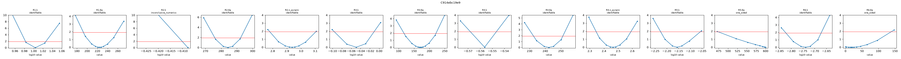
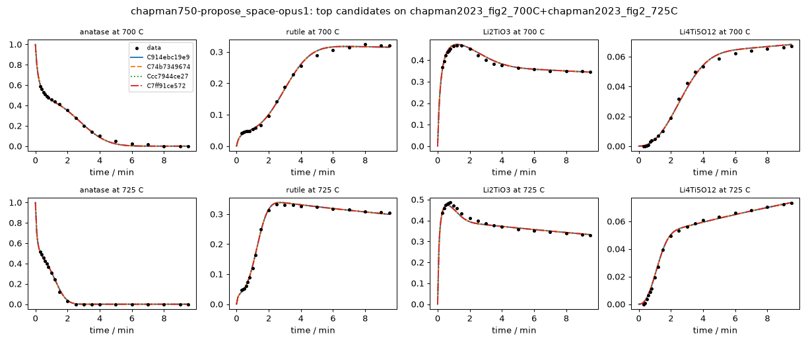

# Investigation report: chapman750-propose_space-opus1

- Investigation: `chapman750`; arm: `propose_space`; phase: `final_evaluated`
- Protocol: `synthesis-mle-v1` (sha256 `c7b943a32f2c32b1`); manifest sha256 `1a596bdc5114f7b3`; evaluator code sha256 `4935f45a7126e490` ({'python': '3.12.13', 'numpy': '2.5.4', 'scipy': '1.18.1'})
- Development data: `chapman2023_fig2_700C+chapman2023_fig2_725C` (sha256 `c44c61ed445348bb`, digitized); 160 observations (joint fit of 2 experiments at T = [700.0, 725.0] C with one parameter vector)

## Question
Which reaction pathways and rate laws are supported by the in situ phase-fraction time courses of anatase TiO2 + Li2CO3 at 700 and 725 C (Hu, ..., Chapman, JACS 2023), what do these data leave ambiguous, and which feasible experiment would best separate the surviving pathways? Candidates are judged afterwards by how well they predict a reserved temperature without refitting.

## System boundary
A pellet of a 5:2 molar anatase TiO2 : Li2CO3 mix moved into a pre-heated hot zone (heating in under 10 s; t = 0 is insertion). Measured: anatase, rutile, Li2TiO3 and Li4Ti5O12, as Rietveld weight fractions of the crystalline solid from in situ X-ray scattering, converted here to mol of each phase per mol of total Ti. Not measured: Li2CO3 after about 30 s, CO2, amorphous or poorly crystalline material, and the Li content of the Li-Ti-O phases. The Ti fractions sum to 1 by construction (a normalised stack), so they cannot reveal unobserved Ti; lithium is not observed directly. Every model must conserve the elements it declares in mechanism.conservation, and every dataset initial species (anatase, Li2CO3) must appear in the model.

## Evidence status
- Partition: The 750 C panel of Fig. 2 is reserved. Development fits use 700 and 725 C jointly with one parameter vector (Arrhenius temperature dependence). The final evaluation is parameter transfer: each frozen candidate and every member of the declared reference space is fitted once on 700 + 725 C, then 750 C is predicted with those parameters (no refitting) and scored by its log-likelihood under the development noise estimate. No development-phase command, tool or evidence file reads the 750 C data; the authors' Avrami analysis, which used all temperatures, is withheld from the evidence and kept as an outside check on fitted exponents.
- Contamination: Retrospective analysis with literature-informed priors, not blind discovery: the proposer sees the 700 and 725 C runs and curated notes, and its pretraining may include this paper and general Li4Ti5O12 synthesis knowledge.

## Ranked candidates (development data, computed in code)

Delta aicc <= 2.0: not distinguished by these data; <= 4.0: still supported. Akaike weights are relative support within this candidate set (one weight per distinct dynamics) under the stated noise model, not probabilities that a mechanism is true. Residual correlation from misspecification makes these differences optimistic.

| candidate | name | source | v | k | AICc | dAICc | weight | band | adequacy | RMSE chapman2023_fig2_700C:Li2TiO3 | RMSE chapman2023_fig2_700C:Li4Ti5O12 | RMSE chapman2023_fig2_700C:anatase | RMSE chapman2023_fig2_700C:rutile | RMSE chapman2023_fig2_725C:Li2TiO3 | RMSE chapman2023_fig2_725C:Li4Ti5O12 | RMSE chapman2023_fig2_725C:anatase | RMSE chapman2023_fig2_725C:rutile | unobserved N end | in declared space | flags |
|---|---|---|---|---|---|---|---|---|---|---|---|---|---|---|---|---|---|---|---|
| C914ebc19e9 | enum-56ad297fc3 | agent_space | 1 | 18 | -1195.99 | 0.00 | 0.721 | indistinguishable_from_best | poor | 0.00681 | 0.00167 | 0.0112 | 0.00549 | 0.0105 | 0.00113 | 0.0072 | 0.00464 | 0 | no | R5.Ea at a protocol bound (600) |
| C74b7349674 | enum-1282ac7e4d | agent_space | 1 | 19 | -1193.54 | 2.45 | 0.212 | supported | poor | 0.00683 | 0.00166 | 0.0112 | 0.00555 | 0.0104 | 0.00111 | 0.00724 | 0.0046 | 0 | no | R5.Ea at a protocol bound (600) |
| Ccc7944ce27 | enum-a7bc858630 | agent_space | 1 | 20 | -1190.73 | 5.25 | 0.052 | less_supported | poor | 0.0068 | 0.00167 | 0.0112 | 0.0055 | 0.0105 | 0.00113 | 0.00721 | 0.00464 | 0 | no | R5.Ea at a protocol bound (600); R7.k at a protocol bound (0.001); R7.Ea at a protocol bound (7.85e-18) |
| C7ff91ce572 | enum-9ae1f16fcc | agent_space | 1 | 21 | -1188.20 | 7.79 | 0.015 | less_supported | poor | 0.00681 | 0.00167 | 0.0112 | 0.00555 | 0.0104 | 0.00111 | 0.00725 | 0.0046 | 0 | no | R5.Ea at a protocol bound (600); R7.k at a protocol bound (0.001); R7.Ea at a protocol bound (5.78e-13) |
| C03fa9abdf3 | enum-a2ff85a4ec | agent_space | 1 | 16 | -1120.77 | 75.22 | 0.000 | less_supported | poor | 0.0148 | 0.0015 | 0.0118 | 0.00749 | 0.0153 | 0.00147 | 0.00522 | 0.00891 | 0 | no | R5.Ea at a protocol bound (600) |
| Cfe21fe0234 | TiOnly_nominal_spinelAssistedRutile_S2fo_S3av_S4fo_S2c | agent | 1 | 17 | -1119.86 | 76.13 | 0.000 | less_supported | poor | 0.0153 | 0.00179 | 0.00904 | 0.00868 | 0.0146 | 0.00124 | 0.0061 | 0.0101 | 0 | no | S2.k at a protocol bound (0.001); S4.Ea at a protocol bound (600) |
| C46a055142c | enum-5685089d58 | agent_space | 1 | 17 | -1119.24 | 76.75 | 0.000 | less_supported | poor | 0.0147 | 0.00143 | 0.0118 | 0.00782 | 0.0151 | 0.0014 | 0.00518 | 0.00893 | 0 | no | R5.Ea at a protocol bound (600) |
| Cecd2a1f23b | enum-9a37163d34 | agent_space | 1 | 18 | -1117.04 | 78.95 | 0.000 | less_supported | poor | 0.0143 | 0.00155 | 0.0119 | 0.00737 | 0.0152 | 0.00147 | 0.00527 | 0.00874 | 0 | no | R5.Ea at a protocol bound (600); R6.Ea at a protocol bound (1.49e-12) |
| C5021a0a15d | enum-b9cad6cf64 | agent_space | 1 | 19 | -1115.02 | 80.97 | 0.000 | less_supported | poor | 0.0143 | 0.00149 | 0.0119 | 0.00763 | 0.0151 | 0.00142 | 0.00524 | 0.00879 | 0 | no | R5.Ea at a protocol bound (600); R6.Ea at a protocol bound (3.92e-15) |
| C6af069469d | TiOnly_nominal_S2av_S3av_S4fo_S2c_EaTieS3S4 | agent | 1 | 15 | -1113.09 | 82.90 | 0.000 | less_supported | poor | 0.0147 | 0.00152 | 0.0119 | 0.00908 | 0.0157 | 0.00165 | 0.00516 | 0.00856 | 0 | no |  |
| Cb8ff151347 | TiOnly_nominal_S2av_S3av_S4fo_S2c_nTieS2S3_EaTieS3S4 | agent | 1 | 14 | -1090.73 | 105.26 | 0.000 | less_supported | poor | 0.0159 | 0.00242 | 0.0106 | 0.0114 | 0.0147 | 0.00117 | 0.00564 | 0.011 | 0 | no |  |
| Ce46f4e1309 | enum-bb36405e6a | agent_space | 1 | 16 | -1086.22 | 109.76 | 0.000 | less_supported | poor | 0.00821 | 0.00236 | 0.0105 | 0.00529 | 0.0157 | 0.00371 | 0.00561 | 0.0108 | 0 | no |  |
| C825fbf9b4f | enum-f3e1782f57 | agent_space | 1 | 18 | -1081.40 | 114.59 | 0.000 | less_supported | poor | 0.00796 | 0.00236 | 0.0105 | 0.00536 | 0.0157 | 0.00371 | 0.00565 | 0.0108 | 0 | no | R6.Ea at a protocol bound (7.76e-23) |
| C3a9765bced | enum-4610f1e335 | agent_space | 1 | 16 | -1072.79 | 123.20 | 0.000 | less_supported | poor | 0.0105 | 0.00158 | 0.00959 | 0.0126 | 0.021 | 0.00123 | 0.00646 | 0.018 | 0 | no | R5.Ea at a protocol bound (600) |
| Cdf1ae59ce5 | enum-9693153003 | agent_space | 1 | 17 | -1071.36 | 124.63 | 0.000 | less_supported | poor | 0.0104 | 0.00156 | 0.00969 | 0.0128 | 0.0208 | 0.00118 | 0.0062 | 0.0182 | 0 | no | R5.Ea at a protocol bound (600) |
| C0b314011ab | enum-4018637c08 | agent_space | 1 | 17 | -1071.06 | 124.92 | 0.000 | less_supported | poor | 0.0101 | 0.0016 | 0.00922 | 0.0126 | 0.0212 | 0.00125 | 0.00638 | 0.0183 | 0 | no | R5.Ea at a protocol bound (600) |
| C5d49e3621a | enum-e32a958df8 | agent_space | 1 | 16 | -1070.25 | 125.74 | 0.000 | less_supported | poor | 0.00906 | 0.00172 | 0.0159 | 0.0208 | 0.00921 | 0.00134 | 0.0105 | 0.0117 | 0 | no | R4.Ea at a protocol bound (600); R5.Ea at a protocol bound (1.55e-19) |
| C65b4c315c5 | enum-853a5b0998 | agent_space | 1 | 18 | -1069.59 | 126.39 | 0.000 | less_supported | poor | 0.00998 | 0.00158 | 0.00931 | 0.0127 | 0.0211 | 0.00121 | 0.00613 | 0.0185 | 0 | no | R5.Ea at a protocol bound (600) |
| C7296bde8f4 | enum-0a6bfd75f3 | agent_space | 1 | 18 | -1069.28 | 126.71 | 0.000 | less_supported | poor | 0.00899 | 0.00213 | 0.013 | 0.0214 | 0.00936 | 0.00139 | 0.00885 | 0.0122 | 0 | no | R4.Ea at a protocol bound (600); R5.Ea at a protocol bound (3.17e-19); R6.Ea at a protocol bound (5.34e-22) |
| C9bb035c339 | enum-9fbc68d0fa | agent_space | 1 | 17 | -1067.97 | 128.01 | 0.000 | less_supported | poor | 0.00899 | 0.0017 | 0.0159 | 0.0207 | 0.00926 | 0.00134 | 0.0107 | 0.0117 | 0 | no | R4.Ea at a protocol bound (600); R5.Ea at a protocol bound (6.07e-16) |
| C521637495e | enum-caef377261 | agent_space | 1 | 19 | -1067.03 | 128.96 | 0.000 | less_supported | poor | 0.00892 | 0.00212 | 0.013 | 0.0212 | 0.00942 | 0.0014 | 0.00896 | 0.0122 | 0 | no | R4.Ea at a protocol bound (600); R5.Ea at a protocol bound (4.38e-14); R6.Ea at a protocol bound (5.93e-16) |
| C8e5bd742db | enum-bbb1783244 | agent_space | 1 | 16 | -1043.62 | 152.37 | 0.000 | less_supported | poor | 0.0178 | 0.00196 | 0.00971 | 0.0235 | 0.0135 | 0.00129 | 0.00755 | 0.016 | 0 | no | R4.Ea at a protocol bound (600); R5.Ea at a protocol bound (1.02e-16) |
| C59af8c1911 | enum-5fbea82597 | agent_space | 1 | 14 | -1043.23 | 152.76 | 0.000 | less_supported | poor | 0.0213 | 0.00153 | 0.00972 | 0.0235 | 0.0139 | 0.00123 | 0.00833 | 0.016 | 0 | no | R4.Ea at a protocol bound (600) |
| Cc29ab2f7d9 | enum-08a6001ffb | agent_space | 1 | 17 | -1041.12 | 154.87 | 0.000 | less_supported | poor | 0.0178 | 0.00196 | 0.00971 | 0.0235 | 0.0135 | 0.00129 | 0.00756 | 0.016 | 0 | no | R4.Ea at a protocol bound (600); R5.Ea at a protocol bound (1.12e-16) |
| Cd27ad91d3b | enum-28769a450f | agent_space | 1 | 15 | -1040.91 | 155.08 | 0.000 | less_supported | poor | 0.0214 | 0.00152 | 0.00972 | 0.0236 | 0.0139 | 0.00123 | 0.00824 | 0.016 | 0 | no | R4.Ea at a protocol bound (600) |

179 lower-ranked fitted candidates omitted here; `python -m nernstwork.cli compare --run chapman750-propose_space-opus1` lists all of them.

## Candidates that were not fitted (recorded, with status)

- Cd911f7f0bb `enum-33a612f076` (agent_space): **nonconvergence** -- {"n_starts": 8, "n_starts_planned": 8, "n_finite": 8, "seed": 857221167454884058, "budget_exhausted": false, "max_ode_solves_per_fit": 200000, "max_rhs_evals": 20000, "nll_by_start": [-121.78574, -254.424069, -254.424066, -251.501144, -251.500607, -251.501066, -254.513644, -251.500963], "converged_b
- Cb3335f40dc `enum-890c4f068b` (agent_space): **nonconvergence** -- {"n_starts": 8, "n_starts_planned": 8, "n_finite": 8, "seed": 199040524599805535, "budget_exhausted": false, "max_ode_solves_per_fit": 200000, "max_rhs_evals": 20000, "nll_by_start": [-304.067824, -314.377815, -304.067824, -314.377815, -314.377815, -315.723742, -314.377815, -304.067823], "converged_
- Caca40bcae8 `enum-1c6b39b3df` (agent_space): **nonconvergence** -- {"n_starts": 8, "n_starts_planned": 8, "n_finite": 8, "seed": 119642273213654641, "budget_exhausted": false, "max_ode_solves_per_fit": 200000, "max_rhs_evals": 20000, "nll_by_start": [-264.09948, -315.201478, -264.099483, -264.099489, -264.099465, -264.099474, -264.099483, -264.099506], "converged_b
- Cfb221b4af5 `enum-c4b38c2a50` (agent_space): **nonconvergence** -- {"n_starts": 8, "n_starts_planned": 8, "n_finite": 8, "seed": 1046793405255557050, "budget_exhausted": false, "max_ode_solves_per_fit": 200000, "max_rhs_evals": 20000, "nll_by_start": [-313.099037, -313.099004, -313.099007, -323.100943, -313.099021, -313.098977, -313.09902, -313.099036], "converged_

## Top candidates in detail

### C914ebc19e9 `enum-56ad297fc3` (source agent_space, version 1)

Rationale (proposer): enumerated: S1:first_order,S2:avrami,S2c:first_order,S3:avrami,S4:first_order,S6:first_order | space LTO-Tionly-nominal-v1

    R1: anatase + 0.8 Li2CO3 -> Li2TiO3 [power_law, Arrhenius(T_ref 712 C)]; R1.k=10.1 (95% Wald 9.56-10.6, well_determined); R1.Ea=224 (95% Wald 190-258, well_determined)
    R2: anatase -> rutile [power_law, avrami(n), Arrhenius(T_ref 712 C)]; R2.k=0.391 (95% Wald 0.386-0.397, well_determined); R2.Ea=284 (95% Wald 276-292, well_determined); R2.n_avrami=2.94 (95% Wald 2.78-3.09, well_determined)
    R3: anatase + Li2CO3 -> rutile + Li2CO3 [power_law, Arrhenius(T_ref 712 C)]; R3.k=0.893 (95% Wald 0.81-0.984, well_determined); R3.Ea=171 (95% Wald 121-221, well_determined)
    R4: 2 Li2TiO3 + 3 anatase -> Li4Ti5O12 [power_law, avrami(n), Arrhenius(T_ref 712 C)]; R4.k=0.278 (95% Wald 0.268-0.288, well_determined); R4.Ea=242 (95% Wald 232-252, well_determined); R4.n_avrami=2.46 (95% Wald 2.33-2.6, well_determined)
    R5: 2 Li2TiO3 + 3 rutile -> Li4Ti5O12 [power_law, Arrhenius(T_ref 712 C)]; R5.k=0.00699 (95% Wald 0.00297-0.0164, moderately_determined); R5.Ea=600 (95% Wald 54.4-600, not_determined_locally)
    R6: 5 Li2TiO3 -> Li4Ti5O12 + 3 Li2O [power_law, Arrhenius(T_ref 712 C)]; R6.k=0.00183 (95% Wald 0.00153-0.00218, well_determined); R6.Ea=17.9 (95% Wald 0-131, moderately_determined)

- Support entries: {'literature': 8, 'data': 6, 'speculative': 2}; reactions without support: []
  - R1: literature -- Shen Y., Sondergaard M., Christensen M., Birgisson S., Iversen B. B., Chem. Mater. 26 (2014) 3679-3686, doi 10.1021/cm500934z, abstract (evidence claim S1) TiO2 + Li2CO3 first react to monoclinic Li2TiO3
  - R1: literature -- Hu D. et al., J. Am. Chem. Soc. 145 (2023) 26545-26549, Fig. 2 legend and main text as recorded in meta.json/SPEC.md 7e (evidence claim C3) 
  - R1: literature -- Hu D. et al., JACS 145 (2023) 26545, main text as recorded in SPEC.md 7e (evidence claim C6): Li2TiO3 excess attributed to Li-deficient Li2-xTiO3 Li2CO3 coefficient 0.8 per Li2TiO3 (Li2 per Ti) caps Li2TiO3 at 0.5 mol/mol Ti
  - R1: data -- chapman2023_fig2_700C/725C Li2TiO3: peaks 0.469/0.486, above the 0.40 stoichiometric Li2TiO3 allows; with Li1.6 per Ti the observed phases hold 0.82 Li per Ti at 9.5 min in both panels (0.8 supplied) 
  - R2: literature -- Hu D. et al., J. Am. Chem. Soc. 145 (2023) 26545-26549, Fig. 2 legend and main text as recorded in meta.json/SPEC.md 7e (evidence claim C3) anatase -> rutile in parallel
  - R2: literature -- Shen et al., Chem. Mater. 26 (2014) 3679, abstract (evidence claim S2): rutile TiO2 and Li2TiO3 persist as impurities in solid-state Li4Ti5O12 
  - R2: data -- chapman2023_fig2_700C rutile: sigmoidal, 0.041->0.067 by 1.5 min then 0.067->0.255 by 4 min (motivates avrami n>1; first_order kept as rival) 
  - R3: speculative --  anatase->rutile promoted while Li2CO3 is still present (local heat/CO2 release of the carbonate reaction); Li2CO3 is not consumed, so the step stops once Li2CO3 is gone. Stand-in for rutile already present at insertion, which the model cannot hold at t=0.
  - R3: data -- chapman2023_fig2_700C/725C rutile: 0.041 and 0.048 already at 0.3 min, nearly temperature independent, before the sigmoidal rise 
  - R4: literature -- Shen Y., Sondergaard M., Christensen M., Birgisson S., Iversen B. B., Chem. Mater. 26 (2014) 3679-3686, doi 10.1021/cm500934z, abstract (evidence claim S1) Li2TiO3 then reacts with remaining TiO2 to Li4Ti5O12
  - R4: literature -- Hu D. et al., J. Am. Chem. Soc. 145 (2023) 26545-26549, Fig. 2 legend and main text as recorded in meta.json/SPEC.md 7e (evidence claim C3) 
  - R4: data -- chapman2023_fig2_725C 0.8-2.0 min: Li2TiO3 -0.075, anatase-to-spinel Ti +0.117 (ratio ~2:3); Li4Ti5O12 sigmoidal with a lag to ~0.6 min at 700 C (motivates avrami) 
- sigma (profiled): anatase=0.00941, rutile=0.00509, Li2TiO3=0.00884, Li4Ti5O12=0.002; adequacy: poor ['chapman2023_fig2_700C:anatase: residual signs cluster (runs test p=0.007)', 'chapman2023_fig2_700C:anatase: residuals are serially correlated (lag-1 r=0.65)', 'chapman2023_fig2_700C:rutile: residual signs cluster (runs test p=0.006)', 'chapman2023_fig2_700C:rutile: residuals are serially correlated (lag-1 r=0.64)', 'chapman2023_fig2_700C:Li2TiO3: residual signs cluster (runs test p=0.001)', 'chapman2023_fig2_700C:Li2TiO3: residuals are serially correlated (lag-1 r=0.63)', 'chapman2023_fig2_700C:Li4Ti5O12: residual signs cluster (runs test p=0.010)', 'chapman2023_fig2_700C:Li4Ti5O12: residuals are serially correlated (lag-1 r=0.70)', 'chapman2023_fig2_725C:anatase: residual signs cluster (runs test p=0.000)', 'chapman2023_fig2_725C:rutile: residual signs cluster (runs test p=0.010)', 'chapman2023_fig2_725C:Li2TiO3: residual signs cluster (runs test p=0.000)', 'chapman2023_fig2_725C:Li2TiO3: residuals are serially correlated (lag-1 r=0.92)', 'chapman2023_fig2_725C:Li4Ti5O12: residual signs cluster (runs test p=0.010)', 'chapman2023_fig2_725C:Li4Ti5O12: residuals are serially correlated (lag-1 r=0.75)']
- Locally unidentifiable combinations: [{'eigenvalue_rel': 1.5179591877095298e-11, 'combination': {'R5.Ea': -1.0}}, {'eigenvalue_rel': 3.5810523204759525e-10, 'combination': {'R6.Ea': -0.999}}, {'eigenvalue_rel': 1.6181144290014042e-09, 'combination': {'R1.Ea': -0.392, 'R3.Ea': -0.917}}, {'eigenvalue_rel': 5.321685497736481e-09, 'combination': {'R1.Ea': -0.913, 'R3.Ea': 0.383}}, {'eigenvalue_rel': 5.150310762712944e-08, 'combination': {'R2.Ea': -0.502, 'R4.Ea': -0.858}}, {'eigenvalue_rel': 2.54952713998398e-07, 'combination': {'R2.Ea': -0.853, 'R4.Ea': 0.512}}]
- Profile likelihood: R1.k: identifiable (95% 9.6-10.6); R1.Ea: identifiable (95% 193-258); R2.k: inconclusive_numerics (95% 0.389-0.391); R2.Ea: identifiable (95% 276-292); R2.n_avrami: identifiable (95% 2.78-3.1); R3.k: identifiable (95% 0.801-0.975); R3.Ea: identifiable (95% 118-221); R4.k: identifiable (95% 0.27-0.284); R4.Ea: identifiable (95% 233-251); R4.n_avrami: identifiable (95% 2.35-2.59); R5.k: identifiable (95% 0.00595-0.00877); R5.Ea: one_sided (95% 473-600); R6.k: identifiable (95% 0.00151-0.00213); R6.Ea: one_sided (95% 0-138)
  

### C74b7349674 `enum-1282ac7e4d` (source agent_space, version 1)

Rationale (proposer): enumerated: S1:first_order,S2:avrami,S2c:first_order,S3:avrami,S4:avrami,S6:first_order | space LTO-Tionly-nominal-v1

    R1: anatase + 0.8 Li2CO3 -> Li2TiO3 [power_law, Arrhenius(T_ref 712 C)]; R1.k=10.1 (95% Wald 9.56-10.6, well_determined); R1.Ea=224 (95% Wald 190-258, well_determined)
    R2: anatase -> rutile [power_law, avrami(n), Arrhenius(T_ref 712 C)]; R2.k=0.391 (95% Wald 0.385-0.398, well_determined); R2.Ea=284 (95% Wald 276-293, well_determined); R2.n_avrami=2.94 (95% Wald 2.78-3.1, well_determined)
    R3: anatase + Li2CO3 -> rutile + Li2CO3 [power_law, Arrhenius(T_ref 712 C)]; R3.k=0.894 (95% Wald 0.81-0.986, well_determined); R3.Ea=171 (95% Wald 121-221, well_determined)
    R4: 2 Li2TiO3 + 3 anatase -> Li4Ti5O12 [power_law, avrami(n), Arrhenius(T_ref 712 C)]; R4.k=0.277 (95% Wald 0.264-0.289, well_determined); R4.Ea=242 (95% Wald 228-255, well_determined); R4.n_avrami=2.46 (95% Wald 2.31-2.6, well_determined)
    R5: 2 Li2TiO3 + 3 rutile -> Li4Ti5O12 [power_law, avrami(n), Arrhenius(T_ref 712 C)]; R5.k=0.00619 (95% Wald 0.00102-0.0374, moderately_determined); R5.Ea=600 (95% Wald 0-600, not_determined_locally); R5.n_avrami=0.916 (95% Wald 0.3-1.63, moderately_determined)
    R6: 5 Li2TiO3 -> Li4Ti5O12 + 3 Li2O [power_law, Arrhenius(T_ref 712 C)]; R6.k=0.00182 (95% Wald 0.00153-0.00217, well_determined); R6.Ea=18.5 (95% Wald 0-131, moderately_determined)

- Support entries: {'literature': 8, 'data': 6, 'speculative': 2}; reactions without support: []
  - R1: literature -- Shen Y., Sondergaard M., Christensen M., Birgisson S., Iversen B. B., Chem. Mater. 26 (2014) 3679-3686, doi 10.1021/cm500934z, abstract (evidence claim S1) TiO2 + Li2CO3 first react to monoclinic Li2TiO3
  - R1: literature -- Hu D. et al., J. Am. Chem. Soc. 145 (2023) 26545-26549, Fig. 2 legend and main text as recorded in meta.json/SPEC.md 7e (evidence claim C3) 
  - R1: literature -- Hu D. et al., JACS 145 (2023) 26545, main text as recorded in SPEC.md 7e (evidence claim C6): Li2TiO3 excess attributed to Li-deficient Li2-xTiO3 Li2CO3 coefficient 0.8 per Li2TiO3 (Li2 per Ti) caps Li2TiO3 at 0.5 mol/mol Ti
  - R1: data -- chapman2023_fig2_700C/725C Li2TiO3: peaks 0.469/0.486, above the 0.40 stoichiometric Li2TiO3 allows; with Li1.6 per Ti the observed phases hold 0.82 Li per Ti at 9.5 min in both panels (0.8 supplied) 
  - R2: literature -- Hu D. et al., J. Am. Chem. Soc. 145 (2023) 26545-26549, Fig. 2 legend and main text as recorded in meta.json/SPEC.md 7e (evidence claim C3) anatase -> rutile in parallel
  - R2: literature -- Shen et al., Chem. Mater. 26 (2014) 3679, abstract (evidence claim S2): rutile TiO2 and Li2TiO3 persist as impurities in solid-state Li4Ti5O12 
  - R2: data -- chapman2023_fig2_700C rutile: sigmoidal, 0.041->0.067 by 1.5 min then 0.067->0.255 by 4 min (motivates avrami n>1; first_order kept as rival) 
  - R3: speculative --  anatase->rutile promoted while Li2CO3 is still present (local heat/CO2 release of the carbonate reaction); Li2CO3 is not consumed, so the step stops once Li2CO3 is gone. Stand-in for rutile already present at insertion, which the model cannot hold at t=0.
  - R3: data -- chapman2023_fig2_700C/725C rutile: 0.041 and 0.048 already at 0.3 min, nearly temperature independent, before the sigmoidal rise 
  - R4: literature -- Shen Y., Sondergaard M., Christensen M., Birgisson S., Iversen B. B., Chem. Mater. 26 (2014) 3679-3686, doi 10.1021/cm500934z, abstract (evidence claim S1) Li2TiO3 then reacts with remaining TiO2 to Li4Ti5O12
  - R4: literature -- Hu D. et al., J. Am. Chem. Soc. 145 (2023) 26545-26549, Fig. 2 legend and main text as recorded in meta.json/SPEC.md 7e (evidence claim C3) 
  - R4: data -- chapman2023_fig2_725C 0.8-2.0 min: Li2TiO3 -0.075, anatase-to-spinel Ti +0.117 (ratio ~2:3); Li4Ti5O12 sigmoidal with a lag to ~0.6 min at 700 C (motivates avrami) 
- sigma (profiled): anatase=0.00943, rutile=0.0051, Li2TiO3=0.00882, Li4Ti5O12=0.002; adequacy: poor ['chapman2023_fig2_700C:anatase: residual signs cluster (runs test p=0.007)', 'chapman2023_fig2_700C:anatase: residuals are serially correlated (lag-1 r=0.65)', 'chapman2023_fig2_700C:rutile: residual signs cluster (runs test p=0.006)', 'chapman2023_fig2_700C:rutile: residuals are serially correlated (lag-1 r=0.64)', 'chapman2023_fig2_700C:Li2TiO3: residual signs cluster (runs test p=0.001)', 'chapman2023_fig2_700C:Li2TiO3: residuals are serially correlated (lag-1 r=0.63)', 'chapman2023_fig2_700C:Li4Ti5O12: residual signs cluster (runs test p=0.010)', 'chapman2023_fig2_700C:Li4Ti5O12: residuals are serially correlated (lag-1 r=0.70)', 'chapman2023_fig2_725C:anatase: residual signs cluster (runs test p=0.000)', 'chapman2023_fig2_725C:rutile: residual signs cluster (runs test p=0.010)', 'chapman2023_fig2_725C:Li2TiO3: residual signs cluster (runs test p=0.000)', 'chapman2023_fig2_725C:Li2TiO3: residuals are serially correlated (lag-1 r=0.92)', 'chapman2023_fig2_725C:Li4Ti5O12: residual signs cluster (runs test p=0.010)', 'chapman2023_fig2_725C:Li4Ti5O12: residuals are serially correlated (lag-1 r=0.74)']
- Locally unidentifiable combinations: [{'eigenvalue_rel': 1.2518447333984156e-11, 'combination': {'R5.Ea': -1.0}}, {'eigenvalue_rel': 3.625164169670954e-10, 'combination': {'R6.Ea': -0.999}}, {'eigenvalue_rel': 1.6345372033097396e-09, 'combination': {'R1.Ea': -0.387, 'R3.Ea': -0.919}}, {'eigenvalue_rel': 5.389657484134625e-09, 'combination': {'R1.Ea': -0.915, 'R3.Ea': 0.377}}, {'eigenvalue_rel': 4.563301940414972e-08, 'combination': {'R2.Ea': -0.382, 'R4.Ea': -0.917}}, {'eigenvalue_rel': 1.830441545614024e-07, 'combination': {'R2.Ea': -0.912, 'R4.Ea': 0.391}}]
- Profile likelihood: not computed (identifiability beyond the local Fisher screen is unassessed)

### Ccc7944ce27 `enum-a7bc858630` (source agent_space, version 1)

Rationale (proposer): enumerated: S1:first_order,S2:avrami,S2c:first_order,S3:avrami,S4:first_order,S6:first_order,S5:first_order | space LTO-Tionly-nominal-v1

    R1: anatase + 0.8 Li2CO3 -> Li2TiO3 [power_law, Arrhenius(T_ref 712 C)]; R1.k=10.1 (95% Wald 9.56-10.6, well_determined); R1.Ea=224 (95% Wald 190-258, well_determined)
    R2: anatase -> rutile [power_law, avrami(n), Arrhenius(T_ref 712 C)]; R2.k=0.391 (95% Wald 0.386-0.397, well_determined); R2.Ea=284 (95% Wald 276-292, well_determined); R2.n_avrami=2.94 (95% Wald 2.78-3.09, well_determined)
    R3: anatase + Li2CO3 -> rutile + Li2CO3 [power_law, Arrhenius(T_ref 712 C)]; R3.k=0.893 (95% Wald 0.81-0.985, well_determined); R3.Ea=171 (95% Wald 121-221, well_determined)
    R4: 2 Li2TiO3 + 3 anatase -> Li4Ti5O12 [power_law, avrami(n), Arrhenius(T_ref 712 C)]; R4.k=0.278 (95% Wald 0.267-0.289, well_determined); R4.Ea=242 (95% Wald 232-253, well_determined); R4.n_avrami=2.47 (95% Wald 2.29-2.64, well_determined)
    R5: 2 Li2TiO3 + 3 rutile -> Li4Ti5O12 [power_law, Arrhenius(T_ref 712 C)]; R5.k=0.00699 (95% Wald 0.00295-0.0165, moderately_determined); R5.Ea=600 (95% Wald 51.5-600, not_determined_locally)
    R6: 5 Li2TiO3 -> Li4Ti5O12 + 3 Li2O [power_law, Arrhenius(T_ref 712 C)]; R6.k=0.00182 (95% Wald 0.00152-0.00219, well_determined); R6.Ea=18.6 (95% Wald 0-132, moderately_determined)
    R7: 5 anatase + 2 Li2CO3 -> Li4Ti5O12 [power_law, Arrhenius(T_ref 712 C)]; R7.k=0.001 (95% Wald 0.001-1e+04, not_determined_locally); R7.Ea=7.85e-18 (95% Wald 0-5.85, well_determined)

- Support entries: {'literature': 8, 'data': 7, 'speculative': 3}; reactions without support: []
  - R1: literature -- Shen Y., Sondergaard M., Christensen M., Birgisson S., Iversen B. B., Chem. Mater. 26 (2014) 3679-3686, doi 10.1021/cm500934z, abstract (evidence claim S1) TiO2 + Li2CO3 first react to monoclinic Li2TiO3
  - R1: literature -- Hu D. et al., J. Am. Chem. Soc. 145 (2023) 26545-26549, Fig. 2 legend and main text as recorded in meta.json/SPEC.md 7e (evidence claim C3) 
  - R1: literature -- Hu D. et al., JACS 145 (2023) 26545, main text as recorded in SPEC.md 7e (evidence claim C6): Li2TiO3 excess attributed to Li-deficient Li2-xTiO3 Li2CO3 coefficient 0.8 per Li2TiO3 (Li2 per Ti) caps Li2TiO3 at 0.5 mol/mol Ti
  - R1: data -- chapman2023_fig2_700C/725C Li2TiO3: peaks 0.469/0.486, above the 0.40 stoichiometric Li2TiO3 allows; with Li1.6 per Ti the observed phases hold 0.82 Li per Ti at 9.5 min in both panels (0.8 supplied) 
  - R2: literature -- Hu D. et al., J. Am. Chem. Soc. 145 (2023) 26545-26549, Fig. 2 legend and main text as recorded in meta.json/SPEC.md 7e (evidence claim C3) anatase -> rutile in parallel
  - R2: literature -- Shen et al., Chem. Mater. 26 (2014) 3679, abstract (evidence claim S2): rutile TiO2 and Li2TiO3 persist as impurities in solid-state Li4Ti5O12 
  - R2: data -- chapman2023_fig2_700C rutile: sigmoidal, 0.041->0.067 by 1.5 min then 0.067->0.255 by 4 min (motivates avrami n>1; first_order kept as rival) 
  - R3: speculative --  anatase->rutile promoted while Li2CO3 is still present (local heat/CO2 release of the carbonate reaction); Li2CO3 is not consumed, so the step stops once Li2CO3 is gone. Stand-in for rutile already present at insertion, which the model cannot hold at t=0.
  - R3: data -- chapman2023_fig2_700C/725C rutile: 0.041 and 0.048 already at 0.3 min, nearly temperature independent, before the sigmoidal rise 
  - R4: literature -- Shen Y., Sondergaard M., Christensen M., Birgisson S., Iversen B. B., Chem. Mater. 26 (2014) 3679-3686, doi 10.1021/cm500934z, abstract (evidence claim S1) Li2TiO3 then reacts with remaining TiO2 to Li4Ti5O12
  - R4: literature -- Hu D. et al., J. Am. Chem. Soc. 145 (2023) 26545-26549, Fig. 2 legend and main text as recorded in meta.json/SPEC.md 7e (evidence claim C3) 
  - R4: data -- chapman2023_fig2_725C 0.8-2.0 min: Li2TiO3 -0.075, anatase-to-spinel Ti +0.117 (ratio ~2:3); Li4Ti5O12 sigmoidal with a lag to ~0.6 min at 700 C (motivates avrami) 
- sigma (profiled): anatase=0.00942, rutile=0.00509, Li2TiO3=0.00883, Li4Ti5O12=0.002; adequacy: poor ['chapman2023_fig2_700C:anatase: residual signs cluster (runs test p=0.007)', 'chapman2023_fig2_700C:anatase: residuals are serially correlated (lag-1 r=0.65)', 'chapman2023_fig2_700C:rutile: residual signs cluster (runs test p=0.006)', 'chapman2023_fig2_700C:rutile: residuals are serially correlated (lag-1 r=0.64)', 'chapman2023_fig2_700C:Li2TiO3: residual signs cluster (runs test p=0.001)', 'chapman2023_fig2_700C:Li2TiO3: residuals are serially correlated (lag-1 r=0.63)', 'chapman2023_fig2_700C:Li4Ti5O12: residual signs cluster (runs test p=0.010)', 'chapman2023_fig2_700C:Li4Ti5O12: residuals are serially correlated (lag-1 r=0.70)', 'chapman2023_fig2_725C:anatase: residual signs cluster (runs test p=0.000)', 'chapman2023_fig2_725C:rutile: residual signs cluster (runs test p=0.010)', 'chapman2023_fig2_725C:Li2TiO3: residual signs cluster (runs test p=0.000)', 'chapman2023_fig2_725C:Li2TiO3: residuals are serially correlated (lag-1 r=0.92)', 'chapman2023_fig2_725C:Li4Ti5O12: residual signs cluster (runs test p=0.010)', 'chapman2023_fig2_725C:Li4Ti5O12: residuals are serially correlated (lag-1 r=0.75)']
- Locally unidentifiable combinations: [{'eigenvalue_rel': 1.422783300714557e-14, 'combination': {'R7.Ea': 1.0}}, {'eigenvalue_rel': 1.4987687088544208e-11, 'combination': {'R5.Ea': 1.0}}, {'eigenvalue_rel': 3.499270938756471e-10, 'combination': {'R6.Ea': -0.999}}, {'eigenvalue_rel': 1.6109064576109782e-09, 'combination': {'R1.Ea': 0.393, 'R3.Ea': 0.917}}, {'eigenvalue_rel': 5.3094045709629005e-09, 'combination': {'R1.Ea': -0.913, 'R3.Ea': 0.384}}, {'eigenvalue_rel': 3.9558992272603096e-08, 'combination': {'R4.Ea': 0.688, 'R7.k': 0.669}}, {'eigenvalue_rel': 6.519679145847434e-08, 'combination': {'R2.Ea': -0.461, 'R4.Ea': -0.51, 'R7.k': 0.72}}, {'eigenvalue_rel': 2.61719186006333e-07, 'combination': {'R2.Ea': -0.833, 'R4.Ea': 0.513}}]
- Profile likelihood: not computed (identifiability beyond the local Fisher screen is unassessed)

### C7ff91ce572 `enum-9ae1f16fcc` (source agent_space, version 1)

Rationale (proposer): enumerated: S1:first_order,S2:avrami,S2c:first_order,S3:avrami,S4:avrami,S6:first_order,S5:first_order | space LTO-Tionly-nominal-v1

    R1: anatase + 0.8 Li2CO3 -> Li2TiO3 [power_law, Arrhenius(T_ref 712 C)]; R1.k=10.1 (95% Wald 9.56-10.6, well_determined); R1.Ea=224 (95% Wald 190-258, well_determined)
    R2: anatase -> rutile [power_law, avrami(n), Arrhenius(T_ref 712 C)]; R2.k=0.391 (95% Wald 0.385-0.398, well_determined); R2.Ea=284 (95% Wald 276-293, well_determined); R2.n_avrami=2.94 (95% Wald 2.78-3.1, well_determined)
    R3: anatase + Li2CO3 -> rutile + Li2CO3 [power_law, Arrhenius(T_ref 712 C)]; R3.k=0.894 (95% Wald 0.81-0.987, well_determined); R3.Ea=171 (95% Wald 121-222, well_determined)
    R4: 2 Li2TiO3 + 3 anatase -> Li4Ti5O12 [power_law, avrami(n), Arrhenius(T_ref 712 C)]; R4.k=0.277 (95% Wald 0.263-0.291, well_determined); R4.Ea=242 (95% Wald 228-256, well_determined); R4.n_avrami=2.46 (95% Wald 2.27-2.65, well_determined)
    R5: 2 Li2TiO3 + 3 rutile -> Li4Ti5O12 [power_law, avrami(n), Arrhenius(T_ref 712 C)]; R5.k=0.00622 (95% Wald 0.00101-0.0384, moderately_determined); R5.Ea=600 (95% Wald 0-600, not_determined_locally); R5.n_avrami=0.92 (95% Wald 0.3-1.66, moderately_determined)
    R6: 5 Li2TiO3 -> Li4Ti5O12 + 3 Li2O [power_law, Arrhenius(T_ref 712 C)]; R6.k=0.00182 (95% Wald 0.00152-0.00218, well_determined); R6.Ea=19.2 (95% Wald 0-133, moderately_determined)
    R7: 5 anatase + 2 Li2CO3 -> Li4Ti5O12 [power_law, Arrhenius(T_ref 712 C)]; R7.k=0.001 (95% Wald 0.001-1e+04, not_determined_locally); R7.Ea=5.78e-13 (95% Wald 0-6.31, well_determined)

- Support entries: {'literature': 8, 'data': 7, 'speculative': 3}; reactions without support: []
  - R1: literature -- Shen Y., Sondergaard M., Christensen M., Birgisson S., Iversen B. B., Chem. Mater. 26 (2014) 3679-3686, doi 10.1021/cm500934z, abstract (evidence claim S1) TiO2 + Li2CO3 first react to monoclinic Li2TiO3
  - R1: literature -- Hu D. et al., J. Am. Chem. Soc. 145 (2023) 26545-26549, Fig. 2 legend and main text as recorded in meta.json/SPEC.md 7e (evidence claim C3) 
  - R1: literature -- Hu D. et al., JACS 145 (2023) 26545, main text as recorded in SPEC.md 7e (evidence claim C6): Li2TiO3 excess attributed to Li-deficient Li2-xTiO3 Li2CO3 coefficient 0.8 per Li2TiO3 (Li2 per Ti) caps Li2TiO3 at 0.5 mol/mol Ti
  - R1: data -- chapman2023_fig2_700C/725C Li2TiO3: peaks 0.469/0.486, above the 0.40 stoichiometric Li2TiO3 allows; with Li1.6 per Ti the observed phases hold 0.82 Li per Ti at 9.5 min in both panels (0.8 supplied) 
  - R2: literature -- Hu D. et al., J. Am. Chem. Soc. 145 (2023) 26545-26549, Fig. 2 legend and main text as recorded in meta.json/SPEC.md 7e (evidence claim C3) anatase -> rutile in parallel
  - R2: literature -- Shen et al., Chem. Mater. 26 (2014) 3679, abstract (evidence claim S2): rutile TiO2 and Li2TiO3 persist as impurities in solid-state Li4Ti5O12 
  - R2: data -- chapman2023_fig2_700C rutile: sigmoidal, 0.041->0.067 by 1.5 min then 0.067->0.255 by 4 min (motivates avrami n>1; first_order kept as rival) 
  - R3: speculative --  anatase->rutile promoted while Li2CO3 is still present (local heat/CO2 release of the carbonate reaction); Li2CO3 is not consumed, so the step stops once Li2CO3 is gone. Stand-in for rutile already present at insertion, which the model cannot hold at t=0.
  - R3: data -- chapman2023_fig2_700C/725C rutile: 0.041 and 0.048 already at 0.3 min, nearly temperature independent, before the sigmoidal rise 
  - R4: literature -- Shen Y., Sondergaard M., Christensen M., Birgisson S., Iversen B. B., Chem. Mater. 26 (2014) 3679-3686, doi 10.1021/cm500934z, abstract (evidence claim S1) Li2TiO3 then reacts with remaining TiO2 to Li4Ti5O12
  - R4: literature -- Hu D. et al., J. Am. Chem. Soc. 145 (2023) 26545-26549, Fig. 2 legend and main text as recorded in meta.json/SPEC.md 7e (evidence claim C3) 
  - R4: data -- chapman2023_fig2_725C 0.8-2.0 min: Li2TiO3 -0.075, anatase-to-spinel Ti +0.117 (ratio ~2:3); Li4Ti5O12 sigmoidal with a lag to ~0.6 min at 700 C (motivates avrami) 
- sigma (profiled): anatase=0.00944, rutile=0.0051, Li2TiO3=0.00881, Li4Ti5O12=0.002; adequacy: poor ['chapman2023_fig2_700C:anatase: residual signs cluster (runs test p=0.007)', 'chapman2023_fig2_700C:anatase: residuals are serially correlated (lag-1 r=0.65)', 'chapman2023_fig2_700C:rutile: residual signs cluster (runs test p=0.006)', 'chapman2023_fig2_700C:rutile: residuals are serially correlated (lag-1 r=0.64)', 'chapman2023_fig2_700C:Li2TiO3: residual signs cluster (runs test p=0.001)', 'chapman2023_fig2_700C:Li2TiO3: residuals are serially correlated (lag-1 r=0.63)', 'chapman2023_fig2_700C:Li4Ti5O12: residual signs cluster (runs test p=0.010)', 'chapman2023_fig2_700C:Li4Ti5O12: residuals are serially correlated (lag-1 r=0.70)', 'chapman2023_fig2_725C:anatase: residual signs cluster (runs test p=0.000)', 'chapman2023_fig2_725C:rutile: residual signs cluster (runs test p=0.010)', 'chapman2023_fig2_725C:Li2TiO3: residual signs cluster (runs test p=0.000)', 'chapman2023_fig2_725C:Li2TiO3: residuals are serially correlated (lag-1 r=0.92)', 'chapman2023_fig2_725C:Li4Ti5O12: residual signs cluster (runs test p=0.010)', 'chapman2023_fig2_725C:Li4Ti5O12: residuals are serially correlated (lag-1 r=0.74)']
- Locally unidentifiable combinations: [{'eigenvalue_rel': 1.4453636005365775e-14, 'combination': {'R7.Ea': 1.0}}, {'eigenvalue_rel': 1.2442116134185079e-11, 'combination': {'R5.Ea': -1.0}}, {'eigenvalue_rel': 3.5524473830473586e-10, 'combination': {'R6.Ea': -0.999}}, {'eigenvalue_rel': 1.627588998837501e-09, 'combination': {'R1.Ea': -0.388, 'R3.Ea': -0.919}}, {'eigenvalue_rel': 5.3678265571257166e-09, 'combination': {'R1.Ea': -0.914, 'R3.Ea': 0.378}}, {'eigenvalue_rel': 3.195283620055286e-08, 'combination': {'R4.Ea': 0.765, 'R7.k': 0.614}}, {'eigenvalue_rel': 6.600529283523825e-08, 'combination': {'R2.Ea': -0.434, 'R4.Ea': -0.493, 'R7.k': 0.749}}, {'eigenvalue_rel': 1.9097941510611687e-07, 'combination': {'R2.Ea': -0.871, 'R4.Ea': 0.405}}]
- Profile likelihood: not computed (identifiability beyond the local Fisher screen is unassessed)

## Experiment plan (plan-2.json, the last of 2)

For every candidate design (temperature, initial amounts, sampling times, measured phases) each surviving model predicts the measured channels with its development MLE. Designs are scored by the pairwise discrimination criterion of Buzzi-Ferraris and Forzatti (1983), weighted by the models' Akaike weights:

Models (equal (models chosen by hand)): C914ebc19e9 (AICc -1195.99, w 0.25), C74b7349674 (AICc -1193.54, w 0.25), C03fa9abdf3 (AICc -1120.77, w 0.25), Cfe21fe0234 (AICc -1119.86, w 0.25)

| design | U | bounded score | separable pairs |
|---|---|---|---|
| Li2CO3_x0.5_T725_long30 | 13.9 | 3.48 | 1/6 |
| Li2CO3_x0.5_T725 | 13.7 | 2.96 | 0/6 |
| T725_long30 | 11.6 | 2.45 | 0/6 |
| T700_long30 | 11.3 | 2.44 | 0/6 |
| mixed_anatase_rutile_T725_long30 | 10.1 | 3.18 | 0/6 |
| mixed_anatase_rutile_T725 | 5.05 | 2.38 | 0/6 |
| T740_standard | 4 | 2.41 | 0/6 |

## Investigator conclusion (conclusion-1.json; an interpretation, numbers above are authoritative)

The two leading candidates are C914ebc19e9 (AICc -1196.0) and C74b7349674 (dAICc 2.45). Both come from space B, which conserves Ti only. They contain six steps:
- S1: anatase + 0.8 Li2CO3 -> Li2TiO3, first-order. k = 10.1 /min, Ea 224 kJ/mol (CI 193-258).
- S2: anatase -> rutile, JMAK, n = 2.94 (CI 2.78-3.10), Ea 284 kJ/mol.
- S2c: early rutile formed while Li2CO3 is present.
- S3: 2 Li2TiO3 + 3 anatase -> Li4Ti5O12, JMAK, n = 2.46 (CI 2.35-2.59), Ea 242 kJ/mol (CI 233-251).
- S4: slow 2 Li2TiO3 + 3 rutile -> spinel.
- S6: slow Li2TiO3 -> spinel with Li going to an unobserved sink.
The two candidates differ only in the S4 rate-law form and are effectively observationally equivalent (planner D <= 0.07 on every design).

Supported by the data:
- The two-stage route through Li2TiO3. The direct route S5 collapses to its lower k bound.
- Sigmoidal nucleation-and-growth kinetics for both the rutile and the spinel steps, with distinct exponents. Tying them costs 22 AICc.
- Early rutile formed during the carbonate stage (S2c). Dropping it costs about 150 AICc, by inference from member identity.
- Extra late consumption of Li2TiO3 (S6). Dropping it costs 75 AICc.

Not pinned down: the Ea of S4 (one-sided, >= 473 kJ/mol, at the bound) and the Ea of S6 (one-sided, <= 138 kJ/mol). Prediction at 750 C therefore depends on extrapolating these poorly constrained activation energies across the Li2CO3 melting point.

Li balance is a finding. Strictly stoichiometric Li2TiO3 is rejected by 386 AICc, because it cannot reach the 0.47-0.49 peaks. Li-balanced Li1.6TiO3 is 48 AICc worse than nominal 2:3 spinel stoichiometry with Li not conserved. So the plotted phase fractions do not close Li with any single fixed Li2TiO3 composition.

All candidates are rated 'poor' on adequacy: residual signs cluster in every channel, and lag-1 autocorrelation is up to 0.92 for Li2TiO3 at 725 C. In the best model the Li2TiO3 maximum at 725 C is underpredicted by about 0.019 between 0.8 and 2.5 min, and anatase at 700 C is depleted too early at 5-7 min. Some of this may come from the digitisation (pixel columns of one drawn curve, ~1-2 wt% boundary bias), so adequacy is recorded as uncertain rather than none.

Process note: 72 of the 136 members of space A (all S6 members under Li conservation) were invalid because of my schema error on the Li2O species. That comparison is therefore missing.

The best next experiment from the planner is a Li2CO3-lean mix (0.2 Li2CO3 per Ti) at 725 C followed to 30 min (U = 13.9, the only design with a separable pair). Long 30-minute runs at 725 or 700 C come next, to resolve S4 versus S6 and the temperature dependence of the slow stage.

- Plausible: ['C914ebc19e9', 'C74b7349674']
- Adequacy: uncertain
- Rejected: [{'candidate_id': 'Ccc7944ce27', 'reason': 'Best topology plus the direct carbonate->spinel step S5 (R7). R7.k fitted to the 0.001 lower bound and R7.Ea to 0, so S5 contributes nothing; dAICc 5.25 is only its parameter penalty. The data give no support for direct spinel formation, which agrees with the two-stage route of Shen et al. (evidence S1).'}, {'candidate_id': 'C7ff91ce572', 'reason': 'Same as Ccc7944ce27, but with S4 in Avrami form. S5 sits at its lower k bound; dAICc 7.79.'}, {'candidate_id': 'C03fa9abdf3', 'reason': 'Best topology without S6 (Li2TiO3 -> Li4Ti5O12 + unobserved Li sink). dAICc 75.2: removing S6 costs about 75 AICc units. In the best model S6.k = 0.0018 (profile CI 0.0015-0.0021, identifiable).'}, {'candidate_id': 'Cfe21fe0234', 'reason': 'Spinel-assisted anatase->rutile instead of a JMAK factor on S2. dAICc 76.1. It does as well as the JMAK version without S6 (C03fa9abdf3, a gap of 0.9) but lacks S6. Uncatalysed S2.k went to the 0.001 bound. The planner gives the largest disagreement for this model (D up to 81 at Li2CO3 x0.5), so it is testable.'}, {'candidate_id': 'C6af069469d', 'reason': 'Shared Ea for spinel formation from anatase (S3) and rutile (S4), without S6. dAICc 82.9, 7.7 units worse than the same structure with separate Ea (C03fa9abdf3). The data want the rutile route to be strongly temperature-dependent: profile Ea(S4) >= 473 kJ/mol in the best model.'}, {'candidate_id': 'Cb8ff151347', 'reason': 'As C6af069469d, plus one shared Avrami exponent for S2 and S3. dAICc 105. The separate exponents are distinct (n_S2 = 2.94, CI 2.78-3.10; n_S3 = 2.46, CI 2.35-2.59).'}, {'candidate_id': 'C3a9765bced', 'reason': 'Best member of space A, which conserves Ti and Li with Li1.6TiO3 (2.5:2.5 spinel stoichiometry). dAICc 123. The same topology under Ti-only bookkeeping with a nominal 2:3 spinel step is 48 AICc better (C03fa9abdf3, -1120.8 vs -1072.8). Caveat: the S6 members of space A were invalid because of my schema error on the Li2O species, so they were never fitted.'}, {'candidate_id': 'C6363892764', 'reason': 'Strict Ti+Li conservation with stoichiometric Li2TiO3 (cap 0.40 mol/mol Ti). dAICc 386. It cannot reach the observed Li2TiO3 peaks of 0.469 (700 C) and 0.486 (725 C). This confirms the Li-balance conflict flagged in the dataset notes.'}, {'candidate_id': 'C59af8c1911', 'reason': 'Ti-only S1/S2av/S3av/S4 without the carbonate-coupled early rutile step S2c (identity inferred from its parameter count and from matching an exploratory fit). dAICc 153. Rutile is already 0.041-0.048 at 0.3 min, and without S2c the model cannot produce it.'}]
- Ambiguities: ['C914ebc19e9 (S4 first-order) and C74b7349674 (S4 Avrami, n = 0.92, CI 0.3-1.63) are effectively observationally equivalent. Planner D between them is 0.02-0.07 on every design, and the Avrami exponent of the slow rutile route cannot be determined.', 'The Ea of the rutile->spinel route S4 is one-sided: profile CI [473, 600] kJ/mol, at the protocol bound. In the data S4 is effectively off at 700 C and on at 725 C. Extrapolating to 750 C with Ea = 600 is unreliable. The step may stand in for a regime change near the Li2CO3 melting point (~723 C), which a single Arrhenius law cannot represent.', 'The Ea of S6 (Li2TiO3 -> spinel + unobserved Li) is one-sided: profile CI [0, 138] kJ/mol. Its k is identifiable, but its temperature dependence is not. Whether Li is really lost (volatilisation or amorphous Li-O) or S6 compensates for digitisation bias in the Li2TiO3 band cannot be decided from the normalised Ti fractions.', 'Li bookkeeping: Ti-only conservation with a 0.8 Li2CO3 budget and a nominal 2:3 spinel step beats Li-balanced Li1.6TiO3 by 48 AICc for the same topology. That means the plotted phases do not balance Li. Either Li2TiO3 is very Li-deficient with a changing stoichiometry, or the extracted Li2TiO3 band is too wide (a known ~2 wt% bias). This dataset cannot tell which.', 'The cause of the sigmoidal rutile growth is open. A JMAK clock on anatase->rutile (n = 2.94) and coupling to spinel growth (Cfe21fe0234) are within 0.9 AICc of each other when S6 is absent. The spinel-coupled variant was never combined with S6.', 'S2c (rutile while Li2CO3 is present) is strongly supported statistically. It may stand in for rutile already present in the precursor, which the model cannot hold at t = 0.', 'Pairs of Ea values are sloppy (Fisher eigenvalues ~1e-9): R1/R3 and R2/R4. With only two temperatures 25 C apart, activation energies are only partly identifiable.']
- Experiment: Li2CO3_x0.5_T725_long30: half the Li2CO3 (anatase 1.0, Li2CO3 0.2 mol per mol Ti), 725 C, sampled to 30 min -- discriminates ['C914ebc19e9', 'Cfe21fe0234', 'C03fa9abdf3']: Top of the planner ranking: U = 13.9, bounded score 3.48, the only design with a separable pair (1/6). Best vs spinel-assisted rutile: D = 81.1 (separable), largest gap rutile at 2 min, 7.2 sigma. Best vs no-S6 model: D = 18.3, largest gap rutile at 30 min, 4.4 sigma. Cutting the Li supply separates rutile growth that is coupled to spinel from rutile growth on its own JMAK clock, and the long tail tests S6 against S4. It does not separate C914ebc19e9 from C74b7349674 (D = 0.06).
- Experiment: T725_long30 (standard 5:2 mix, 725 C, sampled to 30 min) -- discriminates ['C914ebc19e9', 'C03fa9abdf3', 'Cfe21fe0234']: Planner U = 11.6, bounded 2.45, separable 0/6. Best vs no-S6: D = 44.7 (rutile at 30 min, 5.6 sigma). Best vs spinel-assisted: D = 47.3 (Li2TiO3 at 30 min, 5.3 sigma). Extending the slow stage pins down how Li2TiO3 vs rutile consumption is split (S6 vs S4). T700_long30 is similar (U = 11.3) and would show whether the rutile route really switches off at 700 C.
- Experiment: Li2CO3_x1.5_T725C (default menu) -- discriminates ['C914ebc19e9', 'C03fa9abdf3', 'Cfe21fe0234']: Planner U = 9.02, bounded 2.77. Best vs no-S6: D = 28.1, largest gap Li2TiO3 at 9.5 min, 3.8 sigma. Excess Li tests whether the Li2TiO3 plateau is set by a Li budget and whether S6 represents Li loss.
- Experiment: mixed anatase:rutile 0.5:0.5 precursor at 725 C, to 30 min -- discriminates ['C914ebc19e9', 'Cfe21fe0234']: Planner U = 10.1, bounded 3.18. It tests the rutile->spinel route directly, together with the S2c / precursor-rutile question. A pure-rutile precursor scored U = 0 because none of the models forms Li2TiO3 without anatase.

## Frozen selection

- Rule: lowest AICc among fitted candidates without a hidden-pool plausibility violation, plus every such candidate within delta AICc <= 2.0
- Selected: ['C914ebc19e9']
- Agent-concluded plausible: ['C914ebc19e9', 'C74b7349674']
- Frozen at 2026-10-21T23:07:54.527Z

## Final held-out evaluation: chapman2023_fig2_750C (predicted without refitting)

Version: current evaluator code.

Parameter transfer: every candidate is fitted once on the development runs, then the held-out run is simulated with those parameters (no refitting). Primary score: squared prediction error weighted by one noise scale per phase shared by all models (the development sigma of the reference member with the lowest development AICc); lower is better, and rank is among all reference-space members. Also reported: rank by RMSE, and the model-specific predictive log-likelihood (each model's own development sigma), which measures calibration and penalizes overconfident extrapolation.

Common noise scale per phase (development sigma of S:enum-ef52513024): {'anatase': 0.0389, 'rutile': 0.0259, 'Li2TiO3': 0.0368, 'Li4Ti5O12': 0.002}

- C74b7349674 (agent-plausible): fitted; held-out score 565.6, rank 1/153 (by RMSE 1, by own-sigma log-likelihood 145); RMSE {'anatase': 0.02, 'rutile': 0.03, 'Li2TiO3': 0.02, 'Li4Ti5O12': 0.01} (all 0.0221); development AICc -1193.5
- C914ebc19e9 (selected+agent-plausible): fitted; held-out score 744.1, rank 4/153 (by RMSE 1, by own-sigma log-likelihood 150); RMSE {'anatase': 0.02, 'rutile': 0.04, 'Li2TiO3': 0.02, 'Li4Ti5O12': 0.01} (all 0.0248); development AICc -1196
- This run's own candidates (204 scored): best predictor C46a055142c ranks 1; the run's best development-AICc member C914ebc19e9 ranks 4
- Best reference-space members on the held-out run: enum-9db30b59d8 (score 603.8, RMSE 0.0306), enum-0d02fc61ca (score 604.2, RMSE 0.0307), enum-c0459e266c (score 606, RMSE 0.0305)
- The reference member with the best development AICc, enum-ef52513024, ranks 11 (by own-sigma log-likelihood 124)

## Cost and runtime

- Numerics: 188 fits run, 20 reused from the shared cache, 20402 CPU s fitting, 774 s profiles (current evaluator code only; earlier code versions' records are excluded)
- LLM: anthropic/claude-opus-5-5; sessions: 1 investigator; tokens in 94, out 48,845, cache read 3,334,850, cache write 450,277; $3.90 (list prices from the Pi model table); 2271 s wall; 38 tool calls

## Unresolved assumptions and metadata

- chapman2023_fig2_700C: verified_against_figure=False
- chapman2023_fig2_725C: verified_against_figure=False
- [C2] conditions and preparation: recorded by D. Naumov; not re-checked against the full text
- [C3] phases observed: recorded by D. Naumov; not re-checked against the full text
- [C4] temperatures studied: stated (abstract: 700-750 and 482 C); panel list and figure contents recorded by D. Naumov, not re-checked
- [C5] Li2CO3 consumption: recorded by D. Naumov; not re-checked against the full text
- [C6] Li2TiO3 stoichiometry: recorded by D. Naumov; not re-checked against the full text
- [C9] Avrami analysis (authors): recorded by D. Naumov; not re-checked against the full text
- [C10] Avrami analysis (authors): recorded by D. Naumov; not re-checked against the full text
- Noise model: independent Gaussian errors per channel (profiled sigma); no replicate information exists for these runs, so sigma is estimated from misfit and includes model error.
- AICc differences assume independent errors; clustered residual signs (adequacy 'poor') make them optimistic.

