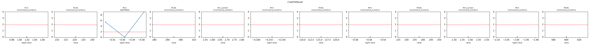
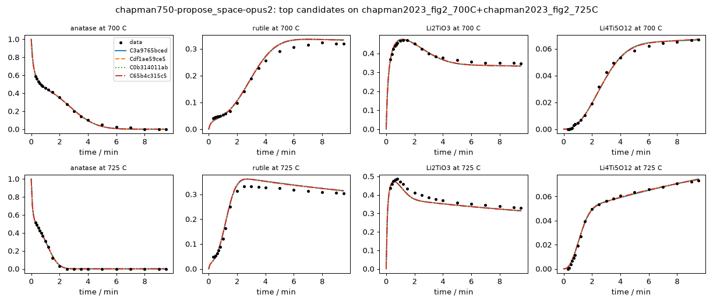

# Investigation report: chapman750-propose_space-opus2

- Investigation: `chapman750`; arm: `propose_space`; phase: `final_evaluated`
- Protocol: `synthesis-mle-v1` (sha256 `c7b943a32f2c32b1`); manifest sha256 `1a596bdc5114f7b3`; evaluator code sha256 `4935f45a7126e490` ({'python': '3.12.13', 'numpy': '2.5.4', 'scipy': '1.18.1'})
- Development data: `chapman2023_fig2_700C+chapman2023_fig2_725C` (sha256 `c44c61ed445348bb`, digitized); 160 observations (joint fit of 2 experiments at T = [700.0, 725.0] C with one parameter vector)

## Question
Which reaction pathways and rate laws are supported by the in situ phase-fraction time courses of anatase TiO2 + Li2CO3 at 700 and 725 C (Hu, ..., Chapman, JACS 2023), what do these data leave ambiguous, and which feasible experiment would best separate the surviving pathways? Candidates are judged afterwards by how well they predict a reserved temperature without refitting.

## System boundary
A pellet of a 5:2 molar anatase TiO2 : Li2CO3 mix moved into a pre-heated hot zone (heating in under 10 s; t = 0 is insertion). Measured: anatase, rutile, Li2TiO3 and Li4Ti5O12, as Rietveld weight fractions of the crystalline solid from in situ X-ray scattering, converted here to mol of each phase per mol of total Ti. Not measured: Li2CO3 after about 30 s, CO2, amorphous or poorly crystalline material, and the Li content of the Li-Ti-O phases. The Ti fractions sum to 1 by construction (a normalised stack), so they cannot reveal unobserved Ti; lithium is not observed directly. Every model must conserve the elements it declares in mechanism.conservation, and every dataset initial species (anatase, Li2CO3) must appear in the model.

## Evidence status
- Partition: The 750 C panel of Fig. 2 is reserved. Development fits use 700 and 725 C jointly with one parameter vector (Arrhenius temperature dependence). The final evaluation is parameter transfer: each frozen candidate and every member of the declared reference space is fitted once on 700 + 725 C, then 750 C is predicted with those parameters (no refitting) and scored by its log-likelihood under the development noise estimate. No development-phase command, tool or evidence file reads the 750 C data; the authors' Avrami analysis, which used all temperatures, is withheld from the evidence and kept as an outside check on fitted exponents.
- Contamination: Retrospective analysis with literature-informed priors, not blind discovery: the proposer sees the 700 and 725 C runs and curated notes, and its pretraining may include this paper and general Li4Ti5O12 synthesis knowledge.

## Ranked candidates (development data, computed in code)

Delta aicc <= 2.0: not distinguished by these data; <= 4.0: still supported. Akaike weights are relative support within this candidate set (one weight per distinct dynamics) under the stated noise model, not probabilities that a mechanism is true. Residual correlation from misspecification makes these differences optimistic.

| candidate | name | source | v | k | AICc | dAICc | weight | band | adequacy | RMSE chapman2023_fig2_700C:Li2TiO3 | RMSE chapman2023_fig2_700C:Li4Ti5O12 | RMSE chapman2023_fig2_700C:anatase | RMSE chapman2023_fig2_700C:rutile | RMSE chapman2023_fig2_725C:Li2TiO3 | RMSE chapman2023_fig2_725C:Li4Ti5O12 | RMSE chapman2023_fig2_725C:anatase | RMSE chapman2023_fig2_725C:rutile | unobserved N end | in declared space | flags |
|---|---|---|---|---|---|---|---|---|---|---|---|---|---|---|---|---|---|---|---|
| C3a9765bced | enum-161a8062fd | agent_space | 1 | 16 | -1072.79 | 0.00 | 0.442 | indistinguishable_from_best | poor | 0.0105 | 0.00158 | 0.00959 | 0.0126 | 0.021 | 0.00123 | 0.00646 | 0.018 | 0 | no | R5.Ea at a protocol bound (600) |
| Cdf1ae59ce5 | enum-576916dd0f | agent_space | 1 | 17 | -1071.36 | 1.43 | 0.216 | indistinguishable_from_best | poor | 0.0104 | 0.00156 | 0.00969 | 0.0128 | 0.0208 | 0.00118 | 0.0062 | 0.0182 | 0 | no | R5.Ea at a protocol bound (600) |
| C0b314011ab | enum-0a5d521edf | agent_space | 1 | 17 | -1071.06 | 1.72 | 0.187 | indistinguishable_from_best | poor | 0.0101 | 0.0016 | 0.00922 | 0.0126 | 0.0212 | 0.00125 | 0.00638 | 0.0183 | 0 | no | R5.Ea at a protocol bound (600) |
| C65b4c315c5 | enum-83f3975432 | agent_space | 1 | 18 | -1069.59 | 3.19 | 0.090 | supported | poor | 0.00998 | 0.00158 | 0.00931 | 0.0127 | 0.0211 | 0.00121 | 0.00613 | 0.0185 | 0 | no | R5.Ea at a protocol bound (600) |
| C19687086bc | enum-1156545791 | agent_space | 1 | 18 | -1067.71 | 5.08 | 0.035 | less_supported | poor | 0.0105 | 0.00159 | 0.0096 | 0.0126 | 0.021 | 0.00122 | 0.00645 | 0.018 | 0 | no | R5.Ea at a protocol bound (600); R6.k at a protocol bound (0.001); R6.Ea at a protocol bound (3.61e-21) |
| Ce9830a54af | enum-c5776a5e46 | agent_space | 1 | 19 | -1066.17 | 6.61 | 0.016 | less_supported | poor | 0.0104 | 0.00156 | 0.00969 | 0.0128 | 0.0208 | 0.00118 | 0.00619 | 0.0182 | 0 | no | R5.Ea at a protocol bound (600); R6.k at a protocol bound (0.001); R6.Ea at a protocol bound (5.49e-23) |
| Cc97a018d61 | enum-2b4f450eb5 | agent_space | 1 | 19 | -1065.92 | 6.87 | 0.014 | less_supported | poor | 0.01 | 0.0016 | 0.00922 | 0.0126 | 0.0212 | 0.00125 | 0.00636 | 0.0184 | 0 | no | R5.Ea at a protocol bound (600); R6.k at a protocol bound (0.001); R6.Ea at a protocol bound (7.75e-27) |
| C41c10646ca | enum-eb06c808f1 | agent_space | 1 | 18 | -1038.54 | 34.25 | 0.000 | less_supported | poor | 0.0141 | 0.00158 | 0.00947 | 0.0169 | 0.0239 | 0.00129 | 0.00588 | 0.0217 | 0 | no | R5.Ea at a protocol bound (600); R6.k at a protocol bound (0.001); R6.Ea at a protocol bound (4.97e-13) |
| C5b1e786454 | enum-6d2e0e144b | agent_space | 1 | 19 | -1036.55 | 36.24 | 0.000 | less_supported | poor | 0.0138 | 0.00161 | 0.00918 | 0.0168 | 0.0242 | 0.00132 | 0.00586 | 0.0219 | 0 | no | R5.Ea at a protocol bound (600); R6.k at a protocol bound (0.001); R6.Ea at a protocol bound (5.45e-17) |
| C315015e545 | enum-8f78aef197 | agent_space | 1 | 19 | -1036.46 | 36.33 | 0.000 | less_supported | poor | 0.0141 | 0.00158 | 0.00954 | 0.017 | 0.0238 | 0.00125 | 0.00573 | 0.0218 | 0 | no | R5.Ea at a protocol bound (600); R6.k at a protocol bound (0.001); R6.Ea at a protocol bound (1.06e-18) |
| Cd0ac65b2cf | enum-aa3cf3cab9 | agent_space | 1 | 20 | -1034.44 | 38.35 | 0.000 | less_supported | poor | 0.0138 | 0.00161 | 0.00924 | 0.0169 | 0.0241 | 0.00128 | 0.00572 | 0.022 | 0 | no | R5.Ea at a protocol bound (600); R6.k at a protocol bound (0.001); R6.Ea at a protocol bound (2.35e-18) |
| C484924f8b8 | enum-5b71ba1f9b | agent_space | 1 | 20 | -1033.28 | 39.51 | 0.000 | less_supported | poor | 0.0141 | 0.00159 | 0.00948 | 0.0169 | 0.0239 | 0.00129 | 0.00588 | 0.0217 | 0 | no | R5.Ea at a protocol bound (600); R6.k at a protocol bound (0.001); R6.Ea at a protocol bound (2.67e-19); R7.k at a protocol bound (0.001); R7.Ea at a protocol bound (6.68e-20) |
| Cc60604cd39 | enum-1783a870cb | agent_space | 1 | 21 | -1031.23 | 41.56 | 0.000 | less_supported | poor | 0.0138 | 0.00161 | 0.00919 | 0.0168 | 0.0242 | 0.00131 | 0.00585 | 0.0219 | 0 | no | R5.Ea at a protocol bound (600); R6.k at a protocol bound (0.001); R6.Ea at a protocol bound (5.52e-17); R7.k at a protocol bound (0.001); R7.Ea at a protocol bound (5.21e-17) |
| Cf54d6d8d8d | enum-d82fa4dc20 | agent_space | 1 | 21 | -1031.11 | 41.68 | 0.000 | less_supported | poor | 0.014 | 0.00159 | 0.00954 | 0.017 | 0.0238 | 0.00125 | 0.00573 | 0.0218 | 0 | no | R5.Ea at a protocol bound (600); R6.k at a protocol bound (0.001); R6.Ea at a protocol bound (4.47e-17); R7.k at a protocol bound (0.001); R7.Ea at a protocol bound (3.94e-17) |
| C678253b6f3 | enum-c8f99bec81 | agent_space | 1 | 14 | -1030.89 | 41.90 | 0.000 | less_supported | poor | 0.0189 | 0.00154 | 0.0086 | 0.0242 | 0.0207 | 0.00128 | 0.00865 | 0.02 | 0 | no | R4.Ea at a protocol bound (600) |
| Cd584ba0213 | enum-2613e99d11 | agent_space | 1 | 16 | -1029.80 | 42.98 | 0.000 | less_supported | poor | 0.0194 | 0.00148 | 0.00813 | 0.0239 | 0.0211 | 0.00111 | 0.00856 | 0.0203 | 0 | no | R2.Ea at a protocol bound (5.38e-14); R5.Ea at a protocol bound (600) |
| Cdb7106c66c | enum-92af766534 | agent_space | 1 | 15 | -1029.04 | 43.74 | 0.000 | less_supported | poor | 0.0195 | 0.00152 | 0.00845 | 0.0243 | 0.0205 | 0.00127 | 0.00849 | 0.02 | 0 | no | R4.Ea at a protocol bound (600) |
| C99651fdd34 | enum-6df327b289 | agent_space | 1 | 15 | -1028.62 | 44.17 | 0.000 | less_supported | poor | 0.0189 | 0.00153 | 0.00863 | 0.0243 | 0.0206 | 0.00128 | 0.00853 | 0.0201 | 0 | no | R4.Ea at a protocol bound (600) |
| Cd483ce9b63 | enum-36429081b7 | agent_space | 1 | 16 | -1027.46 | 45.32 | 0.000 | less_supported | poor | 0.0171 | 0.00171 | 0.00864 | 0.0245 | 0.0205 | 0.0013 | 0.00817 | 0.0203 | 0 | no | R4.Ea at a protocol bound (600); R5.Ea at a protocol bound (1.36e-22) |
| Cc0ddef7339 | enum-35c0f51d29 | agent_space | 1 | 17 | -1027.39 | 45.40 | 0.000 | less_supported | poor | 0.0196 | 0.00147 | 0.00808 | 0.0239 | 0.0211 | 0.0011 | 0.00849 | 0.0203 | 0 | no | R2.Ea at a protocol bound (1.65e-11); R5.Ea at a protocol bound (600) |
| C3b0450a17e | enum-b99c144735 | agent_space | 1 | 16 | -1026.80 | 45.99 | 0.000 | less_supported | poor | 0.0195 | 0.00152 | 0.00848 | 0.0245 | 0.0205 | 0.00127 | 0.00834 | 0.0201 | 0 | no | R4.Ea at a protocol bound (600) |
| C9ccacfb01c | enum-acc03d2f9d | agent_space | 1 | 16 | -1025.95 | 46.84 | 0.000 | less_supported | poor | 0.0189 | 0.00154 | 0.0086 | 0.0242 | 0.0207 | 0.00128 | 0.00865 | 0.02 | 0 | no | R1.k at a protocol bound (0.001); R1.Ea at a protocol bound (0.000484); R5.Ea at a protocol bound (600) |
| Cde506f948c | enum-475ea824be | agent_space | 1 | 17 | -1025.40 | 47.38 | 0.000 | less_supported | poor | 0.0177 | 0.00169 | 0.00854 | 0.0246 | 0.0204 | 0.0013 | 0.00806 | 0.0203 | 0 | no | R4.Ea at a protocol bound (600); R5.Ea at a protocol bound (9.7e-25) |
| C183d520083 | enum-63e1109a45 | agent_space | 1 | 17 | -1025.01 | 47.77 | 0.000 | less_supported | poor | 0.0172 | 0.00171 | 0.00866 | 0.0245 | 0.0205 | 0.0013 | 0.00812 | 0.0204 | 0 | no | R4.Ea at a protocol bound (600); R5.Ea at a protocol bound (8.65e-22) |
| Cbbc730fa2c | enum-7a0ff0923e | agent_space | 1 | 17 | -1023.47 | 49.31 | 0.000 | less_supported | poor | 0.0189 | 0.00154 | 0.0086 | 0.0242 | 0.0207 | 0.00128 | 0.00865 | 0.02 | 0 | no | R1.k at a protocol bound (0.00102); R5.Ea at a protocol bound (600) |

223 lower-ranked fitted candidates omitted here; `python -m nernstwork.cli compare --run chapman750-propose_space-opus2` lists all of them.

## Candidates that were not fitted (recorded, with status)

- C85fc06d5e2 `enum-828daaffe4` (agent_space): **nonconvergence** -- {"n_starts": 8, "n_starts_planned": 8, "n_finite": 8, "seed": 119642273213654641, "budget_exhausted": false, "max_ode_solves_per_fit": 200000, "max_rhs_evals": 20000, "nll_by_start": [-264.09948, -315.201478, -264.099483, -264.099489, -264.099465, -264.099474, -264.099483, -264.099506], "converged_b
- C6ea01e7c3f `enum-fe93a90e5d` (agent_space): **nonconvergence** -- {"n_starts": 8, "n_starts_planned": 8, "n_finite": 8, "seed": 340074265161306095, "budget_exhausted": false, "max_ode_solves_per_fit": 200000, "max_rhs_evals": 20000, "nll_by_start": [-385.633138, -385.633669, -388.16905, -385.632859, -385.632608, -385.63344, -385.633062, -385.633362], "converged_by
- Cc26b4387f8 `enum-88b8b7b9f8` (agent_space): **nonconvergence** -- {"n_starts": 8, "n_starts_planned": 8, "n_finite": 8, "seed": 189121164374741598, "budget_exhausted": false, "max_ode_solves_per_fit": 200000, "max_rhs_evals": 20000, "nll_by_start": [-385.75527, -390.733004, -386.201613, -341.777963, -385.891193, -401.089417, -401.129023, -384.961304], "converged_b
- Cdda2de0afa `enum-f9c9b46719` (agent_space): **nonconvergence** -- {"n_starts": 8, "n_starts_planned": 8, "n_finite": 8, "seed": 110671092780965752, "budget_exhausted": false, "max_ode_solves_per_fit": 200000, "max_rhs_evals": 20000, "nll_by_start": [-455.104399, -453.352516, -454.709541, -456.437938, -455.104521, -455.104651, -455.104778, -455.103845], "converged_
- C8676af069d `enum-303f32b508` (agent_space): **nonconvergence** -- {"n_starts": 8, "n_starts_planned": 8, "n_finite": 8, "seed": 206174183702564172, "budget_exhausted": false, "max_ode_solves_per_fit": 200000, "max_rhs_evals": 20000, "nll_by_start": [-354.773873, -354.773774, -355.120699, -354.773928, -354.773949, -354.773685, -354.773908, -304.378394], "converged_
- Cf428bbb19a `enum-ad70d5fa78` (agent_space): **nonconvergence** -- {"n_starts": 8, "n_starts_planned": 8, "n_finite": 8, "seed": 129852797857871960, "budget_exhausted": false, "max_ode_solves_per_fit": 200000, "max_rhs_evals": 20000, "nll_by_start": [-390.513435, -390.513037, -390.513586, -390.5148, -390.511018, -390.513774, -392.036752, -390.513971], "converged_by
- Ce4a54531fb `enum-c571c4b438` (agent_space): **nonconvergence** -- {"n_starts": 5, "n_starts_planned": 8, "n_finite": 5, "seed": 735530281223234467, "budget_exhausted": true, "max_ode_solves_per_fit": 200000, "max_rhs_evals": 20000, "nll_by_start": [-373.403243, -373.362387, -373.336989, -373.465717, -373.595539], "converged_by_start": [false, false, false, false, 
- C6d363d5367 `enum-ab47719571` (agent_space): **nonconvergence** -- {"n_starts": 3, "n_starts_planned": 8, "n_finite": 3, "seed": 715398265445129205, "budget_exhausted": true, "max_ode_solves_per_fit": 200000, "max_rhs_evals": 20000, "nll_by_start": [-439.893926, -438.57156, -439.964194], "converged_by_start": [false, false, false], "note": "compute budget exhausted

## Top candidates in detail

### C3a9765bced `enum-161a8062fd` (source agent_space, version 1)

Rationale (proposer): enumerated: F:first_order,R1:avrami,R2:first_order,La:avrami,Lr:first_order | space ltd-lideficient-v1

    R1: anatase + 0.8 Li2CO3 -> Li2TiO3 [power_law, Arrhenius(T_ref 712 C)]; R1.k=10.4 (95% Wald 9.58-11.4, well_determined); R1.Ea=221 (95% Wald 169-272, well_determined)
    R2: anatase -> rutile [power_law, avrami(n), Arrhenius(T_ref 712 C)]; R2.k=0.401 (95% Wald 0.393-0.409, well_determined); R2.Ea=295 (95% Wald 281-308, well_determined); R2.n_avrami=2.67 (95% Wald 2.45-2.89, well_determined)
    R3: anatase + Li2CO3 -> rutile + Li2CO3 [power_law, Arrhenius(T_ref 712 C)]; R3.k=0.702 (95% Wald 0.532-0.925, well_determined); R3.Ea=116 (95% Wald 0-240, moderately_determined)
    R4: 2.5 Li2TiO3 + 2.5 anatase -> Li4Ti5O12 [power_law, avrami(n), Arrhenius(T_ref 712 C)]; R4.k=0.277 (95% Wald 0.266-0.288, well_determined); R4.Ea=238 (95% Wald 226-249, well_determined); R4.n_avrami=2.39 (95% Wald 2.24-2.53, well_determined)
    R5: 2.5 Li2TiO3 + 2.5 rutile -> Li4Ti5O12 [power_law, Arrhenius(T_ref 712 C)]; R5.k=0.0102 (95% Wald 0.00411-0.0251, moderately_determined); R5.Ea=600 (95% Wald 23-600, not_determined_locally)

- Support entries: {'literature': 5, 'data': 4, 'speculative': 1}; reactions without support: []
  - R1: literature -- Shen et al., Chem. Mater. 26 (2014) 3679-3686 abstract, evidence note [S1] TiO2 + Li2CO3 first react to Li2TiO3
  - R1: literature -- Hu et al., JACS 145 (2023) 26545, main text, evidence note [C6] (Li-deficient Li2-xTiO3) Li-deficient stoichiometry
  - R1: literature -- Hu et al., JACS 145 (2023) 26545, abstract, evidence note [C7] (two kinetic regimes) fast initial regime; JMAK n<1 would express decelerating diffusion-limited kinetics
  - R2: literature -- Hu et al., JACS 145 (2023) 26545, Fig. 2 legend/main text, evidence note [C3] anatase -> rutile in parallel
  - R2: data -- chapman2023_fig2_700C/725C rutile: sigmoidal rise after a 1-1.5 min lag (JMAK n>1) 
  - R3: data -- chapman2023_fig2_700C/725C rutile: already 0.04-0.05 at 0.3 min, then flat until ~1 min; a step that runs only while Li2CO3 is present 
  - R3: speculative --  Li2CO3/Li+-promoted anatase->rutile during the carbonate reaction; no source in the evidence
  - R4: literature -- Shen et al., Chem. Mater. 26 (2014) 3679-3686 abstract, evidence note [S1] Li2TiO3 reacts with remaining TiO2 to Li4Ti5O12
  - R4: data -- chapman2023_fig2_700C Li4Ti5O12: sigmoidal onset 0.5-3 min while anatase is consumed 
  - R5: data -- chapman2023_fig2_725C: Li4Ti5O12 keeps growing after anatase is gone (2.5-9.5 min) while rutile and Li2TiO3 decline 
- sigma (profiled): anatase=0.00818, rutile=0.0155, Li2TiO3=0.0166, Li4Ti5O12=0.002; adequacy: poor ['chapman2023_fig2_700C:anatase: residual signs cluster (runs test p=0.007)', 'chapman2023_fig2_700C:anatase: residuals are serially correlated (lag-1 r=0.61)', 'chapman2023_fig2_700C:rutile: residual signs cluster (runs test p=0.000)', 'chapman2023_fig2_700C:rutile: residuals are serially correlated (lag-1 r=0.92)', 'chapman2023_fig2_700C:Li2TiO3: residual signs cluster (runs test p=0.006)', 'chapman2023_fig2_700C:Li2TiO3: residuals are serially correlated (lag-1 r=0.89)', 'chapman2023_fig2_700C:Li4Ti5O12: residual signs cluster (runs test p=0.027)', 'chapman2023_fig2_700C:Li4Ti5O12: residuals are serially correlated (lag-1 r=0.66)', 'chapman2023_fig2_725C:anatase: residual signs cluster (runs test p=0.006)', 'chapman2023_fig2_725C:rutile: residual signs cluster (runs test p=0.000)', 'chapman2023_fig2_725C:rutile: residuals are serially correlated (lag-1 r=0.87)', 'chapman2023_fig2_725C:Li2TiO3: residual signs cluster (runs test p=0.000)', 'chapman2023_fig2_725C:Li2TiO3: residuals are serially correlated (lag-1 r=0.94)', 'chapman2023_fig2_725C:Li4Ti5O12: residual signs cluster (runs test p=0.010)', 'chapman2023_fig2_725C:Li4Ti5O12: residuals are serially correlated (lag-1 r=0.75)']
- Locally unidentifiable combinations: [{'eigenvalue_rel': 3.216771228455167e-11, 'combination': {'R5.Ea': 0.999}}, {'eigenvalue_rel': 7.137217292279507e-10, 'combination': {'R3.Ea': -0.983}}, {'eigenvalue_rel': 4.668816033478383e-09, 'combination': {'R1.Ea': -0.985}}, {'eigenvalue_rel': 8.76846517417926e-08, 'combination': {'R2.Ea': 0.619, 'R4.Ea': 0.784}}, {'eigenvalue_rel': 2.3196174874771003e-07, 'combination': {'R2.Ea': -0.782, 'R4.Ea': 0.621}}]
- Profile likelihood: R1.k: inconclusive_numerics (95% 10.4-10.4); R1.Ea: inconclusive_numerics (95% 221-221); R2.k: identifiable (95% 0.394-0.405); R2.Ea: inconclusive_numerics (95% 295-295); R2.n_avrami: inconclusive_numerics (95% 2.67-2.67); R3.k: inconclusive_numerics (95% 0.702-0.702); R3.Ea: inconclusive_numerics (95% 116-116); R4.k: inconclusive_numerics (95% 0.277-0.277); R4.Ea: inconclusive_numerics (95% 238-238); R4.n_avrami: inconclusive_numerics (95% 2.39-2.39); R5.k: inconclusive_numerics (95% 0.0102-0.0102); R5.Ea: inconclusive_numerics (95% 600-600)
  

### Cdf1ae59ce5 `enum-576916dd0f` (source agent_space, version 1)

Rationale (proposer): enumerated: F:first_order,R1:avrami,R2:first_order,La:avrami,Lr:avrami | space ltd-lideficient-v1

    R1: anatase + 0.8 Li2CO3 -> Li2TiO3 [power_law, Arrhenius(T_ref 712 C)]; R1.k=10.4 (95% Wald 9.58-11.4, well_determined); R1.Ea=222 (95% Wald 170-273, well_determined)
    R2: anatase -> rutile [power_law, avrami(n), Arrhenius(T_ref 712 C)]; R2.k=0.404 (95% Wald 0.394-0.414, well_determined); R2.Ea=296 (95% Wald 281-310, well_determined); R2.n_avrami=2.7 (95% Wald 2.47-2.92, well_determined)
    R3: anatase + Li2CO3 -> rutile + Li2CO3 [power_law, Arrhenius(T_ref 712 C)]; R3.k=0.705 (95% Wald 0.535-0.929, well_determined); R3.Ea=115 (95% Wald 0-239, moderately_determined)
    R4: 2.5 Li2TiO3 + 2.5 anatase -> Li4Ti5O12 [power_law, avrami(n), Arrhenius(T_ref 712 C)]; R4.k=0.272 (95% Wald 0.256-0.289, well_determined); R4.Ea=235 (95% Wald 217-253, well_determined); R4.n_avrami=2.36 (95% Wald 2.21-2.51, well_determined)
    R5: 2.5 Li2TiO3 + 2.5 rutile -> Li4Ti5O12 [power_law, avrami(n), Arrhenius(T_ref 712 C)]; R5.k=0.0076 (95% Wald 0.0014-0.0411, moderately_determined); R5.Ea=600 (95% Wald 0-600, not_determined_locally); R5.n_avrami=0.749 (95% Wald 0.3-1.43, moderately_determined)

- Support entries: {'literature': 5, 'data': 4, 'speculative': 1}; reactions without support: []
  - R1: literature -- Shen et al., Chem. Mater. 26 (2014) 3679-3686 abstract, evidence note [S1] TiO2 + Li2CO3 first react to Li2TiO3
  - R1: literature -- Hu et al., JACS 145 (2023) 26545, main text, evidence note [C6] (Li-deficient Li2-xTiO3) Li-deficient stoichiometry
  - R1: literature -- Hu et al., JACS 145 (2023) 26545, abstract, evidence note [C7] (two kinetic regimes) fast initial regime; JMAK n<1 would express decelerating diffusion-limited kinetics
  - R2: literature -- Hu et al., JACS 145 (2023) 26545, Fig. 2 legend/main text, evidence note [C3] anatase -> rutile in parallel
  - R2: data -- chapman2023_fig2_700C/725C rutile: sigmoidal rise after a 1-1.5 min lag (JMAK n>1) 
  - R3: data -- chapman2023_fig2_700C/725C rutile: already 0.04-0.05 at 0.3 min, then flat until ~1 min; a step that runs only while Li2CO3 is present 
  - R3: speculative --  Li2CO3/Li+-promoted anatase->rutile during the carbonate reaction; no source in the evidence
  - R4: literature -- Shen et al., Chem. Mater. 26 (2014) 3679-3686 abstract, evidence note [S1] Li2TiO3 reacts with remaining TiO2 to Li4Ti5O12
  - R4: data -- chapman2023_fig2_700C Li4Ti5O12: sigmoidal onset 0.5-3 min while anatase is consumed 
  - R5: data -- chapman2023_fig2_725C: Li4Ti5O12 keeps growing after anatase is gone (2.5-9.5 min) while rutile and Li2TiO3 decline 
- sigma (profiled): anatase=0.00813, rutile=0.0157, Li2TiO3=0.0165, Li4Ti5O12=0.002; adequacy: poor ['chapman2023_fig2_700C:anatase: residual signs cluster (runs test p=0.007)', 'chapman2023_fig2_700C:anatase: residuals are serially correlated (lag-1 r=0.62)', 'chapman2023_fig2_700C:rutile: residual signs cluster (runs test p=0.000)', 'chapman2023_fig2_700C:rutile: residuals are serially correlated (lag-1 r=0.91)', 'chapman2023_fig2_700C:Li2TiO3: residual signs cluster (runs test p=0.006)', 'chapman2023_fig2_700C:Li2TiO3: residuals are serially correlated (lag-1 r=0.89)', 'chapman2023_fig2_700C:Li4Ti5O12: residual signs cluster (runs test p=0.010)', 'chapman2023_fig2_700C:Li4Ti5O12: residuals are serially correlated (lag-1 r=0.66)', 'chapman2023_fig2_725C:anatase: residual signs cluster (runs test p=0.006)', 'chapman2023_fig2_725C:rutile: residual signs cluster (runs test p=0.000)', 'chapman2023_fig2_725C:rutile: residuals are serially correlated (lag-1 r=0.88)', 'chapman2023_fig2_725C:Li2TiO3: residual signs cluster (runs test p=0.000)', 'chapman2023_fig2_725C:Li2TiO3: residuals are serially correlated (lag-1 r=0.94)', 'chapman2023_fig2_725C:Li4Ti5O12: residual signs cluster (runs test p=0.010)', 'chapman2023_fig2_725C:Li4Ti5O12: residuals are serially correlated (lag-1 r=0.74)']
- Locally unidentifiable combinations: [{'eigenvalue_rel': 2.9899933968123524e-11, 'combination': {'R5.Ea': -0.999}}, {'eigenvalue_rel': 7.570644741601344e-10, 'combination': {'R3.Ea': -0.984}}, {'eigenvalue_rel': 5.1028263327111505e-09, 'combination': {'R1.Ea': -0.985}}, {'eigenvalue_rel': 7.750867689553948e-08, 'combination': {'R2.Ea': 0.387, 'R4.Ea': 0.921}}, {'eigenvalue_rel': 1.858668480840592e-07, 'combination': {'R2.Ea': -0.919, 'R4.Ea': 0.388}}]
- Profile likelihood: not computed (identifiability beyond the local Fisher screen is unassessed)

### C0b314011ab `enum-0a5d521edf` (source agent_space, version 1)

Rationale (proposer): enumerated: F:avrami,R1:avrami,R2:first_order,La:avrami,Lr:first_order | space ltd-lideficient-v1

    R1: anatase + 0.8 Li2CO3 -> Li2TiO3 [power_law, avrami(n), Arrhenius(T_ref 712 C)]; R1.k=11.5 (95% Wald 8.97-14.7, well_determined); R1.Ea=236 (95% Wald 174-298, moderately_determined); R1.n_avrami=0.94 (95% Wald 0.791-1.09, well_determined)
    R2: anatase -> rutile [power_law, avrami(n), Arrhenius(T_ref 712 C)]; R2.k=0.401 (95% Wald 0.392-0.409, well_determined); R2.Ea=296 (95% Wald 283-310, well_determined); R2.n_avrami=2.66 (95% Wald 2.44-2.88, well_determined)
    R3: anatase + Li2CO3 -> rutile + Li2CO3 [power_law, Arrhenius(T_ref 712 C)]; R3.k=0.734 (95% Wald 0.528-1.02, well_determined); R3.Ea=111 (95% Wald 0-239, moderately_determined)
    R4: 2.5 Li2TiO3 + 2.5 anatase -> Li4Ti5O12 [power_law, avrami(n), Arrhenius(T_ref 712 C)]; R4.k=0.277 (95% Wald 0.265-0.288, well_determined); R4.Ea=238 (95% Wald 227-249, well_determined); R4.n_avrami=2.38 (95% Wald 2.24-2.53, well_determined)
    R5: 2.5 Li2TiO3 + 2.5 rutile -> Li4Ti5O12 [power_law, Arrhenius(T_ref 712 C)]; R5.k=0.0102 (95% Wald 0.00411-0.0252, moderately_determined); R5.Ea=600 (95% Wald 21.2-600, not_determined_locally)

- Support entries: {'literature': 5, 'data': 4, 'speculative': 1}; reactions without support: []
  - R1: literature -- Shen et al., Chem. Mater. 26 (2014) 3679-3686 abstract, evidence note [S1] TiO2 + Li2CO3 first react to Li2TiO3
  - R1: literature -- Hu et al., JACS 145 (2023) 26545, main text, evidence note [C6] (Li-deficient Li2-xTiO3) Li-deficient stoichiometry
  - R1: literature -- Hu et al., JACS 145 (2023) 26545, abstract, evidence note [C7] (two kinetic regimes) fast initial regime; JMAK n<1 would express decelerating diffusion-limited kinetics
  - R2: literature -- Hu et al., JACS 145 (2023) 26545, Fig. 2 legend/main text, evidence note [C3] anatase -> rutile in parallel
  - R2: data -- chapman2023_fig2_700C/725C rutile: sigmoidal rise after a 1-1.5 min lag (JMAK n>1) 
  - R3: data -- chapman2023_fig2_700C/725C rutile: already 0.04-0.05 at 0.3 min, then flat until ~1 min; a step that runs only while Li2CO3 is present 
  - R3: speculative --  Li2CO3/Li+-promoted anatase->rutile during the carbonate reaction; no source in the evidence
  - R4: literature -- Shen et al., Chem. Mater. 26 (2014) 3679-3686 abstract, evidence note [S1] Li2TiO3 reacts with remaining TiO2 to Li4Ti5O12
  - R4: data -- chapman2023_fig2_700C Li4Ti5O12: sigmoidal onset 0.5-3 min while anatase is consumed 
  - R5: data -- chapman2023_fig2_725C: Li4Ti5O12 keeps growing after anatase is gone (2.5-9.5 min) while rutile and Li2TiO3 decline 
- sigma (profiled): anatase=0.00793, rutile=0.0157, Li2TiO3=0.0166, Li4Ti5O12=0.002; adequacy: poor ['chapman2023_fig2_700C:anatase: residual signs cluster (runs test p=0.010)', 'chapman2023_fig2_700C:anatase: residuals are serially correlated (lag-1 r=0.61)', 'chapman2023_fig2_700C:rutile: residual signs cluster (runs test p=0.000)', 'chapman2023_fig2_700C:rutile: residuals are serially correlated (lag-1 r=0.91)', 'chapman2023_fig2_700C:Li2TiO3: residual signs cluster (runs test p=0.001)', 'chapman2023_fig2_700C:Li2TiO3: residuals are serially correlated (lag-1 r=0.89)', 'chapman2023_fig2_700C:Li4Ti5O12: residual signs cluster (runs test p=0.027)', 'chapman2023_fig2_700C:Li4Ti5O12: residuals are serially correlated (lag-1 r=0.66)', 'chapman2023_fig2_725C:anatase: residual signs cluster (runs test p=0.006)', 'chapman2023_fig2_725C:rutile: residual signs cluster (runs test p=0.000)', 'chapman2023_fig2_725C:rutile: residuals are serially correlated (lag-1 r=0.88)', 'chapman2023_fig2_725C:Li2TiO3: residual signs cluster (runs test p=0.000)', 'chapman2023_fig2_725C:Li2TiO3: residuals are serially correlated (lag-1 r=0.94)', 'chapman2023_fig2_725C:Li4Ti5O12: residual signs cluster (runs test p=0.010)', 'chapman2023_fig2_725C:Li4Ti5O12: residuals are serially correlated (lag-1 r=0.76)']
- Locally unidentifiable combinations: [{'eigenvalue_rel': 3.2162908003067264e-11, 'combination': {'R5.Ea': 0.999}}, {'eigenvalue_rel': 6.800952455937323e-10, 'combination': {'R3.Ea': 0.983}}, {'eigenvalue_rel': 3.171884365187377e-09, 'combination': {'R1.Ea': -0.984}}, {'eigenvalue_rel': 9.0311547782232e-08, 'combination': {'R2.Ea': 0.62, 'R4.Ea': 0.783}}, {'eigenvalue_rel': 2.2705628207243268e-07, 'combination': {'R2.Ea': 0.781, 'R4.Ea': -0.622}}]
- Profile likelihood: not computed (identifiability beyond the local Fisher screen is unassessed)

### C65b4c315c5 `enum-83f3975432` (source agent_space, version 1)

Rationale (proposer): enumerated: F:avrami,R1:avrami,R2:first_order,La:avrami,Lr:avrami | space ltd-lideficient-v1

    R1: anatase + 0.8 Li2CO3 -> Li2TiO3 [power_law, avrami(n), Arrhenius(T_ref 712 C)]; R1.k=11.5 (95% Wald 8.98-14.7, well_determined); R1.Ea=237 (95% Wald 175-299, moderately_determined); R1.n_avrami=0.94 (95% Wald 0.792-1.09, well_determined)
    R2: anatase -> rutile [power_law, avrami(n), Arrhenius(T_ref 712 C)]; R2.k=0.404 (95% Wald 0.394-0.414, well_determined); R2.Ea=297 (95% Wald 283-312, well_determined); R2.n_avrami=2.68 (95% Wald 2.46-2.91, well_determined)
    R3: anatase + Li2CO3 -> rutile + Li2CO3 [power_law, Arrhenius(T_ref 712 C)]; R3.k=0.737 (95% Wald 0.53-1.03, well_determined); R3.Ea=110 (95% Wald 0-237, moderately_determined)
    R4: 2.5 Li2TiO3 + 2.5 anatase -> Li4Ti5O12 [power_law, avrami(n), Arrhenius(T_ref 712 C)]; R4.k=0.272 (95% Wald 0.256-0.289, well_determined); R4.Ea=235 (95% Wald 217-253, well_determined); R4.n_avrami=2.36 (95% Wald 2.21-2.51, well_determined)
    R5: 2.5 Li2TiO3 + 2.5 rutile -> Li4Ti5O12 [power_law, avrami(n), Arrhenius(T_ref 712 C)]; R5.k=0.00764 (95% Wald 0.00143-0.0408, moderately_determined); R5.Ea=600 (95% Wald 0-600, not_determined_locally); R5.n_avrami=0.751 (95% Wald 0.3-1.43, moderately_determined)

- Support entries: {'literature': 5, 'data': 4, 'speculative': 1}; reactions without support: []
  - R1: literature -- Shen et al., Chem. Mater. 26 (2014) 3679-3686 abstract, evidence note [S1] TiO2 + Li2CO3 first react to Li2TiO3
  - R1: literature -- Hu et al., JACS 145 (2023) 26545, main text, evidence note [C6] (Li-deficient Li2-xTiO3) Li-deficient stoichiometry
  - R1: literature -- Hu et al., JACS 145 (2023) 26545, abstract, evidence note [C7] (two kinetic regimes) fast initial regime; JMAK n<1 would express decelerating diffusion-limited kinetics
  - R2: literature -- Hu et al., JACS 145 (2023) 26545, Fig. 2 legend/main text, evidence note [C3] anatase -> rutile in parallel
  - R2: data -- chapman2023_fig2_700C/725C rutile: sigmoidal rise after a 1-1.5 min lag (JMAK n>1) 
  - R3: data -- chapman2023_fig2_700C/725C rutile: already 0.04-0.05 at 0.3 min, then flat until ~1 min; a step that runs only while Li2CO3 is present 
  - R3: speculative --  Li2CO3/Li+-promoted anatase->rutile during the carbonate reaction; no source in the evidence
  - R4: literature -- Shen et al., Chem. Mater. 26 (2014) 3679-3686 abstract, evidence note [S1] Li2TiO3 reacts with remaining TiO2 to Li4Ti5O12
  - R4: data -- chapman2023_fig2_700C Li4Ti5O12: sigmoidal onset 0.5-3 min while anatase is consumed 
  - R5: data -- chapman2023_fig2_725C: Li4Ti5O12 keeps growing after anatase is gone (2.5-9.5 min) while rutile and Li2TiO3 decline 
- sigma (profiled): anatase=0.00788, rutile=0.0159, Li2TiO3=0.0165, Li4Ti5O12=0.002; adequacy: poor ['chapman2023_fig2_700C:anatase: residual signs cluster (runs test p=0.010)', 'chapman2023_fig2_700C:anatase: residuals are serially correlated (lag-1 r=0.62)', 'chapman2023_fig2_700C:rutile: residual signs cluster (runs test p=0.000)', 'chapman2023_fig2_700C:rutile: residuals are serially correlated (lag-1 r=0.91)', 'chapman2023_fig2_700C:Li2TiO3: residual signs cluster (runs test p=0.006)', 'chapman2023_fig2_700C:Li2TiO3: residuals are serially correlated (lag-1 r=0.89)', 'chapman2023_fig2_700C:Li4Ti5O12: residual signs cluster (runs test p=0.010)', 'chapman2023_fig2_700C:Li4Ti5O12: residuals are serially correlated (lag-1 r=0.66)', 'chapman2023_fig2_725C:anatase: residual signs cluster (runs test p=0.006)', 'chapman2023_fig2_725C:rutile: residual signs cluster (runs test p=0.000)', 'chapman2023_fig2_725C:rutile: residuals are serially correlated (lag-1 r=0.89)', 'chapman2023_fig2_725C:Li2TiO3: residual signs cluster (runs test p=0.000)', 'chapman2023_fig2_725C:Li2TiO3: residuals are serially correlated (lag-1 r=0.94)', 'chapman2023_fig2_725C:Li4Ti5O12: residual signs cluster (runs test p=0.000)', 'chapman2023_fig2_725C:Li4Ti5O12: residuals are serially correlated (lag-1 r=0.75)']
- Locally unidentifiable combinations: [{'eigenvalue_rel': 3.0180008881248773e-11, 'combination': {'R5.Ea': -0.999}}, {'eigenvalue_rel': 7.200736134873653e-10, 'combination': {'R3.Ea': 0.983}}, {'eigenvalue_rel': 3.4613906234951566e-09, 'combination': {'R1.Ea': -0.984}}, {'eigenvalue_rel': 7.893511352956145e-08, 'combination': {'R2.Ea': -0.38, 'R4.Ea': -0.924}}, {'eigenvalue_rel': 1.8534167387672436e-07, 'combination': {'R2.Ea': 0.922, 'R4.Ea': -0.381}}]
- Profile likelihood: not computed (identifiability beyond the local Fisher screen is unassessed)

## Experiment plan (plan-2.json, the last of 2)

For every candidate design (temperature, initial amounts, sampling times, measured phases) each surviving model predicts the measured channels with its development MLE. Designs are scored by the pairwise discrimination criterion of Buzzi-Ferraris and Forzatti (1983), weighted by the models' Akaike weights:

Models (equal (models chosen by hand)): C3a9765bced (AICc -1072.79, w 0.25), Cdf1ae59ce5 (AICc -1071.36, w 0.25), C0b314011ab (AICc -1071.06, w 0.25), C65b4c315c5 (AICc -1069.59, w 0.25)

| design | U | bounded score | separable pairs |
|---|---|---|---|
| T800C_standard | 1.2 | 3.1 | 0/6 |
| T775C_standard | 0.51 | 3.01 | 0/6 |
| T750C_standard | 0.201 | 2.3 | 0/6 |
| T650C_standard | 0.144 | 1.01 | 0/6 |
| T725C_dense_early | 0.144 | 0.886 | 0/6 |
| Li2CO3_x1.5_T725C | 0.142 | 0.332 | 0/6 |
| T700C_dense_early | 0.133 | 0.742 | 0/6 |
| T675C_standard | 0.114 | 0.392 | 0/6 |
| Li2CO3_x0.5_T725C | 0.0611 | 0.178 | 0/6 |
| rutile_precursor_T725C | 0 | 0 | 0/6 |

No design on this menu separates the surviving models beyond noise plus parameter uncertainty.

## Investigator conclusion (conclusion-1.json; an interpretation, numbers above are authoritative)

Bottom line: no candidate is adequate, although one Li-conserving structure clearly leads. Both temperatures show systematic misfit, and the step that feeds the late spinel growth at 725 C has an activation energy stuck at the 600 kJ/mol bound. Expect transfer to 750 C to be uncertain in the late Li4Ti5O12 and Li2TiO3 channels.

Leading structure. The Li2TiO3 phase is Li-deficient Li1.6TiO3, which keeps Li balanced with the Li2CO3 in the mix. Its steps:
- Li2CO3-limited fast formation of Li1.6TiO3 (Li2CO3 consumed in about 0.3 min), first-order kinetics;
- nucleation-and-growth (JMAK) anatase -> rutile, n about 2.7;
- a small Li2CO3-assisted anatase -> rutile step during the first seconds, which explains the 0.04-0.05 rutile present at 0.3 min;
- JMAK spinel formation from Li1.6TiO3 and anatase, n about 2.4 (the two-stage path of Shen et al.);
- a minor rutile-fed spinel route.

What the ranking excludes:
- Stoichiometric Li2TiO3 with Li conserved: dAICc 262 or more. This supports the authors' Li-deficiency interpretation, or a Li2TiO3 band over-read in the digitised figure.
- First-order rutile: dAICc 349.
- Li loss, and direct spinel formation from the precursors: not used by the fits.

What the data leave open:
- First-order versus JMAK forms of the fast stage and of the rutile-fed spinel step: four candidates within dAICc 3.2.
- The temperature dependence of the rutile-fed spinel route.

Next experiments. No design in the planner's menu separates the survivors once parameter uncertainty is included. A run at a higher temperature (800 or 775 C) or an extended hold at 725 C would best constrain the rutile-fed route. Measuring Li stoichiometry over time would address the structural misfit.

- Plausible: ['C3a9765bced', 'Cdf1ae59ce5', 'C0b314011ab', 'C65b4c315c5']
- Adequacy: none_adequate
- Rejected: [{'candidate_id': 'C6363892764', 'reason': 'Stoichiometric Li2TiO3 (Li 2) path of Shen et al. with Li conserved, plus the Li2CO3-assisted rutile step and JMAK spinel: dAICc = 262. With 0.4 Li2CO3 per Ti the Li2TiO3 channel is capped at 0.40, but the data peak at 0.47-0.49.'}, {'candidate_id': 'Cbd3ad8e580', 'reason': 'Same stoichiometric path with a JMAK fast stage: dAICc = 264, same 0.40 cap.'}, {'candidate_id': 'Ca61252ed06', 'reason': 'Plain stoichiometric literature path (no early-rutile step, first-order spinel): dAICc = 471.'}, {'candidate_id': 'Cda0468f09d', 'reason': 'First-order (non-nucleated) anatase->rutile on the otherwise best Li-deficient structure: dAICc = 349, with several rate constants at protocol bounds. The rutile rise has a 1-1.5 min lag (fitted JMAK n = 2.67, Wald CI 2.45-2.89), which first order cannot reproduce.'}, {'candidate_id': 'C19687086bc', 'reason': 'Best core plus the Li-loss step (5 Li1.6TiO3 -> Li4Ti5O12 + 2 Li2O): dAICc = 5.08. The Li-loss rate constant goes to its lower bound (0.001), i.e. the fit switches the step off. The same holds for Ce9830a54af (dAICc 6.61) and Cc97a018d61 (dAICc 6.87). There is no evidence for Li loss.'}, {'candidate_id': 'C41c10646ca', 'reason': 'dAICc >= 34 for this and every lower-ranked member: each lacks one of the elements the leading four share (Li2CO3-assisted early rutile, JMAK spinel from anatase, or the minor rutile-fed spinel step), or uses stoichiometric Li2TiO3.'}]
- Ambiguities: ['The four survivors (dAICc 0, 1.43, 1.72, 3.19) share one core; the planner finds them practically observationally equivalent. The two forms of the fast stage differ by D = 0.02-0.03 on every design. The core: (i) anatase + 0.8 Li2CO3 -> Li1.6TiO3, k(712.5 C) = 10.4/min, Ea about 220 kJ/mol. (ii) anatase -> rutile JMAK, n = 2.67 [2.45, 2.89], Ea = 295 [281, 308] kJ/mol. (iii) A Li2CO3-assisted anatase -> rutile step that runs only while Li2CO3 is present, k = 0.70/min, Ea = 116 kJ/mol with Wald CI [0, 240]. (iv) Li1.6TiO3 + anatase -> Li4Ti5O12 by JMAK, n = 2.39 [2.24, 2.53], Ea = 238 [226, 249] kJ/mol. (v) A minor Li1.6TiO3 + rutile -> Li4Ti5O12 step.', 'They differ only in (a) the rate law of the fast stage: first order, or JMAK with n = 0.94 [0.79, 1.09], which is consistent with first order. (b) The rate law of the rutile-fed spinel step: first order, or JMAK with n = 0.75 [0.3, 1.43].', "The rutile-fed spinel step is the weakest part of every survivor. Its activation energy sits at the 600 kJ/mol protocol bound and is 'not_determined_locally'; k = 0.010/min with a wide CI, and k and Ea are correlated at r = -0.99. In effect the fit uses this step only at 725 C, to supply the late spinel growth after anatase is gone.", 'Prediction at 750 C therefore rests on an extrapolation the development data do not constrain. At the point estimates the survivors differ by about 7.6 sigma in Li4Ti5O12 at 9.5 min at 750 C, but Fisher-discounted D is < 1.', 'Profile likelihood for the top candidate was inconclusive for numerical reasons on 11 of 12 parameters; only the JMAK rutile rate constant is identifiable, [0.394, 0.405]. Identifiability statements rest on Wald/Fisher diagnostics only. The Fisher condition number is 3e10; sloppy directions are dominated by the activation energies of the rutile-fed spinel step, the Li2CO3-assisted step and the fast stage.', 'Adequacy is poor for every fitted candidate. Systematic misfit is in the 725 C Li2TiO3 channel, under-predicted by up to 0.034 between 1 and 3 min, and in rutile, over-predicted by 0.02-0.03 after 2 min at 725 C and after 4.5 min at 700 C. The data show Li2TiO3 falling about 2x faster than rutile late at 725 C. A single fixed Li1.6TiO3 stoichiometry, with spinel formed 1:1 from Li-Ti phase and TiO2, cannot reproduce that. The Li-loss rival that could have was switched off by the fit.', 'The x = 0.4 Li deficiency was fixed by me, not fitted. A time-varying Li content or a different x was not tested. The datasets also carry a stated 1-2 wt% systematic extraction bias in the Li2TiO3 band, which could account for part of the Li excess.']
- Experiment: Standard 5:2 run at a higher temperature (planner default T800C_standard; T775C_standard as second choice) -- discriminates ['C3a9765bced', 'Cdf1ae59ce5', 'C0b314011ab', 'C65b4c315c5']: Highest planner score: U = 1.2 (bounded 3.1) at 800 C; U = 0.51 (bounded 3.01) at 775 C. At the point estimates the first-order and JMAK forms of the rutile-fed spinel step diverge by up to 11.9 sigma in Li4Ti5O12 at 0.7 min at 800 C, and 10.4 sigma at 3.5 min at 775 C. However separable = 0/6: pair D = 4.5-5.1 is below the number of predicted points, because the activation energy of that step is unconstrained. A higher-temperature run would mainly pin that activation energy down, which is what limits transfer to 750 C. The two forms of the fast stage stay inseparable (D about 0.03) on every design.
- Experiment: 725 C extended hold to 30 min (custom design 725C_long_30min) -- discriminates ['C3a9765bced', 'Cdf1ae59ce5', 'C0b314011ab', 'C65b4c315c5']: Best within the development temperature range: U = 0.199 (bounded 1.38), separable 0/6. It follows late spinel growth from rutile after anatase is gone; the largest gap is Li4Ti5O12 at 30 min, about 4 sigma. Score is similar to 740C_10min (U = 0.197) and a 725 C run with 30% rutile in the precursor (U = 0.191). The rutile-spiked run tests directly whether rutile feeds the spinel.
- Experiment: Independent Li measurement (e.g. Li2TiO3 lattice parameter or 7Li NMR on quenched samples), or a 725 C dense-early run (U = 0.144) -- discriminates ['C3a9765bced', 'C19687086bc']: The planner menu cannot score these. The poor adequacy points to Li stoichiometry varying with time, or to Li loss, so measuring Li content in Li2-xTiO3 versus time is the measurement most likely to fix the model structure. Varying the Li2CO3 ratio scored low (U = 0.06-0.14) for separating the current survivors.

## Frozen selection

- Rule: lowest AICc among fitted candidates without a hidden-pool plausibility violation, plus every such candidate within delta AICc <= 2.0
- Selected: ['C3a9765bced', 'Cdf1ae59ce5', 'C0b314011ab']
- Agent-concluded plausible: ['C3a9765bced', 'Cdf1ae59ce5', 'C0b314011ab', 'C65b4c315c5']
- Frozen at 2026-10-22T00:15:02.738Z

## Final held-out evaluation: chapman2023_fig2_750C (predicted without refitting)

Version: current evaluator code.

Parameter transfer: every candidate is fitted once on the development runs, then the held-out run is simulated with those parameters (no refitting). Primary score: squared prediction error weighted by one noise scale per phase shared by all models (the development sigma of the reference member with the lowest development AICc); lower is better, and rank is among all reference-space members. Also reported: rank by RMSE, and the model-specific predictive log-likelihood (each model's own development sigma), which measures calibration and penalizes overconfident extrapolation.

Common noise scale per phase (development sigma of S:enum-ef52513024): {'anatase': 0.0389, 'rutile': 0.0259, 'Li2TiO3': 0.0368, 'Li4Ti5O12': 0.002}

- C0b314011ab (selected+agent-plausible): fitted; held-out score 1572, rank 36/153 (by RMSE 16, by own-sigma log-likelihood 149); RMSE {'anatase': 0.01, 'rutile': 0.04, 'Li2TiO3': 0.05, 'Li4Ti5O12': 0.02} (all 0.036); development AICc -1071.1
- C65b4c315c5 (agent-plausible): fitted; held-out score 661, rank 4/153 (by RMSE 1, by own-sigma log-likelihood 98); RMSE {'anatase': 0.01, 'rutile': 0.04, 'Li2TiO3': 0.03, 'Li4Ti5O12': 0.01} (all 0.0268); development AICc -1069.6
- C3a9765bced (selected+agent-plausible): fitted; held-out score 1567, rank 36/153 (by RMSE 16, by own-sigma log-likelihood 149); RMSE {'anatase': 0.01, 'rutile': 0.04, 'Li2TiO3': 0.05, 'Li4Ti5O12': 0.02} (all 0.0359); development AICc -1072.8
- Cdf1ae59ce5 (selected+agent-plausible): fitted; held-out score 653.6, rank 4/153 (by RMSE 1, by own-sigma log-likelihood 97); RMSE {'anatase': 0.01, 'rutile': 0.04, 'Li2TiO3': 0.03, 'Li4Ti5O12': 0.01} (all 0.0266); development AICc -1071.4
- This run's own candidates (247 scored): best predictor C10673dc735 ranks 4; the run's best development-AICc member C3a9765bced ranks 36
- Best reference-space members on the held-out run: enum-9db30b59d8 (score 603.8, RMSE 0.0306), enum-0d02fc61ca (score 604.2, RMSE 0.0307), enum-c0459e266c (score 606, RMSE 0.0305)
- The reference member with the best development AICc, enum-ef52513024, ranks 11 (by own-sigma log-likelihood 124)

## Cost and runtime

- Numerics: 95 fits run, 161 reused from the shared cache, 29549 CPU s fitting, 104 s profiles (current evaluator code only; earlier code versions' records are excluded)
- LLM: anthropic/claude-opus-5-5; sessions: 1 investigator; tokens in 92, out 38,573, cache read 3,007,502, cache write 278,910; $2.77 (list prices from the Pi model table); 1582 s wall; 40 tool calls

## Unresolved assumptions and metadata

- chapman2023_fig2_700C: verified_against_figure=False
- chapman2023_fig2_725C: verified_against_figure=False
- [C2] conditions and preparation: recorded by D. Naumov; not re-checked against the full text
- [C3] phases observed: recorded by D. Naumov; not re-checked against the full text
- [C4] temperatures studied: stated (abstract: 700-750 and 482 C); panel list and figure contents recorded by D. Naumov, not re-checked
- [C5] Li2CO3 consumption: recorded by D. Naumov; not re-checked against the full text
- [C6] Li2TiO3 stoichiometry: recorded by D. Naumov; not re-checked against the full text
- [C9] Avrami analysis (authors): recorded by D. Naumov; not re-checked against the full text
- [C10] Avrami analysis (authors): recorded by D. Naumov; not re-checked against the full text
- Noise model: independent Gaussian errors per channel (profiled sigma); no replicate information exists for these runs, so sigma is estimated from misfit and includes model error.
- AICc differences assume independent errors; clustered residual signs (adequacy 'poor') make them optimistic.

