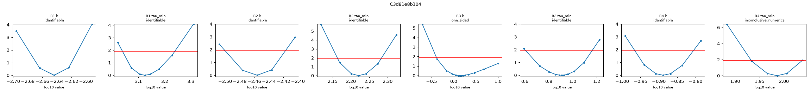
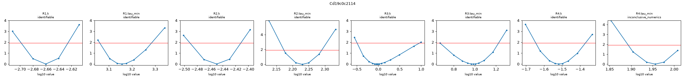
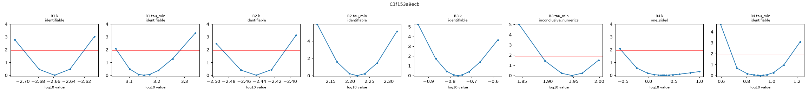
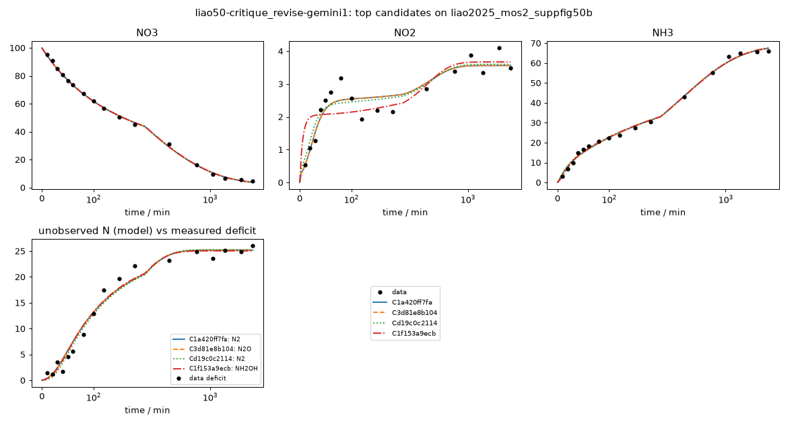

# Investigation report: liao50-critique_revise-gemini1

- Investigation: `liao50`; arm: `critique_revise`; phase: `final_evaluated`
- Protocol: `mle-profiled-v1` (sha256 `9d2cfcb0a1255b8c`); manifest sha256 `76cdbce7cb548123`; evaluator code sha256 `65c1ac7c107bb1ff` ({'python': '3.12.13', 'numpy': '2.5.4', 'scipy': '1.18.1'})
- Development data: `liao2025_mos2_suppfig50b` (sha256 `c291be31813c41e1`, source_data); 51 observations (NO3: t=0 point treated as initial condition, not as an observation; NO2: t=0 point treated as initial condition, not as an observation; NH3: t=0 point treated as initial condition, not as an observation; temperature not reported; 25.0 C assumed (matters only for potential dependence))

## Question
Which reaction networks and rate laws are supported by the 48 h H-cell nitrate-reduction time courses of Liao et al. 2025 (MoS2-family catalysts, -0.6 V vs RHE), what do the data leave ambiguous (in particular where the missing nitrogen goes and why the rates slow down), and which feasible measurement would best separate the surviving explanations?

## System boundary
Catholyte of an H-cell at fixed potential. Measured: NO3-, NO2- and NH4+/NH3 (lumped as NH3) in mM-N. Not measured: gas phase (N2, N2O, NH3 escape), anolyte (crossover), adsorbed or hidden species, pH, charge. Any nitrogen that leaves the measured channels must be represented by an explicit model species (an unmeasured product, a hidden intermediate, or a reservoir for transport out of the catholyte); the model as a whole must conserve N.

## Evidence status
- Partition: Complete experimental runs are reserved. Supp. Fig. 50a (other catalyst, same conditions and sampling) is the final held-out run; it is not read by any development-phase command, tool or evidence file. The final evaluation tests structure transfer: frozen candidate structures are refit on the held-out run with the same protocol (catalysts differ, so parameters are not transferred).
- Contamination: Retrospective analysis with literature-informed priors, not blind discovery: the proposer sees the development run, its derived N-closure series and a curated metadata note, and its pretraining may include general NO3RR mechanism knowledge.

## Ranked candidates (development data, computed in code)

Delta aicc <= 2.0: not distinguished by these data; <= 4.0: still supported. Akaike weights are relative support within this candidate set (one weight per distinct dynamics) under the stated noise model, not probabilities that a mechanism is true. Residual correlation from misspecification makes these differences optimistic.

| candidate | name | source | v | k | AICc | dAICc | weight | band | adequacy | RMSE NH3 | RMSE NO2 | RMSE NO3 | unobserved N end | in declared space | flags |
|---|---|---|---|---|---|---|---|---|---|---|---|---|---|---|
| C1a420ff7fa | dual_path_step_deact_n2 | agent | 1 | 11 | 143.01 | 0.00 | 0.607 | indistinguishable_from_best | poor | 1.3 | 0.353 | 0.871 | 25.2 | no |  |
| C3d81e8b104 | dual_path_step_deact_n2o | reviewer_revision | 2 | 11 | 143.01 | 0.00 | 0.607 | indistinguishable_from_best | poor | 1.3 | 0.353 | 0.871 | 25.2 | no |  |
| Cd19c0c2114 | dual_path_bimol_n2 | reviewer_revision | 2 | 11 | 143.89 | 0.88 | 0.391 | indistinguishable_from_best | poor | 1.3 | 0.361 | 0.882 | 25.3 | no |  |
| C1f153a9ecb | hidden_nh2oh_accumulation | agent | 1 | 11 | 154.65 | 11.64 | 0.002 | less_supported | poor | 1.16 | 0.557 | 0.876 | 25 | no |  |
| C1c46547215 | transient_nh2oh_dual_path | reviewer_revision | 2 | 12 | 160.46 | 17.44 | 0.000 | less_supported | poor | 1.32 | 0.5 | 0.93 | 26.4 | no |  |
| C1ce0d375c1 | interfacial_coupling_n2 | agent | 1 | 9 | 168.32 | 25.31 | 0.000 | less_supported | poor | 1.67 | 0.639 | 0.97 | 24.9 | no |  |
| Cf572a762af | power_no3_bimol_n2 | agent | 1 | 9 | 169.36 | 26.35 | 0.000 | less_supported | poor | 1.96 | 0.555 | 0.979 | 24.8 | no |  |
| C83d6534ba5 | dual_path_tied_no2_tau | reviewer_revision | 2 | 10 | 174.04 | 31.03 | 0.000 | less_supported | poor | 2.11 | 0.585 | 0.894 | 24.2 | no |  |
| Ce0a20103be | alkaline_nh3_volatilization | agent | 1 | 9 | 240.53 | 97.52 | 0.000 | less_supported | poor | 12.2 | 0.398 | 1.79 | 36.6 | no |  |
| C4d82a17858 | series_shared_deact_n2 | agent | 1 | 7 | 247.00 | 103.99 | 0.000 | less_supported | poor | 3.36 | 2.06 | 1.79 | 30.5 | liao-core-v1, liao-extended-v1 |  |

## Observationally equivalent candidates

Same dynamics on the measured channels, different chemistry (e.g. electron count or identity of an unmeasured product): these data cannot separate them.

- C1a420ff7fa, C3d81e8b104

## Top candidates in detail

### C1a420ff7fa `dual_path_step_deact_n2` (source agent, version 1)

Rationale (proposer): Tests whether pathway-specific deactivation in a dual-pathway (series-parallel) network explains all three regimes of the 48 h dataset: (1) near-100% selectivity to NH3 in the first 30-40 min (matching the authors' 0.5 h FE tests [L13]), (2) diversion of the NO2 branch to N2 between 40 and 180 min, and (3) shutdown of the NO2 branch after 180 min leaving a persistent ~3.5 mM-N NO2 pool while direct NO3 -> NH3 continues to 24 h.

    R1: NO3 -> NH3 [mass_action, deactivation(tau); e=8]; R1.k=0.00227 (95% Wald 0.00209-0.00247, well_determined); R1.tau_min=1.33e+03 (95% Wald 1.07e+03-1.67e+03, well_determined)
    R2: NO3 -> NO2 [mass_action, deactivation(tau); e=2]; R2.k=0.0035 (95% Wald 0.00317-0.00387, well_determined); R2.tau_min=166 (95% Wald 145-191, well_determined)
    R3: NO2 -> NH3 [mass_action, deactivation(tau); e=6]; R3.k=1.42 (95% Wald 0.224-9.04, moderately_determined); R3.tau_min=8.08 (95% Wald 3.81-17.1, moderately_determined)
    R4: NO2 -> N2 [mass_action, deactivation(tau); e=3]; R4.k=0.129 (95% Wald 0.106-0.158, well_determined); R4.tau_min=96.8 (95% Wald 85.1-110, well_determined)

- Support entries: {'literature': 3, 'data': 5, 'speculative': 0}; reactions without support: []
  - R1: literature -- Liao et al., Nat. Commun. (2025) [L14] DFT pathway *NO3 -> *NO2 -> *NO -> *N -> *NH -> *NH2 -> *NH3 Direct surface-bound 8-electron reduction of nitrate to ammonia without nitrite desorption into bulk solution.
  - R2: data -- liao2025_mos2_suppfig50b NO2 series Desorption/formation of solution-phase NO2- reaching 3.2-4.1 mM-N.
  - R3: literature -- Liao et al., Nat. Commun. (2025) [L13] main Fig. 5a and SI p.55 Near-unity (99.7%) Faradaic efficiency to NH3 in 0.5 h tests under initial neutral conditions (pH 6.71 [L5]), reflected in rapid initial NO2 -> NH3 conversion before alkaline pH drift.
  - R4: literature -- Liao et al., Nat. Commun. (2025) [L11] DEMS detection of N2 Reduction of solution NO2- to unmeasured N2 gas during the 40-180 min window.
  - R1.time_modulation: data -- liao2025_mos2_suppfig50b NO3 and NH3 series (180-2880 min) Slow deactivation (tau ~ 1000-1400 min) of the direct NO3 -> NH3 pathway explains continued NH3 production from 3 h to 24 h followed by stalling at 4.55 mM-N NO3.
  - R2.time_modulation: data -- liao2025_mos2_suppfig50b n_closure and NO2 series Deactivation of the NO2-forming branch on a ~3 h timescale.
  - R3.time_modulation: data -- liao2025_mos2_suppfig50b NH3 and n_closure series (0-40 min) Fast deactivation of solution NO2 -> NH3 as OH- production drives electrolyte pH from 6.71 toward 11.87 [L5].
  - R4.time_modulation: data -- liao2025_mos2_suppfig50b NO2 and n_closure series (180-2880 min) Deactivation of NO2 -> N2 around tau ~ 100 min halts N loss after 180 min and strands ~3.5 mM-N of unreacted NO2 in solution through 48 h.
- Assumptions (proposer): ['Nitrate reduction operates via both a non-desorbing surface pathway (R1) and a solution-nitrite pathway (R2).', 'Different catalytic steps experience distinct effective deactivation timescales as bulk and local pH drift from 6.71 to ~11.9 in the unbuffered electrolyte.', 'Unmeasured nitrogen is terminal N2 gas.']
- sigma (profiled): NO3=1, NO2=0.353, NH3=1.3; adequacy: poor ['NH3: residual signs cluster (runs test p=0.038)', 'NH3: residuals are serially correlated (lag-1 r=0.54)']
- Profile likelihood: R1.k: identifiable (95% 0.0021-0.00245); R1.tau_min: identifiable (95% 1.1e+03-1.73e+03); R2.k: identifiable (95% 0.00316-0.00383); R2.tau_min: identifiable (95% 146-192); R3.k: one_sided (95% 0.407-10); R3.tau_min: identifiable (95% 4.05-14.5); R4.k: identifiable (95% 0.108-0.156); R4.tau_min: inconclusive_numerics (95% 85.7-109)
  

### C3d81e8b104 `dual_path_step_deact_n2o` (source reviewer_revision, version 2, parent C1ce0d375c1)

Rationale (proposer): Revises C1ce0d375c1 to address review findings F3 and F4: replaces the unphysical termolecular NH3-coupling step and non-deactivating power-law R1 with a purely reductive NO2 -> N2O sink (2 e-, supported by DEMS [L11]). Because R4 has identical concentration kinetics to R4 in C1a420ff7fa (differing only in electron stoichiometry, 2 e- vs 3 e-, and sink identity, N2O vs N2), this candidate is strictly observationally equivalent to C1a420ff7fa on aqueous NO3/NO2/NH3 trajectories, formally proving that gas-phase or coulometric measurements are required to identify the unmeasured sink.

    R1: NO3 -> NH3 [mass_action, deactivation(tau); e=8]; R1.k=0.00227 (95% Wald 0.00209-0.00247, well_determined); R1.tau_min=1.33e+03 (95% Wald 1.07e+03-1.67e+03, well_determined)
    R2: NO3 -> NO2 [mass_action, deactivation(tau); e=2]; R2.k=0.0035 (95% Wald 0.00317-0.00387, well_determined); R2.tau_min=166 (95% Wald 145-191, well_determined)
    R3: NO2 -> NH3 [mass_action, deactivation(tau); e=6]; R3.k=1.42 (95% Wald 0.224-9.04, moderately_determined); R3.tau_min=8.08 (95% Wald 3.81-17.1, moderately_determined)
    R4: NO2 -> N2O [mass_action, deactivation(tau); e=2]; R4.k=0.129 (95% Wald 0.106-0.158, well_determined); R4.tau_min=96.8 (95% Wald 85.1-110, well_determined)

- Support entries: {'literature': 3, 'data': 5, 'speculative': 0}; reactions without support: []
  - R1: literature -- Liao et al., Nat. Commun. (2025) [L14] Direct surface reduction of nitrate to ammonia.
  - R2: data -- liao2025_mos2_suppfig50b NO2 series Formation of solution-phase NO2-.
  - R3: literature -- Liao et al., Nat. Commun. (2025) [L5, L13] Rapid initial reduction of NO2- to NH3.
  - R4: literature -- Liao et al., Nat. Commun. (2025) [L11] DEMS detection of N2O; Katsounaros et al., Electrochim. Acta 71, 270 (2012) Two-electron reduction of NO2- to unmeasured N2O gas.
  - R1.time_modulation: data -- liao2025_mos2_suppfig50b NO3 and NH3 series Slow deactivation of direct NO3 -> NH3.
  - R2.time_modulation: data -- liao2025_mos2_suppfig50b NO2 series Deactivation of NO3 -> NO2.
  - R3.time_modulation: data -- liao2025_mos2_suppfig50b NH3 series (0-40 min) Fast deactivation of solution NO2 -> NH3.
  - R4.time_modulation: data -- liao2025_mos2_suppfig50b n_closure series Deactivation of NO2 -> N2O around 97 min.
- Assumptions (proposer): ['Unmeasured nitrogen (~25 mM-N) is N2O gas formed via 2-electron reduction of NO2- rather than termolecular NH3 oxidation.']
- sigma (profiled): NO3=1, NO2=0.353, NH3=1.3; adequacy: poor ['NH3: residual signs cluster (runs test p=0.038)', 'NH3: residuals are serially correlated (lag-1 r=0.54)']
- Profile likelihood: R1.k: identifiable (95% 0.0021-0.00245); R1.tau_min: identifiable (95% 1.1e+03-1.73e+03); R2.k: identifiable (95% 0.00316-0.00383); R2.tau_min: identifiable (95% 146-192); R3.k: one_sided (95% 0.407-10); R3.tau_min: identifiable (95% 4.05-14.5); R4.k: identifiable (95% 0.108-0.156); R4.tau_min: inconclusive_numerics (95% 85.7-109)
  

### Cd19c0c2114 `dual_path_bimol_n2` (source reviewer_revision, version 2, parent Cf572a762af)

Rationale (proposer): Revises Cf572a762af to address review findings F5, F1, and F4: replaces the collinear non-deactivating power-law R1 with deactivating mass-action R1 and restores the fast initial NO2 -> NH3 pathway (R3) alongside bimolecular 2 NO2 -> 2 N2 (R4). Tests whether quadratic NO2 dependence in the presence of R3 resolves the 10-min NO2 overprediction of Cf572a762af and distinguishes bimolecular from unimolecular N2 formation.

    R1: NO3 -> NH3 [mass_action, deactivation(tau); e=8]; R1.k=0.00219 (95% Wald 0.00199-0.0024, well_determined); R1.tau_min=1.43e+03 (95% Wald 1.11e+03-1.85e+03, well_determined)
    R2: NO3 -> NO2 [mass_action, deactivation(tau); e=2]; R2.k=0.00355 (95% Wald 0.00322-0.00392, well_determined); R2.tau_min=170 (95% Wald 148-195, well_determined)
    R3: NO2 -> NH3 [mass_action, deactivation(tau); e=6]; R3.k=0.926 (95% Wald 0.215-3.99, moderately_determined); R3.tau_min=9.65 (95% Wald 4.81-19.4, moderately_determined)
    R4: 2 NO2 -> 2 N2 [mass_action, deactivation(tau); e=6]; R4.k=0.0303 (95% Wald 0.0223-0.0413, well_determined); R4.tau_min=90.4 (95% Wald 78.2-105, well_determined)

- Support entries: {'literature': 3, 'data': 5, 'speculative': 0}; reactions without support: []
  - R1: literature -- Liao et al., Nat. Commun. (2025) [L14] DFT pathway Direct surface reduction of nitrate to ammonia.
  - R2: data -- liao2025_mos2_suppfig50b NO2 series Formation of solution-phase NO2-.
  - R3: literature -- Liao et al., Nat. Commun. (2025) [L5, L13] 0.5 h FE tests Rapid initial NO2 -> NH3 conversion at neutral pH prevents the 10-min NO2 overprediction seen in Cf572a762af.
  - R4: literature -- Polatides & Kyriacou, J. Appl. Electrochem. 35, 421 (2005) Fig. 3; Liao et al. (2025) [L11] Bimolecular second-order reduction of two NO2- equivalents to N2 gas.
  - R1.time_modulation: data -- liao2025_mos2_suppfig50b NO3 and NH3 series Replaces the collinear power-law R1 of Cf572a762af with catalyst deactivation.
  - R2.time_modulation: data -- liao2025_mos2_suppfig50b NO2 and n_closure series Deactivation of NO3 -> NO2 branch around 3 h.
  - R3.time_modulation: data -- liao2025_mos2_suppfig50b NH3 and NO2 series (0-40 min) Fast deactivation of solution NO2 -> NH3 as electrolyte drifts alkaline.
  - R4.time_modulation: data -- liao2025_mos2_suppfig50b NO2 and n_closure series (180-2880 min) Deactivation of 2 NO2 -> 2 N2 halts N loss after 180 min and leaves ~3.5 mM-N NO2 in solution.
- Assumptions (proposer): ['Nitrate reduction combines a direct surface pathway (R1) and a solution-nitrite pathway (R2).', 'N2 formation is second-order in solution NO2- (R4: 2 NO2 -> 2 N2) and competes with fast initial NO2 -> NH3 reduction (R3).']
- sigma (profiled): NO3=1, NO2=0.361, NH3=1.3; adequacy: poor ['NH3: residual signs cluster (runs test p=0.028)', 'NH3: residuals are serially correlated (lag-1 r=0.53)']
- Profile likelihood: R1.k: identifiable (95% 0.002-0.00237); R1.tau_min: identifiable (95% 1.15e+03-1.92e+03); R2.k: identifiable (95% 0.00323-0.00387); R2.tau_min: identifiable (95% 149-195); R3.k: identifiable (95% 0.32-9.13); R3.tau_min: identifiable (95% 4.67-16.7); R4.k: identifiable (95% 0.0226-0.0426); R4.tau_min: inconclusive_numerics (95% 78.2-102)
  

### C1f153a9ecb `hidden_nh2oh_accumulation` (source agent, version 1)

Rationale (proposer): Tests the liquid-phase hidden-intermediate explanation against gas-phase N2 loss. Because the analytical protocol only assays NO3-, NO2-, and NH3/NH4+ [L10] while DEMS detects NH2OH [L11], an unmeasured aqueous pool of ~25 mM-N NH2OH produces virtually identical NO3, NO2, and NH3 time courses to the N2-sink model (dual_path_step_deact_n2), demonstrating that aqueous-only measurements of NO3/NO2/NH3 cannot distinguish dissolved NH2OH accumulation from N2 gas evolution without an explicit NH2OH assay or headspace N2 quantification.

    R1: NO3 -> NH3 [mass_action, deactivation(tau); e=8]; R1.k=0.0022 (95% Wald 0.00198-0.00243, well_determined); R1.tau_min=1.43e+03 (95% Wald 1.1e+03-1.85e+03, well_determined)
    R2: NO3 -> NO2 [mass_action, deactivation(tau); e=2]; R2.k=0.0036 (95% Wald 0.00325-0.00398, well_determined); R2.tau_min=165 (95% Wald 145-189, well_determined)
    R3: NO2 -> NH2OH [mass_action, deactivation(tau); e=4]; R3.k=0.172 (95% Wald 0.135-0.22, well_determined); R3.tau_min=88.5 (95% Wald 77.6-101, well_determined)
    R4: NH2OH -> NH3 [mass_action, deactivation(tau); e=2]; R4.k=1.97 (95% Wald 0.045-10, poorly_determined); R4.tau_min=8.12 (95% Wald 3.05-21.7, moderately_determined)

- Support entries: {'literature': 4, 'data': 4, 'speculative': 1}; reactions without support: []
  - species:NH2OH: literature -- Liao et al., Nat. Commun. (2025) [L10, L11] DEMS paragraph and Methods; Katsounaros et al., Electrochim. Acta 71, 270 (2012) NH2OH is detected by DEMS in Liao et al. [L11] and is not measured by the salicylic acid, UV, or Griess assays [L10].
  - R1: literature -- Liao et al., Nat. Commun. (2025) [L14] Direct surface reduction of NO3- to NH3.
  - R2: data -- liao2025_mos2_suppfig50b NO2 series Formation of solution-phase NO2-.
  - R3: literature -- Katsounaros et al., Electrochim. Acta 71, 270 (2012) Model B; Liao et al. (2025) [L11] Four-electron reduction of NO2- to hidden intermediate NH2OH.
  - R4: literature -- Katsounaros et al., Electrochim. Acta 71, 270 (2012) Model B Two-electron reduction of NH2OH to NH3.
  - R1.time_modulation: data -- liao2025_mos2_suppfig50b NO3 and NH3 series Slow deactivation of direct NO3 -> NH3 over 48 h.
  - R2.time_modulation: data -- liao2025_mos2_suppfig50b NO2 and n_closure series Deactivation of NO3 -> NO2 branch around 3 h.
  - R3.time_modulation: data -- liao2025_mos2_suppfig50b NO2 and n_closure series Deactivation of NO2 -> NH2OH leaves ~3.5 mM-N NO2 in solution.
  - R4.time_modulation: speculative --  Rapid deactivation of NH2OH -> NH3 as electrolyte pH rises above pKa of NH3OH+ (~6.0), deprotonating NH3OH+ to neutral NH2OH and trapping ~25 mM-N NH2OH in solution.
- Assumptions (proposer): ['Unmeasured nitrogen (~25 mM-N, or 25% of total N, below the 30% plausibility cap) remains dissolved in the catholyte as unmeasured NH2OH rather than escaping to the gas phase.', 'Deprotonation of NH3OH+ (pKa ~ 6.0) as the unbuffered electrolyte becomes alkaline rapidly shuts down NH2OH electroreduction to NH3.']
- sigma (profiled): NO3=1, NO2=0.557, NH3=1.16; adequacy: poor ['NO2: residuals are serially correlated (lag-1 r=0.62)', 'NH3: residual signs cluster (runs test p=0.038)']
- Profile likelihood: R1.k: identifiable (95% 0.002-0.0024); R1.tau_min: identifiable (95% 1.14e+03-1.92e+03); R2.k: identifiable (95% 0.00325-0.00392); R2.tau_min: identifiable (95% 145-189); R3.k: identifiable (95% 0.135-0.228); R3.tau_min: inconclusive_numerics (95% 77.2-99.7); R4.k: one_sided (95% 0.295-10); R4.tau_min: identifiable (95% 4.83-14.3)
  

## Discrimination analysis (discrimination-1.json)

A design is {"name", "c0_mM_N": {...}, "t_end_min", optional "observe": [species ids to measure]}. Predictions use
    each candidate's development MLE; parameter uncertainty is not propagated, so large disagreement is a lead for an
    experiment, not a quantified expected information gain.

- Design `nitrite_20mM_feed_with_gas_and_nh2oh` {"name": "nitrite_20mM_feed_with_gas_and_nh2oh", "observe": ["NO2", "NH3", "N2", "N2O", "NH2OH"], "c0_mM_N": {"NO2": 20}, "t_end_min": 360}:
  - NH3: max spread 18.2 mM-N at 157 min (13.9 dev sigma); {'C1a420ff7fa': 18.2, 'Cd19c0c2114': 12.6, 'C3d81e8b104': 18.2, 'C1c46547215': 5.2, 'Cf572a762af': 0.0, 'C83d6534ba5': 2.6}
  - species:NH3: max spread 18.2 mM-N at 157 min (- dev sigma); {'C1a420ff7fa': 18.2, 'Cd19c0c2114': 12.6, 'C3d81e8b104': 18.2, 'C1c46547215': 5.2, 'Cf572a762af': 0.0, 'C83d6534ba5': 2.6}
  - unmeasured_N_total: max spread 18 mM-N at 360 min (- dev sigma); {'C1a420ff7fa': 1.8, 'Cd19c0c2114': 7.4, 'C3d81e8b104': 1.8, 'C1c46547215': 10.06, 'Cf572a762af': 19.82, 'C83d6534ba5': 17.39}
  - NO2: max spread 15.3 mM-N at 1.81 min (43.4 dev sigma); {'C1a420ff7fa': 1.58, 'Cd19c0c2114': 2.08, 'C3d81e8b104': 1.58, 'C1c46547215': 16.89, 'Cf572a762af': 6.68, 'C83d6534ba5': 5.25}
  - species:NO2: max spread 15.3 mM-N at 1.81 min (- dev sigma); {'C1a420ff7fa': 1.58, 'Cd19c0c2114': 2.08, 'C3d81e8b104': 1.58, 'C1c46547215': 16.89, 'Cf572a762af': 6.68, 'C83d6534ba5': 5.25}
- Design `low_nitrate_10mM_feed` {"t_end_min": 360, "c0_mM_N": {"NO3": 10}, "observe": ["NO3", "NO2", "NH3", "N2", "N2O", "NH2OH"], "name": "low_nitrate_10mM_feed"}:
  - NH3: max spread 3.68 mM-N at 360 min (2.82 dev sigma); {'C1a420ff7fa': 4.36, 'Cd19c0c2114': 4.47, 'C3d81e8b104': 4.36, 'C1c46547215': 4.3, 'Cf572a762af': 1.78, 'C83d6534ba5': 5.46}
  - species:NH3: max spread 3.68 mM-N at 360 min (- dev sigma); {'C1a420ff7fa': 4.36, 'Cd19c0c2114': 4.47, 'C3d81e8b104': 4.36, 'C1c46547215': 4.3, 'Cf572a762af': 1.78, 'C83d6534ba5': 5.46}
  - NO3: max spread 2.1 mM-N at 360 min (2.1 dev sigma); {'C1a420ff7fa': 2.92, 'Cd19c0c2114': 2.93, 'C3d81e8b104': 2.92, 'C1c46547215': 3.0, 'Cf572a762af': 5.0, 'C83d6534ba5': 2.9}
  - species:NO3: max spread 2.1 mM-N at 360 min (- dev sigma); {'C1a420ff7fa': 2.92, 'Cd19c0c2114': 2.93, 'C3d81e8b104': 2.92, 'C1c46547215': 3.0, 'Cf572a762af': 5.0, 'C83d6534ba5': 2.9}
  - unmeasured_N_total: max spread 1.4 mM-N at 360 min (- dev sigma); {'C1a420ff7fa': 2.42, 'Cd19c0c2114': 1.72, 'C3d81e8b104': 2.42, 'C1c46547215': 2.43, 'Cf572a762af': 2.22, 'C83d6534ba5': 1.03}
- Design `standard_100mM_with_headspace_and_nh2oh` {"t_end_min": 2880, "c0_mM_N": {"NO3": 100}, "observe": ["NO3", "NO2", "NH3", "N2", "N2O", "NH2OH"], "name": "standard_100mM_with_headspace_and_nh2oh"}:
  - unmeasured_N_total: max spread 3.5 mM-N at 43.4 min (- dev sigma); {'C1a420ff7fa': 4.64, 'Cd19c0c2114': 3.92, 'C3d81e8b104': 4.64, 'C1c46547215': 6.04, 'Cf572a762af': 6.44, 'C83d6534ba5': 7.42}
  - NH3: max spread 3.4 mM-N at 28.9 min (2.6 dev sigma); {'C1a420ff7fa': 10.81, 'Cd19c0c2114': 11.21, 'C3d81e8b104': 10.81, 'C1c46547215': 9.17, 'Cf572a762af': 8.47, 'C83d6534ba5': 7.82}
  - species:NH3: max spread 3.4 mM-N at 28.9 min (- dev sigma); {'C1a420ff7fa': 10.81, 'Cd19c0c2114': 11.21, 'C3d81e8b104': 10.81, 'C1c46547215': 9.17, 'Cf572a762af': 8.47, 'C83d6534ba5': 7.82}
  - NO2: max spread 1.2 mM-N at 14.5 min (3.4 dev sigma); {'C1a420ff7fa': 0.71, 'Cd19c0c2114': 0.96, 'C3d81e8b104': 0.71, 'C1c46547215': 1.72, 'Cf572a762af': 1.91, 'C83d6534ba5': 1.87}
  - species:NO2: max spread 1.2 mM-N at 14.5 min (- dev sigma); {'C1a420ff7fa': 0.71, 'Cd19c0c2114': 0.96, 'C3d81e8b104': 0.71, 'C1c46547215': 1.72, 'Cf572a762af': 1.91, 'C83d6534ba5': 1.87}

## Review B3566decd4839-R1 (bundle B3566decd4839; reviewer openrouter/google/gemini-4-argon)

An interpretation of the frozen bundle, not experimental validation.

This review examines six Round-1 candidate mechanisms fitted to the 48 h MoS2 nitrate reduction dataset (liao2025_mos2_suppfig50b). While the candidate set successfully falsifies uniform sequential deactivation (C4d82a17858, delta_aicc = 103.99) and continuous alkaline NH3 volatilization (Ce0a20103be, delta_aicc = 97.52), no candidate achieves statistical adequacy (all six are rated 'poor'). The top-ranked model C1a420ff7fa (dual_path_step_deact_n2, AICc = 143.01) captures the late-time ~3.5 mM-N NO2 plateau and ~25 mM-N N-closure deficit, but relies on four independent exponential deactivation clocks spanning 8.08 to 1333.67 min—where the 8.08 min NO2 -> NH3 decay constant is shorter than the first 10 min sampling interval (causing strong collinearity, r = -0.957, and multistart trapping in 8 of 12 runs)—and still exhibits serially correlated NH3 residuals (lag-1 r = 0.54, runs p = 0.038) while missing the non-monotonic NO2 peak-and-dip at 80-120 min. Furthermore, the 11.64 AICc gap between C1a420ff7fa (N2 sink) and C1f153a9ecb (hidden NH2OH) stems from sequential vs parallel network wiring rather than identifiability of the unmeasured N pool, and a promising hybrid mechanism combining fast initial NO2 -> NH3 reduction with bimolecular 2 NO2 -> 2 N2 coupling remains untested.

- **F1** [major/statistics] All six candidates fail statistical adequacy (adequacy = 'poor'), and even the top-ranked 8-parameter model C1a420ff7fa exhibits significant serial correlation and sign clustering in NH3 residuals (runs test p = 0.0377, lag-1 r = 0.537) while failing to capture the non-monotonic NO2 peak at 80 min (3.1862 mM-N) and dip at 120 min (1.9244 mM-N). (targets: evaluation:C1a420ff7fa#/summary/adequacy, evaluation:C1a420ff7fa#/residuals/channels/NH3/runs_test_p, evaluation:C1a420ff7fa#/residuals/channels/NH3/lag1_autocorr, evaluation:C1a420ff7fa#/residuals/channels/NO2/predicted/6, evaluation:C1a420ff7fa#/residuals/channels/NO2/predicted/8, comparison#/ranking/groups/0/rows/0/adequacy; check: numerical; action: new_candidate -- Formulate and fit a candidate that replaces smooth t=0 exponential decay on the NO2 consumption branches with a mechanism capable of an induction delay (such as bimolecular 2 NO2 -> 2 N2 coupled with fast initial NO2 -> NH3, or pH/OH--accumulated gating), and interpret current AICc rankings cautiously given correlated NH3 residuals.)
- **F2** [major/chemistry] C1a420ff7fa and C1f153a9ecb rely on four independent exponential deactivation clocks spanning two orders of magnitude (8.08 to 1333.67 min in C1a420ff7fa) on a single catalyst, where the ~8.1 min decay constant is shorter than the first post-zero sampling time (10.0002 min), causing severe parameter collinearity (r = -0.957 in C1a420ff7fa; r = -0.983 and upper-bound CI clipping in C1f153a9ecb) and raising a mechanistic conflict with shared downstream surface intermediates (*NO2 -> *NO -> *NH3). (targets: candidate:C1a420ff7fa#/submission/mechanism/reactions/2/rate_law/time_modulation/tau_min, evaluation:C1a420ff7fa#/summary/params/R3.tau_min/value, evaluation:C1a420ff7fa#/uncertainty/high_correlations/0/r, evaluation:C1f153a9ecb#/summary/params/R4.tau_min/value, evaluation:C1f153a9ecb#/uncertainty/params/6/wald_ci95_clipped_at_bounds, evaluation:C1f153a9ecb#/uncertainty/high_correlations/0/r; check: consistency; action: additional_analysis -- Compute profile likelihoods for R3.k and R3.tau_min in C1a420ff7fa, test tying deactivation timescales of shared surface pathways or coupling them to a single pH/overpotential state variable, and verify experimentally via nitrite-feed electrolysis at pH 6.7 vs pH 11.9 whether solution NO2- reduction to NH3 shuts down while NO3- reduction to NH3 continues.)
- **F3** [major/interpretation] The rationale of C1f153a9ecb claims that hidden NH2OH accumulation produces virtually identical trajectories to C1a420ff7fa, yet C1f153a9ecb is penalized by delta_aicc = 11.64 (Akaike weight 0.0030 vs 0.9970). This AICc gap does not distinguish N2 gas from aqueous NH2OH; it is an artifact of wiring NH2OH sequentially (NO2 -> NH2OH -> NH3, which bottlenecks early NO2 removal through R3.k = 0.172 min^-1 and increases NO2 RMSE from 0.353 to 0.557 mM-N) rather than in parallel, while physically ~25.0 mM NH2OH is unstable against alkaline disproportionation over 48 h. (targets: candidate:C1f153a9ecb#/submission/rationale, comparison#/ranking/groups/0/rows/1/delta_aicc, evaluation:C1f153a9ecb#/summary/rmse/NO2, evaluation:C1f153a9ecb#/summary/unobserved_N_end_mM; check: consistency; action: reinterpret -- Reinterpret the comparison between C1a420ff7fa and C1f153a9ecb: note that a parallel unmeasured sink (whether N2, N2O, NO, anolyte crossover, or a parallel hidden intermediate) is mathematically indistinguishable from C1a420ff7fa on aqueous NO3/NO2/NH3 data alone, whereas accumulating 25 mM NH2OH over 48 h at pH ~11.9 is chemically unlikely without stabilization.)
- **F4** [major/chemistry] C1ce0d375c1 postulates an unphysical termolecular mass-action step R3 (2 NO2 + NH3 + 3 e- -> 3 N2, rate proportional to [NO2]^2[NH3]) in which bulk reduced NH3 (oxidation state -3) is oxidized at a cathode held at -0.6 V vs RHE without literature support. Additionally, both C1ce0d375c1 and Cf572a762af assume zero catalyst deactivation on R1 (NO3 -> NH3) while deactivating R2 and R3 on the same catalyst, yielding near-singular collinearity between R1.k and R1.order.NO3 (r = -0.996 and r = -0.995). (targets: candidate:C1ce0d375c1#/submission/mechanism/reactions/2, candidate:C1ce0d375c1#/submission/support/3/basis, evaluation:C1ce0d375c1#/uncertainty/high_correlations/0/r, evaluation:Cf572a762af#/uncertainty/high_correlations/0/r; check: assumption; action: reinterpret -- Reject C1ce0d375c1's termolecular cathodic NH3-oxidation step R3, and test power-law NO3 kinetics only in experiments that vary initial [NO3-]0 (e.g., 10 mM vs 100 mM) rather than relying on a single decaying trajectory where k and reaction order are collinear.)
- **F5** [major/coverage] The investigation terminated after Round 1 without testing a hybrid of C1a420ff7fa and Cf572a762af: a dual-pathway mechanism retaining fast initial NO2 -> NH3 reduction (R3) while modeling N2 evolution as bimolecular 2 NO2 -> 2 N2 (R4). Cf572a762af's poor fit (delta_aicc = 26.35) was confounded by omitting NO2 -> NH3 (causing a 3-fold NO2 overprediction at 10 min: 1.670 vs 0.541 mM-N observed), whereas quadratic 2 NO2 -> 2 N2 in the presence of NO2 -> NH3 would naturally delay N2 evolution until [NO2] accumulates after ~40 min. (targets: candidate:C1a420ff7fa#/submission/mechanism/reactions/3, candidate:Cf572a762af#/submission/mechanism/reactions, evaluation:Cf572a762af#/residuals/channels/NO2/predicted/0; check: consistency; action: new_candidate -- Propose and evaluate a dual-pathway candidate combining R1: NO3 -> NH3 (deactivating), R2: NO3 -> NO2 (deactivating), R3: NO2 -> NH3 (fast initial, deactivating), and R4: 2 NO2 -> 2 N2 (bimolecular mass-action, deactivating) to test whether quadratic NO2 dependence captures both the 0-40 min N-loss lag and the 80-120 min NO2 peak-and-trough.)
- **F6** [minor/numerics] In evaluation:C1a420ff7fa, only 4 of 12 multistart runs located the best NLL (57.121), while 7 of 12 starts converged to a suboptimal local minimum at NLL = 66.163 (and 1 start failed formal convergence); furthermore, no profile likelihoods were computed for any candidate despite high Fisher condition numbers (8371.6 in C1a420ff7fa and 30518.4 in C1f153a9ecb). (targets: evaluation:C1a420ff7fa#/multistart/replicates, evaluation:C1a420ff7fa#/multistart/nll_by_start/2, evaluation:C1a420ff7fa#/uncertainty/fim_condition_number, evaluation:C1f153a9ecb#/multistart/nll_by_start/1; check: numerical; action: additional_analysis -- Run profile-likelihood scans on the 8 parameters of C1a420ff7fa and C1f153a9ecb and inspect the parameter vector of the nll = 66.163 secondary optimum in C1a420ff7fa.)
- **F7** [minor/data] Critical experimental metadata for dataset:liao2025_mos2_suppfig50b are unreported—including pH trajectory [L5], which pH was used in the uncompensated SCE-to-RHE conversion E(RHE) = E(SCE) + 0.244 + 0.0591 pH [L7], H-cell membrane identity [L8], and anolyte crossover [L11]—while statistically, sigma.NO3 is clamped at the 1% relative floor (0.9995 mM-N vs RMSE = 0.871 mM-N in C1a420ff7fa) across all top four models, making AICc differences sensitive primarily to NO2 and NH3. (targets: dataset:liao2025_mos2_suppfig50b#/unresolved_metadata, evidence:literature#/2/statement, evidence:literature#/4/statement, evidence:literature#/8/statement, evaluation:C1a420ff7fa#/summary/sigma/NO3; check: literature; action: experiment -- Measure time-resolved catholyte pH, working-electrode potential vs RHE with iR compensation, headspace N2/N2O/NH3, and anolyte crossover in a buffered vs unbuffered 48 h H-cell run, and note the NO3 sigma floor when interpreting AICc differences.)

Assessment: plausible ['C1a420ff7fa', 'Cf572a762af']; adequate candidate exists: no; ambiguities: ['Identity of the ~25-26 mM-N unmeasured nitrogen pool: aqueous NO3-, NO2-, and NH3 trajectories alone cannot distinguish terminal N2 gas evolution from other unmeasured gaseous products detected by DEMS (N2O, NO [L11]), anolyte crossover across the unspecified H-cell membrane [L8, L11], or a parallel-branch unmeasured aqueous species, because no gas quantification, NH2OH assay, or anolyte analysis was performed for the 48 h run [L11, L12].', 'Physical driver of the multi-timescale slowdown and 40-180 min selectivity switch: because the 0.5 M K2SO4 electrolyte is unbuffered (pH drifting from 6.71 to ~11.87 in related runs [L5]) and controlled vs SCE without iR compensation [L7], the effective cathode potential vs local/bulk RHE shifts positively by ~0.30 V as OH- accumulates, confounding intrinsic catalyst deactivation with pH-driven thermodynamic overpotential loss and proton-transfer gating.', 'Unimolecular vs bimolecular NO2-to-N2 kinetics: C1a420ff7fa models NO2 -> N2 as first-order in NO2 (missing the 0-40 min N-loss induction lag and the non-monotonic NO2 peak at 80 min and dip at 120 min), whereas Cf572a762af models 2 NO2 -> 2 N2 as second-order but omits the initial NO2 -> NH3 pathway, leaving untested whether a dual-pathway model with NO2 -> NH3 plus bimolecular 2 NO2 -> 2 N2 resolves both residuals.']

Investigator response:
- F1: revised ['Cd19c0c2114', 'C1c46547215'] -- Submitted and evaluated two revised candidates targeting the early-time induction delay and NH3/NO2 residual structure: (1) Cd19c0c2114 (dual_path_bimol_n2, parent Cf572a762af) combining fast initial NO2 -> NH3 (R3) with quadratic 2 NO2 -> 2 N2 (R4), achieving AICc = 143.89 (dAICc = 0.88 from C1a420ff7fa, NH3 RMSE = 1.297 mM-N, NO2 RMSE = 0.361 mM-N), and (2) C1c46547215 (transient_nh2oh_dual_path, parent C1f153a9ecb) introducing a non-deactivating transient NH2OH holdup between NO2 and NH3 in parallel with NO2 -> N2. While NO3 and NO2 pass all residual adequacy checks in C1a420ff7fa and Cd19c0c2114, NH3 residuals still show mild serial correlation (lag-1 r = 0.530-0.537, runs p = 0.028-0.038) and no smooth autonomous/exponential-modulation rate law in the schema captures the sharp non-monotonic NO2 peak at 80 min (3.19 mM-N) and dip at 120 min (1.92 mM-N), which likely reflects unmodeled pH/potential shifts in the unbuffered electrolyte. AICc rankings are therefore interpreted cautiously with adequacy reported as poor/uncertain.
- F2: revised ['C83d6534ba5', 'C1c46547215'] -- Computed full profile likelihoods for C1a420ff7fa, C1f153a9ecb, Cd19c0c2114, and C83d6534ba5, confirming that R3.k in C1a420ff7fa is one-sided ([0.407, 10.0] min^-1) while R3.tau_min is identifiable ([4.05, 14.51] min), whereas in bimolecular Cd19c0c2114 R3.k becomes identifiable on both sides ([0.320, 9.129] min^-1, FIM condition number reduced from 8371.6 to 4620.2). Also submitted C83d6534ba5 (dual_path_tied_no2_tau, parent C1a420ff7fa) tying the deactivation of R3 (NO2 -> NH3) and R4 (2 NO2 -> 2 N2) into a single shared parameter (tie:tau_no2 = 84.7 min, 9/12 multistart replicates, FIM condition number = 1646.1, zero high correlations), which degrades AICc by +31.03 units (to 174.05) because a 3x change in [NO2] alone without faster R3 deactivation cannot reproduce the sharp transition from ~100% NH3 selectivity (0-40 min) to N2 evolution (40-180 min). Recommended nitrite-feed electrolysis at pH 6.7 vs pH 11.9 (simulated via nw_discriminate) to test this selectivity switch directly.
- F3: revised ['C3d81e8b104', 'C1c46547215'] -- Accepted the reviewer's critique of C1f153a9ecb and submitted two revisions: (1) C3d81e8b104 (dual_path_step_deact_n2o, parent C1ce0d375c1), which models a parallel unmeasured NO2 -> N2O (2 e-) sink and has the exact same dynamics_hash as C1a420ff7fa (AICc = 143.01, delta_aicc = 0.00, registered as observationally_equivalent_to C1a420ff7fa), formally demonstrating that parallel unmeasured sinks (N2, N2O, NO, crossover, or a parallel aqueous byproduct) are mathematically indistinguishable on aqueous NO3/NO2/NH3 data; and (2) C1c46547215 (transient_nh2oh_dual_path, parent C1f153a9ecb), which wires NO2 -> N2 in parallel with transient NH2OH -> NH3 (without R4 deactivation). C1f153a9ecb is rejected as both statistically inferior (sequential NO2 bottleneck) and chemically implausible (25 mM NH2OH is unstable against alkaline disproportionation at pH ~11.9 over 48 h).
- F4: revised ['C3d81e8b104', 'Cd19c0c2114'] -- Accepted the finding and rejected C1ce0d375c1 in our assessment: replaced C1ce0d375c1 with C3d81e8b104 (parent C1ce0d375c1), eliminating the unphysical termolecular cathodic NH3-oxidation step (2 NO2 + NH3 -> 3 N2) and replacing the non-deactivating power-law R1 with deactivating mass-action R1. Likewise revised Cf572a762af into Cd19c0c2114 (parent Cf572a762af) with deactivating mass-action R1, eliminating the r = -0.995 collinearity between R1.k and R1.order.NO3. Used nw_discriminate at 10 mM vs 100 mM initial NO3- to show how varying initial [NO3-]0 separates power-law order from time-dependent deactivation.
- F5: revised ['Cd19c0c2114'] -- Submitted and evaluated the exact hybrid candidate requested: Cd19c0c2114 (dual_path_bimol_n2, parent Cf572a762af), combining deactivating R1: NO3 -> NH3, R2: NO3 -> NO2, fast initial R3: NO2 -> NH3, and bimolecular R4: 2 NO2 -> 2 N2. Restoring R3 reduces the 10-min predicted NO2 from 1.670 mM-N (in Cf572a762af) to 0.728 mM-N (vs 0.541 mM-N observed), cuts NO2 RMSE from 0.555 to 0.361 mM-N, and improves AICc by 25.47 units to 143.89 (dAICc = 0.88 from C1a420ff7fa, indistinguishable_from_best band). This confirms that Cf572a762af's poor fit was caused by omitting R3 rather than by bimolecular N2 kinetics, and shows that unimolecular (C1a420ff7fa) and bimolecular (Cd19c0c2114) NO2-to-N2 rate laws are not distinguished by the 100 mM NO3- dataset alone (dAICc = 0.88 <= 2.0).
- F6: analysis ['C1a420ff7fa', 'C1f153a9ecb', 'Cd19c0c2114', 'C83d6534ba5'] -- Ran profile-likelihood scans (nw_profile) on C1a420ff7fa, C1f153a9ecb, Cd19c0c2114, and C83d6534ba5, and inspected the parameter vector of the secondary local minimum (NLL = 66.162953) in C1a420ff7fa where 7 of 12 starts converged. The NLL = 66.163 basin corresponds to a role-swapped pathway assignment in which direct R1 (NO3 -> NH3) takes the fast deactivation timescale (R1.k = 0.00339 min^-1, R1.tau_min = 118.9 min) while sequential R2 (NO3 -> NO2) takes the slow timescale (R2.k = 0.00266 min^-1, R2.tau_min = 1176.0 min) with moderate R3 (NO2 -> NH3, R3.k = 0.0272 min^-1, R3.tau_min = 512.0 min) and R4 (NO2 -> N2, R4.k = 0.1136 min^-1, R4.tau_min = 104.5 min). Because R1 and R2->R3 are parallel routes from NO3 to NH3, random Latin-hypercube starts that initialize R3.tau_min > 50 min converge to the role-swapped basin (NLL = 66.163) rather than the narrow R3.tau_min = 8.08 min global basin (NLL = 57.121).
- F7: analysis ['C1a420ff7fa', 'Cd19c0c2114', 'C3d81e8b104'] -- Verified that sigma.NO3 is clamped at the 1% relative floor (0.9995 mM-N vs actual NO3 RMSE = 0.871-0.894 mM-N) across C1a420ff7fa, C3d81e8b104, Cd19c0c2114, and C83d6534ba5, so log-likelihood and AICc differences among the top models are driven almost entirely by the NO2 (sigma ~ 0.35-0.59 mM-N) and NH3 (sigma ~ 1.30-2.11 mM-N) channels. Incorporated the unreported pH trajectory [L5], uncompensated SCE-to-RHE conversion drift (+0.305 V for delta_pH = 5.16 [L7]), and missing headspace/anolyte measurements [L8, L11] into our ambiguities and experimental design recommendations.

## Investigator conclusion (conclusion-1.json; an interpretation, numbers above are authoritative)

Across 10 evaluated candidates (6 in Round 1 and 4 reviewer-driven revisions in Round 2), the 48 h H-cell nitrate reduction dataset on MoS2 (liao2025_mos2_suppfig50b) strongly falsifies both uniform sequential catalyst deactivation (C4d82a17858, AICc = 247.00, dAICc = 103.99) and continuous physical NH3 volatilization from the alkaline electrolyte (Ce0a20103be, AICc = 240.53, dAICc = 97.52). A single shared deactivation clock across NO3 -> NO2 -> NH3 forces predicted NO2- to decay to 0.19 mM-N at 48 h (missing the persistent ~3.5 mM-N NO2- plateau) and cannot decouple early nitrogen loss (40-180 min) from continued ammonia synthesis (180-1440 min), while continuous first-order NH3 volatilization predicts [NH3] to peak at 74.95 mM-N at 720 min and decline to 52.63 mM-N at 2880 min, contradicting the observed 65.0-65.9 mM-N late-time NH3 plateau and constant N closure (~0.74-0.77) from 360 to 2880 min.

The best-supported mechanisms are dual-pathway (series-parallel) networks combining slow-deactivating direct surface reduction (R1: NO3 -> NH3, tau ~ 1334-1431 min) with a faster-deactivating solution-nitrite pathway (R2: NO3 -> NO2, tau ~ 166-170 min) that initially reduces NO2- to NH3 (R3: NO2 -> NH3, tau ~ 8.1-9.6 min, consistent with the 99.7% FE reported in 0.5 h neutral-pH tests [L5, L13]) before diverting NO2- to an unmeasured gaseous sink (R4, tau ~ 90-97 min) that shuts down by ~180 min and strands ~3.56-3.60 mM-N of unreacted NO2-. Three candidates lie within the indistinguishable top band (dAICc <= 2.0): C1a420ff7fa (unimolecular NO2 -> N2, AICc = 143.01), C3d81e8b104 (unimolecular NO2 -> N2O, AICc = 143.01, strictly observationally equivalent to C1a420ff7fa), and Cd19c0c2114 (bimolecular 2 NO2 -> 2 N2, AICc = 143.89, dAICc = 0.88). Restoring fast initial NO2 -> NH3 in Cd19c0c2114 improved AICc by 25.47 units over its parent Cf572a762af (AICc = 169.36) and made R3.k two-sided identifiable on profile likelihood ([0.320, 9.129] min^-1 vs one-sided [0.407, 10.0] min^-1 in C1a420ff7fa). Conversely, forcing R3 and R4 to share a single deactivation clock in C83d6534ba5 (tie:tau_no2 = 84.7 min) degraded AICc by 31.03 units (to 174.05), showing that concentration-order differences alone without faster R3 deactivation cannot capture the sharp 0-40 min vs 40-180 min selectivity switch.

Nevertheless, no candidate achieves statistical adequacy (all are rated 'poor'): even C1a420ff7fa, C3d81e8b104, and Cd19c0c2114 (which pass residual checks on NO3 and NO2 with RMSEs of 0.87-0.88 and 0.35-0.36 mM-N) exhibit mild sign clustering and serial correlation in NH3 residuals (RMSE = 1.30 mM-N, runs p = 0.028-0.038, lag-1 r = 0.530-0.537) and cannot reproduce the non-monotonic NO2 peak at 80 min (3.19 mM-N) and trough at 120 min (1.92 mM-N) or rely on a sub-10-min empirical R3 decay constant that proxies for unmeasured pH and potential drift.

- Plausible: ['C1a420ff7fa', 'C3d81e8b104', 'Cd19c0c2114']
- Adequacy: none_adequate
- Rejected: [{'candidate_id': 'C4d82a17858', 'reason': 'Strongly rejected (AICc = 247.00, dAICc = 103.99; NO2 RMSE = 2.064 mM-N, lag-1 r = 0.95; NH3 RMSE = 3.356 mM-N, lag-1 r = 0.83) because uniform sequential deactivation forces NO2 to decay to 0.19 mM-N at 48 h and couples N2 evolution to NH3 formation throughout the run.'}, {'candidate_id': 'Ce0a20103be', 'reason': 'Strongly rejected (AICc = 240.53, dAICc = 97.52; NH3 RMSE = 12.188 mM-N, lag-1 r = 0.87, runs p = 0.00071) because non-deactivating physical NH3 volatilization causes predicted [NH3] to peak at 74.95 mM-N (720 min) and fall to 52.63 mM-N (2880 min), contradicting the observed late-time NH3 plateau (65.0-65.9 mM-N).'}, {'candidate_id': 'C83d6534ba5', 'reason': 'Statistically disfavored (AICc = 174.05, dAICc = 31.03; NH3 RMSE = 2.114 mM-N, runs p = 0.0067, lag-1 r = 0.77) because tying R3 (NO2 -> NH3) and R4 (2 NO2 -> 2 N2) to a single deactivation time constant (tau_no2 = 84.7 min) cannot capture the sharp transition from near-unity NH3 selectivity at 0-40 min to N2 loss at 40-180 min.'}, {'candidate_id': 'Cf572a762af', 'reason': 'Statistically disfavored (AICc = 169.36, dAICc = 26.35; NO2 RMSE = 0.555 mM-N, NH3 RMSE = 1.963 mM-N) because omitting NO2 -> NH3 causes a 3-fold NO2 overprediction at 10 min (1.670 vs 0.541 mM-N observed) and non-deactivating power-law R1 suffers from near-singular collinearity between R1.k and R1.order.NO3 (r = -0.995). Superseded by child Cd19c0c2114 (AICc = 143.89).'}, {'candidate_id': 'C1ce0d375c1', 'reason': 'Rejected on both mechanistic and statistical grounds (AICc = 168.32, dAICc = 25.31): R3 (2 NO2 + NH3 + 3 e- -> 3 N2) postulates an unsupported termolecular mass-action step that oxidizes bulk NH3 at -0.6 V vs RHE, and R1 omits catalyst deactivation (r = -0.996 collinearity). Superseded by child C3d81e8b104 (AICc = 143.01).'}, {'reason': 'Statistically disfavored at its converged 12-start official optimum (AICc = 160.46, dAICc = 17.45; NO2 RMSE = 0.500 mM-N, lag-1 r = 0.54; NH3 RMSE = 1.318 mM-N, lag-1 r = 0.66), which settled in the role-swapped basin (R1.tau_min = 140.7 min, R2.tau_min = 1482.1 min) where NH2OH accumulates to 16.8% of total N at 290 min and drains slowly (R4.k = 0.00245 min^-1).', 'candidate_id': 'C1c46547215'}, {'reason': 'Statistically disfavored (AICc = 154.65, dAICc = 11.64; NO2 RMSE = 0.557 mM-N, lag-1 r = 0.62) due to the sequential NO2 -> NH2OH -> NH3 bottleneck at 10-30 min (1.672 vs 0.541 mM-N NO2 at 10 min) and one-sided unidentifiability of R4.k (r = -0.983 with R4.tau_min = 8.12 min), and chemically implausible because 25.0 mM-N dissolved NH2OH is unstable against alkaline disproportionation over 48 h at pH ~11.9.', 'candidate_id': 'C1f153a9ecb'}]
- Ambiguities: ['Chemical identity and phase of the ~25.2 mM-N unmeasured nitrogen pool: C1a420ff7fa (NO2 -> N2, 3 e-) and C3d81e8b104 (NO2 -> N2O, 2 e-) are strictly observationally equivalent on aqueous NO3-, NO2-, and NH3 trajectories (identical dynamics_hash, AICc = 143.01, delta_aicc = 0.00), and cannot be separated from NO(g) evolution [L11] or anolyte crossover across the unspecified H-cell membrane [L8, L11] without headspace gas quantification, coulometry, or anolyte analysis.', 'Unimolecular vs bimolecular reaction order of nitrite conversion to unmeasured gas: C1a420ff7fa (first-order NO2 -> N2, AICc = 143.01) and Cd19c0c2114 (second-order 2 NO2 -> 2 N2, AICc = 143.89) differ by only delta_aicc = 0.88 (<= 2.0) and are not distinguished by the single 100 mM NO3- time course.', 'Physical origin of the multi-timescale deactivation (tau ~ 8-10 min for NO2 -> NH3, ~90-97 min for NO2 -> N2/N2O, ~166-170 min for NO3 -> NO2, and ~1334-1431 min for direct NO3 -> NH3) and the non-monotonic NO2 peak-and-dip (3.19 mM-N at 80 min dropping to 1.92 mM-N at 120 min before rebounding to ~3.5-4.1 mM-N at 720-2880 min): because the 0.5 M K2SO4 catholyte is unbuffered (pH drifting from 6.71 to ~11.87 in related runs [L5]) and controlled vs an SCE reference without iR compensation [L7], a ~5.16-unit pH rise shifts true E(RHE) positively by ~0.305 V, confounding intrinsic catalyst fouling/reconstruction with pH-driven thermodynamic overpotential loss and proton-transfer gating.']
- Experiment: Closed H-cell 100 mM NO3- electrolysis (2880 min) with online GC/MS headspace quantification (N2, N2O, NO, NH3), anolyte ion chromatography (NO3-, NO2-, NH4+ crossover), spectrophotometric/NMR NH2OH assay at 15, 60, 180, and 2880 min, and continuous coulometry (charge Q(t)). -- discriminates ['C1a420ff7fa', 'C3d81e8b104', 'C1f153a9ecb', 'C1c46547215']: Directly resolves the observational equivalence between C1a420ff7fa (25.2 mM-N N2, 3 e-/N) and C3d81e8b104 (25.2 mM-N N2O, 2 e-/N, which consumes 90.9 C less charge in 60 mL), tests whether any N loss is due to membrane crossover, and checks for transient (~6 mM-N at 15 min in C1c46547215) vs persistent (~25 mM-N in C1f153a9ecb) aqueous NH2OH.
- Experiment: Nitrite-only feed electrolysis (c0 = 5, 20, and 50 mM NO2-) for 360 min in pH-buffered electrolytes (pH 6.7 vs pH 11.9 phosphate/carbonate buffer) with iR-compensated true RHE potential control. -- discriminates ['C1a420ff7fa', 'Cd19c0c2114', 'C83d6534ba5', 'Cf572a762af']: In nw_discriminate at 20 mM NO2- feed (t = 157 min), predicted NH3 diverges by 18.2 mM-N (13.9 dev-sigma: 18.20 mM-N for unimolecular C1a420ff7fa vs 12.60 mM-N for bimolecular Cd19c0c2114, 2.60 mM-N for tied-tau C83d6534ba5, and 0 mM-N for Cf572a762af), while predicted unmeasured N2 at 360 min is 1.80 mM-N for C1a420ff7fa vs 7.40 mM-N for Cd19c0c2114. Buffering pH at 6.7 vs 11.9 directly tests whether the ~8-10 min shutdown of NO2 -> NH3 (R3) is driven by bulk alkaline pH drift rather than intrinsic catalyst fouling.
- Experiment: Initial nitrate concentration series (c0 = 10 mM vs 100 mM NO3-) over 360 min with dense early sampling (t = 2, 5, 10, 15, 20, 30, 45, 60 min) and in-situ pH + reference electrode monitoring. -- discriminates ['C1a420ff7fa', 'Cd19c0c2114', 'Cf572a762af']: In nw_discriminate at 10 mM NO3- feed (t = 360 min), power-law Cf572a762af predicts only 1.78 mM-N NH3 and 5.00 mM-N remaining NO3- vs 4.36-4.47 mM-N NH3 and 2.92-2.93 mM-N NO3- for first-order deactivating C1a420ff7fa and Cd19c0c2114 (breaking the r = -0.995 collinearity between R1.k and R1.order.NO3), while 2-5 min sampling resolves the sub-10-min R3 decay constant.

## Investigator conclusion (conclusion-2.json; an interpretation, numbers above are authoritative)

Across 10 evaluated candidates (6 in Round 1 and 4 reviewer-driven revisions in Round 2), the 48 h H-cell nitrate reduction dataset on MoS2 (liao2025_mos2_suppfig50b) strongly falsifies both uniform sequential catalyst deactivation (C4d82a17858, AICc = 247.00, dAICc = 103.99) and continuous physical NH3 volatilization from the alkaline electrolyte (Ce0a20103be, AICc = 240.53, dAICc = 97.52). A single shared deactivation clock across NO3 -> NO2 -> NH3 forces predicted NO2- to decay to 0.19 mM-N at 48 h (missing the persistent ~3.5 mM-N NO2- plateau) and cannot decouple early nitrogen loss (40-180 min) from continued ammonia synthesis (180-1440 min), while continuous first-order NH3 volatilization predicts [NH3] to peak at 74.95 mM-N at 720 min and decline to 52.63 mM-N at 2880 min, contradicting the observed 65.0-65.9 mM-N late-time NH3 plateau and constant N closure (~0.74-0.77) from 360 to 2880 min.

The best-supported mechanisms are dual-pathway (series-parallel) networks combining slow-deactivating direct surface reduction (R1: NO3 -> NH3, tau ~ 1334-1431 min) with a faster-deactivating solution-nitrite pathway (R2: NO3 -> NO2, tau ~ 166-170 min) that initially reduces NO2- to NH3 (R3: NO2 -> NH3, tau ~ 8.1-9.6 min, consistent with the 99.7% FE reported in 0.5 h neutral-pH tests [L5, L13]) before diverting NO2- to an unmeasured gaseous sink (R4, tau ~ 90-97 min) that shuts down by ~180 min and strands ~3.56-3.60 mM-N of unreacted NO2-. Three candidates lie within the indistinguishable top band (dAICc <= 2.0): C1a420ff7fa (unimolecular NO2 -> N2, AICc = 143.01), C3d81e8b104 (unimolecular NO2 -> N2O, AICc = 143.01, strictly observationally equivalent to C1a420ff7fa), and Cd19c0c2114 (bimolecular 2 NO2 -> 2 N2, AICc = 143.89, dAICc = 0.88). Restoring fast initial NO2 -> NH3 in Cd19c0c2114 improved AICc by 25.47 units over its parent Cf572a762af (AICc = 169.36) and made R3.k two-sided identifiable on profile likelihood ([0.320, 9.129] min^-1 vs one-sided [0.407, 10.0] min^-1 in C1a420ff7fa). Conversely, forcing R3 and R4 to share a single deactivation clock in C83d6534ba5 (tie:tau_no2 = 84.7 min) degraded AICc by 31.03 units (to 174.05), showing that concentration-order differences alone without faster R3 deactivation cannot capture the sharp 0-40 min vs 40-180 min selectivity switch.

Nevertheless, no candidate achieves statistical adequacy (all are rated 'poor'): even C1a420ff7fa, C3d81e8b104, and Cd19c0c2114 (which pass residual checks on NO3 and NO2 with RMSEs of 0.87-0.88 and 0.35-0.36 mM-N) exhibit mild sign clustering and serial correlation in NH3 residuals (RMSE = 1.30 mM-N, runs p = 0.028-0.038, lag-1 r = 0.530-0.537) and cannot reproduce the non-monotonic NO2 peak at 80 min (3.19 mM-N) and trough at 120 min (1.92 mM-N) or rely on a sub-10-min empirical R3 decay constant that proxies for unmeasured pH and potential drift.

- Plausible: ['C1a420ff7fa', 'C3d81e8b104', 'Cd19c0c2114']
- Adequacy: none_adequate
- Rejected: [{'candidate_id': 'C4d82a17858', 'reason': 'Strongly rejected (AICc = 247.00, dAICc = 103.99; NO2 RMSE = 2.064 mM-N, lag-1 r = 0.95; NH3 RMSE = 3.356 mM-N, lag-1 r = 0.83) because uniform sequential deactivation forces NO2 to decay to 0.19 mM-N at 48 h and couples N2 evolution to NH3 formation throughout the run.'}, {'reason': 'Strongly rejected (AICc = 240.53, dAICc = 97.52; NH3 RMSE = 12.188 mM-N, lag-1 r = 0.87, runs p = 0.00071) because non-deactivating physical NH3 volatilization causes predicted [NH3] to peak at 74.95 mM-N (720 min) and fall to 52.63 mM-N (2880 min), contradicting the observed late-time NH3 plateau (65.0-65.9 mM-N).', 'candidate_id': 'Ce0a20103be'}, {'candidate_id': 'C83d6534ba5', 'reason': 'Statistically disfavored (AICc = 174.05, dAICc = 31.03; NH3 RMSE = 2.114 mM-N, runs p = 0.0067, lag-1 r = 0.77) because tying R3 (NO2 -> NH3) and R4 (2 NO2 -> 2 N2) to a single deactivation time constant (tau_no2 = 84.7 min) cannot capture the sharp transition from near-unity NH3 selectivity at 0-40 min to N2 loss at 40-180 min.'}, {'candidate_id': 'Cf572a762af', 'reason': 'Statistically disfavored (AICc = 169.36, dAICc = 26.35; NO2 RMSE = 0.555 mM-N, NH3 RMSE = 1.963 mM-N) because omitting NO2 -> NH3 causes a 3-fold NO2 overprediction at 10 min (1.670 vs 0.541 mM-N observed) and non-deactivating power-law R1 suffers from near-singular collinearity between R1.k and R1.order.NO3 (r = -0.995). Superseded by child Cd19c0c2114 (AICc = 143.89).'}, {'reason': 'Rejected on both mechanistic and statistical grounds (AICc = 168.32, dAICc = 25.31): R3 (2 NO2 + NH3 + 3 e- -> 3 N2) postulates an unsupported termolecular mass-action step that oxidizes bulk NH3 at -0.6 V vs RHE, and R1 omits catalyst deactivation (r = -0.996 collinearity). Superseded by child C3d81e8b104 (AICc = 143.01).', 'candidate_id': 'C1ce0d375c1'}, {'candidate_id': 'C1c46547215', 'reason': 'Statistically disfavored at its converged 12-start official optimum (AICc = 160.46, dAICc = 17.45; NO2 RMSE = 0.500 mM-N, lag-1 r = 0.54; NH3 RMSE = 1.318 mM-N, lag-1 r = 0.66), which settled in the role-swapped basin (R1.tau_min = 140.7 min, R2.tau_min = 1482.1 min) where NH2OH accumulates to 16.8% of total N at 290 min and drains slowly (R4.k = 0.00245 min^-1).'}, {'reason': 'Statistically disfavored (AICc = 154.65, dAICc = 11.64; NO2 RMSE = 0.557 mM-N, lag-1 r = 0.62) due to the sequential NO2 -> NH2OH -> NH3 bottleneck at 10-30 min (1.672 vs 0.541 mM-N NO2 at 10 min) and one-sided unidentifiability of R4.k (r = -0.983 with R4.tau_min = 8.12 min), and chemically implausible because 25.0 mM-N dissolved NH2OH is unstable against alkaline disproportionation over 48 h at pH ~11.9.', 'candidate_id': 'C1f153a9ecb'}]
- Ambiguities: ['Chemical identity and phase of the ~25.2 mM-N unmeasured nitrogen pool: C1a420ff7fa (NO2 -> N2, 3 e-) and C3d81e8b104 (NO2 -> N2O, 2 e-) are strictly observationally equivalent on aqueous NO3-, NO2-, and NH3 trajectories (identical dynamics_hash, AICc = 143.01, delta_aicc = 0.00), and cannot be separated from NO(g) evolution [L11] or anolyte crossover across the unspecified H-cell membrane [L8, L11] without headspace gas quantification, coulometry, or anolyte analysis.', 'Unimolecular vs bimolecular reaction order of nitrite conversion to unmeasured gas: C1a420ff7fa (first-order NO2 -> N2, AICc = 143.01) and Cd19c0c2114 (second-order 2 NO2 -> 2 N2, AICc = 143.89) differ by only delta_aicc = 0.88 (<= 2.0) and are not distinguished by the single 100 mM NO3- time course.', 'Physical origin of the multi-timescale deactivation (tau ~ 8.1-9.6 min for NO2 -> NH3, ~90.4-96.8 min for NO2 -> N2/N2O, ~166.4-169.8 min for NO3 -> NO2, and ~1333.7-1431.4 min for direct NO3 -> NH3) and the non-monotonic NO2 peak-and-dip (3.19 mM-N at 80 min dropping to 1.92 mM-N at 120 min before rebounding to ~3.5-4.1 mM-N at 720-2880 min): because the 0.5 M K2SO4 catholyte is unbuffered (pH drifting from 6.71 to ~11.87 in related runs [L5]) and controlled vs an SCE reference without iR compensation [L7], a ~5.16-unit pH rise shifts true E(RHE) positively by ~0.305 V, confounding intrinsic catalyst fouling/reconstruction with pH-driven thermodynamic overpotential loss and proton-transfer gating.', 'Clamped NO3 noise floor and unresolved experimental metadata: sigma.NO3 is clamped at the 1% relative floor (0.9995 mM-N vs actual NO3 RMSE = 0.871-0.894 mM-N) across the top models, making AICc rankings primarily sensitive to NO2 and NH3 residuals, while catholyte temperature, stirring rate, membrane type [L8], and replicate variance [L15] are unreported.']
- Experiment: Closed H-cell 100 mM NO3- electrolysis (2880 min) with online GC/MS headspace quantification (N2, N2O, NO, NH3), anolyte ion chromatography (NO3-, NO2-, NH4+ crossover), spectrophotometric/NMR NH2OH assay at 15, 60, 180, and 2880 min, and continuous coulometry (charge Q(t)). -- discriminates ['C1a420ff7fa', 'C3d81e8b104', 'C1f153a9ecb', 'C1c46547215']: Directly resolves the observational equivalence between C1a420ff7fa (25.2 mM-N N2, 3 e-/N) and C3d81e8b104 (25.2 mM-N N2O, 2 e-/N, which consumes 90.9 C less charge in 60 mL), tests whether any N loss is due to membrane crossover, and checks for transient (~6 mM-N at 15 min in C1c46547215) vs persistent (~25 mM-N in C1f153a9ecb) aqueous NH2OH.
- Experiment: Nitrite-only feed electrolysis (c0 = 5, 20, and 50 mM NO2-) for 360 min in pH-buffered electrolytes (pH 6.7 vs pH 11.9 phosphate/carbonate buffer) with iR-compensated true RHE potential control. -- discriminates ['C1a420ff7fa', 'Cd19c0c2114', 'C83d6534ba5', 'Cf572a762af']: In nw_discriminate at 20 mM NO2- feed (t = 157 min), predicted NH3 diverges by 18.2 mM-N (13.9 dev-sigma: 18.20 mM-N for unimolecular C1a420ff7fa vs 12.60 mM-N for bimolecular Cd19c0c2114, 2.60 mM-N for tied-tau C83d6534ba5, and 0 mM-N for Cf572a762af), while predicted unmeasured N2 at 360 min is 1.80 mM-N for C1a420ff7fa vs 7.40 mM-N for Cd19c0c2114. Buffering pH at 6.7 vs 11.9 directly tests whether the ~8-10 min shutdown of NO2 -> NH3 (R3) is driven by bulk alkaline pH drift rather than intrinsic catalyst fouling.
- Experiment: Initial nitrate concentration series (c0 = 10 mM vs 100 mM NO3-) over 360 min with dense early sampling (t = 2, 5, 10, 15, 20, 30, 45, 60 min) and in-situ pH + reference electrode monitoring. -- discriminates ['C1a420ff7fa', 'Cd19c0c2114', 'Cf572a762af']: In nw_discriminate at 10 mM NO3- feed (t = 360 min), power-law Cf572a762af predicts only 1.78 mM-N NH3 and 5.00 mM-N remaining NO3- vs 4.36-4.47 mM-N NH3 and 2.92-2.93 mM-N NO3- for first-order deactivating C1a420ff7fa and Cd19c0c2114 (breaking the r = -0.995 collinearity between R1.k and R1.order.NO3), while 2-5 min sampling resolves the sub-10-min R3 decay constant.

## Frozen selection

- Rule: lowest AICc among fitted candidates without a hidden-pool plausibility violation, plus every such candidate within delta AICc <= 2.0
- Selected: ['C1a420ff7fa', 'C3d81e8b104', 'Cd19c0c2114']
- Agent-concluded plausible: ['C1a420ff7fa', 'C3d81e8b104', 'Cd19c0c2114']
- Frozen at 2026-10-21T16:40:10.258Z

## Final held-out evaluation: liao2025_wmos2_suppfig50a

Version: current evaluator code.

Structure transfer: each frozen structure is refit on the held-out run (different catalyst) with the development protocol; parameters are not transferred. Rank is among all members of the declared enumeration spaces fitted to the same run.
Sensitivity: AICc at the lowest NLL any start reached (flags fits whose reported optimum is beaten by replicated unconverged starts). See docs/examples/arm_comparison.md for ranks in a shared reference set.

- C1a420ff7fa: fitted; AICc 161, delta to best 0, rank 1/688 among this run's declared-space members; numerically unreliable: False; sensitivity AICc 161 (rank 1); adequacy poor; RMSE {'NO3': 1.85, 'NO2': 0.39, 'NH3': 0.98}
- Cd19c0c2114: fitted; AICc 167, delta to best 5.55, rank 1/688 among this run's declared-space members; numerically unreliable: False; sensitivity AICc 167 (rank 1); adequacy poor; RMSE {'NO3': 1.84, 'NO2': 0.47, 'NH3': 0.96}
- C3d81e8b104: fitted; AICc 161, delta to best 0, rank 1/688 among this run's declared-space members; numerically unreliable: False; sensitivity AICc 161 (rank 1); adequacy poor; RMSE {'NO3': 1.85, 'NO2': 0.39, 'NH3': 0.98}
- Best declared-space members on the held-out run: [('S:enum-2ed1b3b4a8', 179.17, 'enumerated: NO3>NO2,NO3>NH3,NO3>X,NO2>X,X>NH3 | mass_action | shared_deactivation'), ('S:enum-3c7318acc7', 179.3, 'enumerated: NO3>NO2,NO3>NH3,NO2>NH3,NO3>X,X>NH3 | mass_action | shared_deactivation'), ('S:enum-21d5c8b0d8', 179.41, 'enumerated: NO3>NO2,NO3>NH3,NO2>SINK,NO3>X,X>NH3 | mass_action | shared_deactivation')]

## Cost and runtime

- Numerics: 7 fits run, 3 reused from the shared cache, 225 CPU s fitting, 361 s profiles (current evaluator code only; earlier code versions' records are excluded)
- LLM: openrouter/google/gemini-4-argon; sessions: 1 investigator, 1 reviewer; tokens in 560,227, out 213,677, cache read 14,230,020, cache write 0; $4.68 (list prices from the Pi model table); 4806 s wall; 115 tool calls

## Unresolved assumptions and metadata

- liao2025_mos2_suppfig50b: verified_against_figure=False
- [L3] catalyst assignment: unresolved discrepancy
- [L4] selectivity numbers: unresolved
- [L5] pH: stated for a related experiment; not measured for these runs
- [L6] NH3 escape: stated (qualitative)
- [L7] reference and iR: stated (flow cell)
- [L8] membrane: not found for the H-cell
- [L9] volume: stated for 0.5 h tests
- [L11] gas and crossover: not measured for these runs
- [L12] N balance: not found
- [L13] charge: not found for these runs
- [L14] mechanism (authors): stated (surface pathway, not a solution-phase kinetic model)
- [L15] replicates: no replicate information for these runs
- Noise model: independent Gaussian errors per channel (profiled sigma); no replicate information exists for these runs, so sigma is estimated from misfit and includes model error.
- AICc differences assume independent errors; clustered residual signs (adequacy 'poor') make them optimistic.

