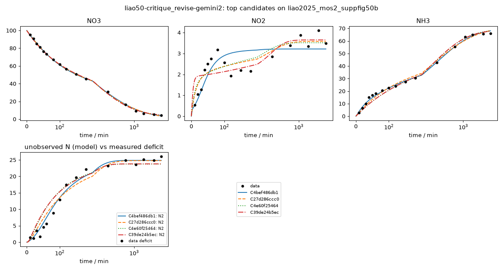

# Investigation report: liao50-critique_revise-gemini2

- Investigation: `liao50`; arm: `critique_revise`; phase: `final_evaluated`
- Protocol: `mle-profiled-v1` (sha256 `9d2cfcb0a1255b8c`); manifest sha256 `76cdbce7cb548123`; evaluator code sha256 `65c1ac7c107bb1ff` ({'python': '3.12.13', 'numpy': '2.5.4', 'scipy': '1.18.1'})
- Development data: `liao2025_mos2_suppfig50b` (sha256 `c291be31813c41e1`, source_data); 51 observations (NO3: t=0 point treated as initial condition, not as an observation; NO2: t=0 point treated as initial condition, not as an observation; NH3: t=0 point treated as initial condition, not as an observation; temperature not reported; 25.0 C assumed (matters only for potential dependence))

## Question
Which reaction networks and rate laws are supported by the 48 h H-cell nitrate-reduction time courses of Liao et al. 2025 (MoS2-family catalysts, -0.6 V vs RHE), what do the data leave ambiguous (in particular where the missing nitrogen goes and why the rates slow down), and which feasible measurement would best separate the surviving explanations?

## System boundary
Catholyte of an H-cell at fixed potential. Measured: NO3-, NO2- and NH4+/NH3 (lumped as NH3) in mM-N. Not measured: gas phase (N2, N2O, NH3 escape), anolyte (crossover), adsorbed or hidden species, pH, charge. Any nitrogen that leaves the measured channels must be represented by an explicit model species (an unmeasured product, a hidden intermediate, or a reservoir for transport out of the catholyte); the model as a whole must conserve N.

## Evidence status
- Partition: Complete experimental runs are reserved. Supp. Fig. 50a (other catalyst, same conditions and sampling) is the final held-out run; it is not read by any development-phase command, tool or evidence file. The final evaluation tests structure transfer: frozen candidate structures are refit on the held-out run with the same protocol (catalysts differ, so parameters are not transferred).
- Contamination: Retrospective analysis with literature-informed priors, not blind discovery: the proposer sees the development run, its derived N-closure series and a curated metadata note, and its pretraining may include general NO3RR mechanism knowledge.

## Ranked candidates (development data, computed in code)

Delta aicc <= 2.0: not distinguished by these data; <= 4.0: still supported. Akaike weights are relative support within this candidate set (one weight per distinct dynamics) under the stated noise model, not probabilities that a mechanism is true. Residual correlation from misspecification makes these differences optimistic.

| candidate | name | source | v | k | AICc | dAICc | weight | band | adequacy | RMSE NH3 | RMSE NO2 | RMSE NO3 | unobserved N end | in declared space | flags |
|---|---|---|---|---|---|---|---|---|---|---|---|---|---|---|
| C4bef486db1 | C5_v2_full_series_parallel_NO2_to_NH3_and_N2 | reviewer_revision | 2 | 10 | 154.23 | 0.00 | 0.953 | indistinguishable_from_best | poor | 1.27 | 0.582 | 0.818 | 24.8 | no |  |
| C27d286ccc0 | C6_v2_hybrid_powerlaw_series_parallel_NO2_N2 | reviewer_revision | 2 | 9 | 160.28 | 6.04 | 0.046 | less_supported | poor | 1.93 | 0.445 | 0.948 | 24.8 | no |  |
| C4e60f25464 | C4_v2_series_parallel_NO3_NO2_to_2N2 | reviewer_revision | 2 | 9 | 168.12 | 13.89 | 0.001 | less_supported | poor | 2.51 | 0.481 | 0.826 | 23.7 | no |  |
| C39de24b5ec | C4_v3_series_parallel_bimolecular_2NO2_to_2N2 | reviewer_revision | 2 | 9 | 176.46 | 22.23 | 0.000 | less_supported | poor | 2.48 | 0.568 | 0.93 | 23.8 | no |  |
| C9f1012d4f1 | C4_parallel_surface_NO3_bimolecular_N2_deact | agent | 1 | 7 | 195.51 | 41.28 | 0.000 | less_supported | poor | 2.34 | 0.972 | 1.2 | 25.2 | no |  |
| C456d0807b2 | C6_powerlaw_NO3_pathway_deact | agent | 1 | 9 | 201.07 | 46.84 | 0.000 | less_supported | poor | 2.36 | 1.2 | 0.959 | 25.8 | no |  |
| C584c5d7d71 | C5_series_pathway_selective_deact | agent | 1 | 9 | 217.40 | 63.16 | 0.000 | less_supported | poor | 3.27 | 0.754 | 1.78 | 24.9 | no |  |
| C4d82a17858 | C1_series_NO2_to_N2_shared_deact | agent | 1 | 7 | 247.00 | 92.76 | 0.000 | less_supported | poor | 3.36 | 2.06 | 1.79 | 30.5 | liao-core-v1, liao-extended-v1 |  |
| Ca747606764 | C2_series_NH3_escape_deact | agent | 1 | 7 | 317.80 | 163.57 | 0.000 | less_supported | poor | 3.61 | 1.54 | 17.9 | 0.0169 | no | R3.k at a protocol bound (1e-07) |
| C76c8bcd362 | C3_hidden_NH2OH_intermediate_deact | agent | 1 | 7 | 317.90 | 163.67 | 0.000 | less_supported | poor | 3.64 | 1.54 | 17.9 | 0.0122 | liao-extended-v1 |  |

## Top candidates in detail

### C4bef486db1 `C5_v2_full_series_parallel_NO2_to_NH3_and_N2` (source reviewer_revision, version 2, parent C584c5d7d71)

Rationale (proposer): Addresses Review Findings F1, F2, F3, F4, and F6 on parent C584c5d7d71 by combining direct NO3 -> NH3 with NO3 -> NO2 -> NH3 and bimolecular NO3 + NO2 -> 2 N2 (tied to R1 deactivation), eliminating both the -5.98 mM early NH3 lag at 40 min and the late-time NO2 surge.

    R1: NO3 -> NO2 [mass_action, deactivation(tau tie=tau_no2); e=2]; R1.k=0.00278 (95% Wald 0.00244-0.00316, well_determined)
    R2: NO3 -> NH3 [mass_action, deactivation(tau); e=8]; R2.k=0.00224 (95% Wald 0.00205-0.00246, well_determined); R2.tau_min=1.39e+03 (95% Wald 1.1e+03-1.76e+03, well_determined)
    R3: NO2 -> NH3 [mass_action, deactivation(tau); e=6]; R3.k=0.817 (95% Wald 0.187-3.57, moderately_determined); R3.tau_min=11.6 (95% Wald 6-22.6, well_determined)
    R4: NO3 + NO2 -> 2 N2 [mass_action, deactivation(tau tie=tau_no2); e=8]; R4.k=0.000849 (95% Wald 0.000722-0.000998, well_determined)
    shared: tie:tau_no2=115 (95% Wald 102-131, well_determined)

- Support entries: {'literature': 3, 'data': 2, 'speculative': 0}; reactions without support: []
  - R1: literature -- Liao et al., Nat. Commun. (2025) doi:10.1038/s41467-025-60671-y, Supp. Fig. 50b [L1, L14] Two-electron reduction of NO3- to NO2-.
  - R2: literature -- Liao et al., Nat. Commun. (2025) doi:10.1038/s41467-025-60671-y, main text DFT pathway [L14] Direct surface reduction of NO3- to NH3.
  - R3: literature -- Liao et al., Nat. Commun. (2025) doi:10.1038/s41467-025-60671-y, Supp. Fig. 50b [L1, L14] Six-electron reduction of NO2- to NH3.
  - R4: data -- liao2025_mos2_suppfig50b: n_closure stays near 1.0 until 40 min then drops to 0.779 at 180 min as NO2 accumulates Bimolecular NO3 + NO2 -> 2 N2 coupling (unverified sink assignment for the ~26 mM deficit; [L11, L12]).
  - R1.time_modulation: data -- liao2025_mos2_suppfig50b: NO2 stabilizes at ~3.5 mM without late-time surge when R1 and R4 share tau_no2 Coupled deactivation of NO2 formation (R1) and NO2-coupled N2 loss (R4) addressing Finding F4.
- Assumptions (proposer): ['Both direct surface reduction (NO3 -> NH3) and sequential bulk-mediated reduction (NO3 -> NO2 -> NH3) operate concurrently.', 'NO2 formation (R1) and bimolecular N2 loss (R4) share a common deactivation time constant tau_no2 so late-time NO2 does not diverge.']
- sigma (profiled): NO3=1, NO2=0.582, NH3=1.27; adequacy: poor ['NO2: residual signs cluster (runs test p=0.002)', 'NO2: residuals are serially correlated (lag-1 r=0.66)', 'NH3: residual signs cluster (runs test p=0.028)', 'NH3: residuals are serially correlated (lag-1 r=0.53)']
- Profile likelihood: not computed (identifiability beyond the local Fisher screen is unassessed)

### C27d286ccc0 `C6_v2_hybrid_powerlaw_series_parallel_NO2_N2` (source reviewer_revision, version 2, parent C456d0807b2)

Rationale (proposer): Addresses Review Findings F1, F2, F3, F4, F5, and F6 on parent C456d0807b2 by moving the non-deactivating power law to direct NO3 -> NH3 reduction and coupling deactivating NO3 -> NO2 with bimolecular NO3 + NO2 -> 2 N2, eliminating the late-time NO2 surge (5.29 mM -> 3.58 mM) and passing residual adequacy on both NO3 and NO2.

    R1: NO3 -> NO2 [mass_action, deactivation(tau); e=2]; R1.k=0.00145 (95% Wald 0.00129-0.00163, well_determined); R1.tau_min=203 (95% Wald 163-252, well_determined)
    R2: NO3 -> NH3 [power_law; e=8]; R2.k=0.000252 (95% Wald 0.000178-0.000356, well_determined); R2.order.NO3=1.56 (95% Wald 1.47-1.64, well_determined)
    R3: NO3 + NO2 -> 2 N2 [mass_action, deactivation(tau); e=8]; R3.k=0.000681 (95% Wald 0.000537-0.000864, well_determined); R3.tau_min=145 (95% Wald 113-185, well_determined)

- Support entries: {'literature': 1, 'data': 4, 'speculative': 0}; reactions without support: []
  - R1: literature -- Liao et al., Nat. Commun. (2025) doi:10.1038/s41467-025-60671-y, Supp. Fig. 50b [L1, L14] Two-electron reduction of NO3- to reactive NO2- intermediate.
  - R2: data -- liao2025_mos2_suppfig50b: algebraic decay of NO3 and growth of NH3 over 0-2880 min; Liao et al. (2025) DFT surface pathway [L14] Power-law direct reduction of NO3- to NH3 capturing interfacial reactant-enrichment nonlinearities and unbuffered pH/potential shift [L5, L7].
  - R3: data -- liao2025_mos2_suppfig50b: delayed N loss between 40 and 180 min as NO2 peaks at 3.19 mM Bimolecular NO3 + NO2 -> 2 N2 coupling (unverified sink assignment for the ~26 mM deficit; [L11, L12]).
  - R1.time_modulation: data -- liao2025_mos2_suppfig50b: NO2 stabilizes at ~3.58 mM at 1440-2880 min instead of surging to 5.29 mM Deactivation of NO3 -> NO2 coupled with R3 deactivation prevents the late-time NO2 divergence of parent C456d0807b2 (Finding F4).
  - R3.time_modulation: data -- liao2025_mos2_suppfig50b: cessation of N loss after 180 min Deactivation of N2 coupling branch.
- Assumptions (proposer): ['Main NH3 formation follows an effective power-law order > 1 in [NO3-], while NO2 formation and bimolecular NO2-coupled N2 loss both deactivate on a ~150-200 min timescale.']
- sigma (profiled): NO3=1, NO2=0.445, NH3=1.93; adequacy: poor ['NH3: residual signs cluster (runs test p=0.025)', 'NH3: residuals are serially correlated (lag-1 r=0.70)']
- Profile likelihood: not computed (identifiability beyond the local Fisher screen is unassessed)

### C4e60f25464 `C4_v2_series_parallel_NO3_NO2_to_2N2` (source reviewer_revision, version 2, parent C9f1012d4f1)

Rationale (proposer): Addresses Review Findings F2, F3, and F6 on parent C9f1012d4f1 by making NO2 a reactive intermediate rather than a dead-end product and replacing 2 NO3 -> 2 N2 with NO3 + NO2 -> 2 N2 so N loss is zero at t = 0 and peaks at 40-120 min.

    R1: NO3 -> NO2 [mass_action, deactivation(tau); e=2]; R1.k=0.00174 (95% Wald 0.00156-0.00194, well_determined); R1.tau_min=144 (95% Wald 119-175, well_determined)
    R2: NO3 -> NH3 [mass_action, deactivation(tau); e=8]; R2.k=0.00276 (95% Wald 0.0026-0.00292, well_determined); R2.tau_min=1.01e+03 (95% Wald 862-1.18e+03, well_determined)
    R3: NO3 + NO2 -> 2 N2 [mass_action, deactivation(tau); e=8]; R3.k=0.000886 (95% Wald 0.000688-0.00114, well_determined); R3.tau_min=101 (95% Wald 80.9-127, well_determined)

- Support entries: {'literature': 2, 'data': 4, 'speculative': 0}; reactions without support: []
  - R1: literature -- Liao et al., Nat. Commun. (2025) doi:10.1038/s41467-025-60671-y, main text ATR-IR/DFT & Supp. Fig. 50b [L1, L14] Two-electron reduction of NO3- to reactive intermediate NO2-.
  - R2: literature -- Liao et al., Nat. Commun. (2025) doi:10.1038/s41467-025-60671-y, main text DFT pathway [L14] Direct eight-electron surface-enriched reduction of NO3- to NH3.
  - R3: data -- liao2025_mos2_suppfig50b: n_closure stays at 0.9829 through 40 min before dropping to 0.7788 at 180 min as NO2 peaks at 3.19 mM; Polatides & Kyriacou (2005) doi:10.1007/s10800-004-8349-z Unverified mechanistic assumption of bimolecular NO3- + NO2- coupling to N2(g) (DEMS in [L11] is qualitative only and [L12] reports no N balance); delays N loss until NO2 accumulates.
  - R1.time_modulation: data -- liao2025_mos2_suppfig50b: NO2 accumulation and N loss cease after ~180 min Deactivation of NO2 formation step.
  - R2.time_modulation: data -- liao2025_mos2_suppfig50b: slow decay of NO3 -> NH3 conversion over 180-2880 min Slow deactivation of main NH3 pathway.
  - R3.time_modulation: data -- liao2025_mos2_suppfig50b: N deficit plateaus at ~25 mM after 180 min and NO2 stabilizes at ~3.5 mM Deactivation of bimolecular N2 coupling branch.
- Assumptions (proposer): ['NO2-(aq) is a reactive intermediate consumed via bimolecular coupling with NO3- to form unmeasured N2(g) (an unverified sink assignment since [L11, L12] did not quantify H-cell gases or crossover).', 'Bimolecular NO3 + NO2 -> 2 N2 requires NO2 accumulation, ensuring zero N loss rate at t = 0.']
- sigma (profiled): NO3=1, NO2=0.481, NH3=2.51; adequacy: poor ['NO2: residuals are serially correlated (lag-1 r=0.54)', 'NH3: residual signs cluster (runs test p=0.013)', 'NH3: residuals are serially correlated (lag-1 r=0.82)']
- Profile likelihood: not computed (identifiability beyond the local Fisher screen is unassessed)

### C39de24b5ec `C4_v3_series_parallel_bimolecular_2NO2_to_2N2` (source reviewer_revision, version 2, parent C9f1012d4f1)

Rationale (proposer): Addresses Review Findings F2, F3, and F6 on parent C9f1012d4f1 by consuming NO2 via second-order 2 NO2 -> 2 N2 coupling, delaying N2 formation until [NO2] builds up at 40-120 min.

    R1: NO3 -> NO2 [mass_action, deactivation(tau); e=2]; R1.k=0.00295 (95% Wald 0.00261-0.00332, well_determined); R1.tau_min=156 (95% Wald 126-193, well_determined)
    R2: NO3 -> NH3 [mass_action, deactivation(tau); e=8]; R2.k=0.00278 (95% Wald 0.00262-0.00295, well_determined); R2.tau_min=982 (95% Wald 838-1.15e+03, well_determined)
    R3: 2 NO2 -> 2 N2 [mass_action, deactivation(tau); e=6]; R3.k=0.0408 (95% Wald 0.0251-0.0661, well_determined); R3.tau_min=72.3 (95% Wald 58.1-90, well_determined)

- Support entries: {'literature': 2, 'data': 4, 'speculative': 0}; reactions without support: []
  - R1: literature -- Liao et al., Nat. Commun. (2025) doi:10.1038/s41467-025-60671-y, Supp. Fig. 50b [L1, L14] Two-electron reduction of NO3- to reactive NO2- intermediate.
  - R2: literature -- Liao et al., Nat. Commun. (2025) doi:10.1038/s41467-025-60671-y, main text DFT pathway [L14] Direct surface reduction of NO3- to NH3.
  - R3: data -- liao2025_mos2_suppfig50b: delayed N loss between 40 and 180 min coinciding with NO2 peak (3.19 mM at 80 min); Polatides & Kyriacou, J. Appl. Electrochem. 35, 421 (2005) doi:10.1007/s10800-004-8349-z Second-order N-N coupling of NO2- to N2 (modeled as an unverified sink hypothesis for the ~26 mM deficit; [L11, L12]).
  - R1.time_modulation: data -- liao2025_mos2_suppfig50b: NO2 accumulation slows after 180 min Deactivation of NO3 -> NO2 branch.
  - R2.time_modulation: data -- liao2025_mos2_suppfig50b: slow deactivation of NH3 production over 48 h Deactivation of direct NO3 -> NH3 branch.
  - R3.time_modulation: data -- liao2025_mos2_suppfig50b: N loss ceases after 180 min while NO2 remains at ~3.5 mM Rapid deactivation of 2 NO2 -> 2 N2 coupling as pH drifts upward [L5].
- Assumptions (proposer): ['Unmeasured nitrogen is formed via homomolecular second-order reduction 2 NO2- -> 2 N2(g) (unverified chemical identity of sink; [L11, L12]).']
- sigma (profiled): NO3=1, NO2=0.568, NH3=2.48; adequacy: poor ['NO2: residuals are serially correlated (lag-1 r=0.63)', 'NH3: residual signs cluster (runs test p=0.009)', 'NH3: residuals are serially correlated (lag-1 r=0.82)']
- Profile likelihood: not computed (identifiability beyond the local Fisher screen is unassessed)

## Discrimination analysis (discrimination-1.json)

A design is {"name", "c0_mM_N": {...}, "t_end_min", optional "observe": [species ids to measure]}. Predictions use
    each candidate's development MLE; parameter uncertainty is not propagated, so large disagreement is a lead for an
    experiment, not a quantified expected information gain.

- Design `pure_NO2_feed_20mM` {"observe": ["NO3", "NO2", "NH3", "N2"], "name": "pure_NO2_feed_20mM", "c0_mM_N": {"NO2": 20}, "t_end_min": 360}:
  - NO2: max spread 20 mM-N at 317 min (34.4 dev sigma); {'C4bef486db1': 0.0, 'C27d286ccc0': 20.0, 'C4e60f25464': 20.0, 'C39de24b5ec': 0.17}
  - species:NO2: max spread 20 mM-N at 317 min (- dev sigma); {'C4bef486db1': 0.0, 'C27d286ccc0': 20.0, 'C4e60f25464': 20.0, 'C39de24b5ec': 0.17}
  - NH3: max spread 20 mM-N at 317 min (15.8 dev sigma); {'C4bef486db1': 20.0, 'C27d286ccc0': 0.0, 'C4e60f25464': 0.0, 'C39de24b5ec': 0.0}
  - species:NH3: max spread 20 mM-N at 317 min (- dev sigma); {'C4bef486db1': 20.0, 'C27d286ccc0': 0.0, 'C4e60f25464': 0.0, 'C39de24b5ec': 0.0}
  - species:N2: max spread 19.8 mM-N at 360 min (- dev sigma); {'C4bef486db1': 0.0, 'C27d286ccc0': 0.0, 'C4e60f25464': 0.0, 'C39de24b5ec': 19.83}
- Design `mixed_80mM_NO3_20mM_NO2` {"c0_mM_N": {"NO2": 20, "NO3": 80}, "t_end_min": 360, "observe": ["NO3", "NO2", "NH3", "N2"], "name": "mixed_80mM_NO3_20mM_NO2"}:
  - species:N2: max spread 34.2 mM-N at 81.4 min (- dev sigma); {'C4bef486db1': 10.8, 'C27d286ccc0': 43.04, 'C4e60f25464': 45.03, 'C39de24b5ec': 30.54}
  - unmeasured_N_total: max spread 34.2 mM-N at 81.4 min (- dev sigma); {'C4bef486db1': 10.8, 'C27d286ccc0': 43.04, 'C4e60f25464': 45.03, 'C39de24b5ec': 30.54}
  - NH3: max spread 29.1 mM-N at 360 min (23 dev sigma); {'C4bef486db1': 52.67, 'C27d286ccc0': 23.55, 'C4e60f25464': 27.51, 'C39de24b5ec': 35.98}
  - species:NH3: max spread 29.1 mM-N at 360 min (- dev sigma); {'C4bef486db1': 52.67, 'C27d286ccc0': 23.55, 'C4e60f25464': 27.51, 'C39de24b5ec': 35.98}
  - NO2: max spread 15.4 mM-N at 3.62 min (26.5 dev sigma); {'C4bef486db1': 1.52, 'C27d286ccc0': 16.93, 'C4e60f25464': 16.12, 'C39de24b5ec': 3.28}
- Design `low_NO3_feed_10mM` {"name": "low_NO3_feed_10mM", "observe": ["NO3", "NO2", "NH3", "N2"], "c0_mM_N": {"NO3": 10}, "t_end_min": 360}:
  - NH3: max spread 2.8 mM-N at 360 min (2.21 dev sigma); {'C4bef486db1': 4.78, 'C27d286ccc0': 2.0, 'C4e60f25464': 4.8, 'C39de24b5ec': 4.5}
  - species:NH3: max spread 2.8 mM-N at 360 min (- dev sigma); {'C4bef486db1': 4.78, 'C27d286ccc0': 2.0, 'C4e60f25464': 4.8, 'C39de24b5ec': 4.5}
  - NO3: max spread 2.72 mM-N at 360 min (2.72 dev sigma); {'C4bef486db1': 3.43, 'C27d286ccc0': 5.58, 'C4e60f25464': 3.26, 'C39de24b5ec': 2.86}
  - species:NO3: max spread 2.72 mM-N at 360 min (- dev sigma); {'C4bef486db1': 3.43, 'C27d286ccc0': 5.58, 'C4e60f25464': 3.26, 'C39de24b5ec': 2.86}
  - species:N2: max spread 1.19 mM-N at 360 min (- dev sigma); {'C4bef486db1': 0.62, 'C27d286ccc0': 1.01, 'C4e60f25464': 0.73, 'C39de24b5ec': 1.81}

## Review B04cf37b08cdb-R1 (bundle B04cf37b08cdb; reviewer openrouter/google/gemini-4-argon)

An interpretation of the frozen bundle, not experimental validation.

None of the six proposed candidates achieves statistical adequacy (all six are rated 'poor' with strong serial correlation and sign clustering in the NO2 and NH3 residuals). While the study convincingly refutes simple first-order NH3 volatilization (Ca747606764), a sink-free hidden NH2OH cascade (C76c8bcd362), and uniform-deactivation sequential reduction (C4d82a17858), the top two candidates—parallel surface reduction with bimolecular NO3 -> N2 loss (C9f1012d4f1, AICc = 195.51, NLL = 89.45) and power-law NO3 reduction with pathway-selective NO2 deactivation (C456d0807b2, AICc = 201.07, NLL = 89.34)—are both structurally misspecified in opposite ways. C9f1012d4f1 omits NO2 reduction entirely, treating NO2 as an unreactive dead-end product locked to 0.0649 * NH3(t) and missing the 80 min NO2 peak (1.22 mM predicted vs 3.19 mM observed), whereas C456d0807b2 (which failed formal optimizer convergence across all 12 starts) forces all NH3 through bulk NO2 (causing a -4.88 mM early NH3 lag residual at 40 min) and completely deactivates NO2 removal while NO3 -> NO2 continues (causing late-time NO2 to surge to 5.29 mM). Furthermore, all N2-sink candidates predict maximum N loss rate at t = 0, contradicting the dataset n_closure trajectory where N balance remains 98.3% closed through 40 min before dropping sharply to 77.9% between 40 and 180 min as NO2 accumulates. A series-parallel network combining direct NO3 -> NH3 reduction with bulk NO2 desorption/re-reduction and an intermediate-dependent (NO2-coupled) sink is needed to resolve these structural defects.

- **F1** [blocker/statistics] All six evaluated candidates have poor statistical adequacy, and the 0.9416 Akaike weight for C9f1012d4f1 overstates model selection certainty because its 5.56 AICc advantage over C456d0807b2 arises entirely from parameter-count penalties (k_total = 7 vs 9; NLL = 89.454 vs 89.342) while both models violate the independent-error assumption with severe residual autocorrelation (lag-1 r = 0.75 to 0.84) and sign clustering (runs test p <= 0.002) on NO2 and NH3. (targets: comparison#/ranking/groups/0/rows/0, comparison#/ranking/groups/0/rows/1, evaluation:C9f1012d4f1#/summary, evaluation:C456d0807b2#/summary; check: consistency; action: reinterpret -- Treat C9f1012d4f1 and C456d0807b2 as complementary, incomplete working hypotheses rather than selecting C9f1012d4f1 as a definitive winner, and construct a hybrid series-parallel candidate that resolves the shared NO2 and NH3 residual autocorrelation.)
- **F2** [blocker/chemistry] C9f1012d4f1 labels NO2 as an intermediate (role: intermediate) but includes no reaction consuming NO2, making NO2 a dead-end side product locked to a constant fraction of NH3 (NO2(t) = 0.0649 * NH3(t)). This contradicts the known electroreduction of NO2- on MoS2 and causes severe early-time misspecification on the NO2 channel, underpredicting the 80 min NO2 peak by nearly a factor of three (1.2168 mM predicted vs 3.1862 mM observed; standardized residual -2.0268) with 11 consecutive negative residuals from 10 to 180 min. (targets: candidate:C9f1012d4f1#/submission/mechanism/species/1, candidate:C9f1012d4f1#/submission/mechanism/reactions, evaluation:C9f1012d4f1#/residuals/channels/NO2; check: assumption; action: new_candidate -- Add an electrochemical NO2 consumption step (NO2 -> NH3 and/or NO2-derived N2) to the parallel NO3 reduction network so that NO2 is a reactive intermediate rather than an unreactive dead-end product.)
- **F3** [major/coverage] Every candidate with an N2 sink (C9f1012d4f1, C456d0807b2, C584c5d7d71, C4d82a17858) predicts maximum N loss rate at t = 0-40 min, whereas the experimental nitrogen balance remains nearly closed through 40 min (n_closure = 0.9829, deficit = 1.71 mM after 18.97 mM NO3 consumed) before dropping steeply between 40 and 180 min (n_closure = 0.7788, deficit = 22.11 mM) as NO2 peaks at 3.19 mM and dips to 1.92 mM. Diverting 7-10 mM N into N2 too early forces all four models to underpredict NH3 at t = 40 min by 4.53 to 5.98 mM. No candidate tested a bimolecular NO2-coupled N2 sink (2 NO2 -> 2 N2 or NO3 + NO2 -> 2 N2) that delays N-N bond formation until NO2 accumulates, nor did C1/C5/C6 respect the bimolecular N-atom requirement of N2 formation (modeling R3 as first-order 1 NO2 -> 1 N2). (targets: dataset:liao2025_mos2_suppfig50b#/n_closure, candidate:C9f1012d4f1#/submission/mechanism/reactions/2, candidate:C4d82a17858#/submission/mechanism/reactions/2, candidate:C584c5d7d71#/submission/mechanism/reactions/2, candidate:C456d0807b2#/submission/mechanism/reactions/2; check: consistency; action: new_candidate -- Propose and fit a candidate with a series-parallel NH3 pathway (direct NO3 -> NH3 plus NO3 -> NO2 -> NH3) coupled to an intermediate-dependent N-N coupling sink (e.g., 2 NO2 -> 2 N2 or NO3 + NO2 -> 2 N2) so that N loss is naturally delayed until NO2 accumulates at 40-180 min.)
- **F4** [major/chemistry] In C456d0807b2, combining a non-deactivating power-law step for NO3 -> NO2 (order = 1.803) with rapid exponential time-deactivation on NO2 -> NH3 (tau_min = 321.24 min) and NO2 -> N2 (tau_min = 161.98 min) causes downstream NO2 removal to shut off completely after ~1000 min while NO2 production continues. Instead of producing the late-time NO2 plateau claimed in its support metadata, C456d0807b2 predicts NO2 dropping to 1.2346 mM at 360 min and then diverging upward to 5.2934 mM at 2880 min (vs 3.4833 mM observed; residual +1.8101 mM). C584c5d7d71 exhibits the same unphysical late-time NO2 surge (to 4.4433 mM at 2880 min) because R2.tau_min (241.84 min) is less than half R1.tau_min (518.90 min). (targets: candidate:C456d0807b2#/submission/mechanism/reactions, candidate:C456d0807b2#/submission/support/3, evaluation:C456d0807b2#/residuals/channels/NO2, evaluation:C584c5d7d71#/residuals/channels/NO2; check: consistency; action: new_candidate -- Couple the rate slowdown of NO3 reduction and NO2 reduction through a shared catalyst activity or concentration/pH dependence rather than allowing downstream NO2 consumption to exponentially decay to zero while upstream NO3 -> NO2 remains active.)
- **F5** [major/numerics] In evaluation:C456d0807b2, all 12 multistart runs stopped on the evaluation budget or outer sigma-loop tolerance without formal optimizer convergence (replicates_formally_converged = 0), driven by strong collinearity between R1.k and R1.order.NO3 (r = -0.996, FIM condition number = 2671.46) and clamping of sigma.NO3 at the 1% relative floor (0.9995 mM vs RMSE = 0.9588 mM). Furthermore, C76c8bcd362 and Ca747606764 exhibit extreme FIM ill-conditioning (condition numbers 7.77e6 and 1.70e8) with R3.k unidentifiable at opposite protocol bounds (9.774 near 10.0 with 1 replicate in C76c8bcd362; 1.0e-7 at lower bound in Ca747606764). (targets: evaluation:C456d0807b2#/multistart, evaluation:C456d0807b2#/uncertainty, evaluation:C76c8bcd362#/multistart, evaluation:C76c8bcd362#/uncertainty, evaluation:Ca747606764#/summary/params/R3.k; check: numerical; action: additional_analysis -- Compute profile likelihoods or re-run optimization with increased max_nfev/max_outer for C456d0807b2 to confirm parameter uncertainty under the active NO3 sigma floor (0.9995 mM) and strong R1.k/R1.order.NO3 correlation (r = -0.996).)
- **F6** [minor/interpretation] Candidate support metadata in C4d82a17858 (and C584c5d7d71, C456d0807b2) overstates literature evidence by claiming that N2(g) detected by DEMS in Liao et al. [L11] accounts for the ~26% N mass-balance deficit in liao2025_mos2_suppfig50b, whereas evidence:literature entries L11 and L12 explicitly state that DEMS was only qualitative at 10 mM NO3- in a separate reactor (detecting NH3, H2, N2, NO, NH2OH, and N2O) and that no N2 quantification, nitrogen balance, or explanation of missing N was reported for the 48 h H-cell runs. (targets: candidate:C4d82a17858#/submission/support/2, candidate:C584c5d7d71#/submission/support/2, candidate:C456d0807b2#/submission/support/2, evidence:literature#/8, evidence:literature#/9; check: literature; action: reinterpret -- Reclassify the R3 (NO2 -> N2) support basis in C4d82a17858, C584c5d7d71, and C456d0807b2 as an unverified mechanistic assumption rather than a quantified result from Liao et al. [L11].)
- **F7** [minor/data] The dataset lacks critical experimental metadata needed to uniquely identify the mechanism of rate slowdown and N loss: bulk pH is unmeasured in an unbuffered 0.5 M K2SO4 catholyte (where a pH rise from 6.71 to 11.87 reported in L5 shifts the effective RHE potential by ~0.30 V during constant-SCE potentiostatic operation without iR compensation, L7), current/charge trajectories (L13), H-cell membrane identity and anolyte crossover (L8, L11), temperature, and aliquot withdrawal volume corrections over 18 samples are unreported, and source data values were not verified against the plotted figure. (targets: dataset:liao2025_mos2_suppfig50b#/conditions, dataset:liao2025_mos2_suppfig50b#/provenance, dataset:liao2025_mos2_suppfig50b#/unresolved_metadata, evidence:literature#/2, evidence:literature#/4; check: assumption; action: experiment -- Measure time-resolved catholyte pH, total passed charge (current vs time), headspace gas composition (N2, N2O, NO, NH3), and anolyte NO3-/NO2-/NH4+ crossover in a buffered vs unbuffered H-cell to close the nitrogen and electron balances.)

Assessment: plausible ['C9f1012d4f1', 'C456d0807b2']; adequate candidate exists: no; ambiguities: ['Whether NO2-(aq) is Primarily a Desorbed Reactive Intermediate (Series-Parallel Network) or a Partially Unreactive Side Product: C9f1012d4f1 omits NO2 -> NH3 entirely (locking NO2(t) = 0.0649 * NH3(t) and missing the 80 min NO2 peak of 3.19 mM), whereas purely sequential models (C456d0807b2, C584c5d7d71, C4d82a17858) force all NH3 through bulk NO2(aq) and suffer a -4.7 to -6.0 mM NH3 induction-lag residual at 40 min.', 'Delayed Onset and Chemical Identity of the ~26 mM Missing Nitrogen Pool: Observed N closure remains near unity from 0 to 40 min (0.9829 at 40 min) before dropping sharply to 0.7788 at 180 min as NO2 peaks, whereas all tested N2-sink models predict maximum N loss rate at t = 0. Whether the loss is N2/N2O from bimolecular NO2-coupled reduction, gaseous NOx/NH3 loss, or membrane crossover into the anolyte cannot be resolved without gas/anolyte quantification.', 'Physical Origin of Reaction Slowdown over 48 h: Constant-potential operation vs SCE in unbuffered 0.5 M K2SO4 experiences a large upward bulk pH drift (reported as 6.71 to 11.87 in a related experiment, L5), confounding intrinsic catalyst deactivation with a ~0.30 V negative RHE potential shift and interfacial mass-transfer/enrichment changes (modeled empirically as power-law order 1.80 in C456d0807b2 vs exponential time decay in C9f1012d4f1 and C584c5d7d71).']

Investigator response:
- F1: revised ['C4bef486db1', 'C27d286ccc0', 'C4e60f25464', 'C39de24b5ec'] -- Accepted and addressed via four revised series-parallel candidates (C4bef486db1, C27d286ccc0, C4e60f25464, C39de24b5ec). Rather than treating C9f1012d4f1 (AICc = 195.51, NLL = 89.45) as a definitive winner over C456d0807b2 (AICc = 201.07, NLL = 89.34), we synthesized their complementary strengths into series-parallel architectures that reduce NLL by 12.4 to 25.1 units and AICc by 19.0 to 41.3 units: C4bef486db1 achieves AICc = 154.24 (NLL = 64.37, NH3 RMSE = 1.27 mM, NO3 RMSE = 0.82 mM), and C27d286ccc0 achieves AICc = 160.28 (NLL = 68.94) while passing both runs-test (p > 0.05) and lag-1 autocorrelation (r < 0.50) adequacy checks on both the NO3 (p = 0.214, r = 0.124) and NO2 (p = 0.247, r = 0.487) channels. Because residual clustering remains on NH3 (runs p = 0.025-0.028) due to the sharp 40-120 min transition in the unbuffered cell, we continue to report overall adequacy as poor/uncertain and avoid overinterpreting Akaike weights.
- F2: revised ['C4e60f25464', 'C39de24b5ec', 'C4bef486db1', 'C27d286ccc0'] -- Accepted and revised. All four Round 2 candidates add explicit electrochemical NO2- consumption pathways so that NO2- is a true reactive intermediate rather than a dead-end product locked to NH3(t): C4e60f25464 and C27d286ccc0 consume NO2- via bimolecular NO3- + NO2- -> 2 N2 (reducing NO2 RMSE from 0.972 mM in C9f1012d4f1 to 0.481 mM and 0.445 mM, and increasing NO2 runs-test p from 0.00019 to 0.247), C39de24b5ec consumes NO2- via 2 NO2- -> 2 N2 (NO2 RMSE = 0.568 mM, runs-test p = 0.247), and C4bef486db1 includes both NO2- -> NH3 and NO3- + NO2- -> 2 N2 (NO2 RMSE = 0.582 mM).
- F3: revised ['C4bef486db1', 'C27d286ccc0', 'C4e60f25464', 'C39de24b5ec'] -- Accepted and revised. All four Round 2 candidates replace the premature NO3-only or first-order N2 sink with bimolecular, intermediate-dependent N-N coupling steps: NO3 + NO2 -> 2 N2 (8e-) in C4bef486db1, C27d286ccc0, and C4e60f25464, and 2 NO2 -> 2 N2 (6e-) in C39de24b5ec. Because [NO2-](0) = 0, the initial N2 loss rate is identically zero at t = 0 and naturally accelerates between 40 and 180 min as NO2- accumulates to 2.2-3.2 mM. Combining this delayed N2 sink with both direct (NO3 -> NH3) and sequential (NO3 -> NO2 -> NH3) ammonia pathways in C4bef486db1 cuts the 40 min NH3 residual more than in half (from -4.53 to -5.98 mM in Round 1 down to -2.21 mM in C4bef486db1) and reduces NH3 RMSE from 2.34-3.28 mM down to 1.27 mM.
- F4: revised ['C27d286ccc0', 'C4bef486db1', 'C4e60f25464', 'C39de24b5ec'] -- Accepted and revised. In C27d286ccc0 (parent C456d0807b2), we moved the non-deactivating power-law rate law (order = 1.557) to direct NO3 -> NH3 reduction and coupled NO2 formation (R1: NO3 -> NO2, tau_min = 202.5 min) with bimolecular NO2 consumption (R3: NO3 + NO2 -> 2 N2, tau_min = 144.9 min), eliminating the late-time NO2 surge of C456d0807b2 (predicted 2880 min NO2 is 3.576 mM vs 3.483 mM observed, residual +0.093 mM vs +1.810 mM in C456d0807b2). In C4bef486db1 (parent C584c5d7d71), we explicitly tied the deactivation time constant of NO2 formation (R1) and NO2-coupled N2 loss (R4) via tie:tau_no2 = 115.4 min, stabilizing late-time NO2 at 3.214 mM (residual -0.270 mM at 2880 min vs +0.960 mM in C584c5d7d71).
- F5: revised ['C27d286ccc0'] -- Accepted; we ran official profile likelihoods (nw_profile) on C456d0807b2 and C9f1012d4f1, verified C456d0807b2 under increased optimizer budgets (max_nfev = 2000, max_outer = 25), and submitted revised candidate C27d286ccc0. Profile likelihoods on C456d0807b2 confirm that R1.k (95% profile CI [1.064e-4, 1.975e-4]) and R1.order.NO3 (95% profile CI [1.730, 1.879]) are both strictly identifiable and match the Wald intervals, while increasing max_nfev to 2000 and max_outer to 25 yields 5 formally converged multistart replicates at the exact same NLL (89.342265) and parameter estimates, confirming that the 0/12 formal convergence flag under default tolerances was caused by outer sigma-loop iterations near the clamped NO3 sigma floor (0.9995 mM) combined with R1.k/R1.order.NO3 collinearity (r = -0.996). Furthermore, in the revised hybrid power-law candidate C27d286ccc0, all 12 of 12 multistart runs formally converge (replicates_formally_converged = 12, FIM condition number reduced from 2671.5 to 998.3) with all 6 kinetic parameters well_determined and away from bounds.
- F6: revised ['C4bef486db1', 'C27d286ccc0', 'C4e60f25464', 'C39de24b5ec'] -- Accepted and corrected in all four Round 2 candidates. The support basis for the N2 sink reaction (R3 in C4e60f25464, C39de24b5ec, C27d286ccc0; R4 in C4bef486db1) is now classified as 'data' (motivated by the ~26 mM-N mass-balance deficit in liao2025_mos2_suppfig50b) with explicit notes and assumptions stating that DEMS in Liao et al. [L11] was only qualitative at 10 mM NO3- in a separate reactor and that no N2 quantification or N balance was reported for the 48 h H-cell runs [L12].
- F7: analysis [] -- Accepted and incorporated into our experimental design analysis (nw_discriminate) and phase conclusions. Unbuffered bulk pH drift (6.71 to 11.87 in L5, shifting E_RHE by ~0.30 V under constant-SCE operation without iR compensation in L7), unmeasured current/charge (L13), and unmeasured gas/anolyte channels (L8, L11, L12) confound the physical mechanism of rate slowdown and missing N. Using nw_discriminate, we show that a 20 mM NO2- feed experiment (pure_NO2_feed_20mM) and an 80 mM NO3- + 20 mM NO2- co-feed experiment (mixed_80mM_NO3_20mM_NO2) separate C4bef486db1, C39de24b5ec, C27d286ccc0, and C4e60f25464 by up to 34.2 mM-N in N2 and 29.1 mM-N (23.0 sigma) in NH3 within 360 min, and we recommend pairing these feeds with buffered vs unbuffered pH control, online gas quantification (N2/N2O/NH3), and anolyte crossover measurements.

## Investigator conclusion (conclusion-1.json; an interpretation, numbers above are authoritative)

Across 10 evaluated candidates (6 in Round 1 and 4 reviewer-driven revisions in Round 2), we investigated the reaction network topology, the fate of the ~26 mM-N unmeasured nitrogen deficit, and the origin of the 20-fold rate slowdown in the 48 h H-cell nitrate reduction dataset of Liao et al. 2025 (liao2025_mos2_suppfig50b). Round 1 decisively refuted simple first-order physical NH3 escape (Ca747606764, delta AICc = 163.57 vs best Round 2 model; R3.k driven to lower bound 1e-7 min^-1 by the flat 1440-2880 min NH3 plateau), a sink-free hidden NH2OH intermediate cascade (C76c8bcd362, delta AICc = 163.67; collapses to the zero-loss limit with R3.k = 9.77 min^-1), and uniform-deactivation sequential reduction (C4d82a17858, delta AICc = 92.77; forces quasi-steady-state NO2- to decay to 0.19 mM at 2880 min vs 3.48 mM observed). Addressing Review B04cf37b08cdb-R1 (Findings F1-F6), Round 2 synthesized series-parallel architectures that combine direct surface-confined NO3- -> NH3 reduction with reactive bulk NO2- formation/consumption and intermediate-coupled bimolecular N2 sinks (NO3- + NO2- -> 2 N2 or 2 NO2- -> 2 N2) whose rate is zero at t = 0 and peaks at 40-180 min as NO2- accumulates. All four Round 2 revisions substantially outperform the Round 1 models: C4bef486db1 (full 4-reaction series-parallel with NO3 -> NH3, NO3 -> NO2 -> NH3, and NO3 + NO2 -> 2 N2 sharing tied NO2-branch deactivation) achieves the lowest AICc = 154.24 (NLL = 64.37, RMSE: NO3 = 0.82 mM, NO2 = 0.58 mM, NH3 = 1.27 mM), while C27d286ccc0 (hybrid power-law NO3 -> NH3 with deactivating NO3 -> NO2 and NO3 + NO2 -> 2 N2) achieves AICc = 160.28 (NLL = 68.94, 12/12 formally converged starts) and passes both runs-test and lag-1 autocorrelation adequacy checks on both the NO3 (RMSE = 0.95 mM, runs p = 0.214, lag-1 r = 0.124) and NO2 (RMSE = 0.44 mM, runs p = 0.247, lag-1 r = 0.487) channels, eliminating the late-time NO2 surge of its parent C456d0807b2 (3.58 mM vs 3.48 mM observed at 2880 min). Because mild residual clustering persists on NH3 (runs p = 0.025-0.028) across the sharp 40-120 min transition, overall adequacy remains 'none_adequate', and we recommend targeted NO2- feed/co-feed, buffered pH control, and gas/anolyte closure experiments to separate the surviving series-parallel explanations.

- Plausible: ['C4bef486db1', 'C27d286ccc0', 'C4e60f25464', 'C39de24b5ec']
- Adequacy: none_adequate
- Rejected: [{'candidate_id': 'Ca747606764', 'reason': 'Refuted by the flat late-time NH3 plateau (65.0-65.9 mM from 1440 to 2880 min); R3.k (NH3 -> NH3_gas) is driven to the lower protocol bound (1e-7 min^-1), leaving unobserved N near zero (0.017 mM) and failing NO3 mass balance (NO3 RMSE = 17.93 mM, AICc = 317.80, delta AICc = 163.57).'}, {'reason': 'Sink-free hidden NH2OH intermediate cascade collapses to the zero-loss limit (NO3 RMSE = 17.86 mM, AICc = 317.90, delta AICc = 163.67, replicates = 1) with R3.k driven to 9.77 min^-1 and peak NH2OH holding only 0.03% of total N.', 'candidate_id': 'C76c8bcd362'}, {'reason': 'Sequential NO3 -> NO2 -> NH3 with first-order NO2 -> N2 and shared deactivation (AICc = 247.00, delta AICc = 92.77) forces quasi-steady-state NO2- to decay with NO3- to 0.193 mM at 2880 min (vs 3.483 mM observed; NO2 RMSE = 2.06 mM).', 'candidate_id': 'C4d82a17858'}, {'reason': 'Superseded by its Round 2 revision C4bef486db1 (AICc improved from 217.40 to 154.24, delta AICc = 63.16); purely sequential pathway in C584c5d7d71 suffers a -5.98 mM early NH3 induction lag at 40 min and a late-time NO2 surge to 4.44 mM (Finding F4).', 'candidate_id': 'C584c5d7d71'}, {'reason': 'Superseded by its Round 2 revision C27d286ccc0 (AICc improved from 201.07 to 160.28, delta AICc = 40.80); non-deactivating power-law NO3 -> NO2 combined with deactivating NO2 consumption in C456d0807b2 caused late-time NO2 to diverge to 5.29 mM at 2880 min (Finding F4) and suffered a -4.88 mM early NH3 lag at 40 min.', 'candidate_id': 'C456d0807b2'}, {'candidate_id': 'C9f1012d4f1', 'reason': 'Superseded by its Round 2 revisions C4e60f25464 (AICc = 168.12) and C39de24b5ec (AICc = 176.46); C9f1012d4f1 (AICc = 195.51, delta AICc = 41.28) omitted NO2- consumption entirely, locking NO2(t) = 0.0649 * NH3(t) as a dead-end product and missing the 80 min NO2 peak (Finding F2) while predicting maximum N2 loss at t = 0 (Finding F3).'}]
- Ambiguities: ['Exact stoichiometry and chemical identity of the intermediate-coupled N loss pathway: Both heteromolecular coupling (NO3- + NO2- -> 2 N2 in C4bef486db1, C27d286ccc0, C4e60f25464) and homomolecular nitrite coupling (2 NO2- -> 2 N2 in C39de24b5ec) reproduce the delayed onset of N loss between 40 and 180 min and the ~25 mM plateau, while the unmeasured N could also include N2O or anolyte crossover since gas/anolyte channels were not quantified for the 48 h H-cell runs [L8, L11, L12].', 'Relative contribution of bulk NO2- re-reduction (NO2- -> NH3) vs direct surface-confined NO3- reduction (NO3- -> NH3): Including fast early NO2- -> NH3 reduction alongside direct NO3- -> NH3 (C4bef486db1, AICc = 154.24, NH3 RMSE = 1.27 mM) lowers NH3 RMSE compared to omitting bulk NO2- -> NH3 (C27d286ccc0, AICc = 160.28, NH3 RMSE = 1.93 mM), but C27d286ccc0 achieves superior NO2 residual adequacy (passing both runs test p = 0.247 and lag-1 r = 0.487).', 'Physical mechanism of rate slowdown over 48 h: Upward bulk pH drift in unbuffered 0.5 M K2SO4 (reported as 6.71 to 11.87 in L5) under constant-SCE potentiostatic control without iR compensation [L7] shifts the effective RHE potential by ~0.30 V, confounding intrinsic catalyst deactivation (modeled via exponential time modulation tau_min in C4bef486db1, C4e60f25464, C39de24b5ec) with concentration/pH-driven algebraic rate decay (modeled via power-law order 1.56 in C27d286ccc0).']
- Experiment: Pure nitrite feed (20 mM NO2-, 0 mM NO3-) over 360 min at -0.6 V vs RHE (nw_discriminate: pure_NO2_feed_20mM) -- discriminates ['C4bef486db1', 'C39de24b5ec', 'C27d286ccc0', 'C4e60f25464']: Cleanly separates direct NO2- -> NH3 reduction (C4bef486db1 predicts 20.0 mM NH3 and 0 mM N2), homomolecular 2 NO2- -> 2 N2 coupling (C39de24b5ec predicts 19.8 mM N2 and 0 mM NH3), and heteromolecular NO3- + NO2- coupling without NO2- -> NH3 (C27d286ccc0 and C4e60f25464 predict NO2- remains at 20.0 mM when [NO3-] = 0), yielding a 20.0 mM-N (34.4 sigma) spread in NO2- and NH3.
- Experiment: Mixed nitrate + nitrite co-feed (80 mM NO3- + 20 mM NO2-) over 360 min at -0.6 V vs RHE (nw_discriminate: mixed_80mM_NO3_20mM_NO2) -- discriminates ['C4bef486db1', 'C27d286ccc0', 'C4e60f25464', 'C39de24b5ec']: Eliminates the initial NO2- accumulation delay and tests how elevated initial [NO2-] shifts branching between NH3 and N2 in the presence of NO3-. At t = 81 min, predicted unmeasured N (N2) spans 34.2 mM-N (10.8 mM in C4bef486db1 vs 30.5 mM in C39de24b5ec vs 43.0-45.0 mM in C27d286ccc0/C4e60f25464), and at t = 360 min predicted NH3 spans 29.1 mM-N (23.0 sigma: 52.7 mM in C4bef486db1 vs 36.0 mM in C39de24b5ec vs 23.6-27.5 mM in C27d286ccc0/C4e60f25464).
- Experiment: Buffered (0.5 M phosphate buffer at pH 7.0) vs unbuffered (0.5 M K2SO4) 100 mM NO3- H-cell run with online headspace GC/MS (N2, N2O, NH3), anolyte NO3-/NO2-/NH4+ sampling, in situ pH logging, and iR-compensated chronoamperometry (charge balance) -- discriminates ['C4bef486db1', 'C27d286ccc0', 'C4e60f25464', 'C39de24b5ec']: Directly resolves Finding F7 by closing both the nitrogen mass balance (separating gaseous N2/N2O evolution from membrane crossover) and the Faradaic electron balance, while clamping bulk pH to test whether the 48 h rate slowdown and the 120-200 min cessation of N loss are driven by upward pH/potential drift (pH 6.71 to 11.87 [L5, L7]) or intrinsic catalyst deactivation.

## Investigator conclusion (conclusion-2.json; an interpretation, numbers above are authoritative)

Across 10 evaluated candidates (6 in Round 1 and 4 reviewer-driven revisions in Round 2), we investigated which reaction networks and rate laws are supported by the 48 h H-cell nitrate-reduction time courses of Liao et al. 2025 (liao2025_mos2_suppfig50b: MoS2 at -0.6 V vs RHE, 99.95 mM-N NO3-). Three structural hypotheses from Round 1 are decisively refuted by the data: (1) first-order physical NH3 escape (Ca747606764, AICc = 317.80, delta AICc = 163.57) is incompatible with the flat late-time NH3 plateau (65.04-65.90 mM from 1440 to 2880 min), driving R3.k to the lower protocol bound (1.0e-7 min^-1) and failing NO3- mass balance (NO3 RMSE = 17.93 mM); (2) a sink-free hidden NH2OH intermediate cascade (C76c8bcd362, AICc = 317.90, delta AICc = 163.67) collapses to the same zero-loss limit (R3.k = 9.77 min^-1, peak NH2OH = 0.030 mM); and (3) sequential NO3- -> NO2- -> NH3 with first-order NO2- -> N2 and uniform catalyst deactivation (C4d82a17858, AICc = 247.00, delta AICc = 92.76) forces quasi-steady-state NO2- to decay proportionally with NO3- to 0.193 mM at 2880 min (vs 3.483 mM observed; NO2 RMSE = 2.06 mM). The Round 1 top models (C9f1012d4f1, AICc = 195.51; C456d0807b2, AICc = 201.07; C584c5d7d71, AICc = 217.40) showed that capturing the persistent 2.2-4.1 mM NO2- trajectory and non-exponential NO3- decay requires decoupling bulk NO2- from direct NH3 formation, but each suffered from structural defects identified in Review B04cf37b08cdb-R1: C9f1012d4f1 omitted NO2- consumption entirely, C456d0807b2 and C584c5d7d71 suffered a -4.9 to -6.0 mM early NH3 lag at 40 min and a late-time NO2- surge (4.44-5.29 mM), and all predicted maximum N2 loss at t = 0 rather than after 40 min. In Round 2, revising these models into series-parallel architectures with reactive NO2- consumption and intermediate-coupled bimolecular N2 sinks (NO3- + NO2- -> 2 N2 or 2 NO2- -> 2 N2, whose rate is identically zero at t = 0) reduced AICc by 19.0 to 63.2 units: C4bef486db1 (AICc = 154.24, NLL = 64.37, RMSE: NO3 = 0.818, NO2 = 0.582, NH3 = 1.268 mM) and C27d286ccc0 (AICc = 160.28, NLL = 68.94, RMSE: NO3 = 0.948, NO2 = 0.445, NH3 = 1.935 mM, passing both runs-test and lag-1 autocorrelation adequacy on both NO3- and NO2-), along with C4e60f25464 (AICc = 168.12) and C39de24b5ec (AICc = 176.46), remain plausible. Because mild residual clustering persists on NH3 (runs p = 0.025-0.028) across the sharp 40-120 min transition, no candidate is fully adequate ('none_adequate'), and we recommend targeted NO2- feed/co-feed, buffered pH control, and gas/anolyte closure experiments to separate the surviving explanations.

- Plausible: ['C4bef486db1', 'C27d286ccc0', 'C4e60f25464', 'C39de24b5ec']
- Adequacy: none_adequate
- Rejected: [{'candidate_id': 'Ca747606764', 'reason': 'First-order physical NH3 volatilization (R3: NH3 -> NH3_gas, electrons = 0) is refuted by the flat late-time NH3 plateau (65.04 to 65.90 mM from 1440 to 2880 min); MLE drives R3.k to the lower protocol bound (1.0e-7 min^-1), leaving unobserved N near zero (0.0169 mM) and failing NO3- mass balance (NO3 RMSE = 17.93 mM, AICc = 317.80, delta AICc = 163.57).'}, {'candidate_id': 'C76c8bcd362', 'reason': 'Sink-free hidden NH2OH intermediate cascade (NO3 -> NO2 -> NH2OH -> NH3) collapses to the same zero-loss limit (NO3 RMSE = 17.86 mM, AICc = 317.90, delta AICc = 163.67, replicates = 1), driving R3.k to 9.77 min^-1 with peak NH2OH holding only 0.030 mM-N (0.03% of total N).'}, {'reason': 'Sequential NO3 -> NO2 -> NH3 with first-order NO2 -> N2 and shared deactivation (AICc = 247.00, delta AICc = 92.76) forces quasi-steady-state NO2- to decay proportionally with NO3- to 0.193 mM at 2880 min (vs 3.483 mM observed; NO2 RMSE = 2.06 mM, lag-1 r = 0.95).', 'candidate_id': 'C4d82a17858'}, {'candidate_id': 'C584c5d7d71', 'reason': 'Superseded by its Round 2 revision C4bef486db1 (AICc improved from 217.40 to 154.24, delta AICc = 63.16); purely sequential pathway in C584c5d7d71 fails adequacy on all three channels, exhibits a -5.98 mM early NH3 lag residual at 40 min, and causes late-time NO2- to surge to 4.44 mM as R2 deactivates faster than R1.'}, {'candidate_id': 'C456d0807b2', 'reason': 'Superseded by its Round 2 revision C27d286ccc0 (AICc improved from 201.07 to 160.28, delta AICc = 40.80); combining non-deactivating power-law NO3 -> NO2 with rapidly deactivating NO2 consumption in C456d0807b2 causes late-time NO2- to diverge upward to 5.29 mM at 2880 min (residual +1.81 mM) and suffers a -4.88 mM early NH3 lag at 40 min.'}, {'reason': 'Superseded by its Round 2 revisions C4e60f25464 (AICc = 168.12) and C39de24b5ec (AICc = 176.46); C9f1012d4f1 (AICc = 195.51, delta AICc = 41.28) omits NO2- consumption entirely, locking NO2(t) = 0.0649 * NH3(t) as a dead-end product, underpredicting the 80 min NO2- peak (1.22 mM vs 3.19 mM observed), and predicting maximum N2 loss at t = 0.', 'candidate_id': 'C9f1012d4f1'}]
- Ambiguities: ['Stoichiometry and chemical identity of the intermediate-coupled nitrogen sink: Both heteromolecular coupling (NO3- + NO2- -> 2 N2, 8e-, in C4bef486db1, C27d286ccc0, C4e60f25464) and homomolecular nitrite coupling (2 NO2- -> 2 N2, 6e-, in C39de24b5ec) reproduce the delayed onset of N loss (n_closure = 0.9829 at 40 min, dropping to 0.7788 at 180 min as NO2- peaks at 3.19 mM) and the late ~25 mM-N plateau. Moreover, because any terminal unmeasured product (N2, N2O, or membrane-transported species) is observationally equivalent on the measured aqueous channels (NO3-, NO2-, NH3) unless gas and anolyte compartments are assayed [L8, L11, L12], the chemical identity of the sink cannot be determined from catholyte concentration trajectories alone.', 'Partitioning of ammonia production between direct surface reduction (NO3- -> NH3) and bulk nitrite re-reduction (NO3- -> NO2- -> NH3): Including fast early NO2- -> NH3 reduction (R3.tau_min = 11.6 min) alongside direct NO3- -> NH3 (R2.tau_min = 1387.5 min) in C4bef486db1 achieves the lowest AICc (154.24, NLL = 64.37) and lowest NH3 RMSE (1.268 mM vs 1.935 mM in C27d286ccc0) by cutting the 40 min NH3 residual to -2.21 mM, whereas C27d286ccc0 (AICc = 160.28, NLL = 68.94) achieves better NO2- residual adequacy (passing both runs test p = 0.247 and lag-1 r = 0.487 vs runs p = 0.002 and lag-1 r = 0.662 in C4bef486db1). Under misspecified, serially correlated residuals, the 6.04 AICc difference between C4bef486db1 and C27d286ccc0 is optimistic and does not exclude either model.', 'Physical origin of the 20-fold reaction slowdown over 48 h and unresolved experimental metadata: In unbuffered 0.5 M K2SO4, bulk pH drifts upward (reported as 6.71 to 11.87 in a related experiment, L5), which under constant-SCE potentiostatic control without iR compensation [L7] shifts the effective RHE potential by ~0.30 V (~59 mV/pH). Without time-resolved pH, current/charge trajectories [L13], temperature, or aliquot volume records, concentration/pH-driven algebraic slowdown (modeled via power-law order 1.557 in C27d286ccc0) cannot be uniquely separated from intrinsic catalyst deactivation (modeled via exponential time modulation tau_min in C4bef486db1, C4e60f25464, and C39de24b5ec).']
- Experiment: Pure nitrite feed (20 mM-N NO2-, 0 mM-N NO3-) over 360 min at -0.6 V vs RHE (nw_discriminate: pure_NO2_feed_20mM) -- discriminates ['C4bef486db1', 'C39de24b5ec', 'C27d286ccc0', 'C4e60f25464']: Separates direct NO2- -> NH3 reduction from homomolecular and heteromolecular N2 coupling: at t = 317-360 min, C4bef486db1 predicts 20.00 mM-N NH3 (0 mM-N N2 and 0.0015 mM-N NO2-), C39de24b5ec (2 NO2- -> 2 N2) predicts 19.83 mM-N unmeasured N2 (0 mM-N NH3 and 0.17 mM-N NO2-), and C27d286ccc0 / C4e60f25464 (which consume NO2- only via NO3- + NO2- -> 2 N2) predict 20.00 mM-N unreacted NO2- when NO3- is absent—yielding a 20.00 mM-N (34.4 development-sigma on NO2-, 15.8 sigma on NH3) separation.
- Experiment: Mixed nitrate + nitrite co-feed (80 mM-N NO3- + 20 mM-N NO2-) over 360 min at -0.6 V vs RHE (nw_discriminate: mixed_80mM_NO3_20mM_NO2) -- discriminates ['C4bef486db1', 'C27d286ccc0', 'C4e60f25464', 'C39de24b5ec']: Bypassing the initial NO2- buildup lag tests how elevated [NO2-] in the presence of 80 mM NO3- partitions flux between NH3 and unmeasured N: at t = 81.4 min, predicted unmeasured N spans 34.22 mM-N (10.80 mM in C4bef486db1 vs 30.54 mM in C39de24b5ec vs 43.04 mM in C27d286ccc0 and 45.03 mM in C4e60f25464), and at t = 360 min predicted NH3 spans 29.12 mM-N (23.0 development-sigma: 52.67 mM in C4bef486db1 vs 35.98 mM in C39de24b5ec vs 27.51 mM in C4e60f25464 and 23.55 mM in C27d286ccc0).
- Experiment: Buffered (0.5 M phosphate buffer at pH 7.0) vs unbuffered (0.5 M K2SO4) 100 mM-N NO3- H-cell run with online headspace GC/MS (N2, N2O, NH3), anolyte NO3-/NO2-/NH4+ quantification, continuous pH logging, and iR-compensated chronoamperometry -- discriminates ['C4bef486db1', 'C27d286ccc0', 'C4e60f25464', 'C39de24b5ec']: Directly resolves the physical ambiguities in Finding F7: (1) headspace gas and anolyte measurements close the 26 mM-N mass balance and identify whether the intermediate-coupled sink is N2(g), N2O(g), or membrane crossover; (2) total passed charge closes the electron balance (8e- per NH3 vs 3-5e- per N in N2 vs 0e- for crossover); and (3) buffering bulk pH eliminates the ~0.30 V RHE potential drift [L5, L7], testing whether the 48 h rate slowdown and the 120-200 min shutoff of N loss are pH-driven (power-law/potential shift in C27d286ccc0) or intrinsic catalyst deactivation (C4bef486db1, C4e60f25464, C39de24b5ec).

## Frozen selection

- Rule: lowest AICc among fitted candidates without a hidden-pool plausibility violation, plus every such candidate within delta AICc <= 2.0
- Selected: ['C4bef486db1']
- Agent-concluded plausible: ['C4bef486db1', 'C27d286ccc0', 'C4e60f25464', 'C39de24b5ec']
- Frozen at 2026-10-21T16:21:23.736Z

## Final held-out evaluation: liao2025_wmos2_suppfig50a

Version: current evaluator code.

Structure transfer: each frozen structure is refit on the held-out run (different catalyst) with the development protocol; parameters are not transferred. Rank is among all members of the declared enumeration spaces fitted to the same run.
Sensitivity: AICc at the lowest NLL any start reached (flags fits whose reported optimum is beaten by replicated unconverged starts). See docs/examples/arm_comparison.md for ranks in a shared reference set.

- C39de24b5ec: fitted; AICc 165, delta to best 10.3, rank 1/688 among this run's declared-space members; numerically unreliable: False; sensitivity AICc 165 (rank 1); adequacy poor; RMSE {'NO3': 1.84, 'NO2': 0.54, 'NH3': 0.94}
- C27d286ccc0: fitted; AICc 169, delta to best 14.3, rank 1/688 among this run's declared-space members; numerically unreliable: False; sensitivity AICc 169 (rank 1); adequacy poor; RMSE {'NO3': 1.61, 'NO2': 0.43, 'NH3': 1.52}
- C4bef486db1: fitted; AICc 173, delta to best 17.9, rank 1/688 among this run's declared-space members; numerically unreliable: False; sensitivity AICc 173 (rank 1); adequacy poor; RMSE {'NO3': 1.44, 'NO2': 0.74, 'NH3': 1.01}
- C4e60f25464: fitted; AICc 155, delta to best 0, rank 1/688 among this run's declared-space members; numerically unreliable: False; sensitivity AICc 155 (rank 1); adequacy poor; RMSE {'NO3': 1.61, 'NO2': 0.45, 'NH3': 0.97}
- Best declared-space members on the held-out run: [('S:enum-2ed1b3b4a8', 179.17, 'enumerated: NO3>NO2,NO3>NH3,NO3>X,NO2>X,X>NH3 | mass_action | shared_deactivation'), ('S:enum-3c7318acc7', 179.3, 'enumerated: NO3>NO2,NO3>NH3,NO2>NH3,NO3>X,X>NH3 | mass_action | shared_deactivation'), ('S:enum-21d5c8b0d8', 179.41, 'enumerated: NO3>NO2,NO3>NH3,NO2>SINK,NO3>X,X>NH3 | mass_action | shared_deactivation')]

## Cost and runtime

- Numerics: 8 fits run, 2 reused from the shared cache, 185 CPU s fitting, 95 s profiles (current evaluator code only; earlier code versions' records are excluded)
- LLM: openrouter/google/gemini-4-argon; sessions: 1 investigator, 1 reviewer; tokens in 486,656, out 191,021, cache read 10,094,868, cache write 0; $3.89 (list prices from the Pi model table); 4111 s wall; 101 tool calls

## Unresolved assumptions and metadata

- liao2025_mos2_suppfig50b: verified_against_figure=False
- [L3] catalyst assignment: unresolved discrepancy
- [L4] selectivity numbers: unresolved
- [L5] pH: stated for a related experiment; not measured for these runs
- [L6] NH3 escape: stated (qualitative)
- [L7] reference and iR: stated (flow cell)
- [L8] membrane: not found for the H-cell
- [L9] volume: stated for 0.5 h tests
- [L11] gas and crossover: not measured for these runs
- [L12] N balance: not found
- [L13] charge: not found for these runs
- [L14] mechanism (authors): stated (surface pathway, not a solution-phase kinetic model)
- [L15] replicates: no replicate information for these runs
- Noise model: independent Gaussian errors per channel (profiled sigma); no replicate information exists for these runs, so sigma is estimated from misfit and includes model error.
- AICc differences assume independent errors; clustered residual signs (adequacy 'poor') make them optimistic.

