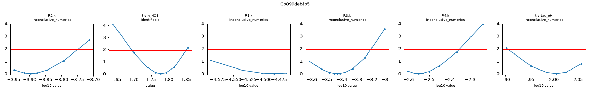
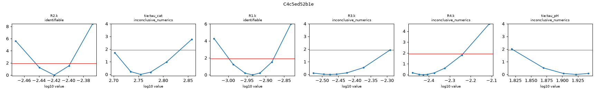
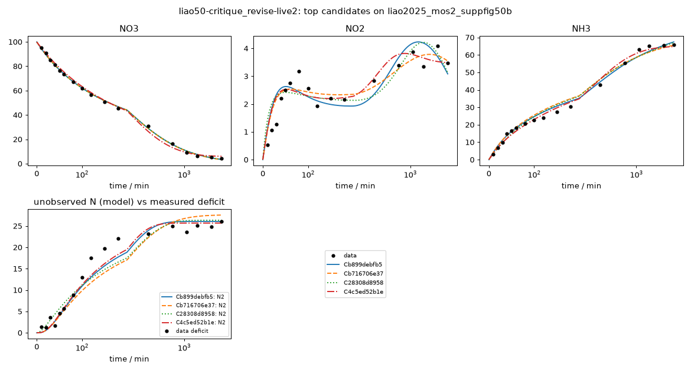

# Investigation report: liao50-critique_revise-live2

- Investigation: `liao50`; arm: `critique_revise`; phase: `final_evaluated`
- Protocol: `mle-profiled-v1` (sha256 `9d2cfcb0a1255b8c`); manifest sha256 `387136c91943e11c`; evaluator code sha256 `396a76ab80769a09` ({'python': '3.12.13', 'numpy': '2.5.4', 'scipy': '1.18.1'})
- Development data: `liao2025_mos2_suppfig50b` (sha256 `c291be31813c41e1`, source_data); 51 observations (NO3: t=0 point treated as initial condition, not as an observation; NO2: t=0 point treated as initial condition, not as an observation; NH3: t=0 point treated as initial condition, not as an observation; temperature not reported; 25.0 C assumed (matters only for potential dependence))

## Question
Which reaction networks and rate laws are supported by the 48 h H-cell nitrate-reduction time courses of Liao et al. 2025 (MoS2-family catalysts, -0.6 V vs RHE), what do the data leave ambiguous (in particular where the missing nitrogen goes and why the rates slow down), and which feasible measurement would best separate the surviving explanations?

## System boundary
Catholyte of an H-cell at fixed potential. Measured: NO3-, NO2- and NH4+/NH3 (lumped as NH3) in mM-N. Not measured: gas phase (N2, N2O, NH3 escape), anolyte (crossover), adsorbed or hidden species, pH, charge. Any nitrogen that leaves the measured channels must be represented by an explicit model species (an unmeasured product, a hidden intermediate, or a reservoir for transport out of the catholyte); the model as a whole must conserve N.

## Evidence status
- Partition: Complete experimental runs are reserved. Supp. Fig. 50a (other catalyst, same conditions and sampling) is the final held-out run; it is not read by any development-phase command, tool or evidence file. The final evaluation tests structure transfer: frozen candidate structures are refit on the held-out run with the same protocol (catalysts differ, so parameters are not transferred).
- Contamination: Retrospective analysis with literature-informed priors, not blind discovery: the proposer sees the development run, its derived N-closure series and a curated metadata note, and its pretraining may include general NO3RR mechanism knowledge.

## Ranked candidates (development data, computed in code)

Delta aicc <= 2.0: not distinguished by these data; <= 4.0: still supported. Akaike weights are relative support within this candidate set (one weight per distinct dynamics) under the stated noise model, not probabilities that a mechanism is true. Residual correlation from misspecification makes these differences optimistic.

| candidate | name | source | v | k | AICc | dAICc | weight | band | adequacy | RMSE NH3 | RMSE NO2 | RMSE NO3 | unobserved N end | in declared space | flags |
|---|---|---|---|---|---|---|---|---|---|---|---|---|---|---|
| Cb899debfb5 | comprop_N2_pHshutoff_powerlaw | agent | 1 | 9 | 168.74 | 0.00 | 0.570 | indistinguishable_from_best | poor | 2.06 | 0.515 | 0.987 | 26 | no | R4: catalyst-state time modulation on a non-electrochemical step (electrons = 0), e.g. crossover or volatilization would not deactivate with the catalyst |
| Cb716706e37 | PL_comprop_N2_conversion_gated | reviewer_revision | 2 | 9 | 169.40 | 0.66 | 0.411 | indistinguishable_from_best | poor | 2.61 | 0.407 | 1.01 | 27.5 | no | R4.order.NO3 at a protocol bound (3) |
| C28308d8958 | PL_nitrite_N2_firstorder | reviewer_revision | 2 | 9 | 175.70 | 6.96 | 0.018 | less_supported | poor | 2.43 | 0.545 | 0.973 | 26.3 | no |  |
| C4c5ed52b1e | comprop_N2_pHshutoff_deact | agent | 1 | 9 | 181.76 | 13.02 | 0.001 | less_supported | poor | 1.84 | 0.443 | 1.89 | 25.7 | no | R4: catalyst-state time modulation on a non-electrochemical step (electrons = 0), e.g. crossover or volatilization would not deactivate with the catalyst |
| Cad716a3ef0 | PL_direct_NO3_sink | reviewer_revision | 2 | 9 | 182.86 | 14.13 | 0.000 | less_supported | poor | 2 | 0.813 | 0.975 | 24.9 | no |  |
| C21ef2d151b | direct_NO3_N2_fastdeact | agent | 1 | 9 | 189.54 | 20.80 | 0.000 | less_supported | poor | 2.53 | 0.794 | 0.961 | 23.6 | no |  |
| Cdc9aa73c9c | nitrite_N2_firstorder_fastdeact | agent | 1 | 9 | 193.17 | 24.43 | 0.000 | less_supported | poor | 2.49 | 0.479 | 1.8 | 25.7 | no |  |
| C4e4058b025 | nitrite_N2_secondorder | agent | 1 | 9 | 196.20 | 27.46 | 0.000 | less_supported | poor | 2.41 | 0.545 | 1.79 | 25.5 | no |  |
| C736e059092 | PL_NH3_escape | reviewer_revision | 2 | 8 | 236.89 | 68.15 | 0.000 | less_supported | poor | 11.4 | 0.773 | 0.961 | 38.6 | no |  |
| C791f3627e4 | NH3_escape_reservoir | agent | 1 | 8 | 257.89 | 89.15 | 0.000 | less_supported | poor | 11.7 | 0.728 | 1.86 | 36.3 | no |  |

## Top candidates in detail

### Cb899debfb5 `comprop_N2_pHshutoff_powerlaw` (source agent, version 1)

Rationale (proposer): Same N-loss hypothesis as comprop_N2_pHshutoff_deact but replaces catalyst ageing with a nitrate order above one; the pair tests whether the slowdown is catalyst-state (time) or concentration driven.

    R1: NO3 -> NH3 [power_law; e=8]; R1.k=0.000127 (95% Wald 9.4e-05-0.000171, well_determined)
    R2: NO3 -> NO2 [power_law; e=2]; R2.k=3.29e-05 (95% Wald 2.41e-05-4.5e-05, well_determined)
    R3: NO2 -> NH3 [mass_action; e=6]; R3.k=0.000371 (95% Wald 0.000244-0.000565, well_determined)
    R4: NH3 + NO2 -> 2 N2 [mass_action, deactivation(tau tie=tau_pH); e=0]; R4.k=0.0028 (95% Wald 0.00208-0.00379, well_determined)
    shared: tie:n_NO3=1.78 (95% Wald 1.71-1.85, well_determined); tie:tau_pH=101 (95% Wald 86.9-118, well_determined)

- Support entries: {'literature': 2, 'data': 3, 'speculative': 1}; reactions without support: []
  - R1: literature -- Liao et al. Nat. Commun. 2025 (doi 10.1038/s41467-025-60671-y), main text in situ ATR-IR/DEMS/DFT paragraph [evidence note L14]: surface pathway *NO3->*NO2->*NO->*N->*NH->*NH2->*NH3 lumped direct 8e path: NO2 stays adsorbed and is reduced on the surface without entering solution
  - R2: data -- liao2025_mos2_suppfig50b: NO2 channel rises to ~3 mM-N within 80 min and then stays at 2-4 mM-N to 48 h, so a minor nitrite-release branch is needed 
  - R3: literature -- Liao et al. Nat. Commun. 2025 (doi 10.1038/s41467-025-60671-y), main text in situ ATR-IR/DEMS/DFT paragraph [evidence note L14]: surface pathway *NO3->*NO2->*NO->*N->*NH->*NH2->*NH3; nitrite is the established solution-phase intermediate of NO3RR 
  - R1.orders: data -- liao2025_mos2_suppfig50b: NO3 consumption rate falls ~300-fold while NO3 falls ~20-fold (apparent order ~1.5-2); tests whether concentration dependence (e.g. interfacial nitrate enrichment that weakens at low bulk concentration) explains the slowdown without catalyst ageing. One shared order (tie n_NO3) for R1,R2 
  - R4: data -- liao2025_mos2_suppfig50b: lag then plateau of the N not accounted for (2 mM-N at 40 min, ~22 at 360 min, 23-26 thereafter) non-electrochemical NH4+ + NO2- -> N2, electrons 0
  - R4.time_modulation: speculative -- Liao et al. 2025 SI p.55 [evidence note L5]: K2SO4 electrolyte pH 6.71 -> 11.87 over NO3RR (related experiment); alkalinization quenches the acid-promoted ammonium-nitrite reaction 
- Assumptions (proposer): ['No catalyst deactivation: the slowdown is apparent order in nitrate >1', 'N2 via comproportionation is the only unmeasured N product']
- sigma (profiled): NO3=1, NO2=0.515, NH3=2.06; adequacy: poor ['NO3: residual signs cluster (runs test p=0.025)', 'NH3: residual signs cluster (runs test p=0.038)', 'NH3: residuals are serially correlated (lag-1 r=0.69)']
- Profile likelihood: R2.k: inconclusive_numerics (95% 0.000113-0.000178); tie:n_NO3: identifiable (95% 1.7-1.85); R1.k: inconclusive_numerics (95% 2.59e-05-3.44e-05); R3.k: inconclusive_numerics (95% 0.000243-0.000619); R4.k: inconclusive_numerics (95% 0.00249-0.00443); tie:tau_pH: inconclusive_numerics (95% 80.6-114)
  

### Cb716706e37 `PL_comprop_N2_conversion_gated` (source reviewer_revision, version 2, parent Cb899debfb5)

Rationale (proposer): Review F1: same comproportionation network with the gate tied to the reaction state instead of a free time window.

    R1: NO3 -> NH3 [power_law; e=8]; R1.k=0.000137 (95% Wald 0.000101-0.000185, well_determined)
    R2: NO3 -> NO2 [power_law; e=2]; R2.k=3.33e-05 (95% Wald 2.42e-05-4.58e-05, well_determined)
    R3: NO2 -> NH3 [mass_action; e=6]; R3.k=0.000162 (95% Wald 6.37e-05-0.00041, moderately_determined)
    R4: NO3 + NH3 + NO2 -> NO3 + 2 N2 [power_law; e=0]; R4.k=3.43e-09 (95% Wald 9.8e-10-1.2e-08, moderately_determined); R4.order.NO3=3 (95% Wald 2.68-3, moderately_determined)
    shared: tie:n_NO3=1.76 (95% Wald 1.69-1.83, well_determined)

- Support entries: {'literature': 2, 'data': 3, 'speculative': 1}; reactions without support: []
  - R1: literature -- Liao et al. Nat. Commun. 2025 (doi 10.1038/s41467-025-60671-y), main text in situ ATR-IR/DEMS/DFT paragraph [evidence note L14]: surface pathway *NO3->*NO2->*NO->*N->*NH->*NH2->*NH3 lumped direct 8e path: NO2 stays adsorbed and is reduced on the surface without entering solution
  - R2: data -- liao2025_mos2_suppfig50b: NO2 channel rises to ~3 mM-N within 80 min and then stays at 2-4 mM-N to 48 h, so a minor nitrite-release branch is needed 
  - R3: literature -- Liao et al. Nat. Commun. 2025 (doi 10.1038/s41467-025-60671-y), main text in situ ATR-IR/DEMS/DFT paragraph [evidence note L14]: surface pathway *NO3->*NO2->*NO->*N->*NH->*NH2->*NH3; nitrite is the established solution-phase intermediate of NO3RR 
  - R1.orders: data -- liao2025_mos2_suppfig50b: same power-law slowdown (shared nitrate order, tie n_NO3) as Cb899debfb5, so that the N-sink comparison is made under one slowdown model (review Ba08689bd71ab-R1 F2). The order is phenomenological and is not separable from catalyst ageing, pH or potential drift in one batch run (F4) 
  - R4: speculative -- No rate constant for NH4+ + NO2- -> N2 is located in the evidence pack; the homogeneous reaction is acid-promoted and is expected to be slow at pH >= 7, so the step may instead stand for interfacial N-N coupling. Kept as a hypothesis motivated by liao2025_mos2_suppfig50b: delayed onset and plateau of the N not accounted for 
  - R4.orders: data -- liao2025_mos2_suppfig50b: replaces the free exponential window tau_pH of Cb899debfb5 by a state-tied gate NO3^m (NO3 acts as a catalyst in R4, unchanged); remaining nitrate is a monotone proxy for conversion, hence for the cumulative OH- produced (~8 OH- per NO3->NH3), answering review F1 
- Assumptions (proposer): ['The N2-forming step is shut off as conversion (and hence alkalinity) increases; remaining nitrate is used as the conversion proxy because the evaluator cannot carry a pH state', 'Equivalently, the step could be an interfacial coupling that needs a nitrate-derived surface species; electrons 0 vs nonzero would not change the measured dynamics']
- sigma (profiled): NO3=1.01, NO2=0.407, NH3=2.61; adequacy: poor ['NO3: residual signs cluster (runs test p=0.025)', 'NH3: residual signs cluster (runs test p=0.009)', 'NH3: residuals are serially correlated (lag-1 r=0.78)']
- Profile likelihood: not computed (identifiability beyond the local Fisher screen is unassessed)

### C28308d8958 `PL_nitrite_N2_firstorder` (source reviewer_revision, version 2, parent Cdc9aa73c9c)

Rationale (proposer): Review F2: isolates the N-sink choice (first-order electrochemical nitrite->N2 vs NH3+NO2 comproportionation) under an identical slowdown model.

    R1: NO3 -> NH3 [power_law; e=8]; R1.k=0.0001 (95% Wald 7.43e-05-0.000135, well_determined)
    R2: NO3 -> NO2 [power_law; e=2]; R2.k=5.5e-05 (95% Wald 4.01e-05-7.56e-05, well_determined)
    R3: NO2 -> NH3 [mass_action; e=6]; R3.k=0.000472 (95% Wald 0.000309-0.000722, well_determined)
    R4: NO2 -> N2 [mass_action, deactivation(tau tie=tau_N2); e=3]; R4.k=0.0707 (95% Wald 0.057-0.0878, well_determined)
    shared: tie:n_NO3=1.79 (95% Wald 1.71-1.86, well_determined); tie:tau_N2=169 (95% Wald 147-196, well_determined)

- Support entries: {'literature': 3, 'data': 3, 'speculative': 0}; reactions without support: []
  - R1: literature -- Liao et al. Nat. Commun. 2025 (doi 10.1038/s41467-025-60671-y), main text in situ ATR-IR/DEMS/DFT paragraph [evidence note L14]: surface pathway *NO3->*NO2->*NO->*N->*NH->*NH2->*NH3 lumped direct 8e path: NO2 stays adsorbed and is reduced on the surface without entering solution
  - R2: data -- liao2025_mos2_suppfig50b: NO2 channel rises to ~3 mM-N within 80 min and then stays at 2-4 mM-N to 48 h, so a minor nitrite-release branch is needed 
  - R3: literature -- Liao et al. Nat. Commun. 2025 (doi 10.1038/s41467-025-60671-y), main text in situ ATR-IR/DEMS/DFT paragraph [evidence note L14]: surface pathway *NO3->*NO2->*NO->*N->*NH->*NH2->*NH3; nitrite is the established solution-phase intermediate of NO3RR 
  - R1.orders: data -- liao2025_mos2_suppfig50b: same power-law slowdown (shared nitrate order, tie n_NO3) as Cb899debfb5, so that the N-sink comparison is made under one slowdown model (review Ba08689bd71ab-R1 F2). The order is phenomenological and is not separable from catalyst ageing, pH or potential drift in one batch run (F4) 
  - R4: literature -- Liao et al. 2025, Methods/main text DEMS paragraph [evidence note L11]: N2 and N2O detected qualitatively by DEMS (separate reactor, 10 mM NO3-); nitrite-derived N2, first order in NO2 
  - R4.time_modulation: data -- liao2025_mos2_suppfig50b: N loss stops after ~360 min while NO2 stays 3-4 mM-N 
- Assumptions (proposer): ['Same as Cdc9aa73c9c but with the power-law slowdown of Cb899debfb5 instead of catalyst deactivation']
- sigma (profiled): NO3=1, NO2=0.545, NH3=2.43; adequacy: poor ['NO3: residual signs cluster (runs test p=0.025)', 'NO2: residuals are serially correlated (lag-1 r=0.54)', 'NH3: residual signs cluster (runs test p=0.025)', 'NH3: residuals are serially correlated (lag-1 r=0.73)']
- Profile likelihood: not computed (identifiability beyond the local Fisher screen is unassessed)

### C4c5ed52b1e `comprop_N2_pHshutoff_deact` (source agent, version 1)

Rationale (proposer): Missing N appears with a lag and stops while NH3 keeps rising; a chemical comproportionation that needs both NH3 and NO2 and is quenched by alkalinization reproduces both the lag and the plateau, while catalyst ageing explains the slowdown of nitrate consumption.

    R1: NO3 -> NH3 [mass_action, deactivation(tau tie=tau_cat); e=8]; R1.k=0.00381 (95% Wald 0.00364-0.00398, well_determined)
    R2: NO3 -> NO2 [mass_action, deactivation(tau tie=tau_cat); e=2]; R2.k=0.00116 (95% Wald 0.00104-0.0013, well_determined)
    R3: NO2 -> NH3 [mass_action, deactivation(tau tie=tau_cat); e=6]; R3.k=0.00334 (95% Wald 0.0022-0.00508, well_determined)
    R4: NH3 + NO2 -> 2 N2 [mass_action, deactivation(tau tie=tau_pH); e=0]; R4.k=0.00374 (95% Wald 0.00264-0.0053, well_determined)
    shared: tie:tau_cat=568 (95% Wald 497-649, well_determined); tie:tau_pH=83.6 (95% Wald 68.9-101, well_determined)

- Support entries: {'literature': 2, 'data': 3, 'speculative': 1}; reactions without support: []
  - R1: literature -- Liao et al. Nat. Commun. 2025 (doi 10.1038/s41467-025-60671-y), main text in situ ATR-IR/DEMS/DFT paragraph [evidence note L14]: surface pathway *NO3->*NO2->*NO->*N->*NH->*NH2->*NH3 lumped direct 8e path: NO2 stays adsorbed and is reduced on the surface without entering solution
  - R2: data -- liao2025_mos2_suppfig50b: NO2 channel rises to ~3 mM-N within 80 min and then stays at 2-4 mM-N to 48 h, so a minor nitrite-release branch is needed 
  - R3: literature -- Liao et al. Nat. Commun. 2025 (doi 10.1038/s41467-025-60671-y), main text in situ ATR-IR/DEMS/DFT paragraph [evidence note L14]: surface pathway *NO3->*NO2->*NO->*N->*NH->*NH2->*NH3; nitrite is the established solution-phase intermediate of NO3RR 
  - R1.time_modulation: data -- liao2025_mos2_suppfig50b: apparent first-order NO3 rate constant falls from ~0.005 min-1 (0-50 min) to ~2e-4 min-1 (1440-2880 min); one catalyst-state tau shared by R1-R3 (also used on R2,R3) 
  - R4: data -- liao2025_mos2_suppfig50b: N not accounted for is ~2 mM-N at 40 min, rises 40-360 min (when both NH3 and NO2 have built up) to ~22 mM-N, then plateaus at 23-26 mM-N; a bimolecular NH4+ + NO2- -> N2 step gives the lag. Chemistry itself is textbook ammonium-nitrite decomposition, no source in the evidence pack non-electrochemical, electrons 0
  - R4.time_modulation: speculative -- Liao et al. 2025 SI p.55 [evidence note L5]: K2SO4 electrolyte pH 6.71 -> 11.87 over NO3RR (related experiment); the ammonium-nitrite reaction is acid-promoted, so alkalinization would switch it off; represented by its own exponential decay (tau_pH), not the catalyst tau 
- Assumptions (proposer): ['N2 is the only unmeasured N product; no NH3 escape or crossover', 'Catalyst activity decays exponentially with one tau for all electrochemical steps', 'Bulk-pH drift is represented only as an exponential shut-off of the chemical step']
- sigma (profiled): NO3=1.89, NO2=0.443, NH3=1.84; adequacy: poor ['NO3: residuals are serially correlated (lag-1 r=0.54)', 'NH3: residual signs cluster (runs test p=0.006)', 'NH3: residuals are serially correlated (lag-1 r=0.73)']
- Profile likelihood: R2.k: identifiable (95% 0.00359-0.004); tie:tau_cat: inconclusive_numerics (95% 504-681); R1.k: identifiable (95% 0.001-0.00132); R3.k: inconclusive_numerics (95% 0.00297-0.00511); R4.k: inconclusive_numerics (95% 0.00332-0.0058); tie:tau_pH: inconclusive_numerics (95% 66.4-87.5)
  

## Discrimination analysis (discrimination-1.json)

A design is {"name", "c0_mM_N": {...}, "t_end_min", optional "observe": [species ids to measure]}. Predictions use
    each candidate's development MLE; parameter uncertainty is not propagated, so large disagreement is a lead for an
    experiment, not a quantified expected information gain.

- Design `NH4_spike_50mM` {"name": "NH4_spike_50mM", "c0_mM_N": {"NO3": 99.95, "NH3": 50}, "t_end_min": 360, "observe": ["NO3", "NO2", "NH3", "N2"]}:
  - species:N2: max spread 6.68 mM-N at 311 min (- dev sigma); {'Cb899debfb5': 25.43, 'C28308d8958': 21.35, 'C4c5ed52b1e': 28.03, 'Cad716a3ef0': 22.14}
  - unmeasured_N_total: max spread 6.68 mM-N at 311 min (- dev sigma); {'Cb899debfb5': 25.43, 'C28308d8958': 21.35, 'C4c5ed52b1e': 28.03, 'Cad716a3ef0': 22.14}
  - NH3: max spread 4.4 mM-N at 172 min (2.13 dev sigma); {'Cb899debfb5': 81.38, 'C28308d8958': 83.76, 'C4c5ed52b1e': 79.35, 'Cad716a3ef0': 81.85}
  - species:NH3: max spread 4.4 mM-N at 172 min (- dev sigma); {'Cb899debfb5': 81.38, 'C28308d8958': 83.76, 'C4c5ed52b1e': 79.35, 'Cad716a3ef0': 81.85}
  - NO3: max spread 2.54 mM-N at 360 min (2.54 dev sigma); {'Cb899debfb5': 29.11, 'C28308d8958': 29.1, 'C4c5ed52b1e': 26.57, 'Cad716a3ef0': 28.88}
- Design `half_nitrate_50mM` {"name": "half_nitrate_50mM", "c0_mM_N": {"NO3": 50}, "t_end_min": 2880, "observe": ["NO3", "NO2", "NH3", "N2"]}:
  - NO3: max spread 8.12 mM-N at 318 min (8.12 dev sigma); {'Cb899debfb5': 22.97, 'C28308d8958': 23.01, 'C4c5ed52b1e': 14.89, 'Cad716a3ef0': 19.98}
  - species:NO3: max spread 8.12 mM-N at 318 min (- dev sigma); {'Cb899debfb5': 22.97, 'C28308d8958': 23.01, 'C4c5ed52b1e': 14.89, 'Cad716a3ef0': 19.98}
  - NH3: max spread 7.86 mM-N at 593 min (3.81 dev sigma); {'Cb899debfb5': 24.48, 'C28308d8958': 22.87, 'C4c5ed52b1e': 29.38, 'Cad716a3ef0': 21.52}
  - species:NH3: max spread 7.86 mM-N at 593 min (- dev sigma); {'Cb899debfb5': 24.48, 'C28308d8958': 22.87, 'C4c5ed52b1e': 29.38, 'Cad716a3ef0': 21.52}
  - species:N2: max spread 6.27 mM-N at 2.88e+03 min (- dev sigma); {'Cb899debfb5': 7.67, 'C28308d8958': 11.05, 'C4c5ed52b1e': 10.26, 'Cad716a3ef0': 13.94}
- Design `nitrite_feed_10mM` {"name": "nitrite_feed_10mM", "c0_mM_N": {"NO2": 10}, "t_end_min": 360, "observe": ["NO2", "NH3", "N2"]}:
  - species:N2: max spread 9.93 mM-N at 360 min (- dev sigma); {'Cb899debfb5': 0.93, 'C28308d8958': 9.93, 'C4c5ed52b1e': 3.96, 'Cad716a3ef0': 0.0}
  - unmeasured_N_total: max spread 9.93 mM-N at 360 min (- dev sigma); {'Cb899debfb5': 0.93, 'C28308d8958': 9.93, 'C4c5ed52b1e': 3.96, 'Cad716a3ef0': 0.0}
  - NO2: max spread 9.74 mM-N at 95.9 min (18.9 dev sigma); {'Cb899debfb5': 9.49, 'C28308d8958': 0.05, 'C4c5ed52b1e': 6.45, 'Cad716a3ef0': 9.8}
  - species:NO2: max spread 9.74 mM-N at 95.9 min (- dev sigma); {'Cb899debfb5': 9.49, 'C28308d8958': 0.05, 'C4c5ed52b1e': 6.45, 'Cad716a3ef0': 9.8}
  - NH3: max spread 2.98 mM-N at 360 min (1.44 dev sigma); {'Cb899debfb5': 0.75, 'C28308d8958': 0.07, 'C4c5ed52b1e': 3.06, 'Cad716a3ef0': 0.75}
- Design `baseline_with_gas` {"name": "baseline_with_gas", "c0_mM_N": {"NO3": 99.95}, "t_end_min": 2880, "observe": ["NO3", "NO2", "NH3", "N2"]}:
  - species:N2: max spread 4.31 mM-N at 43.4 min (- dev sigma); {'Cb899debfb5': 3.14, 'C28308d8958': 4.81, 'C4c5ed52b1e': 3.3, 'Cad716a3ef0': 7.45}
  - unmeasured_N_total: max spread 4.31 mM-N at 43.4 min (- dev sigma); {'Cb899debfb5': 3.14, 'C28308d8958': 4.81, 'C4c5ed52b1e': 3.3, 'Cad716a3ef0': 7.45}
  - NH3: max spread 3.69 mM-N at 2.88e+03 min (1.79 dev sigma); {'Cb899debfb5': 67.42, 'C28308d8958': 67.04, 'C4c5ed52b1e': 64.74, 'Cad716a3ef0': 68.43}
  - species:NH3: max spread 3.69 mM-N at 2.88e+03 min (- dev sigma); {'Cb899debfb5': 67.42, 'C28308d8958': 67.04, 'C4c5ed52b1e': 64.74, 'Cad716a3ef0': 68.43}
  - NO3: max spread 3.11 mM-N at 579 min (3.11 dev sigma); {'Cb899debfb5': 19.33, 'C28308d8958': 19.36, 'C4c5ed52b1e': 16.46, 'Cad716a3ef0': 19.57}

## Review Ba08689bd71ab-R1 (bundle Ba08689bd71ab; reviewer anthropic/claude-opus-5-5)

An interpretation of the frozen bundle, not experimental validation.

The six candidates all describe one unreplicated batch run (MoS2, 100 mM nitrate, 48 h). Up to 26 mM-N goes missing between about 50 and 180 min, then the deficit stays flat. Every fit is rated poor adequacy, and NH3 residuals are serially correlated in all of them. The top-ranked model, Cb899debfb5 (NH3+NO2 comproportionation, pH shut-off, nitrate order 1.78), has an Akaike weight that overstates the evidence. The ranking mixes the slowdown choice with the N-sink choice. The comproportionation step has no source in the evidence pack, and its pH gate is a free exponential window. The NH3-escape fit never converged. Mechanisms nobody proposed remain open: RHE potential drift, anolyte crossover and hidden intermediates.

- **F1** [major/chemistry] The NH4+ + NO2- -> N2 step in both top candidates has no literature support here and is physically doubtful. It is acid-promoted, but the unbuffered catholyte should turn alkaline early, and its pH shut-off is a free exponential window from t=0 that is not tied to the OH- produced. (targets: candidate:Cb899debfb5#/submission/mechanism/reactions/3, candidate:C4c5ed52b1e#/submission/mechanism/reactions/3; check: literature; action: new_candidate -- Replace tau_pH with a pH proxy computed from the OH- produced, and refit. Run a no-current NH4+ + NO2- control at pH 7 and pH 11.)
- **F2** [major/interpretation] The ranking confounds slowdown and N sink. Under the same deactivation slowdown, comproportionation beats the other sinks by only about 7.8-14.4 AICc, so the 0.998 weight does not isolate the sink. (targets: comparison#/ranking/groups/0/rows/0; check: consistency; action: new_candidate -- Fit power-law versions of each alternative sink.)
- **F3** [major/statistics] All candidates fail the adequacy screen with the same correlated NH3 residuals, so AICc gaps are optimistic. (targets: evaluation:Cb899debfb5#/residuals; check: numerical; action: additional_analysis -- Report adjusted AICc gaps.)
- **F4** [major/chemistry] The nitrate order of 1.78 is physically unexplained and nearly perfectly confounded with its rate constant; in one batch run it can stand in for ageing, pH rise or potential drift. (targets: evaluation:Cb899debfb5#/summary/params/tie:n_NO3; check: assumption; action: experiment -- Re-spike nitrate at 24 h and run a starting-concentration series.)
- **F5** [major/numerics] The NH3-escape fit failed, so its reported delta AICc of 274 is invalid. (targets: evaluation:C791f3627e4#/summary; check: numerical; action: additional_analysis -- Report the real AICc gap.)
- **F6** [major/coverage] Unproposed mechanisms: RHE potential drift as pH rises, anolyte crossover, and hidden intermediates such as NH2OH. (targets: evidence:literature; check: assumption; action: new_candidate -- Fit these candidates and assay the anolyte.)

Assessment: plausible ['Cb899debfb5', 'C4c5ed52b1e']; adequate candidate exists: no; ambiguities: ['Nitrate order, catalyst deactivation and pH or potential drift cannot be told apart from one batch run.', 'The N sink is unresolved.', 'There are no anolyte, gas or pH measurements.']

Investigator response:
- F1: revised ['Cb716706e37'] -- Accepted. The evidence pack has no rate constant for NH4+ + NO2- -> N2, so the step is now labelled speculative. The homogeneous reaction is acid-promoted and is expected to be slow at pH >= 7. The fitted bulk rate (k ~3e-3 mM^-1 min^-1, so nitrite lasts only minutes at 20 mM NH3) is therefore doubtful as bulk chemistry; it could stand for interfacial N-N coupling. The evaluator cannot carry a pH state. So revision Cb716706e37 replaces the free exponential window with a gate tied to the reaction state, NO3^m: remaining nitrate tracks conversion and so the cumulative OH- produced. The official fit was a numerical failure, not chemistry: 10 of 12 starts reached NLL 73.50 but were flagged unconverged, and the stored optimum (NLL 123.87, AICc 270) is a stuck start (predicted NO2 about 0). NLL 73.50 gives AICc about 169.4, i.e. dAICc about +0.7 against the time-window parent Cb899debfb5. My own sandbox refit gave NLL 72.4, with the gate order near its upper bound of 3. So a gate tied to conversion fits as well as the free window, but the official rank of Cb716706e37 is invalid. The no-current NH4+ + NO2- controls at pH 7 and pH 11 are adopted as recommended experiments.
- F2: revised ['C28308d8958', 'Cad716a3ef0', 'C736e059092'] -- Done: power-law (PL) versions of the alternative sinks were fitted. AICc by slowdown x sink. Comproportionation: PL 168.7, deactivation 181.8. First-order NO2->N2: PL 175.7, deactivation 193.2. Direct NO3 sink: PL 182.9, deactivation 189.5. Second-order NO2: deactivation 196.2 (my exploratory PL fit gave 178.5). NH3 escape: PL 236.9. Under the same PL slowdown, comproportionation beats first-order NO2->N2 by 7.0, the direct NO3 sink by 14.1 and NH3 escape by 68. The 0.97 weight therefore does not isolate the sink. After the correction for serial correlation (see F3), the comproportionation vs NO2->N2 gap shrinks to about 1.7, so these two sinks are not distinguished by these data.
- F3: analysis [] -- Accepted. Correction: each channel's log-likelihood difference was scaled by the effective-sample-size factor (1-r)/(1+r), using lag-1 r from the best model (NO3 0.19, NO2 0.49, NH3 0.69). Equal k means no penalty difference. Adjusted gaps from Cb899debfb5: PL nitrite->N2 7.5 -> 1.7 (indistinguishable); PL direct NO3 sink 14.5 -> 5.1; deactivation comproportionation 12.4 -> 12.2. The last gap comes almost entirely from the NO3 channel, where residuals are only weakly correlated; with a worst case of r = 0.7 on all channels it falls to 2.2. PL NH3 escape 71.9 -> 15.4 (12.7 worst case). Sinks driven by nitrite or a lagged coupling stay jointly plausible, the nitrate-driven sink is weakly disfavoured, and NH3 escape is disfavoured under every correction. This is an approximation, not an AR(1) refit.
- F4: accepted_no_change [] -- Accepted. The order of 1.78 is phenomenological. In one batch run, a power-law order is equivalent to an activity that decays as a power of time, i.e. ageing, pH rise or RHE-potential drift that saturates. In this run it only shows that a single-exponential catalyst decay fits the NO3 channel worse (NO3 RMSE 1.9 vs 1.0). nw_discriminate shows a starting-concentration series separates the two slowdown forms. At 50 mM initial nitrate, NO3 near 320 min is predicted at 23.0 mM-N (PL) vs 14.9 (deactivation), about 8 development sigma apart. A nitrate re-spike at 24 h is also recommended. An order-1 model with a pH-tied gate cannot be written in the evaluator without a pH state; my exploratory order-1 plus deactivation model with the conversion-gated sink (AICc about 187) did no better than C4c5ed52b1e.
- F5: revised ['C736e059092'] -- Accepted that the dAICc of 274 for C791f3627e4 is invalid. Its unconverged lower NLL of 119.2 bounds its AICc at about 255 (dAICc about 86 or more). The power-law version C736e059092 converged at AICc 236.9 (dAICc 68; about 15 after the serial-correlation correction). Every version fails the same way: escape proportional to NH3 predicts the missing N growing fastest late (NH3 residual -21 at 360 min, +11 at 2880 min), while the measured deficit plateaus. NH3 escape as the main sink is not supported, whatever the numerical issue.
- F6: analysis [] -- (a) RHE potential drift: at a fixed reference-electrode potential a rising pH makes the effective potential less cathodic. In a lumped model this is a time or state modulation of all electrochemical steps, the same family as catalyst deactivation and the power-law order. It cannot be separated without pH and potential logs, and is listed as an ambiguity with F4. (b) Anolyte crossover of nitrate: NO3 -> reservoir with a decaying coefficient is dynamically identical to the direct NO3 sinks C21ef2d151b and Cad716a3ef0, and the assumptions of Cad716a3ef0 say so. These cannot produce the delayed onset (corrected dAICc about 5). Crossover of NH4+ behaves like NH3 escape and is disfavoured. An anolyte assay would settle it. (c) Hidden intermediate (NO2 -> X -> NH3 under PL): my exploratory sandbox fit gave AICc about 220, not an official result. The flat deficit from 360 to 2880 min means any hidden pool does not convert back within 48 h, so it acts as a terminal sink on this timescale. Only measuring the transient pools (NH2OH assay, adsorbed species) could separate it from N2. No budget remained for official candidates.

## Investigator conclusion (conclusion-1.json; an interpretation, numbers above are authoritative)

These data rule out NH3 escape as the main sink, and they weakly disfavour sinks driven by nitrate (including crossover), because the measured deficit starts late and then plateaus. They support a nitrite-involving N2 branch active only in the first ~6 h. They do not tell apart a lagged NH3+NO2 coupling from first-order nitrite reduction to N2 once residual correlation is accounted for. They also cannot separate the cause of the slowdown (apparent nitrate order of about 1.8, catalyst ageing, pH or potential drift). No candidate is adequate. A nitrite-only feed with gas analysis, plus a starting-concentration series with pH logging, are the most informative next measurements.

- Plausible: ['Cb899debfb5', 'C28308d8958', 'Cb716706e37', 'C4c5ed52b1e']
- Adequacy: none_adequate
- Rejected: [{'candidate_id': 'C791f3627e4', 'reason': 'NH3 escape: missing N would grow with NH3, but the measured deficit plateaus after 360 min. Its official fit did not converge; the lower unconverged bound still gives dAICc about 86 or more.'}, {'candidate_id': 'C736e059092', 'reason': 'NH3 escape under the power-law slowdown converged but is dAICc 68 worse (about 15 after the serial-correlation correction), with large clustered NH3 residuals.'}, {'candidate_id': 'C21ef2d151b', 'reason': 'Direct nitrate sink (also stands for nitrate crossover) has no delayed onset of N loss; dAICc 20.8.'}, {'candidate_id': 'Cdc9aa73c9c', 'reason': 'Superseded by its power-law version C28308d8958; under deactivation, dAICc 24.'}, {'candidate_id': 'C4e4058b025', 'reason': 'Second-order nitrite sink under deactivation, dAICc 27; adds nothing over the first-order version.'}]
- Ambiguities: ['Where the N goes: a lagged N2 source involving nitrite (NH3+NO2 coupling with a gate, Cb899debfb5/Cb716706e37) and first-order nitrite->N2 with its own decay (C28308d8958) are not distinguished once residual autocorrelation is accounted for (corrected dAICc about 1.7). A nitrate-driven sink or crossover (Cad716a3ef0) is weakly disfavoured (corrected about 5).', 'Why the rate slows: a nitrate order of about 1.8, catalyst ageing, pH rise and RHE-potential drift are not separable from one batch run. A single-exponential catalyst decay fits the NO3 channel worse, but this concerns only the functional form.', "The N2-forming step's shut-off (free time window vs conversion-tied gate) fits equally well (dAICc about 0.7, using the unconverged-but-repeated optimum for Cb716706e37; the official rank of Cb716706e37 is invalid because of an optimizer failure).", 'A hidden intermediate that does not convert within 48 h looks the same as a terminal N2 sink on the measured channels.', 'Every candidate is rated poor adequacy (clustered, serially correlated NH3 residuals, e.g. a kink at about 40 min that no candidate captures).']
- Experiment: Nitrite-only feed, 10 mM-N NO2-, same cell and potential, 6 h, sampling NO2-, NH4+ and gas-phase N2/N2O -- discriminates ['Cb899debfb5', 'C28308d8958', 'Cb716706e37']: nw_discriminate: first-order nitrite->N2 predicts NO2 gone by about 96 min, converted to about 10 mM-N of N2. The coupling-gated model predicts NO2 almost unchanged (9.5 mM-N) because no NH3 is present. Spread about 19 development sigma in NO2.
- Experiment: No-current controls: 50 mM NH4+ + 3 mM NO2- in 0.5 M K2SO4 at pH 7 and pH 11; plus an NH4+ spike (50 mM-N) at t=0 of a standard run -- discriminates ['Cb899debfb5', 'C28308d8958']: Tests directly whether NH4+/NO2- chemistry produces N2 at a significant rate in this electrolyte (review F1). If it does not, the coupling term must be interfacial or wrong.
- Experiment: Starting-concentration series (50 mM nitrate) and a 100 mM nitrate re-spike at 24 h, with logged bulk pH and electrode potential vs RHE -- discriminates ['Cb899debfb5', 'C4c5ed52b1e']: Power-law order vs catalyst ageing: at 50 mM nitrate, NO3 near 320 min is predicted at 23.0 vs 14.9 mM-N (about 8 sigma). A re-spike restoring the initial rate argues against ageing; pH and potential logs test RHE drift.
- Experiment: Gas-phase N2/N2O quantification (GC) plus acid trap and anolyte NH4+/NO3- assay during a standard run -- discriminates ['Cb899debfb5', 'Cad716a3ef0', 'C736e059092']: Directly closes the N balance. Separates N2 from crossover (anolyte nitrate) and from NH3 escape (trap / anolyte NH4+), and shows whether N2 formation has a delayed onset (about 3 vs 7 mM-N at 43 min).

## Investigator conclusion (conclusion-2.json; an interpretation, numbers above are authoritative)

One unreplicated 48 h MoS2 run (100 mM nitrate, -0.6 V vs RHE). About 26 mM-N goes missing: the deficit starts after about 40 min, rises until about 360 min, then stays flat while NH3 keeps rising. NO2 levels off at 2-4 mM-N.

Rejected: NH3 escape, which predicts loss growing late. Its power-law fit converged at dAICc 68 (about 13-15 after correction); the deactivation fit failed numerically but is still about 86 or more behind. Also rejected are sinks that combine an exponential deactivation slowdown with a nitrate or nitrite sink (dAICc 20-27).

Still plausible: a short-lived N2 branch that involves nitrite. Either it is a lagged NH3+NO2 coupling with its own shut-off, as a time window (Cb899debfb5, best, AICc 168.7) or as a gate tied to conversion (Cb716706e37, about 169.4 once its optimizer failure is set aside). Or it is first-order nitrite reduction to N2 (C28308d8958, dAICc 7.0, about 1.7 after correcting for serial correlation). A nitrate-driven sink or crossover is weakly disfavoured (about 5 after correction).

The slowdown is described better by an apparent nitrate order of about 1.8 than by single-exponential deactivation (C4c5ed52b1e, dAICc 13, less robust under worst-case correction). It remains confounded with catalyst ageing, pH rise and RHE drift.

No candidate is adequate: every candidate has serially correlated NH3 residuals. The comproportionation step lacks literature support and is chemically doubtful in bulk at alkaline pH. The most informative next measurements are a nitrite-only feed with gas analysis (about 19 sigma between the leading sinks), no-current NH4+/NO2- controls, and a starting-concentration series or re-spike with pH logging.

- Plausible: ['Cb899debfb5', 'C28308d8958', 'Cb716706e37', 'C4c5ed52b1e']
- Adequacy: none_adequate
- Rejected: [{'candidate_id': 'C791f3627e4', 'reason': 'NH3 escape, deactivation slowdown. The official fit did not converge, so dAICc 274 is invalid. The repeated unconverged NLL of 119.2 still bounds AICc near 255, i.e. dAICc about 86 or more. Mechanistically, escape proportional to NH3 predicts the N deficit growing fastest late, but the measured deficit is flat at 23-26 mM-N from 360 to 2880 min while NH3 rises from 43 to 66 mM-N.'}, {'candidate_id': 'C736e059092', 'reason': 'NH3 escape, power-law slowdown. Converged; dAICc 68.2, still about 13-15 after the serial-correlation correction. NH3 RMSE is 11.4 vs 2.06 for the best model, with large clustered residuals (-21 at 360 min, +11 at 2880 min).'}, {'candidate_id': 'C21ef2d151b', 'reason': 'Direct nitrate sink (also stands for nitrate crossover) with a decaying coefficient, under deactivation. dAICc 20.8. It cannot produce the delayed onset of N loss (deficit only about 2 mM-N at 40 min).'}, {'candidate_id': 'Cdc9aa73c9c', 'reason': 'First-order nitrite->N2 under single-exponential deactivation. dAICc 24.4. The same sink survives in its power-law version C28308d8958, so what is rejected is this combination of sink and slowdown, not the nitrite sink itself.'}, {'candidate_id': 'C4e4058b025', 'reason': 'Second-order nitrite->N2 under deactivation. dAICc 27.5, worse than the first-order version with the same parameter count. My exploratory power-law version (AICc about 178.5, not official) was also worse than first order.'}]
- Ambiguities: ['No candidate is adequate. All ten are rated poor: clustered residual signs and serially correlated NH3 residuals, lag-1 r = 0.69 even for the best model Cb899debfb5. A kink in NH3 at about 40-50 min, where the N deficit starts, is captured by none. AICc gaps are therefore optimistic.', 'Sink, comproportionation vs nitrite reduction to N2: Cb899debfb5 (NH3+NO2 coupling with its own shut-off) leads C28308d8958 (first-order NO2->N2 with its own decay) by dAICc 7.0 under the same power-law slowdown. Scaling channel likelihoods by (1-r)/(1+r) shrinks this to about 1.7, so they are not distinguished. The coupling step has no located rate constant in the evidence pack (basis: speculative), and bulk NH4+/NO2- chemistry is expected to be slow at pH >= 7; it may stand for interfacial N-N coupling.', 'Shut-off of the N2 branch: free time window (Cb899debfb5) vs gate tied to conversion, NO3^m (Cb716706e37). The official result for Cb716706e37 (AICc 270.1) is an optimizer failure: 10 of 12 starts reached NLL 73.50 but were flagged unconverged. NLL 73.50 gives AICc about 169.4, about 0.7 from Cb899debfb5, so they are effectively indistinguishable. Its official rank must not be read as evidence against it.', 'Slowdown: power-law nitrate order 1.78 (Cb899debfb5) vs single-exponential catalyst deactivation (C4c5ed52b1e), raw dAICc 13.0. The gap comes almost entirely from the NO3 channel (RMSE 1.0 vs 1.9). It is about 12 after the correction with per-channel r, but about 2 under a worst-case r = 0.7 on all channels. The order is phenomenological and confounded with its rate constant (r = -0.996). In one batch run it cannot be separated from catalyst ageing, pH rise, or RHE-potential drift under fixed-reference control (pH 6.71 -> ~11.9 in a related run; the pH used for the RHE conversion is not stated).', 'Observational equivalences: nitrate crossover to the anolyte with a decaying transfer coefficient produces the same measured curves as the direct nitrate->N2 sinks (Cad716a3ef0, C21ef2d151b). Electrochemical vs chemical forms of the coupling step (electrons 8 vs 0) cannot be told apart. A hidden intermediate that does not convert back within 48 h looks the same as a terminal N2 sink.', 'Cad716a3ef0 (power-law, direct nitrate sink / crossover) is weakly disfavoured: dAICc 14.1, about 5 after correction, NO2 residuals clustered. It is not firmly excluded.', 'Unresolved metadata: pH, temperature, stirring, H-cell membrane, anolyte composition and volume, and charge/FE for these runs are not reported. Values have not been checked against the plotted figure. There is a single unreplicated run with no gas or anolyte data.']
- Experiment: Nitrite-only feed: 10 mM-N NO2-, no nitrate, same H-cell and potential, 6 h. Sample NO2- and NH4+, and quantify gas-phase N2/N2O by GC. -- discriminates ['Cb899debfb5', 'Cb716706e37', 'C28308d8958', 'C4c5ed52b1e']: nw_discriminate at the fitted parameters: first-order NO2->N2 (C28308d8958) predicts NO2 is about 0.05 mM-N by 96 min, with about 9.9 mM-N N2 by 6 h. The coupling model (Cb899debfb5) predicts NO2 about 9.5 and N2 about 0.9, because no NH3 is present. Spread is about 19 development sigma in NO2. Caveat: models with clock-based windows assume the window restarts at t=0.
- Experiment: No-current chemical controls: 50 mM NH4+ + 3 mM NO2- in 0.5 M K2SO4 at pH 7 and pH 11, plus a standard run with 50 mM-N NH4+ added at t=0 -- discriminates ['Cb899debfb5', 'Cb716706e37', 'C28308d8958']: Directly tests whether bulk NH4+/NO2- chemistry makes N2 at the fitted rate (k about 3e-3 mM^-1 min^-1); this addresses review F1. A negative result moves the coupling term to the interface or rules it out. In the NH4+-spike run, N2 at about 310 min is predicted at 21-28 mM-N across models (spread 6.7 mM-N), so gas measurement is needed.
- Experiment: Starting-concentration series (50 mM-N nitrate, 48 h) and a 100 mM nitrate re-spike at 24 h, with bulk pH and electrode potential vs RHE logged -- discriminates ['Cb899debfb5', 'C4c5ed52b1e']: Separates the power-law order from catalyst ageing and potential drift. At 50 mM, NO3 near 320 min is predicted at 23.0 mM-N (power-law) vs 14.9 mM-N (deactivation), about 8 development sigma apart. A re-spike that restores the initial rate argues against ageing; the pH and potential logs test RHE drift.
- Experiment: Standard 100 mM run with gas-phase N2/N2O quantification, an acid trap on the outlet, and anolyte NH4+/NO3- assays at each sampling time -- discriminates ['Cb899debfb5', 'C28308d8958', 'Cad716a3ef0', 'C736e059092']: Closes the N balance directly. It separates N2 from nitrate crossover (anolyte nitrate) and from NH3 escape (trap / anolyte NH4+), and tests the delayed onset of N2: at 43 min, N2 is predicted at about 3.1 (coupling), 4.8 (nitrite first order) and 7.4 mM-N (direct nitrate sink).

## Frozen selection

- Rule: lowest AICc among fitted candidates without a hidden-pool plausibility violation, plus every such candidate within delta AICc <= 2.0
- Selected: ['Cb899debfb5']
- Agent-concluded plausible: ['Cb899debfb5', 'C28308d8958', 'Cb716706e37', 'C4c5ed52b1e']
- Frozen at 2026-10-20T16:50:48.576Z

## Final held-out evaluation: liao2025_wmos2_suppfig50a

Version: current evaluator code; the pre-registered evaluation (earlier code) is kept in final/final_evaluation.json.

Structure transfer: each frozen structure is refit on the held-out run (different catalyst) with the development protocol; parameters are not transferred. Rank is among all members of the declared enumeration spaces fitted to the same run.
Sensitivity: AICc at the lowest NLL any start reached (flags fits whose reported optimum is beaten by replicated unconverged starts). See docs/examples/arm_comparison.md for ranks in a shared reference set.

- C4c5ed52b1e: fitted; AICc 166, delta to best 0, rank 1/688 among this run's declared-space members; numerically unreliable: False; sensitivity AICc 166 (rank 1); adequacy poor; RMSE {'NO3': 2.11, 'NO2': 0.51, 'NH3': 0.88}
- C28308d8958: fitted; AICc 189, delta to best 23.1, rank 32/688 among this run's declared-space members; numerically unreliable: False; sensitivity AICc 189 (rank 32); adequacy poor; RMSE {'NO3': 2.36, 'NO2': 0.48, 'NH3': 1.66}
- Cb716706e37: fitted; AICc 192, delta to best 26.4, rank 33/688 among this run's declared-space members; numerically unreliable: False; sensitivity AICc 192 (rank 33); adequacy poor; RMSE {'NO3': 4.69, 'NO2': 0.35, 'NH3': 1.28}
- Cb899debfb5: fitted; AICc 194, delta to best 28.3, rank 33/688 among this run's declared-space members; numerically unreliable: False; sensitivity AICc 194 (rank 33); adequacy poor; RMSE {'NO3': 2.23, 'NO2': 0.45, 'NH3': 2.18}
- Best declared-space members on the held-out run: [('S:enum-2ed1b3b4a8', 179.17, 'enumerated: NO3>NO2,NO3>NH3,NO3>X,NO2>X,X>NH3 | mass_action | shared_deactivation'), ('S:enum-3c7318acc7', 179.3, 'enumerated: NO3>NO2,NO3>NH3,NO2>NH3,NO3>X,X>NH3 | mass_action | shared_deactivation'), ('S:enum-21d5c8b0d8', 179.41, 'enumerated: NO3>NO2,NO3>NH3,NO2>SINK,NO3>X,X>NH3 | mass_action | shared_deactivation')]

## Cost and runtime

- Numerics: 4 fits run, 6 reused from the shared cache, 67 CPU s fitting, 98 s profiles (current evaluator code only; earlier code versions' records are excluded)
- LLM: anthropic/claude-opus-5-5; sessions: 1 investigator, 2 reviewer; tokens in 184, out 125,647, cache read 6,396,397, cache write 538,692; $6.49 (list prices from the Pi model table); 3238 s wall; 73 tool calls

## Unresolved assumptions and metadata

- liao2025_mos2_suppfig50b: verified_against_figure=False
- [L3] catalyst assignment: unresolved discrepancy
- [L4] selectivity numbers: unresolved
- [L5] pH: stated for a related experiment; not measured for these runs
- [L6] NH3 escape: stated (qualitative)
- [L7] reference and iR: stated (flow cell)
- [L8] membrane: not found for the H-cell
- [L9] volume: stated for 0.5 h tests
- [L11] gas and crossover: not measured for these runs
- [L12] N balance: not found
- [L13] charge: not found for these runs
- [L14] mechanism (authors): stated (surface pathway, not a solution-phase kinetic model)
- [L15] replicates: no replicate information for these runs
- Noise model: independent Gaussian errors per channel (profiled sigma); no replicate information exists for these runs, so sigma is estimated from misfit and includes model error.
- AICc differences assume independent errors; clustered residual signs (adequacy 'poor') make them optimistic.

