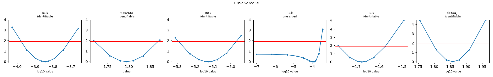
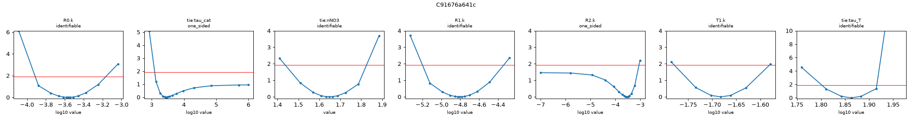
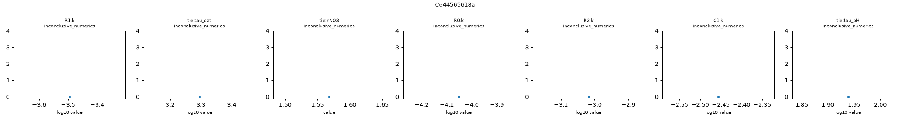
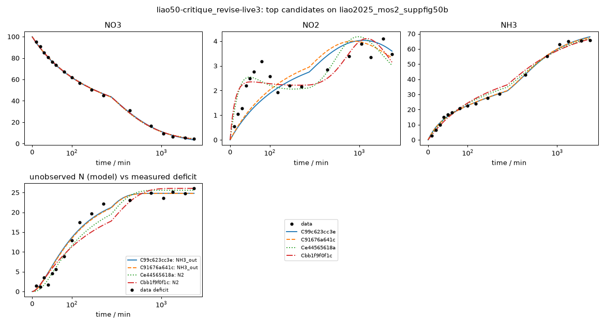

# Investigation report: liao50-critique_revise-live3

- Investigation: `liao50`; arm: `critique_revise`; phase: `final_evaluated`
- Protocol: `mle-profiled-v1` (sha256 `9d2cfcb0a1255b8c`); manifest sha256 `76cdbce7cb548123`; evaluator code sha256 `65c1ac7c107bb1ff` ({'python': '3.12.13', 'numpy': '2.5.4', 'scipy': '1.18.1'})
- Development data: `liao2025_mos2_suppfig50b` (sha256 `c291be31813c41e1`, source_data); 51 observations (NO3: t=0 point treated as initial condition, not as an observation; NO2: t=0 point treated as initial condition, not as an observation; NH3: t=0 point treated as initial condition, not as an observation; temperature not reported; 25.0 C assumed (matters only for potential dependence))

## Question
Which reaction networks and rate laws are supported by the 48 h H-cell nitrate-reduction time courses of Liao et al. 2025 (MoS2-family catalysts, -0.6 V vs RHE), what do the data leave ambiguous (in particular where the missing nitrogen goes and why the rates slow down), and which feasible measurement would best separate the surviving explanations?

## System boundary
Catholyte of an H-cell at fixed potential. Measured: NO3-, NO2- and NH4+/NH3 (lumped as NH3) in mM-N. Not measured: gas phase (N2, N2O, NH3 escape), anolyte (crossover), adsorbed or hidden species, pH, charge. Any nitrogen that leaves the measured channels must be represented by an explicit model species (an unmeasured product, a hidden intermediate, or a reservoir for transport out of the catholyte); the model as a whole must conserve N.

## Evidence status
- Partition: Complete experimental runs are reserved. Supp. Fig. 50a (other catalyst, same conditions and sampling) is the final held-out run; it is not read by any development-phase command, tool or evidence file. The final evaluation tests structure transfer: frozen candidate structures are refit on the held-out run with the same protocol (catalysts differ, so parameters are not transferred).
- Contamination: Retrospective analysis with literature-informed priors, not blind discovery: the proposer sees the development run, its derived N-closure series and a curated metadata note, and its pretraining may include general NO3RR mechanism knowledge.

## Ranked candidates (development data, computed in code)

Delta aicc <= 2.0: not distinguished by these data; <= 4.0: still supported. Akaike weights are relative support within this candidate set (one weight per distinct dynamics) under the stated noise model, not probabilities that a mechanism is true. Residual correlation from misspecification makes these differences optimistic.

| candidate | name | source | v | k | AICc | dAICc | weight | band | adequacy | RMSE NH3 | RMSE NO2 | RMSE NO3 | unobserved N end | in declared space | flags |
|---|---|---|---|---|---|---|---|---|---|---|---|---|---|---|
| C99c623cc3e | c3_parallel_pl_NH4_transport_no_deact | agent | 1 | 9 | 166.25 | 0.00 | 0.521 | indistinguishable_from_best | poor | 1.29 | 0.785 | 0.96 | 24.8 | no | T1: catalyst-state time modulation on a non-electrochemical step (electrons = 0), e.g. crossover or volatilization would not deactivate with the catalyst |
| C91676a641c | c2_parallel_pl_NH4_transport_shutoff | agent | 1 | 10 | 167.46 | 1.21 | 0.285 | indistinguishable_from_best | poor | 1.24 | 0.763 | 0.975 | 24.8 | no | T1: catalyst-state time modulation on a non-electrochemical step (electrons = 0), e.g. crossover or volatilization would not deactivate with the catalyst |
| Ce44565618a | c4_parallel_pl_NO2_NH4_comproportionation | agent | 1 | 10 | 168.27 | 2.02 | 0.189 | supported | poor | 1.75 | 0.521 | 1.04 | 25.6 | no | C1: catalyst-state time modulation on a non-electrochemical step (electrons = 0), e.g. crossover or volatilization would not deactivate with the catalyst |
| Cbb1f9f0f1c | c5_parallel_pl_N2_electrochemical_shift | agent | 1 | 10 | 176.90 | 10.66 | 0.003 | less_supported | poor | 2.37 | 0.521 | 0.986 | 26 | no |  |
| C42681e96dd | r4_NO2_N2_plus_NH4_transport | reviewer_revision | 2 | 10 | 177.04 | 10.79 | 0.002 | less_supported | poor | 3.11 | 0.404 | 0.972 | 27.1 | no | T1: catalyst-state time modulation on a non-electrochemical step (electrons = 0), e.g. crossover or volatilization would not deactivate with the catalyst |
| Cab52de2d44 | r2_NO3_crossover_shutoff | reviewer_revision | 2 | 9 | 182.86 | 16.62 | 0.000 | less_supported | poor | 2 | 0.813 | 0.975 | 24.9 | no | T1: catalyst-state time modulation on a non-electrochemical step (electrons = 0), e.g. crossover or volatilization would not deactivate with the catalyst |
| Cb91e3fac66 | r3_time_only_sink_control | reviewer_revision | 2 | 9 | 183.08 | 16.83 | 0.000 | less_supported | poor | 2 | 0.82 | 0.973 | 24.5 | no | T1: catalyst-state time modulation on a non-electrochemical step (electrons = 0), e.g. crossover or volatilization would not deactivate with the catalyst |
| Cc6b0e7ff11 | c6_parallel_pl_hidden_intermediate_pool | agent | 1 | 9 | 236.18 | 69.93 | 0.000 | less_supported | poor | 3.66 | 0.647 | 3.22 | 27.3 | no | tie:nNO3 at a protocol bound (1.05e-14) |
| C4d82a17858 | c1_series_N2_constant_selectivity | agent | 1 | 7 | 247.00 | 80.75 | 0.000 | less_supported | poor | 3.36 | 2.06 | 1.79 | 30.5 | liao-core-v1, liao-extended-v1 |  |
| C2d410fda0c | r5_surface_coupling_no_switch | reviewer_revision | 2 | 8 | 271.85 | 105.60 | 0.000 | less_supported | poor | 1.87 | 0.856 | 14.9 | 8.43 | no | tie:nNO3 at a protocol bound (3); R2.k at a protocol bound (1e-07) |

## Top candidates in detail

### C99c623cc3e `c3_parallel_pl_NH4_transport_no_deact` (source agent, version 1)

Rationale (proposer): Tests whether catalyst deactivation is needed at all, or whether an apparent nitrate order above 1 explains the slowdown (nested in c2 with tau_cat -> infinity).

    R0: NO3 -> NH3 [power_law; e=8]; R0.k=0.000143 (95% Wald 0.000106-0.000195, well_determined)
    R1: NO3 -> NO2 [power_law; e=2]; R1.k=7.48e-06 (95% Wald 5.17e-06-1.08e-05, well_determined)
    R2: NO2 -> NH3 [mass_action; e=6]; R2.k=0.000112 (95% Wald 2.69e-05-0.000468, moderately_determined)
    T1: NH3 -> NH3_out [mass_action, deactivation(tau tie=tau_T); e=0]; T1.k=0.0211 (95% Wald 0.0168-0.0266, well_determined)
    shared: tie:nNO3=1.79 (95% Wald 1.72-1.87, well_determined); tie:tau_T=72.1 (95% Wald 62.4-83.4, well_determined)

- Support entries: {'literature': 3, 'data': 3, 'speculative': 1}; reactions without support: []
  - R0: literature -- Liao et al. 2025 Nat. Commun., main text in situ ATR-IR/DEMS/DFT paragraph (evidence note L14): NO3->NO2->...->NH3 pathway, NO2 band in ATR-IR; surface pathway reaches NH3 without releasing free nitrite (lumped direct step) 
  - R0: data -- liao2025_mos2_suppfig50b: NO2 never exceeds ~4 mM-N (<5% of N) while NH3 reaches 15 mM-N within 40 min, and NO2 keeps rising slowly late while NO3 falls; a pure series path forces NO2 to track NO3 
  - R1: literature -- Liao et al. 2025 Nat. Commun., main text in situ ATR-IR/DEMS/DFT paragraph (evidence note L14): NO3->NO2->...->NH3 pathway, NO2 band in ATR-IR 
  - R2: literature -- Liao et al. 2025 Nat. Commun., main text in situ ATR-IR/DEMS/DFT paragraph (evidence note L14): NO3->NO2->...->NH3 pathway, NO2 band in ATR-IR 
  - nNO3: data -- liao2025_mos2_suppfig50b: apparent first-order NO3 rate constant drops ~20-fold over the run while NO3 falls 20-fold; exploratory fits with first-order NO3 leave systematic NO3 residuals at 360-720 min; here the order alone carries the slowdown 
  - T1: data -- liao2025_mos2_suppfig50b: N deficit accrues mainly 40-360 min and coincides with a dip in NO2 (3.2 -> 1.9 mM-N, 80-120 min); deficit flat 23-26 mM-N after 360 min while NH3 doubles 
  - tau_T: speculative -- pH-driven shutoff of NH4+ crossover (L5, L8) 
- Assumptions (proposer): ['no catalyst deactivation: the slowdown is entirely concentration dependence (apparent order >1 in NO3)', 'same transport sink as c2']
- sigma (profiled): NO3=1, NO2=0.785, NH3=1.29; adequacy: poor ['NO2: residual signs cluster (runs test p=0.006)', 'NO2: residuals are serially correlated (lag-1 r=0.79)', 'NH3: residual signs cluster (runs test p=0.038)']
- Profile likelihood: R1.k: identifiable (95% 0.000105-0.000196); tie:nNO3: identifiable (95% 1.72-1.87); R0.k: identifiable (95% 5.1e-06-1.08e-05); R2.k: one_sided (95% 1e-07-0.000295); T1.k: identifiable (95% 0.0167-0.0268); tie:tau_T: identifiable (95% 62.5-83.2)
  

### C91676a641c `c2_parallel_pl_NH4_transport_shutoff` (source agent, version 1)

Rationale (proposer): Transport-sink hypothesis: the missing N is ammonium that left the catholyte while it was still protonated; rate slowdown from apparent nitrate order plus catalyst decay.

    R0: NO3 -> NH3 [power_law, deactivation(tau tie=tau_cat); e=8]; R0.k=0.000274 (95% Wald 0.000119-0.000634, moderately_determined)
    R1: NO3 -> NO2 [power_law, deactivation(tau tie=tau_cat); e=2]; R1.k=1.57e-05 (95% Wald 6.2e-06-3.96e-05, moderately_determined)
    R2: NO2 -> NH3 [mass_action, deactivation(tau tie=tau_cat); e=6]; R2.k=0.00029 (95% Wald 8.99e-05-0.000937, moderately_determined)
    T1: NH3 -> NH3_out [mass_action, deactivation(tau tie=tau_T); e=0]; T1.k=0.0208 (95% Wald 0.0166-0.0261, well_determined)
    shared: tie:tau_cat=2.82e+03 (95% Wald 853-9.33e+03, moderately_determined); tie:nNO3=1.65 (95% Wald 1.46-1.84, well_determined); tie:tau_T=72.9 (95% Wald 63.2-84.1, well_determined)

- Support entries: {'literature': 3, 'data': 4, 'speculative': 1}; reactions without support: []
  - R0: literature -- Liao et al. 2025 Nat. Commun., main text in situ ATR-IR/DEMS/DFT paragraph (evidence note L14): NO3->NO2->...->NH3 pathway, NO2 band in ATR-IR; surface pathway reaches NH3 without releasing free nitrite (lumped direct step) 
  - R0: data -- liao2025_mos2_suppfig50b: NO2 never exceeds ~4 mM-N (<5% of N) while NH3 reaches 15 mM-N within 40 min, and NO2 keeps rising slowly late while NO3 falls; a pure series path forces NO2 to track NO3 
  - R1: literature -- Liao et al. 2025 Nat. Commun., main text in situ ATR-IR/DEMS/DFT paragraph (evidence note L14): NO3->NO2->...->NH3 pathway, NO2 band in ATR-IR 
  - R2: literature -- Liao et al. 2025 Nat. Commun., main text in situ ATR-IR/DEMS/DFT paragraph (evidence note L14): NO3->NO2->...->NH3 pathway, NO2 band in ATR-IR 
  - nNO3: data -- liao2025_mos2_suppfig50b: apparent first-order NO3 rate constant drops ~20-fold over the run while NO3 falls 20-fold; exploratory fits with first-order NO3 leave systematic NO3 residuals at 360-720 min 
  - tau_cat: data -- liao2025_mos2_suppfig50b: apparent first-order NO3 rate constant falls from ~0.005 min-1 (0-60 min) to ~0.0002 min-1 (1440-2880 min), NO3 tails at ~4.5 mM-N 
  - T1: data -- liao2025_mos2_suppfig50b: N deficit accrues mainly 40-360 min and coincides with a dip in NO2 (3.2 -> 1.9 mM-N, 80-120 min); deficit flat 23-26 mM-N after 360 min while NH3 doubles; deficit grows while NH3 is 10-30 mM-N 
  - tau_T: speculative -- NH4+ migration across a cation-exchange membrane (Nafion used in the flow cell, L8; H-cell membrane not described) stops as the unbuffered catholyte turns alkaline (pH 6.71 -> 11.87 for a related run, L5) and NH4+ deprotonates; own time constant, not catalyst decay. Volatilization (L6) would instead accelerate with pH 
- Assumptions (proposer): ['N loss is NH4+/NH3 leaving the catholyte (anolyte crossover), electrons 0, with a time-limited driving force', 'no N2 formation', 'nitrate steps share apparent order nNO3 and catalyst decay tau_cat']
- sigma (profiled): NO3=1, NO2=0.763, NH3=1.24; adequacy: poor ['NO2: residual signs cluster (runs test p=0.001)', 'NO2: residuals are serially correlated (lag-1 r=0.77)', 'NH3: residual signs cluster (runs test p=0.038)']
- Profile likelihood: R0.k: identifiable (95% 0.000122-0.000686); tie:tau_cat: one_sided (95% 1.25e+03-1e+06); tie:nNO3: identifiable (95% 1.44-1.83); R1.k: identifiable (95% 6.3e-06-4.56e-05); R2.k: one_sided (95% 1e-07-0.00089); T1.k: identifiable (95% 0.0166-0.0263); tie:tau_T: identifiable (95% 63.3-82.4)
  

### Ce44565618a `c4_parallel_pl_NO2_NH4_comproportionation` (source agent, version 1)

Rationale (proposer): N2-by-comproportionation hypothesis: loss rate proportional to NO2 x NH3, which peaks mid-run, and stops when pH rises.

    R0: NO3 -> NH3 [power_law, deactivation(tau tie=tau_cat); e=8]; R0.k=0.00032 (95% Wald 0.000137-0.000745, moderately_determined)
    R1: NO3 -> NO2 [power_law, deactivation(tau tie=tau_cat); e=2]; R1.k=8.88e-05 (95% Wald 3.68e-05-0.000214, moderately_determined)
    R2: NO2 -> NH3 [mass_action, deactivation(tau tie=tau_cat); e=6]; R2.k=0.000959 (95% Wald 0.000499-0.00184, well_determined)
    C1: NO2 + NH3 -> 2 N2 [mass_action, deactivation(tau tie=tau_pH); e=0]; C1.k=0.0035 (95% Wald 0.00252-0.00486, well_determined)
    shared: tie:tau_cat=1.97e+03 (95% Wald 828-4.7e+03, moderately_determined); tie:nNO3=1.57 (95% Wald 1.38-1.76, well_determined); tie:tau_pH=86.8 (95% Wald 73.1-103, well_determined)

- Support entries: {'literature': 4, 'data': 4, 'speculative': 1}; reactions without support: []
  - R0: literature -- Liao et al. 2025 Nat. Commun., main text in situ ATR-IR/DEMS/DFT paragraph (evidence note L14): NO3->NO2->...->NH3 pathway, NO2 band in ATR-IR; surface pathway reaches NH3 without releasing free nitrite (lumped direct step) 
  - R0: data -- liao2025_mos2_suppfig50b: NO2 never exceeds ~4 mM-N (<5% of N) while NH3 reaches 15 mM-N within 40 min, and NO2 keeps rising slowly late while NO3 falls; a pure series path forces NO2 to track NO3 
  - R1: literature -- Liao et al. 2025 Nat. Commun., main text in situ ATR-IR/DEMS/DFT paragraph (evidence note L14): NO3->NO2->...->NH3 pathway, NO2 band in ATR-IR 
  - R2: literature -- Liao et al. 2025 Nat. Commun., main text in situ ATR-IR/DEMS/DFT paragraph (evidence note L14): NO3->NO2->...->NH3 pathway, NO2 band in ATR-IR 
  - nNO3: data -- liao2025_mos2_suppfig50b: apparent first-order NO3 rate constant drops ~20-fold over the run while NO3 falls 20-fold; exploratory fits with first-order NO3 leave systematic NO3 residuals at 360-720 min 
  - tau_cat: data -- liao2025_mos2_suppfig50b: apparent first-order NO3 rate constant falls from ~0.005 min-1 (0-60 min) to ~0.0002 min-1 (1440-2880 min), NO3 tails at ~4.5 mM-N 
  - C1: literature -- Liu et al. 2024 Nature 626, 98 (LITERATURE_index section 4): networks with chemical comproportionation steps; N2 detected by DEMS (L11). Applied here as solution/interface NO2- + NH4+ -> N2 
  - C1: data -- liao2025_mos2_suppfig50b: N deficit accrues mainly 40-360 min and coincides with a dip in NO2 (3.2 -> 1.9 mM-N, 80-120 min); deficit flat 23-26 mM-N after 360 min while NH3 doubles 
  - tau_pH: speculative -- ammonium-nitrite decomposition requires near-neutral/acidic conditions; stops as the unbuffered catholyte turns alkaline (L5) 
- Assumptions (proposer): ['unmeasured N is N2 from a non-electrochemical NO2-/NH4+ coupling (electrons 0)', 'coupling shuts off with its own time constant (pH), not with catalyst decay']
- sigma (profiled): NO3=1.04, NO2=0.521, NH3=1.75; adequacy: poor ['NO2: residuals are serially correlated (lag-1 r=0.51)', 'NH3: residual signs cluster (runs test p=0.028)', 'NH3: residuals are serially correlated (lag-1 r=0.67)']
- Profile likelihood: R1.k: inconclusive_numerics (95% 0.00032-0.00032); tie:tau_cat: inconclusive_numerics (95% 1.97e+03-1.97e+03); tie:nNO3: inconclusive_numerics (95% 1.57-1.57); R0.k: inconclusive_numerics (95% 8.88e-05-8.88e-05); R2.k: inconclusive_numerics (95% 0.000959-0.000959); C1.k: inconclusive_numerics (95% 0.0035-0.0035); tie:tau_pH: inconclusive_numerics (95% 86.8-86.8)
  

### Cbb1f9f0f1c `c5_parallel_pl_N2_electrochemical_shift` (source agent, version 1)

Rationale (proposer): Electrochemical-selectivity-shift hypothesis: N2 is a cathodic product whose pathway switches off early, independent of NH3 formation.

    R0: NO3 -> NH3 [power_law, deactivation(tau tie=tau_cat); e=8]; R0.k=0.000191 (95% Wald 7.84e-05-0.000465, moderately_determined)
    R1: NO3 -> NO2 [power_law, deactivation(tau tie=tau_cat); e=2]; R1.k=0.000108 (95% Wald 4.3e-05-0.000273, moderately_determined)
    R2: NO2 -> NH3 [mass_action, deactivation(tau tie=tau_cat); e=6]; R2.k=0.0009 (95% Wald 0.000414-0.00196, moderately_determined)
    R3: NO2 -> N2 [mass_action, deactivation(tau tie=tau_N2); e=3]; R3.k=0.0756 (95% Wald 0.0603-0.0947, well_determined)
    shared: tie:tau_cat=2.81e+03 (95% Wald 767-1.03e+04, moderately_determined); tie:nNO3=1.64 (95% Wald 1.44-1.84, well_determined); tie:tau_N2=156 (95% Wald 131-184, well_determined)

- Support entries: {'literature': 4, 'data': 4, 'speculative': 0}; reactions without support: []
  - R0: literature -- Liao et al. 2025 Nat. Commun., main text in situ ATR-IR/DEMS/DFT paragraph (evidence note L14): NO3->NO2->...->NH3 pathway, NO2 band in ATR-IR; surface pathway reaches NH3 without releasing free nitrite (lumped direct step) 
  - R0: data -- liao2025_mos2_suppfig50b: NO2 never exceeds ~4 mM-N (<5% of N) while NH3 reaches 15 mM-N within 40 min, and NO2 keeps rising slowly late while NO3 falls; a pure series path forces NO2 to track NO3 
  - R1: literature -- Liao et al. 2025 Nat. Commun., main text in situ ATR-IR/DEMS/DFT paragraph (evidence note L14): NO3->NO2->...->NH3 pathway, NO2 band in ATR-IR 
  - R2: literature -- Liao et al. 2025 Nat. Commun., main text in situ ATR-IR/DEMS/DFT paragraph (evidence note L14): NO3->NO2->...->NH3 pathway, NO2 band in ATR-IR 
  - nNO3: data -- liao2025_mos2_suppfig50b: apparent first-order NO3 rate constant drops ~20-fold over the run while NO3 falls 20-fold; exploratory fits with first-order NO3 leave systematic NO3 residuals at 360-720 min 
  - tau_cat: data -- liao2025_mos2_suppfig50b: apparent first-order NO3 rate constant falls from ~0.005 min-1 (0-60 min) to ~0.0002 min-1 (1440-2880 min), NO3 tails at ~4.5 mM-N 
  - R3: literature -- Liao et al. 2025, Methods/main text DEMS paragraph (evidence note L11): N2 and N2O detected by DEMS; electrochemical nitrite -> N2 branch 
  - tau_N2: data -- liao2025_mos2_suppfig50b: N deficit accrues mainly 40-360 min and coincides with a dip in NO2 (3.2 -> 1.9 mM-N, 80-120 min); deficit flat 23-26 mM-N after 360 min while NH3 doubles; N2 selectivity decays faster than the NH3 path 
- Assumptions (proposer): ['unmeasured N is N2 from electrochemical first-order reduction of free nitrite', 'the N2 branch has its own decay (selectivity shift), faster than tau_cat']
- sigma (profiled): NO3=1, NO2=0.521, NH3=2.37; adequacy: poor ['NO3: residual signs cluster (runs test p=0.028)', 'NO2: residuals are serially correlated (lag-1 r=0.52)', 'NH3: residual signs cluster (runs test p=0.025)', 'NH3: residuals are serially correlated (lag-1 r=0.74)']
- Profile likelihood: not computed (identifiability beyond the local Fisher screen is unassessed)

## Discrimination analysis (discrimination-1.json)

A design is {"name", "c0_mM_N": {...}, "t_end_min", optional "observe": [species ids to measure]}. Predictions use
    each candidate's development MLE; parameter uncertainty is not propagated, so large disagreement is a lead for an
    experiment, not a quantified expected information gain.

- Design `NH4_spike_30` {"name": "NH4_spike_30", "c0_mM_N": {"NO3": 99.95, "NH3": 30}, "t_end_min": 720}:
  - NH3: max spread 27.1 mM-N at 246 min (21 dev sigma); {'C99c623cc3e': 42.8, 'C91676a641c': 43.12, 'Ce44565618a': 66.82, 'Cbb1f9f0f1c': 69.95, 'Cab52de2d44': 68.16}
  - unmeasured_N_total: max spread 26.3 mM-N at 221 min (- dev sigma); {'C99c623cc3e': 45.0, 'C91676a641c': 44.81, 'Ce44565618a': 22.85, 'Cbb1f9f0f1c': 18.71, 'Cab52de2d44': 19.99}
  - NO2: max spread 1.9 mM-N at 264 min (2.42 dev sigma); {'C99c623cc3e': 3.09, 'C91676a641c': 3.3, 'Ce44565618a': 1.4, 'Cbb1f9f0f1c': 2.3, 'Cab52de2d44': 3.16}
  - NO3: max spread 0.887 mM-N at 666 min (0.887 dev sigma); {'C99c623cc3e': 16.94, 'C91676a641c': 16.59, 'Ce44565618a': 16.4, 'Cbb1f9f0f1c': 16.61, 'Cab52de2d44': 17.29}
- Design `NO2_spike_10` {"name": "NO2_spike_10", "c0_mM_N": {"NO3": 99.95, "NO2": 10}, "t_end_min": 720}:
  - unmeasured_N_total: max spread 18.5 mM-N at 409 min (- dev sigma); {'C99c623cc3e': 24.63, 'C91676a641c': 24.71, 'Ce44565618a': 41.82, 'Cbb1f9f0f1c': 33.31, 'Cab52de2d44': 23.37}
  - NO2: max spread 10.5 mM-N at 322 min (13.4 dev sigma); {'C99c623cc3e': 12.96, 'C91676a641c': 12.67, 'Ce44565618a': 3.32, 'Cbb1f9f0f1c': 2.41, 'Cab52de2d44': 12.73}
  - NH3: max spread 9.76 mM-N at 720 min (7.55 dev sigma); {'C99c623cc3e': 56.21, 'C91676a641c': 57.25, 'Ce44565618a': 47.49, 'Cbb1f9f0f1c': 55.54, 'Cab52de2d44': 56.6}
  - NO3: max spread 0.887 mM-N at 666 min (0.887 dev sigma); {'C99c623cc3e': 16.94, 'C91676a641c': 16.59, 'Ce44565618a': 16.4, 'Cbb1f9f0f1c': 16.61, 'Cab52de2d44': 17.29}
- Design `NO3_50` {"name": "NO3_50", "c0_mM_N": {"NO3": 50}, "t_end_min": 2880}:
  - unmeasured_N_total: max spread 6.06 mM-N at 2.88e+03 min (- dev sigma); {'C99c623cc3e': 8.67, 'C91676a641c': 9.21, 'Ce44565618a': 7.88, 'Cbb1f9f0f1c': 11.11, 'Cab52de2d44': 13.94}
  - NH3: max spread 4.79 mM-N at 2.03e+03 min (3.71 dev sigma); {'C99c623cc3e': 34.67, 'C91676a641c': 33.99, 'Ce44565618a': 34.51, 'Cbb1f9f0f1c': 31.35, 'Cab52de2d44': 29.88}
  - NO3: max spread 3.37 mM-N at 188 min (3.37 dev sigma); {'C99c623cc3e': 29.89, 'C91676a641c': 28.75, 'Ce44565618a': 28.22, 'Cbb1f9f0f1c': 28.77, 'Cab52de2d44': 26.52}
  - NO2: max spread 1.4 mM-N at 796 min (1.79 dev sigma); {'C99c623cc3e': 1.78, 'C91676a641c': 1.83, 'Ce44565618a': 3.15, 'Cbb1f9f0f1c': 2.26, 'Cab52de2d44': 1.75}
- Design `NH4_only_30` {"name": "NH4_only_30", "c0_mM_N": {"NH3": 30}, "t_end_min": 360}:
  - unmeasured_N_total: max spread 23.4 mM-N at 360 min (- dev sigma); {'C99c623cc3e': 23.4, 'C91676a641c': 23.34, 'Ce44565618a': 0.0, 'Cbb1f9f0f1c': 0.0, 'Cab52de2d44': 0.0}
  - NH3: max spread 23.4 mM-N at 360 min (18.1 dev sigma); {'C99c623cc3e': 6.6, 'C91676a641c': 6.66, 'Ce44565618a': 30.0, 'Cbb1f9f0f1c': 30.0, 'Cab52de2d44': 30.0}
  - NO2: max spread 0 mM-N at 0 min (0 dev sigma); {'C99c623cc3e': 0.0, 'C91676a641c': 0.0, 'Ce44565618a': 0.0, 'Cbb1f9f0f1c': 0.0, 'Cab52de2d44': 0.0}
  - NO3: max spread 0 mM-N at 0 min (0 dev sigma); {'C99c623cc3e': 0.0, 'C91676a641c': 0.0, 'Ce44565618a': 0.0, 'Cbb1f9f0f1c': 0.0, 'Cab52de2d44': 0.0}

## Review Baaaf458096ab-R1 (bundle Baaaf458096ab; reviewer anthropic/claude-opus-5-5)

An interpretation of the frozen bundle, not experimental validation.

Six candidates were fitted to one 48 h MoS2 batch run (NO3, NO2 and NH3 channels; about 25% of the N is missing after about 6 h). The code-computed ranking places three candidates within ΔAICc 2.02 of each other: C99c623cc3e (NH3 transport, no catalyst decay), C91676a641c (NH3 transport plus catalyst decay) and Ce44565618a (NO2/NH4+ comproportionation to N2). All three are rated "poor" for adequacy, mainly because NO2 residuals cluster. The data do not say where the missing N goes. In every top model the sink follows a free exponential switch-off with tau ≈ 72–87 min, and that switch sets the shape of the deficit curve; the chemistry of the step does not. Each proposed sink also has a chemistry problem: NH4+ would have to cross out of the catholyte against migration, or the comproportionation rate would have to be implausibly fast at neutral-to-alkaline pH. Two kinds of explanation were never proposed: anion (NO3-/NO2-) crossover and analytical bias. The data do reject a pure series path at constant selectivity (C4d82a17858) and the hidden-intermediate pool (Cc6b0e7ff11). The "no catalyst deactivation" reading is not settled either: a nitrate order of about 1.8 and a long decay constant trade off against each other. No candidate is adequate.

- **F1** [major/interpretation] The identity of the N sink (NH3 leaving the catholyte versus N2 from NO2/NH4+ comproportionation) cannot be told apart from these data. The two NH3-transport candidates and the comproportionation candidate are within ΔAICc 2.02, all are rated poor, and they predict nearly the same end-of-run unobserved N (24.8–25.6 mM). With misspecified, serially correlated residuals, ΔAICc differences this small mean nothing. (targets: comparison#/ranking/groups/0/rows/0, comparison#/ranking/groups/0/rows/1, comparison#/ranking/groups/0/rows/2; check: consistency; action: experiment -- Measure N2 and N2O in the headspace (GC) together with NH4+ in the anolyte and in an acid trap on the cell vent, over the same 48 h run. Comproportionation predicts about 1.5 mmol N as N2, mostly formed before 6 h, and no anolyte NH4+. The transport candidates predict the reverse.)
- **F2** [major/chemistry] In all three top candidates the deficit curve is shaped by a free exponential switch-off on a step with zero electrons (tau_T ≈ 72 min, tau_pH ≈ 87 min). The step is labelled as pH-driven, but tau is not linked to any pH or charge variable. It acts as a fitted on/off time profile, so the fit says little about which species the sink acts on. These are the same terms the T1/C1 plausibility flags mark. (targets: candidate:C99c623cc3e#/submission/mechanism/reactions/3, candidate:Ce44565618a#/submission/mechanism/reactions/3, candidate:C91676a641c#/submission/mechanism/reactions/3; check: assumption; action: new_candidate -- As a control, fit a sink that depends only on time (rate = k·exp(-t/tau), not proportional to any species), and a sink proportional to NO3 with the same tau. If they fit about as well, the species attached to the sink is not identified. Separately, replace exp(-t/tau) with a pH proxy computed from cumulative charge or OH- production (for example, the NH3 formed times the stoichiometric OH- yield).)
- **F3** [major/chemistry] The NH4+ crossover sink in C99c623cc3e and C91676a641c is physically doubtful. Under cathodic current, cations migrate into the catholyte through a cation-exchange membrane, not out of it. K+ at about 1 M would carry almost all of that charge. That leaves diffusion as the only way out, yet the fitted initial first-order loss rate (about 0.021 min⁻¹, half-life about 33 min for 60 mL) would remove about 25% of the NH3 formed within about 3 h. The H-cell membrane is not described at all. Volatilization, as the investigator notes, would speed up with alkaline pH rather than stop. (targets: candidate:C99c623cc3e#/submission/support/6, candidate:C91676a641c#/submission/support/7; check: assumption; action: experiment -- Find out the membrane type. Assay NH4+ in the anolyte and in a vent acid trap at 3 h and 48 h. If no N is found there, reject the transport candidates.)
- **F4** [major/chemistry] The comproportionation rate constant in Ce44565618a, C1.k ≈ 0.0035 mM⁻¹ min⁻¹ (about 3.5 M⁻¹ min⁻¹), implies a homogeneous NH4+ + NO2- → N2 reaction at room temperature that is far faster than expected. That decomposition goes through HNO2 and is negligible at neutral or alkaline pH, and this electrolyte becomes alkaline. The literature cited for C1 (Liu et al. 2024 Nature) is not in the evidence bundle and was never located, so the C1 step has no checked literature support. (targets: candidate:Ce44565618a#/submission/mechanism/reactions/3, candidate:Ce44565618a#/submission/support/6; check: literature; action: additional_analysis -- Take literature rate constants for NH4+/NO2- decomposition as a function of pH and T. Check whether a 0.0035 mM⁻¹ min⁻¹ rate is reachable at pH ≥ 6.7. If it is only reachable at the electrode interface, recast C1 as a surface (electrocatalytic) N–N coupling step and fix its time modulation to match.)
- **F5** [major/coverage] No candidate puts the sink on NO3- or NO2- leaving the catholyte. Under current, anions migrate toward the anode, so their loss through an imperfectly selective or undescribed membrane is a natural direction. No candidate considers analytical bias either. Nitrite absorbs in the A220-A275 nitrate assay, sample dilution factors are not given, the values were not verified against the figure, and there are no replicates. The deficit builds up mainly between 40 and 180 min (closure 0.943 at 60 min to 0.779 at 180 min). (targets: dataset:liao2025_mos2_suppfig50b#/n_closure, evidence:literature#/7; check: consistency; action: new_candidate -- Fit a candidate with NO3 → anolyte transport, proportional to NO3 (optionally with tau). Measure NO3- and NO2- in the anolyte at the end of the run. Cross-check nitrate by ion chromatography to rule out nitrite interference in the UV method.)
- **F6** [major/statistics] In every top candidate the NO2 residuals cluster in the same way: NO2 is underpredicted at 40–80 min, and the observed peak at about 80 min followed by a dip at 120 min is missed. The candidates also trade fit between channels. The comproportionation model fits NO2 best (RMSE 0.52 against 0.78, runs p 0.08) but NH3 worse (1.75 against 1.29). The AICc order therefore depends on which channel each sink fits, not on one mechanism fitting the whole run. (targets: evaluation:C99c623cc3e#/residuals/channels/NO2, evaluation:Ce44565618a#/residuals/channels/NO2; check: numerical; action: additional_analysis -- Report the AICc contribution of each channel. Fit a combined candidate with a NO2-consuming sink plus an NH3 sink to see whether the NO2 dip and the NH3 shape need different processes. Also check whether the NO2 points at 80–120 min are an analytical artefact before building a mechanism around them.)
- **F7** [minor/interpretation] The step from C91676a641c to C99c623cc3e (removing catalyst decay) costs only about 0.95 in NLL, and the decay constant in C91676a641c is long and broad (about 2820 min, CI roughly 850–9300). The data therefore do not require catalyst decay. But the replacement, an apparent nitrate order of about 1.8 at 5–100 mM, is phenomenological: real nitrate orders are usually ≤1 or saturating. It is strongly correlated with the rate constants (r = −0.996 with R0.k), so it is probably absorbing other slowdowns such as pH drift, falling current or decay. Neither 'no deactivation' nor 'order 1.8' should be read as mechanism. (targets: evaluation:C91676a641c#/summary/params/tie:tau_cat, evaluation:C99c623cc3e#/summary/params/tie:nNO3; check: numerical; action: experiment -- Spike fresh nitrate at 48 h, or run initial-rate tests at several starting NO3 concentrations, to separate a concentration order from catalyst decay. Also profile the likelihood in nNO3 and tau_cat together.)
- **F8** [minor/statistics] The error model sits at its floor for the NO3 channel in several candidates: the NO3 sigma equals the 1% relative floor (0.9995), which is above the fitted RMSE. Part of the NO3 likelihood is therefore set by the floor. Combined with the sampling gaps at 180–360 and 360–720 min, where the fitted switch-off times of about 72–155 min act, the sink timing is weakly constrained. (targets: evaluation:C99c623cc3e#/summary/sigma/NO3, protocol#/noise; check: numerical; action: additional_analysis -- Re-rank with the floor varied (for example 0.5% and 2%) to check that the top-three order holds. Compute profile likelihoods for tau_T and tau_pH, given the 180–720 min data gap.)
- **F9** [minor/numerics] None of the 9 replicate starts for Ce44565618a converged formally; they stopped on the evaluation budget or the sigma tolerance. The optimum was accepted only because those starts replicated. Its ΔAICc of 2.02, right at the band edge, could move if the fit were properly converged. (targets: evaluation:Ce44565618a#/multistart; check: numerical; action: additional_analysis -- Refit Ce44565618a with a larger max_nfev budget, polishing from the best start, and confirm the NLL of 71.386.)
- **F10** [note/interpretation] Two candidates are rejected, and the rejections hold. The pure series path at constant selectivity (C4d82a17858) predicts that NO2 falls to about 0.19 mM by 48 h when 3.48 mM is observed, at ΔAICc 80.7. The hidden-pool candidate (Cc6b0e7ff11) puts the nitrate order at its 0 bound and leaves the X→NH3 step undetermined. Its pool peaks at the final time (fraction 0.273, near the 0.30 limit), so in effect it is a terminal sink, not a pool that drains back. (targets: evaluation:C4d82a17858#/residuals/channels/NO2, evaluation:Cc6b0e7ff11#/annotations; check: consistency; action: none -- No further action needed. Record these two as rejected. Note that the Katsounaros reference used for C6 is also absent from the evidence bundle.)

Assessment: plausible ['C99c623cc3e', 'C91676a641c', 'Ce44565618a']; adequate candidate exists: no; ambiguities: ['Where the missing ~25 mM-N goes (NH4+/NH3 leaving the catholyte, N2 from comproportionation, anion crossover, or analytical bias) is not resolved by concentration data alone.', 'In every top model the deficit shape is set by a free exponential switch-off with no measured pH; what the switch physically represents is unknown.', 'The slowdown can be explained by an apparent nitrate order of about 1.8 or by catalyst decay; the two trade off and cannot be separated in a single batch run.', 'The H-cell membrane type, the pH trajectory, and verification of the extracted values against the figure are all missing.']

Investigator response:
- F1: accepted_no_change ['C99c623cc3e', 'C91676a641c', 'Ce44565618a'] -- Agreed: these concentration data do not identify the sink. nw_discriminate at the development MLEs shows how to separate the candidates. (a) Spike 30 mM NH4+ at t=0, with or without nitrate: the NH3-transport candidates lose about 23 of 30 mM-N within 6 h; Ce44565618a, Cbb1f9f0f1c and Cab52de2d44 lose none (21 dev-sigma spread in NH3). (b) Spike 10 mM nitrite: the NO2-consuming sinks (Ce44565618a, Cbb1f9f0f1c) remove the spike (NO2 about 2.4-3.3 vs 12.7-13.0 mM at 320 min, 13 dev-sigma). Caveat: in the models tau is clock time, but if the switch is really pH-driven it will move with the spike. The direct test remains the reviewer's: headspace N2/N2O by GC plus NH4+ in the anolyte and in a vent acid trap.
- F2: revised ['Cb91e3fac66', 'Cab52de2d44', 'C2d410fda0c'] -- Ran the requested controls. The time-only zero-order sink (Cb91e3fac66) has dAICc 16.8 and a NO3-proportional sink with tau (Cab52de2d44) has dAICc 16.6; both fit about 8 NLL units worse than the NH3-proportional sink, almost all of it in the NH3 channel (NH3 RMSE 2.0 vs 1.29). So the species dependence is not empty. A sink whose rate grows with product concentration (NH3, or NO2xNH3) beats a time-only profile. NH3 and NO2xNH3 are not separated from each other, though. The switch-off itself is required: a NO2xNH3 coupling without tau (C2d410fda0c) gives AICc 271.9, dAICc 106. Its official fit has nNO3 at the bound 3 and NO3 RMSE 14.9, partly numerical, but a sandbox fit also stayed about 50 NLL worse. A pH proxy from cumulative OH-/charge cannot be expressed in the available rate-law families (no dependence on integrated variables; ph_dependence needs known pH), so the tau remains a phenomenological switch. That limit is recorded.
- F3: accepted_no_change ['C99c623cc3e', 'C91676a641c'] -- Accepted. Under cathodic current, cations migrate into the catholyte through a CEM, so NH4+ leaving would have to go by diffusion against migration. A half-life of about 33 min (T1.k 0.021 min-1) is implausible for Nafion, and volatilization (L6) would speed up, not stop, as the pH rises. I keep the NH3-proportional sink as a phenomenological descriptor that fits best, not as an identified transport process. The NH4+-spike design above and the anolyte/vent-trap assay would reject it if no N appears there.
- F4: revised ['C2d410fda0c', 'C42681e96dd'] -- Accepted that homogeneous NH4+/NO2- decomposition goes through HNO2 and is negligible at pH >= 6.7. The fitted 3.5 M-1 min-1 would mean about 0.14 mM/min at 2 mM NO2 and 20 mM NH4+, which is not credible in bulk solution. I did not find a rate source in the evidence. The Liu 2024 citation supports only the generic idea of comproportionation steps in networks; I withdraw it as support for C1, which should be read as speculative. Two revisions: (1) C2d410fda0c drops the independent switch (coupling at constant k), and the fit fails, dAICc 106; (2) C42681e96dd replaces the bulk chemistry with a cathodic NO2->N2 step (electrons 3) plus the NH3 sink, sharing one switch. If Ce44565618a fits, it does so through its switch and its NO2 dependence, not through credible bulk chemistry. Only an interfacial N-N coupling reading would survive.
- F5: revised ['Cab52de2d44', 'Cb91e3fac66'] -- Added the NO3 -> anolyte crossover candidate (Cab52de2d44, first order in NO3 with tau, same main network as C99c623cc3e). It is less supported (dAICc 16.6) and is dynamically almost the same as the time-only control: once a switch-off is allowed, a sink proportional to NO3 cannot place the loss at 40-180 min while NO3 is highest at t<40. Analytical bias cannot be written as a mechanism. Some checks against it: (i) nitrite interference in the A220-A275 nitrate assay would raise apparent NO3 and shrink the deficit, and NO2 is at most 4 mM against a 25 mM gap; (ii) random dilution errors would scatter, but the deficit is a smooth rise that then plateaus. A systematic calibration drift in the indophenol NH3 assay at high NH3 cannot be excluded. Recommended: anolyte NO3-/NO2- at 48 h, and IC cross-check of NO3- and NH4+.
- F6: analysis ['C42681e96dd', 'Ce44565618a', 'C99c623cc3e'] -- Per-channel NLL (profiled sigma, n=17 each). C99c623cc3e: NO3 23.4, NO2 20.0, NH3 28.5. C91676a641c: 23.7 / 19.5 / 27.7. Ce44565618a: 24.7 / 13.1 / 33.6. The ranking does come from a trade-off: the NO2xNH3 sink gains about 7 NLL on NO2 and loses about 5-6 on NH3. Combined candidate C42681e96dd (cathodic NO2->N2 plus NH3 sink, one shared tau): official AICc 177.0 at NLL 75.8, a local optimum. It nests C99c623cc3e (R3.k -> 0), so its true optimum must be at or below 71.93. A sandbox Nelder-Mead from the C99c623cc3e point reaches NLL 71.52, with R3.k 0.013 min-1 and tau 73 min. That is exploratory and would mean AICc about 168.5, dAICc about 2.3. So adding a first-order NO2 sink to the NH3 sink buys only 0.4 NLL and does not capture the NO2 peak at 80 min or the dip at 120 min. No tested combination explains both the NO2 dip and the NH3 shape. The 80-120 min NO2 points may be an analytical artefact (single run, no replicates, values not verified against the figure), and I have not built a mechanism around them.
- F7: accepted_no_change ['C91676a641c', 'C99c623cc3e'] -- The profile likelihood confirms this. In C91676a641c, tau_cat is one-sided (95% CI 1247 min to the bound; delta NLL only 0.95 at 1e6 min) and nNO3 is 1.44-1.83. In C99c623cc3e, nNO3 is 1.72-1.87, with r = -0.996 to -0.999 against the rate constants. Neither 'no deactivation' nor 'order about 1.8' is read as mechanism: the order is a phenomenological slowdown term that probably absorbs pH drift, falling current or decay. A nitrate spike at 48 h, or initial rates at several starting concentrations, would separate them.
- F8: analysis ['C99c623cc3e', 'C91676a641c', 'Ce44565618a'] -- Re-scored the fitted residuals with the relative floor varied (parameters held at the MLE, not refit). At a 0.5% floor nothing changes (AICc 166.2 / 167.4 / 168.3). At a 2% floor the NO3 sigma is floor-set for every model, and the top three become 178.1 / 179.0 / 178.2. The comproportionation candidate then ties the best, so the order inside the top three is not robust, but membership is. The less-supported candidates stay more than 10 AICc behind. Profiles of the switch-off times are bounded despite the 180-720 min gap: tau_T is 62-83 min (C99c623cc3e) and 63-82 min (C91676a641c). Its correlation with T1.k is -0.958. For Ce44565618a the official profile was numerically inconclusive (F9), but the Wald interval for tau_pH is 73-103 min.
- F9: analysis ['Ce44565618a'] -- Polished the Ce44565618a optimum in the sandbox with my own implementation of the protocol likelihood, using the reference simulator, Nelder-Mead and then Powell, from the official MLE. NLL went from 71.38621 to 71.38621 (change about 1e-6) with the same parameters, so the optimum holds and dAICc 2.02 stands. The official profile for this candidate was 'inconclusive_numerics' (refits did not converge), so its parameter intervals rest only on the Wald approximation.
- F10: accepted_no_change ['C4d82a17858', 'Cc6b0e7ff11'] -- Agreed: both are rejected. C4d82a17858 (series path, constant N2 selectivity) forces NO2 to about 0.2 mM. Cc6b0e7ff11 is in effect a terminal sink: its pool peaks at the end of the run, its nitrate order sits at the 0 bound, and its X->NH3 step is undetermined. The Katsounaros 2012 reference is listed in LITERATURE_index but not summarized in the evidence notes; it was cited only for the generic hidden-intermediate structure.

## Investigator conclusion (conclusion-1.json; an interpretation, numbers above are authoritative)

The data reject a pure series path at constant selectivity and a draining hidden-intermediate pool. They require (i) free nitrite to be a minor, slowly consumed side product (a parallel direct NO3->NH3 route), (ii) a rate slowdown, fitted by an apparent order of ~1.7 in nitrate or by catalyst decay without a clear preference, and (iii) an N sink that is active mainly at 40-360 min and then stops. A sink whose rate grows with product (NH3, or NO2xNH3) fits better than a time-only or nitrate-proportional sink, which beat those by ~8 NLL. Which product it acts on is not identified, and the shutoff is a phenomenological exponential. No candidate is adequate: the NO2 residuals cluster in every model. The decisive measurements are a nitrogen mass balance outside the catholyte (headspace N2, anolyte and vent-trap NH4+) and spike experiments (NH4+ or NO2-).

- Plausible: ['C99c623cc3e', 'C91676a641c', 'Ce44565618a', 'C42681e96dd']
- Adequacy: none_adequate
- Rejected: [{'candidate_id': 'C4d82a17858', 'reason': 'dAICc 80.7; series path at constant selectivity forces NO2 to ~0.2 mM vs 3.5 observed'}, {'candidate_id': 'Cc6b0e7ff11', 'reason': 'dAICc 69.9; nitrate order at the 0 bound, pool peaks at final time (in effect a terminal sink), X->NH3 undetermined'}, {'candidate_id': 'C2d410fda0c', 'reason': 'dAICc 106; NO2xNH3 coupling without a switch-off cannot produce the deficit plateau'}, {'candidate_id': 'Cab52de2d44', 'reason': 'dAICc 16.6; NO3-proportional crossover cannot place the loss at 40-180 min; NH3 residuals clustered'}, {'candidate_id': 'Cb91e3fac66', 'reason': 'dAICc 16.8; a time-only sink fits worse than product-proportional sinks (control)'}, {'candidate_id': 'Cbb1f9f0f1c', 'reason': 'dAICc 10.7; first-order NO2->N2 sink with its own switch; NH3 residuals clustered'}]
- Ambiguities: ['Fate of the ~25 mM-N deficit: an NH3-proportional loss and a NO2xNH3-proportional loss to N2 fit equally (dAICc <= 2.02; their order flips under a 2% noise floor). The physical readings of both are doubtful: NH4+ would have to exit against migration through a CEM, and bulk NH4NO2 decomposition at pH >= 6.7 is too slow.', 'In every surviving model the deficit shape comes from a free exponential switch-off (tau ~ 72-87 min) that is not tied to any measured pH or charge variable.', 'The slowdown is fitted either by an apparent nitrate order of ~1.6-1.8 or by catalyst decay (tau_cat one-sided, >1247 min); the two trade off and neither is mechanistic.', 'The NO2 peak at 80 min and dip at 120 min are not captured by any candidate and may be analytical (single run, no replicates, values not verified against the figure).', "C42681e96dd's official fit is a local optimum (NLL 75.8). It nests C99c623cc3e, and a sandbox fit reaches 71.5 (dAICc ~2.3), so its official rank understates it."]
- Experiment: Same 48 h run with headspace GC for N2/N2O, an acid trap on the vent, and anolyte NH4+/NO3-/NO2- at 3 h and 48 h; membrane type reported -- discriminates ['C99c623cc3e', 'C91676a641c', 'Ce44565618a', 'C42681e96dd', 'Cab52de2d44']: Direct mass balance of the missing N: N2 supports the NO2-consuming/coupling sinks, anolyte or trap NH4+ supports the NH3-loss sinks, and anolyte NO3- supports anion crossover.
- Experiment: Spike 30 mM-N NH4+ at t=0 (with 100 mM nitrate, or alone at -0.6 V) -- discriminates ['C99c623cc3e', 'Ce44565618a', 'Cbb1f9f0f1c']: The NH3-proportional sink predicts ~23 mM-N of the spike lost within 6 h; the NO2-based sinks predict none (21 dev-sigma spread in NH3).
- Experiment: Spike 10 mM-N NO2- at t=0 with 100 mM nitrate -- discriminates ['Ce44565618a', 'Cbb1f9f0f1c', 'C99c623cc3e']: NO2-consuming sinks remove the spike (NO2 ~2.4-3.3 vs ~13 mM at 320 min); the NH3-sink models do not.
- Experiment: Logged pH trajectory, plus a buffered (pH ~7) repeat -- discriminates ['C99c623cc3e', 'Ce44565618a']: Tests whether the exponential switch-off is pH-driven: in a buffered run the loss should continue.
- Experiment: Nitrate spike at 48 h, or initial rates at 25/50/100 mM NO3- -- discriminates ['C99c623cc3e', 'C91676a641c']: Separates an apparent concentration order from catalyst deactivation.

## Investigator conclusion (conclusion-2.json; an interpretation, numbers above are authoritative)

Ten candidates were fitted to one 48 h MoS2 H-cell run. None is adequate: every one has clustered or serially correlated residuals, mainly in NO2. The data do settle three structural points. (1) Free nitrite is a minor, slowly consumed product, so a parallel direct NO3->NH3 route is needed; the pure series model is rejected at dAICc 80.75 because it drives NO2 to ~0.2 mM. (2) The overall rate slows by ~20-fold. That is fitted equally by an apparent nitrate order of ~1.7 or by catalyst decay; the decay time is unbounded above and removing decay costs 0.95 NLL. (3) The ~25 mM-N deficit comes from a terminal sink that is active mainly at 40-360 min and then shuts off. A draining hidden pool is rejected (dAICc 69.9), and so is a sink without a switch-off (dAICc 105.6). The sink must scale with product concentration: time-only and nitrate-proportional sinks are dAICc ~16.7 worse. Three candidates remain within dAICc 2.02 and are not distinguished: an NH3-proportional loss with or without catalyst decay (C99c623cc3e, C91676a641c) and a NO2xNH3 coupling to N2 (Ce44565618a). Their order depends on how each fit splits between the NO2 and NH3 channels and on the noise floor. Both physical readings are doubtful: NH4+ exit against migration, and bulk NH4NO2 decomposition at neutral-to-alkaline pH. The switch-off is a phenomenological exponential. The combined candidate C42681e96dd is left unresolved because its official fit stopped at a local optimum. The decisive next step is an N mass balance outside the catholyte (headspace N2/N2O, vent-trap and anolyte NH4+, membrane type) together with NH4+- or NO2- spike runs. At the fitted parameters, the spikes separate the survivors by 13-21 development sigma.

- Plausible: ['C99c623cc3e', 'C91676a641c', 'Ce44565618a']
- Adequacy: none_adequate
- Rejected: [{'candidate_id': 'C4d82a17858', 'reason': 'dAICc 80.75. A pure series path with constant N2 selectivity forces NO2 to ~0.19 mM at 48 h against 3.48 observed; residuals cluster in all channels.'}, {'candidate_id': 'Cc6b0e7ff11', 'reason': 'dAICc 69.93. The nitrate order sits at the 0 bound and X->NH3 is not determined; the hidden pool peaks at the final time (0.27 of total N), so it acts as a terminal sink, not a draining pool.'}, {'candidate_id': 'C2d410fda0c', 'reason': 'dAICc 105.6. A NO2xNH3 coupling without a switch-off cannot produce the plateau of the deficit after 360 min. Its official fit has parameters at bounds (partly numerical), but an independent sandbox fit was also ~50 NLL worse than the best.'}, {'candidate_id': 'Cab52de2d44', 'reason': 'dAICc 16.62. A NO3-proportional crossover puts the loss where nitrate is highest (t<40 min), whereas the deficit accrues at 40-180 min. NH3 RMSE 2.0 vs 1.29 for the best; NO2 and NH3 residuals cluster.'}, {'candidate_id': 'Cb91e3fac66', 'reason': "dAICc 16.83. The time-only control fits ~8 NLL worse than product-proportional sinks, so the sink's rate does depend on product concentration."}, {'candidate_id': 'Cbb1f9f0f1c', 'reason': 'dAICc 10.66. A first-order NO2->N2 electrochemical sink with its own switch-off; NH3 residuals serially correlated (lag-1 r 0.74) and NO3 runs p 0.028.'}]
- Ambiguities: ['The three plausible candidates are within dAICc 2.02: C99c623cc3e (NH3-proportional sink, no catalyst decay, AICc 166.25), C91676a641c (same plus decay, 167.46; nested), Ce44565618a (NO2xNH3 -> N2, 168.27). The fits split the gain differently by channel. Per-channel NLL is NO3 23.4/23.7/24.7, NO2 20.0/19.5/13.1, NH3 28.5/27.7/33.6. Under a 2% noise floor (residuals re-scored at the fixed MLE) the order becomes 178.1/179.0/178.2, so the ranking within the set is not robust.', 'None of the surviving physical readings is credible as stated. NH4+ leaving the catholyte would go against migration through a CEM at a fitted half-life of ~33 min, and NH3 volatilization would speed up, not stop, as pH rises. Bulk NH4+/NO2- decomposition is negligible at pH >= 6.7, while the fit needs 3.5 M-1 min-1. These sinks are phenomenological; only an interfacial N-N coupling reading of Ce44565618a remains chemically open.', 'In every survivor the deficit shape comes from a free exponential switch-off: tau_T 62-83 min by profile in C99c623cc3e and C91676a641c, tau_pH Wald 73-103 min in Ce44565618a. It is not linked to any measured pH or charge, and a pH proxy cannot be expressed in the available rate-law families.', 'Slowdown: an apparent nitrate order (1.72-1.87 in C99c623cc3e; 1.44-1.83 in C91676a641c) trades off against catalyst decay (tau_cat one-sided, >1247 min; removing it costs 0.95 NLL). Neither is mechanistic.', "C42681e96dd (cathodic NO2->N2 plus NH3 sink, one shared switch-off): the official AICc 177.04 comes from a local optimum (NLL 75.8). The model nests C99c623cc3e, and an exploratory sandbox fit reached NLL 71.52 (dAICc ~2.3). Its official 'less_supported' status is a numerical event, not evidence against it; it is neither rejected nor counted as plausible.", 'No candidate captures the NO2 rise to 3.19 mM at 80 min followed by the drop to 1.92 at 120 min. NO2 residuals cluster in all top models (runs p 0.001-0.006 for the NH3-sink models, lag-1 0.51 for Ce44565618a). This may be analytical.', "Ce44565618a's official optimum was reached only by budget-limited replicate starts, and its profile was numerically inconclusive. A sandbox polish confirmed the NLL 71.386.", 'Unresolved metadata: pH trajectory, temperature, H-cell membrane type, anolyte composition and volume, charge/FE, replicates, dilution factors; the extracted values have not been verified against the figure. Analytical bias (e.g. indophenol calibration at high NH3) cannot be excluded as part of the deficit.']
- Experiment: Repeat the 48 h run with headspace GC (N2, N2O), an acid trap on the cell vent, and anolyte NH4+/NO3-/NO2- at 3 h and 48 h; report the membrane type -- discriminates ['C99c623cc3e', 'C91676a641c', 'Ce44565618a', 'C42681e96dd']: Closes the N balance directly. Ce44565618a predicts ~25 mM-N as N2 (about 1.5 mmol N in 60 mL), mostly formed before 6 h, and no NH4+ outside the catholyte; the NH3-sink candidates predict the reverse.
- Experiment: Spike 30 mM-N NH4+ at t=0 (with 100 mM nitrate, or NH4+ alone at -0.6 V), sample to 6-12 h -- discriminates ['C99c623cc3e', 'C91676a641c', 'Ce44565618a']: nw_discriminate: the NH3-sink models lose ~23 of the 30 mM-N within 6 h (NH3 ~6.6 left at 360 min with NH4+ alone); Ce44565618a loses none in the NH4+-only design. In the spiked-nitrate design NH3 differs by 21 dev-sigma at ~250 min (42.8 vs 66.8).
- Experiment: Spike 10 mM-N NO2- at t=0 with 100 mM nitrate, sample to 12 h -- discriminates ['Ce44565618a', 'C99c623cc3e', 'C91676a641c']: nw_discriminate: Ce44565618a consumes the spike (NO2 ~3.3 mM at 320 min, deficit ~42 mM-N) while the NH3-sink models keep NO2 ~12.7-13.0 mM (13 dev-sigma).
- Experiment: Log the pH over the run, and repeat with a pH-7 buffer -- discriminates ['C99c623cc3e', 'Ce44565618a']: Tests whether the fitted exponential switch-off (tau ~72-87 min) is a pH effect. If it is, the loss should continue in the buffered run.
- Experiment: Nitrate spike at 48 h, or initial rates at 25/50/100 mM NO3- -- discriminates ['C99c623cc3e', 'C91676a641c']: Separates an apparent nitrate order of ~1.8 from catalyst deactivation, which trade off in a single batch.
- Experiment: Triplicate runs with sampling at 60-150 min, and IC cross-check of NO3-, NO2-, NH4+ -- discriminates ['Ce44565618a', 'C99c623cc3e']: Shows whether the NO2 peak and dip, which drives the per-channel trade-off in the ranking, is real, and checks the deficit for analytical bias.

## Frozen selection

- Rule: lowest AICc among fitted candidates without a hidden-pool plausibility violation, plus every such candidate within delta AICc <= 2.0
- Selected: ['C99c623cc3e', 'C91676a641c']
- Agent-concluded plausible: ['C99c623cc3e', 'C91676a641c', 'Ce44565618a']
- Frozen at 2026-10-20T19:24:24.839Z

## Final held-out evaluation: liao2025_wmos2_suppfig50a

Version: current evaluator code.

Structure transfer: each frozen structure is refit on the held-out run (different catalyst) with the development protocol; parameters are not transferred. Rank is among all members of the declared enumeration spaces fitted to the same run.
Sensitivity: AICc at the lowest NLL any start reached (flags fits whose reported optimum is beaten by replicated unconverged starts). See docs/examples/arm_comparison.md for ranks in a shared reference set.

- Ce44565618a: fitted; AICc 168, delta to best 0, rank 1/688 among this run's declared-space members; numerically unreliable: False; sensitivity AICc 168 (rank 1); adequacy poor; RMSE {'NO3': 2.24, 'NO2': 0.49, 'NH3': 0.85}
- C91676a641c: fitted; AICc 187, delta to best 19.3, rank 32/688 among this run's declared-space members; numerically unreliable: False; sensitivity AICc 187 (rank 32); adequacy poor; RMSE {'NO3': 2.17, 'NO2': 0.75, 'NH3': 1.02}
- C99c623cc3e: fitted; AICc 208, delta to best 39.5, rank 82/688 among this run's declared-space members; numerically unreliable: False; sensitivity AICc 208 (rank 83); adequacy poor; RMSE {'NO3': 2.09, 'NO2': 0.78, 'NH3': 2.02}
- Best declared-space members on the held-out run: [('S:enum-2ed1b3b4a8', 179.17, 'enumerated: NO3>NO2,NO3>NH3,NO3>X,NO2>X,X>NH3 | mass_action | shared_deactivation'), ('S:enum-3c7318acc7', 179.3, 'enumerated: NO3>NO2,NO3>NH3,NO2>NH3,NO3>X,X>NH3 | mass_action | shared_deactivation'), ('S:enum-21d5c8b0d8', 179.41, 'enumerated: NO3>NO2,NO3>NH3,NO2>SINK,NO3>X,X>NH3 | mass_action | shared_deactivation')]

## Cost and runtime

- Numerics: 5 fits run, 5 reused from the shared cache, 207 CPU s fitting, 174 s profiles (current evaluator code only; earlier code versions' records are excluded)
- LLM: anthropic/claude-opus-5-5; sessions: 1 investigator, 1 reviewer; tokens in 104, out 68,772, cache read 2,742,300, cache write 214,930; $3.00 (list prices from the Pi model table); 1106 s wall; 49 tool calls

## Unresolved assumptions and metadata

- liao2025_mos2_suppfig50b: verified_against_figure=False
- [L3] catalyst assignment: unresolved discrepancy
- [L4] selectivity numbers: unresolved
- [L5] pH: stated for a related experiment; not measured for these runs
- [L6] NH3 escape: stated (qualitative)
- [L7] reference and iR: stated (flow cell)
- [L8] membrane: not found for the H-cell
- [L9] volume: stated for 0.5 h tests
- [L11] gas and crossover: not measured for these runs
- [L12] N balance: not found
- [L13] charge: not found for these runs
- [L14] mechanism (authors): stated (surface pathway, not a solution-phase kinetic model)
- [L15] replicates: no replicate information for these runs
- Noise model: independent Gaussian errors per channel (profiled sigma); no replicate information exists for these runs, so sigma is estimated from misfit and includes model error.
- AICc differences assume independent errors; clustered residual signs (adequacy 'poor') make them optimistic.

