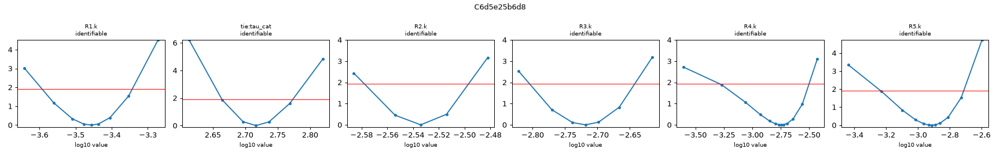
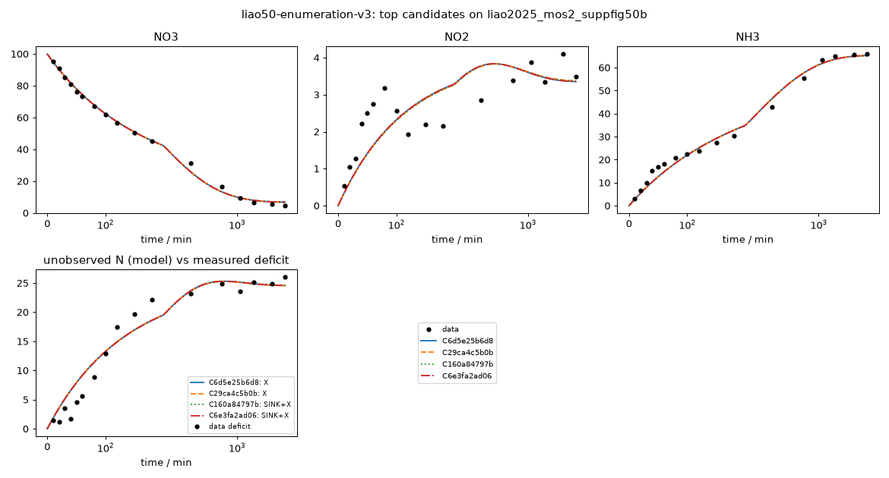

# Investigation report: liao50-enumeration-v3

- Investigation: `liao50`; arm: `enumeration`; phase: `final_evaluated`
- Protocol: `mle-profiled-v1` (sha256 `9d2cfcb0a1255b8c`); manifest sha256 `43bdea86a0014269`; evaluator code sha256 `04da1f3af06b6660` ({'python': '3.12.13', 'numpy': '2.5.4', 'scipy': '1.18.1'})
- Development data: `liao2025_mos2_suppfig50b` (sha256 `c291be31813c41e1`, source_data); 51 observations (NO3: t=0 point treated as initial condition, not as an observation; NO2: t=0 point treated as initial condition, not as an observation; NH3: t=0 point treated as initial condition, not as an observation; temperature not reported; 25.0 C assumed (matters only for potential dependence))

## Question
Which reaction networks and rate laws are supported by the 48 h H-cell nitrate-reduction time courses of Liao et al. 2025 (MoS2-family catalysts, -0.6 V vs RHE), what do the data leave ambiguous (in particular where the missing nitrogen goes and why the rates slow down), and which feasible measurement would best separate the surviving explanations?

## System boundary
Catholyte of an H-cell at fixed potential. Measured: NO3-, NO2- and NH4+/NH3 (lumped as NH3) in mM-N. Not measured: gas phase (N2, N2O, NH3 escape), anolyte (crossover), adsorbed or hidden species, pH, charge. Any nitrogen that leaves the measured channels must be represented by an explicit model species (an unmeasured product, a hidden intermediate, or a reservoir for transport out of the catholyte); the model as a whole must conserve N.

## Evidence status
- Partition: Complete experimental runs are reserved. Supp. Fig. 50a (other catalyst, same conditions and sampling) is the final held-out run; it is not read by any development-phase command, tool or evidence file. The final evaluation tests structure transfer: frozen candidate structures are refit on the held-out run with the same protocol (catalysts differ, so parameters are not transferred).
- Contamination: Retrospective analysis with literature-informed priors, not blind discovery: the proposer sees the development run, its derived N-closure series and a curated metadata note, and its pretraining may include general NO3RR mechanism knowledge.

## Ranked candidates (development data, computed in code)

Delta aicc <= 2.0: not distinguished by these data; <= 4.0: still supported. Akaike weights are relative support within this candidate set (one weight per distinct dynamics) under the stated noise model, not probabilities that a mechanism is true. Residual correlation from misspecification makes these differences optimistic.

| candidate | name | source | v | k | AICc | dAICc | weight | band | adequacy | RMSE NH3 | RMSE NO2 | RMSE NO3 | unobserved N end | in declared space | flags |
|---|---|---|---|---|---|---|---|---|---|---|---|---|---|---|
| C6d5e25b6d8 | enum-2ed1b3b4a8 | enumerator | 1 | 9 | 204.95 | 0.00 | 0.168 | indistinguishable_from_best | poor | 2.36 | 0.724 | 1.78 | 24.6 | liao-extended-v1 |  |
| C29ca4c5b0b | enum-3c7318acc7 | enumerator | 1 | 9 | 205.12 | 0.17 | 0.154 | indistinguishable_from_best | poor | 2.37 | 0.724 | 1.78 | 24.6 | liao-extended-v1 |  |
| C160a84797b | enum-21d5c8b0d8 | enumerator | 1 | 9 | 205.29 | 0.34 | 0.142 | indistinguishable_from_best | poor | 2.38 | 0.725 | 1.78 | 24.7 | liao-extended-v1 |  |
| C6e3fa2ad06 | enum-0e3ffc9561 | enumerator | 1 | 10 | 208.06 | 3.11 | 0.035 | supported | poor | 2.36 | 0.724 | 1.78 | 24.6 | liao-extended-v1 | R6.k at a protocol bound (1e-07) |
| C7b6f1e9a50 | enum-3fc3cce5e4 | enumerator | 1 | 10 | 208.06 | 3.11 | 0.035 | supported | poor | 2.36 | 0.724 | 1.78 | 24.6 | liao-extended-v1 |  |
| C5d39ed2824 | enum-2a13710e5a | enumerator | 1 | 10 | 208.06 | 3.11 | 0.035 | supported | poor | 2.36 | 0.724 | 1.78 | 24.6 | liao-extended-v1 |  |
| C7e72c3cc82 | enum-d082d3a9e9 | enumerator | 1 | 10 | 208.06 | 3.11 | 0.035 | supported | poor | 2.36 | 0.724 | 1.78 | 24.6 | liao-extended-v1 |  |
| C427f74379b | enum-e841d2dee5 | enumerator | 1 | 10 | 208.23 | 3.28 | 0.033 | supported | poor | 2.37 | 0.724 | 1.78 | 24.5 | liao-extended-v1 | R4.k at a protocol bound (1.01e-07) |
| C29b8bc28ed | enum-f48df1199c | enumerator | 1 | 10 | 208.23 | 3.28 | 0.033 | supported | poor | 2.37 | 0.724 | 1.78 | 24.5 | liao-extended-v1 |  |
| C6e9e028c8e | enum-7915dfd896 | enumerator | 1 | 10 | 208.23 | 3.28 | 0.033 | supported | poor | 2.37 | 0.724 | 1.78 | 24.5 | liao-extended-v1 |  |
| C6c39d40881 | enum-66a6ba3983 | enumerator | 1 | 10 | 208.27 | 3.32 | 0.032 | supported | poor | 2.37 | 0.724 | 1.78 | 24.5 | liao-extended-v1 | tie:K_NO3 at a protocol bound (1e+05) |
| Cc6fdb3be8d | enum-d8a3b0d62b | enumerator | 1 | 10 | 208.40 | 3.45 | 0.030 | supported | poor | 2.38 | 0.725 | 1.78 | 24.7 | liao-extended-v1 | R3.k at a protocol bound (1e-07) |
| C9af3245b8e | enum-efab4dfa56 | enumerator | 1 | 10 | 208.40 | 3.45 | 0.030 | supported | poor | 2.38 | 0.725 | 1.78 | 24.7 | liao-extended-v1 | R6.k at a protocol bound (1e-07) |
| C078df48517 | enum-479aea09c1 | enumerator | 1 | 10 | 208.44 | 3.49 | 0.029 | supported | poor | 2.38 | 0.725 | 1.78 | 24.7 | liao-extended-v1 | tie:K_NO3 at a protocol bound (1e+05) |
| Ccbf6e44a57 | enum-3f4cee0d77 | enumerator | 1 | 10 | 208.45 | 3.49 | 0.029 | supported | poor | 2.37 | 0.724 | 1.79 | 24.6 | liao-extended-v1 |  |
| Ce452f2c701 | enum-a8cbd2c271 | enumerator | 1 | 8 | 208.96 | 4.00 | 0.023 | less_supported | poor | 2.37 | 0.883 | 1.78 | 23.9 | liao-extended-v1 |  |
| C5630213701 | enum-55b3dee5e1 | enumerator | 1 | 8 | 210.05 | 5.10 | 0.013 | less_supported | poor | 2.9 | 0.738 | 1.8 | 27.2 | liao-core-v1, liao-extended-v1 |  |
| C7e76d59202 | enum-8cacaf756f | enumerator | 1 | 11 | 211.39 | 6.43 | 0.007 | less_supported | poor | 2.36 | 0.724 | 1.78 | 24.6 | liao-extended-v1 |  |
| Ccfe34ac1a7 | enum-3f0abf3e4e | enumerator | 1 | 11 | 211.39 | 6.43 | 0.007 | less_supported | poor | 2.36 | 0.724 | 1.78 | 24.6 | liao-extended-v1 |  |
| C3b5fb688ab | enum-431fdd7358 | enumerator | 1 | 11 | 211.41 | 6.45 | 0.007 | less_supported | poor | 2.36 | 0.725 | 1.78 | 24.6 | liao-extended-v1 |  |
| C9ea91054c5 | enum-645b12f334 | enumerator | 1 | 11 | 211.54 | 6.59 | 0.006 | less_supported | poor | 2.37 | 0.724 | 1.78 | 24.5 | liao-extended-v1 | tie:K_NO3 at a protocol bound (9.96e+04) |
| Cebe7a411ee | enum-4c6ff449db | enumerator | 1 | 11 | 211.62 | 6.67 | 0.006 | less_supported | poor | 2.37 | 0.724 | 1.79 | 24.6 | liao-extended-v1 |  |
| Cfca71d81f3 | enum-67ad8fffab | enumerator | 1 | 11 | 211.71 | 6.76 | 0.006 | less_supported | poor | 2.38 | 0.725 | 1.78 | 24.7 | liao-extended-v1 | tie:K_NO3 at a protocol bound (1e+05) |
| C9e26f205b1 | enum-65108665a9 | enumerator | 1 | 11 | 211.71 | 6.76 | 0.006 | less_supported | poor | 2.38 | 0.725 | 1.78 | 24.7 | liao-extended-v1 | tie:K_NO3 at a protocol bound (1e+05); R6.k at a protocol bound (1.01e-07) |
| C61a84848dd | enum-2db0a08a67 | enumerator | 1 | 11 | 211.78 | 6.82 | 0.006 | less_supported | poor | 2.38 | 0.724 | 1.79 | 24.6 | liao-extended-v1 |  |

629 lower-ranked fitted candidates omitted here; `python -m nernstwork.cli compare --run liao50-enumeration-v3` lists all of them.

## Top candidates in detail

### C6d5e25b6d8 `enum-2ed1b3b4a8` (source enumerator, version 1)

Rationale (proposer): enumerated: NO3>NO2,NO3>NH3,NO3>X,NO2>X,X>NH3 | mass_action | shared_deactivation

    R1: NO3 -> NO2 [mass_action, deactivation(tau tie=tau_cat); e=2]; R1.k=0.000349 (95% Wald 0.00027-0.000452, well_determined)
    R2: NO3 -> NH3 [mass_action, deactivation(tau tie=tau_cat); e=8]; R2.k=0.00292 (95% Wald 0.00266-0.00321, well_determined)
    R3: NO3 -> X [mass_action, deactivation(tau tie=tau_cat); e=None]; R3.k=0.00191 (95% Wald 0.00157-0.00233, well_determined)
    R4: NO2 -> X [mass_action, deactivation(tau tie=tau_cat); e=None]; R4.k=0.0018 (95% Wald 0.000947-0.00343, well_determined)
    R5: X -> NH3 [mass_action, deactivation(tau tie=tau_cat); e=None]; R5.k=0.00122 (95% Wald 0.000682-0.00219, well_determined)
    shared: tie:tau_cat=521 (95% Wald 460-590, well_determined)

- Support entries: {'literature': 0, 'data': 0, 'speculative': 5}; reactions without support: []
  - R1: speculative --  member of declared enumeration space liao-extended-v1
  - R2: speculative --  member of declared enumeration space liao-extended-v1
  - R3: speculative --  member of declared enumeration space liao-extended-v1
  - R4: speculative --  member of declared enumeration space liao-extended-v1
  - R5: speculative --  member of declared enumeration space liao-extended-v1
- sigma (profiled): NO3=1.78, NO2=0.724, NH3=2.36; adequacy: poor ['NO3: residual signs cluster (runs test p=0.026)', 'NO3: residuals are serially correlated (lag-1 r=0.52)', 'NO2: residual signs cluster (runs test p=0.038)', 'NO2: residuals are serially correlated (lag-1 r=0.74)', 'NH3: residual signs cluster (runs test p=0.002)', 'NH3: residuals are serially correlated (lag-1 r=0.79)']
- Profile likelihood: R1.k: identifiable (95% 0.000255-0.000454); tie:tau_cat: identifiable (95% 461-594); R2.k: identifiable (95% 0.00264-0.00318); R3.k: identifiable (95% 0.00157-0.00228); R4.k: identifiable (95% 0.000522-0.00316); R5.k: identifiable (95% 0.00058-0.00194)
  

### C29ca4c5b0b `enum-3c7318acc7` (source enumerator, version 1)

Rationale (proposer): enumerated: NO3>NO2,NO3>NH3,NO2>NH3,NO3>X,X>NH3 | mass_action | shared_deactivation

    R1: NO3 -> NO2 [mass_action, deactivation(tau tie=tau_cat); e=2]; R1.k=0.000345 (95% Wald 0.000266-0.000448, well_determined)
    R2: NO3 -> NH3 [mass_action, deactivation(tau tie=tau_cat); e=8]; R2.k=0.00292 (95% Wald 0.00266-0.0032, well_determined)
    R3: NO2 -> NH3 [mass_action, deactivation(tau tie=tau_cat); e=6]; R3.k=0.00175 (95% Wald 0.0009-0.00339, well_determined)
    R4: NO3 -> X [mass_action, deactivation(tau tie=tau_cat); e=None]; R4.k=0.00192 (95% Wald 0.00159-0.00233, well_determined)
    R5: X -> NH3 [mass_action, deactivation(tau tie=tau_cat); e=None]; R5.k=0.000962 (95% Wald 0.000454-0.00204, moderately_determined)
    shared: tie:tau_cat=521 (95% Wald 459-590, well_determined)

- Support entries: {'literature': 0, 'data': 0, 'speculative': 5}; reactions without support: []
  - R1: speculative --  member of declared enumeration space liao-extended-v1
  - R2: speculative --  member of declared enumeration space liao-extended-v1
  - R3: speculative --  member of declared enumeration space liao-extended-v1
  - R4: speculative --  member of declared enumeration space liao-extended-v1
  - R5: speculative --  member of declared enumeration space liao-extended-v1
- sigma (profiled): NO3=1.78, NO2=0.724, NH3=2.37; adequacy: poor ['NO3: residual signs cluster (runs test p=0.026)', 'NO3: residuals are serially correlated (lag-1 r=0.52)', 'NO2: residual signs cluster (runs test p=0.038)', 'NO2: residuals are serially correlated (lag-1 r=0.74)', 'NH3: residual signs cluster (runs test p=0.002)', 'NH3: residuals are serially correlated (lag-1 r=0.79)']
- Profile likelihood: not computed (identifiability beyond the local Fisher screen is unassessed)

### C160a84797b `enum-21d5c8b0d8` (source enumerator, version 1)

Rationale (proposer): enumerated: NO3>NO2,NO3>NH3,NO2>SINK,NO3>X,X>NH3 | mass_action | shared_deactivation

    R1: NO3 -> NO2 [mass_action, deactivation(tau tie=tau_cat); e=2]; R1.k=0.000346 (95% Wald 0.000267-0.000448, well_determined)
    R2: NO3 -> NH3 [mass_action, deactivation(tau tie=tau_cat); e=8]; R2.k=0.00292 (95% Wald 0.00265-0.00321, well_determined)
    R3: NO2 -> SINK [mass_action, deactivation(tau tie=tau_cat); e=3]; R3.k=0.00176 (95% Wald 0.00091-0.00339, well_determined)
    R4: NO3 -> X [mass_action, deactivation(tau tie=tau_cat); e=None]; R4.k=0.00192 (95% Wald 0.00157-0.00234, well_determined)
    R5: X -> NH3 [mass_action, deactivation(tau tie=tau_cat); e=None]; R5.k=0.00129 (95% Wald 0.000712-0.00235, well_determined)
    shared: tie:tau_cat=522 (95% Wald 460-591, well_determined)

- Support entries: {'literature': 0, 'data': 0, 'speculative': 5}; reactions without support: []
  - R1: speculative --  member of declared enumeration space liao-extended-v1
  - R2: speculative --  member of declared enumeration space liao-extended-v1
  - R3: speculative --  member of declared enumeration space liao-extended-v1
  - R4: speculative --  member of declared enumeration space liao-extended-v1
  - R5: speculative --  member of declared enumeration space liao-extended-v1
- sigma (profiled): NO3=1.78, NO2=0.725, NH3=2.38; adequacy: poor ['NO3: residual signs cluster (runs test p=0.026)', 'NO3: residuals are serially correlated (lag-1 r=0.52)', 'NO2: residual signs cluster (runs test p=0.038)', 'NO2: residuals are serially correlated (lag-1 r=0.74)', 'NH3: residual signs cluster (runs test p=0.002)', 'NH3: residuals are serially correlated (lag-1 r=0.79)']
- Profile likelihood: not computed (identifiability beyond the local Fisher screen is unassessed)

### C6e3fa2ad06 `enum-0e3ffc9561` (source enumerator, version 1)

Rationale (proposer): enumerated: NO3>NO2,NO3>NH3,NO3>X,NO2>X,X>NH3,X>SINK | mass_action | shared_deactivation

    R1: NO3 -> NO2 [mass_action, deactivation(tau tie=tau_cat); e=2]; R1.k=0.000349 (95% Wald 0.00027-0.000452, well_determined)
    R2: NO3 -> NH3 [mass_action, deactivation(tau tie=tau_cat); e=8]; R2.k=0.00293 (95% Wald 0.00267-0.00321, well_determined)
    R3: NO3 -> X [mass_action, deactivation(tau tie=tau_cat); e=None]; R3.k=0.00191 (95% Wald 0.00157-0.00233, well_determined)
    R4: NO2 -> X [mass_action, deactivation(tau tie=tau_cat); e=None]; R4.k=0.0018 (95% Wald 0.000943-0.00343, well_determined)
    R5: X -> NH3 [mass_action, deactivation(tau tie=tau_cat); e=None]; R5.k=0.00122 (95% Wald 0.000678-0.00218, well_determined)
    R6: X -> SINK [mass_action, deactivation(tau tie=tau_cat); e=None]; R6.k=1e-07 (95% Wald 1e-07-1e-07, well_determined)
    shared: tie:tau_cat=521 (95% Wald 460-590, well_determined)

- Support entries: {'literature': 0, 'data': 0, 'speculative': 6}; reactions without support: []
  - R1: speculative --  member of declared enumeration space liao-extended-v1
  - R2: speculative --  member of declared enumeration space liao-extended-v1
  - R3: speculative --  member of declared enumeration space liao-extended-v1
  - R4: speculative --  member of declared enumeration space liao-extended-v1
  - R5: speculative --  member of declared enumeration space liao-extended-v1
  - R6: speculative --  member of declared enumeration space liao-extended-v1
- sigma (profiled): NO3=1.78, NO2=0.724, NH3=2.36; adequacy: poor ['NO3: residual signs cluster (runs test p=0.026)', 'NO3: residuals are serially correlated (lag-1 r=0.52)', 'NO2: residual signs cluster (runs test p=0.038)', 'NO2: residuals are serially correlated (lag-1 r=0.74)', 'NH3: residual signs cluster (runs test p=0.002)', 'NH3: residuals are serially correlated (lag-1 r=0.79)']
- Locally unidentifiable combinations: [{'eigenvalue_rel': 1.3916542805752017e-13, 'combination': {'R6.k': 1.0}}]
- Profile likelihood: not computed (identifiability beyond the local Fisher screen is unassessed)

## Frozen selection

- Rule: lowest AICc among fitted candidates without a hidden-pool plausibility violation, plus every such candidate within delta AICc <= 2.0
- Selected: ['C6d5e25b6d8', 'C29ca4c5b0b', 'C160a84797b']
- Agent-concluded plausible: []
- Frozen at 2026-10-20T17:31:54.859Z

## Final held-out evaluation: liao2025_wmos2_suppfig50a

Version: current evaluator code; the pre-registered evaluation (earlier code) is kept in final/final_evaluation.json.

Structure transfer: each frozen structure is refit on the held-out run (different catalyst) with the development protocol; parameters are not transferred. Rank is among all members of the declared enumeration spaces fitted to the same run.
Sensitivity: AICc at the lowest NLL any start reached (flags fits whose reported optimum is beaten by replicated unconverged starts). See docs/examples/arm_comparison.md for ranks in a shared reference set.

- C6d5e25b6d8: fitted; AICc 179, delta to best 0, rank 1/688 among this run's declared-space members; numerically unreliable: False; sensitivity AICc 179 (rank 1); adequacy poor; RMSE {'NO3': 2.08, 'NO2': 0.75, 'NH3': 0.91}
- C29ca4c5b0b: fitted; AICc 179, delta to best 0.121, rank 2/688 among this run's declared-space members; numerically unreliable: False; sensitivity AICc 179 (rank 2); adequacy poor; RMSE {'NO3': 2.08, 'NO2': 0.75, 'NH3': 0.92}
- C160a84797b: fitted; AICc 179, delta to best 0.24, rank 3/688 among this run's declared-space members; numerically unreliable: False; sensitivity AICc 179 (rank 3); adequacy poor; RMSE {'NO3': 2.08, 'NO2': 0.75, 'NH3': 0.92}
- Best declared-space members on the held-out run: [('S:enum-2ed1b3b4a8', 179.17, 'enumerated: NO3>NO2,NO3>NH3,NO3>X,NO2>X,X>NH3 | mass_action | shared_deactivation'), ('S:enum-3c7318acc7', 179.3, 'enumerated: NO3>NO2,NO3>NH3,NO2>NH3,NO3>X,X>NH3 | mass_action | shared_deactivation'), ('S:enum-21d5c8b0d8', 179.41, 'enumerated: NO3>NO2,NO3>NH3,NO2>SINK,NO3>X,X>NH3 | mass_action | shared_deactivation')]

## Cost and runtime

- Numerics: 654 fits run, 0 reused from the shared cache, 21607 CPU s fitting, 12 s profiles (current evaluator code only; earlier code versions' records are excluded)
- LLM: none recorded

## Unresolved assumptions and metadata

- liao2025_mos2_suppfig50b: verified_against_figure=False
- [L3] catalyst assignment: unresolved discrepancy
- [L4] selectivity numbers: unresolved
- [L5] pH: stated for a related experiment; not measured for these runs
- [L6] NH3 escape: stated (qualitative)
- [L7] reference and iR: stated (flow cell)
- [L8] membrane: not found for the H-cell
- [L9] volume: stated for 0.5 h tests
- [L11] gas and crossover: not measured for these runs
- [L12] N balance: not found
- [L13] charge: not found for these runs
- [L14] mechanism (authors): stated (surface pathway, not a solution-phase kinetic model)
- [L15] replicates: no replicate information for these runs
- Noise model: independent Gaussian errors per channel (profiled sigma); no replicate information exists for these runs, so sigma is estimated from misfit and includes model error.
- AICc differences assume independent errors; clustered residual signs (adequacy 'poor') make them optimistic.

