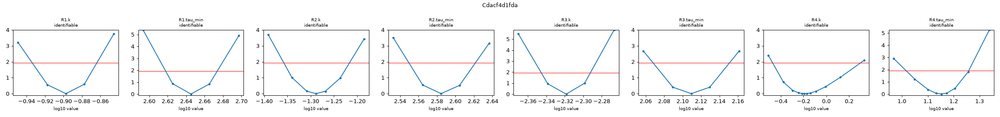
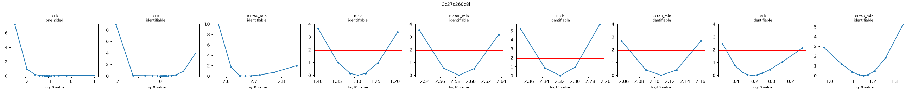
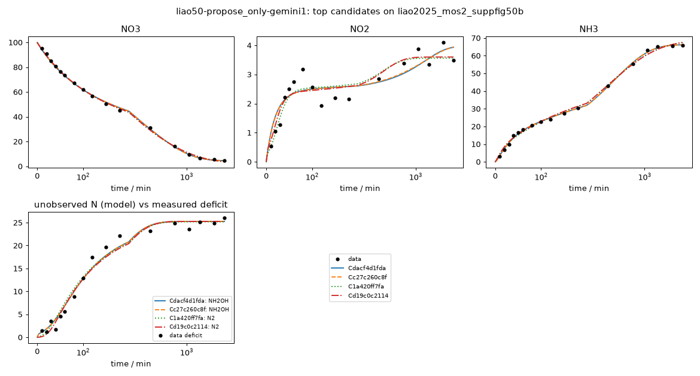

# Investigation report: liao50-propose_only-gemini1

- Investigation: `liao50`; arm: `propose_only`; phase: `final_evaluated`
- Protocol: `mle-profiled-v1` (sha256 `9d2cfcb0a1255b8c`); manifest sha256 `76cdbce7cb548123`; evaluator code sha256 `65c1ac7c107bb1ff` ({'python': '3.12.13', 'numpy': '2.5.4', 'scipy': '1.18.1'})
- Development data: `liao2025_mos2_suppfig50b` (sha256 `c291be31813c41e1`, source_data); 51 observations (NO3: t=0 point treated as initial condition, not as an observation; NO2: t=0 point treated as initial condition, not as an observation; NH3: t=0 point treated as initial condition, not as an observation; temperature not reported; 25.0 C assumed (matters only for potential dependence))

## Question
Which reaction networks and rate laws are supported by the 48 h H-cell nitrate-reduction time courses of Liao et al. 2025 (MoS2-family catalysts, -0.6 V vs RHE), what do the data leave ambiguous (in particular where the missing nitrogen goes and why the rates slow down), and which feasible measurement would best separate the surviving explanations?

## System boundary
Catholyte of an H-cell at fixed potential. Measured: NO3-, NO2- and NH4+/NH3 (lumped as NH3) in mM-N. Not measured: gas phase (N2, N2O, NH3 escape), anolyte (crossover), adsorbed or hidden species, pH, charge. Any nitrogen that leaves the measured channels must be represented by an explicit model species (an unmeasured product, a hidden intermediate, or a reservoir for transport out of the catholyte); the model as a whole must conserve N.

## Evidence status
- Partition: Complete experimental runs are reserved. Supp. Fig. 50a (other catalyst, same conditions and sampling) is the final held-out run; it is not read by any development-phase command, tool or evidence file. The final evaluation tests structure transfer: frozen candidate structures are refit on the held-out run with the same protocol (catalysts differ, so parameters are not transferred).
- Contamination: Retrospective analysis with literature-informed priors, not blind discovery: the proposer sees the development run, its derived N-closure series and a curated metadata note, and its pretraining may include general NO3RR mechanism knowledge.

## Ranked candidates (development data, computed in code)

Delta aicc <= 2.0: not distinguished by these data; <= 4.0: still supported. Akaike weights are relative support within this candidate set (one weight per distinct dynamics) under the stated noise model, not probabilities that a mechanism is true. Residual correlation from misspecification makes these differences optimistic.

| candidate | name | source | v | k | AICc | dAICc | weight | band | adequacy | RMSE NH3 | RMSE NO2 | RMSE NO3 | unobserved N end | in declared space | flags |
|---|---|---|---|---|---|---|---|---|---|---|---|---|---|---|
| Cdacf4d1fda | C10_dual_pathway_zeroorder_hidden | agent | 1 | 11 | 131.05 | 0.00 | 0.835 | indistinguishable_from_best | no_systematic_misfit_detected | 0.736 | 0.427 | 0.905 | 25.3 | no |  |
| Cc27c260c8f | C09_dual_pathway_langmuir_hidden | agent | 1 | 12 | 134.35 | 3.30 | 0.161 | supported | no_systematic_misfit_detected | 0.733 | 0.424 | 0.912 | 25.3 | no |  |
| C1a420ff7fa | C04_serpar_deact_n2_sink | agent | 1 | 11 | 143.01 | 11.96 | 0.002 | less_supported | poor | 1.3 | 0.353 | 0.871 | 25.2 | no |  |
| Cd19c0c2114 | C05_serpar_bimol_n2_sink | agent | 1 | 11 | 143.89 | 12.84 | 0.001 | less_supported | poor | 1.3 | 0.361 | 0.882 | 25.3 | no |  |
| C6bdd2aa9e9 | C06_serpar_powerlaw_no2 | agent | 1 | 11 | 144.22 | 13.17 | 0.001 | less_supported | poor | 1.29 | 0.31 | 1.05 | 25.5 | no |  |
| Ceb24146642 | C07_series_powerlaw_hidden_nh2oh | agent | 1 | 11 | 151.85 | 20.80 | 0.000 | less_supported | poor | 0.738 | 0.744 | 0.962 | 25.2 | no |  |
| C2dbc498f38 | C08_dual_pathway_massaction_hidden | agent | 1 | 11 | 175.32 | 44.27 | 0.000 | less_supported | poor | 1.98 | 0.57 | 0.928 | 25.9 | no |  |
| C584c5d7d71 | C02_series_diff_deact | agent | 1 | 9 | 217.40 | 86.34 | 0.000 | less_supported | poor | 3.27 | 0.754 | 1.78 | 24.9 | no |  |
| C4d82a17858 | C01_series_shared_deact | agent | 1 | 7 | 247.00 | 115.94 | 0.000 | less_supported | poor | 3.36 | 2.06 | 1.79 | 30.5 | liao-core-v1, liao-extended-v1 |  |
| C791f3627e4 | C03_serpar_nh3_volatilization | agent | 1 | 8 | 257.89 | 126.84 | 0.000 | less_supported | poor | 11.7 | 0.728 | 1.86 | 36.3 | no |  |

## Top candidates in detail

### Cdacf4d1fda `C10_dual_pathway_zeroorder_hidden` (source agent, version 1)

Rationale (proposer): Tests whether fixing R1 in the zero-order interfacial saturation limit resolves the (k1, K1) collinearity of C09 while preserving full residual adequacy across all three channels.

    R1: NO3 -> NO2 [power_law, deactivation(tau); e=2]; R1.k=0.127 (95% Wald 0.116-0.138, well_determined); R1.tau_min=442 (95% Wald 412-474, well_determined)
    R2: NO2 -> NH3 [mass_action, deactivation(tau); e=6]; R2.k=0.0515 (95% Wald 0.0436-0.0608, well_determined); R2.tau_min=384 (95% Wald 352-420, well_determined)
    R3: NO3 -> NH2OH [mass_action, deactivation(tau); e=6]; R3.k=0.0048 (95% Wald 0.0045-0.00513, well_determined); R3.tau_min=129 (95% Wald 116-143, well_determined)
    R4: NH2OH -> NH3 [mass_action, deactivation(tau); e=2]; R4.k=0.642 (95% Wald 0.295-1.4, moderately_determined); R4.tau_min=14.2 (95% Wald 10.9-18.5, well_determined)

- Support entries: {'literature': 3, 'data': 2, 'speculative': 0}; reactions without support: []
  - R1: literature -- Liao et al., Nat. Commun. (2025) doi:10.1038/s41467-025-60671-y, main text title and interfacial reactant enrichment results [L1, L14] Zero-order limit (K << [NO3-]) of interfacial nitrate enrichment on the NO3- -> NO2- step.
  - R1.orders: data -- liao2025_mos2_suppfig50b: NO3, NO2, NH3 trajectories and N closure (0 to 2880 min) Free power-law order on R1 converges to 0, and Langmuir K (~1.5 mM-N) is below the lowest measured [NO3-] (4.55 mM-N), motivating the fixed zero-order saturation limit.
  - R2: literature -- Katsounaros et al., Electrochim. Acta 71, 270 (2012) doi:10.1016/j.electacta.2012.03.154, Table 1 Model B First-order reduction of bulk NO2- to NH3.
  - R3: literature -- Liao et al., Nat. Commun. (2025) doi:10.1038/s41467-025-60671-y, Methods / main text DEMS paragraph [L11] Parallel interfacial reduction of NO3- to NH2OH intermediate.
  - R4: data -- liao2025_mos2_suppfig50b: NO3, NO2, NH3 trajectories and N closure (0 to 2880 min) Fast early NH2OH -> NH3 reduction that deactivates as electrolyte pH rises.
- Assumptions (proposer): ['Throughout the measured concentration range ([NO3-] >= 4.55 mM-N), the nitrite-generating sites remain fully saturated by enriched interfacial NO3- (effective order 0).']
- sigma (profiled): NO3=1, NO2=0.427, NH3=0.736; adequacy: no_systematic_misfit_detected []
- Profile likelihood: R1.k: identifiable (95% 0.116-0.137); R1.tau_min: identifiable (95% 415-472); R2.k: identifiable (95% 0.0439-0.0607); R2.tau_min: identifiable (95% 355-418); R3.k: identifiable (95% 0.00451-0.0051); R3.tau_min: identifiable (95% 117-142); R4.k: identifiable (95% 0.338-1.99); R4.tau_min: identifiable (95% 10.4-18.1)
  

### Cc27c260c8f `C09_dual_pathway_langmuir_hidden` (source agent, version 1)

Rationale (proposer): Tests the central mechanistic hypothesis of Liao et al. (2025)—interfacial nitrate enrichment/saturation—on the NO3 -> NO2 -> NH3 pathway alongside a parallel intermediate pathway that accounts for the early NH3 burst and the 25% N deficit.

    R1: NO3 -> NO2 [langmuir_saturation, deactivation(tau), K; e=2]; R1.k=0.0864 (95% Wald 1e-07-10, not_determined_locally); R1.K=1.47 (95% Wald 0.01-1e+05, not_determined_locally); R1.tau_min=468 (95% Wald 177-1.24e+03, moderately_determined)
    R2: NO2 -> NH3 [mass_action, deactivation(tau); e=6]; R2.k=0.0512 (95% Wald 0.0429-0.0612, well_determined); R2.tau_min=384 (95% Wald 352-420, well_determined)
    R3: NO3 -> NH2OH [mass_action, deactivation(tau); e=6]; R3.k=0.00482 (95% Wald 0.00445-0.00522, well_determined); R3.tau_min=128 (95% Wald 116-143, well_determined)
    R4: NH2OH -> NH3 [mass_action, deactivation(tau); e=2]; R4.k=0.626 (95% Wald 0.277-1.41, moderately_determined); R4.tau_min=14.4 (95% Wald 10.8-19.1, well_determined)

- Support entries: {'literature': 3, 'data': 1, 'speculative': 0}; reactions without support: []
  - R1: literature -- Liao et al., Nat. Commun. (2025) doi:10.1038/s41467-025-60671-y, main text title and interfacial reactant enrichment results [L1, L14] Interfacial reactant enrichment of NO3- at the solid-liquid interface produces Langmuir saturation of NO3- -> NO2-.
  - R2: literature -- Katsounaros et al., Electrochim. Acta 71, 270 (2012) doi:10.1016/j.electacta.2012.03.154, Table 1 Model B First-order reduction of bulk NO2- to NH3.
  - R3: literature -- Liao et al., Nat. Commun. (2025) doi:10.1038/s41467-025-60671-y, Methods / main text DEMS paragraph [L11] Parallel interfacial pathway forming unmeasured intermediate NH2OH (or NO) detected by DEMS.
  - R4: data -- liao2025_mos2_suppfig50b: NO3, NO2, NH3 trajectories and N closure (0 to 2880 min) Sigmoidal early NH3 rise (0-40 min) and subsequent accumulation of ~25 mM-N unmeasured N (40-180 min) as proton-coupled NH2OH -> NH3 deactivates during pH rise [L5].
- Assumptions (proposer): ['Nitrate-to-nitrite conversion occurs on strongly adsorbing sites that are Langmuir-saturated at mM nitrate concentrations (K ~ 1.5 mM-N).', 'A parallel interfacial pathway proceeds via an unmeasured intermediate (represented as NH2OH, observationally equivalent to NO(aq) or surface-desorbed NOx) whose reduction to NH3 deactivates rapidly as local pH increases.']
- sigma (profiled): NO3=1, NO2=0.424, NH3=0.733; adequacy: no_systematic_misfit_detected []
- Locally unidentifiable combinations: [{'eigenvalue_rel': 6.581539561488354e-08, 'combination': {'R1.k': 0.704, 'R1.K': -0.71}}]
- Profile likelihood: R1.k: one_sided (95% 0.00979-10); R1.K: identifiable (95% 0.0408-16.7); R1.tau_min: identifiable (95% 414-711); R2.k: identifiable (95% 0.0436-0.0605); R2.tau_min: identifiable (95% 355-418); R3.k: identifiable (95% 0.00452-0.00512); R3.tau_min: identifiable (95% 117-141); R4.k: identifiable (95% 0.333-1.93); R4.tau_min: identifiable (95% 10.5-18.3)
  

### C1a420ff7fa `C04_serpar_deact_n2_sink` (source agent, version 1)

Rationale (proposer): Tests whether a 4-species series-parallel network with a terminal N2 sink from NO2- and no hidden aqueous intermediate can explain all three measured channels.

    R1: NO3 -> NH3 [mass_action, deactivation(tau); e=8]; R1.k=0.00227 (95% Wald 0.00209-0.00247, well_determined); R1.tau_min=1.33e+03 (95% Wald 1.07e+03-1.67e+03, well_determined)
    R2: NO3 -> NO2 [mass_action, deactivation(tau); e=2]; R2.k=0.0035 (95% Wald 0.00317-0.00387, well_determined); R2.tau_min=166 (95% Wald 145-191, well_determined)
    R3: NO2 -> NH3 [mass_action, deactivation(tau); e=6]; R3.k=1.42 (95% Wald 0.224-9.04, moderately_determined); R3.tau_min=8.08 (95% Wald 3.81-17.1, moderately_determined)
    R4: NO2 -> N2 [mass_action, deactivation(tau); e=3]; R4.k=0.129 (95% Wald 0.106-0.158, well_determined); R4.tau_min=96.8 (95% Wald 85.1-110, well_determined)

- Support entries: {'literature': 3, 'data': 1, 'speculative': 0}; reactions without support: []
  - R1: literature -- Liao et al., Nat. Commun. (2025) doi:10.1038/s41467-025-60671-y, main text in situ ATR-IR/DEMS/DFT section and SI Figs. 61-65 [L14] Direct 8e- surface pathway from NO3- to NH3.
  - R2: literature -- Liao et al., Nat. Commun. (2025) doi:10.1038/s41467-025-60671-y, main text in situ ATR-IR/DEMS/DFT section and SI Figs. 61-65 [L14] 2e- reduction of NO3- to bulk NO2-.
  - R3: data -- liao2025_mos2_suppfig50b: NO3, NO2, NH3 trajectories and N closure (0 to 2880 min) Rapid initial NH3 generation (0-30 min) with minimal N loss requires fast early NO2->NH3 conversion that deactivates as pH rises.
  - R4: literature -- Liao et al., Nat. Commun. (2025) doi:10.1038/s41467-025-60671-y, Methods / main text DEMS paragraph [L11] Electrochemical reduction of NO2- to gaseous N2/N2O sink during intermediate times (40-180 min).
- Assumptions (proposer): ['Unmeasured nitrogen is a terminal gaseous reduction product (N2/N2O) formed electrochemically from NO2-.', 'Different surface sites/steps deactivate on distinct timescales as electrolyte pH drifts from 6.71 to 11.87.']
- sigma (profiled): NO3=1, NO2=0.353, NH3=1.3; adequacy: poor ['NH3: residual signs cluster (runs test p=0.038)', 'NH3: residuals are serially correlated (lag-1 r=0.54)']
- Profile likelihood: R1.k: identifiable (95% 0.0021-0.00245); R1.tau_min: identifiable (95% 1.1e+03-1.73e+03); R2.k: identifiable (95% 0.00316-0.00383); R2.tau_min: identifiable (95% 146-192); R3.k: one_sided (95% 0.407-10); R3.tau_min: identifiable (95% 4.05-14.5); R4.k: identifiable (95% 0.108-0.156); R4.tau_min: inconclusive_numerics (95% 85.7-109)
  

### Cd19c0c2114 `C05_serpar_bimol_n2_sink` (source agent, version 1)

Rationale (proposer): Tests whether second-order bimolecular N2 formation (2 NO2 -> 2 N2) can be distinguished from first-order NO2 -> N2 loss (C04) from a single time course.

    R1: NO3 -> NH3 [mass_action, deactivation(tau); e=8]; R1.k=0.00219 (95% Wald 0.00199-0.0024, well_determined); R1.tau_min=1.43e+03 (95% Wald 1.11e+03-1.85e+03, well_determined)
    R2: NO3 -> NO2 [mass_action, deactivation(tau); e=2]; R2.k=0.00355 (95% Wald 0.00322-0.00392, well_determined); R2.tau_min=170 (95% Wald 148-195, well_determined)
    R3: NO2 -> NH3 [mass_action, deactivation(tau); e=6]; R3.k=0.926 (95% Wald 0.215-3.99, moderately_determined); R3.tau_min=9.65 (95% Wald 4.81-19.4, moderately_determined)
    R4: 2 NO2 -> 2 N2 [mass_action, deactivation(tau); e=6]; R4.k=0.0303 (95% Wald 0.0223-0.0413, well_determined); R4.tau_min=90.4 (95% Wald 78.2-105, well_determined)

- Support entries: {'literature': 3, 'data': 1, 'speculative': 0}; reactions without support: []
  - R1: literature -- Liao et al., Nat. Commun. (2025) doi:10.1038/s41467-025-60671-y, main text in situ ATR-IR/DEMS/DFT section and SI Figs. 61-65 [L14] Direct surface reduction of NO3- to NH3.
  - R2: literature -- Liao et al., Nat. Commun. (2025) doi:10.1038/s41467-025-60671-y, main text in situ ATR-IR/DEMS/DFT section and SI Figs. 61-65 [L14] Formation of solution NO2- from NO3-.
  - R3: data -- liao2025_mos2_suppfig50b: NO3, NO2, NH3 trajectories and N closure (0 to 2880 min) Fast early reduction of NO2- to NH3.
  - R4: literature -- Polatides & Kyriacou, J. Appl. Electrochem. 35, 421 (2005) doi:10.1007/s10800-004-8349-z, Fig. 3 Second-order N2 branch (2 NO2- -> 2 N2 in N-equivalents) representing bimolecular N-N coupling.
- Assumptions (proposer): ['N-N bond formation to N2 requires bimolecular coupling of two nitrite-derived N atoms (second-order in [NO2-]).']
- sigma (profiled): NO3=1, NO2=0.361, NH3=1.3; adequacy: poor ['NH3: residual signs cluster (runs test p=0.028)', 'NH3: residuals are serially correlated (lag-1 r=0.53)']
- Profile likelihood: R1.k: identifiable (95% 0.002-0.00237); R1.tau_min: identifiable (95% 1.15e+03-1.92e+03); R2.k: identifiable (95% 0.00323-0.00387); R2.tau_min: identifiable (95% 149-195); R3.k: identifiable (95% 0.32-9.13); R3.tau_min: identifiable (95% 4.67-16.7); R4.k: identifiable (95% 0.0226-0.0426); R4.tau_min: inconclusive_numerics (95% 78.2-102)
  

## Discrimination analysis (discrimination-1.json)

A design is {"name", "c0_mM_N": {...}, "t_end_min", optional "observe": [species ids to measure]}. Predictions use
    each candidate's development MLE; parameter uncertainty is not propagated, so large disagreement is a lead for an
    experiment, not a quantified expected information gain.

- Design `low_nitrate_10mM` {"observe": ["NO3", "NO2", "NH3"], "t_end_min": 360, "name": "low_nitrate_10mM", "c0_mM_N": {"NO3": 10}}:
  - NO3: max spread 29.9 mM-N at 360 min (30 dev sigma); {'Cdacf4d1fda': -22.56, 'Cc27c260c8f': 0.0, 'C1a420ff7fa': 2.92, 'Cd19c0c2114': 2.93, 'C6bdd2aa9e9': 4.87, 'Ceb24146642': 7.38}
  - species:NO3: max spread 29.9 mM-N at 360 min (- dev sigma); {'Cdacf4d1fda': -22.56, 'Cc27c260c8f': 0.0, 'C1a420ff7fa': 2.92, 'Cd19c0c2114': 2.93, 'C6bdd2aa9e9': 4.87, 'Ceb24146642': 7.38}
  - NH3: max spread 28 mM-N at 360 min (38 dev sigma); {'Cdacf4d1fda': 29.52, 'Cc27c260c8f': 9.48, 'C1a420ff7fa': 4.36, 'Cd19c0c2114': 4.47, 'C6bdd2aa9e9': 5.03, 'Ceb24146642': 1.53}
  - species:NH3: max spread 28 mM-N at 360 min (- dev sigma); {'Cdacf4d1fda': 29.52, 'Cc27c260c8f': 9.48, 'C1a420ff7fa': 4.36, 'Cd19c0c2114': 4.47, 'C6bdd2aa9e9': 5.03, 'Ceb24146642': 1.53}
  - NO2: max spread 2.74 mM-N at 360 min (6.41 dev sigma); {'Cdacf4d1fda': 2.74, 'Cc27c260c8f': 0.0, 'C1a420ff7fa': 0.3, 'Cd19c0c2114': 0.88, 'C6bdd2aa9e9': 0.01, 'Ceb24146642': 0.24}
- Design `high_nitrate_250mM` {"t_end_min": 1440, "name": "high_nitrate_250mM", "c0_mM_N": {"NO3": 250}, "observe": ["NO3", "NO2", "NH3"]}:
  - NH3: max spread 80.8 mM-N at 1.44e+03 min (110 dev sigma); {'Cdacf4d1fda': 86.34, 'Cc27c260c8f': 88.41, 'C1a420ff7fa': 159.25, 'Cd19c0c2114': 156.88, 'C6bdd2aa9e9': 135.77, 'Ceb24146642': 167.1}
  - species:NH3: max spread 80.8 mM-N at 1.44e+03 min (- dev sigma); {'Cdacf4d1fda': 86.34, 'Cc27c260c8f': 88.41, 'C1a420ff7fa': 159.25, 'Cd19c0c2114': 156.88, 'C6bdd2aa9e9': 135.77, 'Ceb24146642': 167.1}
  - NO3: max spread 79.3 mM-N at 1.44e+03 min (79.3 dev sigma); {'Cdacf4d1fda': 87.57, 'Cc27c260c8f': 85.13, 'C1a420ff7fa': 18.89, 'Cd19c0c2114': 18.76, 'C6bdd2aa9e9': 8.39, 'Ceb24146642': 8.3}
  - species:NO3: max spread 79.3 mM-N at 1.44e+03 min (- dev sigma); {'Cdacf4d1fda': 87.57, 'Cc27c260c8f': 85.13, 'C1a420ff7fa': 18.89, 'Cd19c0c2114': 18.76, 'C6bdd2aa9e9': 8.39, 'Ceb24146642': 8.3}
  - unmeasured_N_total: max spread 35.9 mM-N at 1.44e+03 min (- dev sigma); {'Cdacf4d1fda': 72.54, 'Cc27c260c8f': 72.41, 'C1a420ff7fa': 62.96, 'Cd19c0c2114': 68.22, 'C6bdd2aa9e9': 98.87, 'Ceb24146642': 70.97}
- Design `direct_nitrite_feed_20mM` {"observe": ["NO2", "NH3"], "t_end_min": 360, "name": "direct_nitrite_feed_20mM", "c0_mM_N": {"NO2": 20}}:
  - NH3: max spread 35.8 mM-N at 360 min (48.7 dev sigma); {'Cdacf4d1fda': 48.45, 'Cc27c260c8f': 20.0, 'C1a420ff7fa': 18.2, 'Cd19c0c2114': 12.6, 'C6bdd2aa9e9': 18.08, 'Ceb24146642': 19.99}
  - species:NH3: max spread 35.8 mM-N at 360 min (- dev sigma); {'Cdacf4d1fda': 48.45, 'Cc27c260c8f': 20.0, 'C1a420ff7fa': 18.2, 'Cd19c0c2114': 12.6, 'C6bdd2aa9e9': 18.08, 'Ceb24146642': 19.99}
  - NO3: max spread 31.2 mM-N at 360 min (31.2 dev sigma); {'Cdacf4d1fda': -31.19, 'Cc27c260c8f': 0.0, 'C1a420ff7fa': 0.0, 'Cd19c0c2114': 0.0, 'C6bdd2aa9e9': 0.0, 'Ceb24146642': 0.0}
  - NO2: max spread 16.9 mM-N at 1.81 min (39.5 dev sigma); {'Cdacf4d1fda': 18.44, 'Cc27c260c8f': 18.23, 'C1a420ff7fa': 1.58, 'Cd19c0c2114': 2.08, 'C6bdd2aa9e9': 2.98, 'Ceb24146642': 10.89}
  - species:NO2: max spread 16.9 mM-N at 1.81 min (- dev sigma); {'Cdacf4d1fda': 18.44, 'Cc27c260c8f': 18.23, 'C1a420ff7fa': 1.58, 'Cd19c0c2114': 2.08, 'C6bdd2aa9e9': 2.98, 'Ceb24146642': 10.89}
- Design `mixed_nitrate_50mM_nitrite_20mM` {"t_end_min": 720, "observe": ["NO3", "NO2", "NH3"], "name": "mixed_nitrate_50mM_nitrite_20mM", "c0_mM_N": {"NO2": 20, "NO3": 50}}:
  - NH3: max spread 28.5 mM-N at 720 min (38.7 dev sigma); {'Cdacf4d1fda': 68.86, 'Cc27c260c8f': 59.91, 'C1a420ff7fa': 45.93, 'Cd19c0c2114': 40.35, 'C6bdd2aa9e9': 49.91, 'Ceb24146642': 45.25}
  - species:NH3: max spread 28.5 mM-N at 720 min (- dev sigma); {'Cdacf4d1fda': 68.86, 'Cc27c260c8f': 59.91, 'C1a420ff7fa': 45.93, 'Cd19c0c2114': 40.35, 'C6bdd2aa9e9': 49.91, 'Ceb24146642': 45.25}
  - NO3: max spread 24.4 mM-N at 720 min (24.4 dev sigma); {'Cdacf4d1fda': -11.57, 'Cc27c260c8f': 0.0, 'C1a420ff7fa': 7.95, 'Cd19c0c2114': 8.0, 'C6bdd2aa9e9': 11.14, 'Ceb24146642': 12.85}
  - species:NO3: max spread 24.4 mM-N at 720 min (- dev sigma); {'Cdacf4d1fda': -11.57, 'Cc27c260c8f': 0.0, 'C1a420ff7fa': 7.95, 'Cd19c0c2114': 8.0, 'C6bdd2aa9e9': 11.14, 'Ceb24146642': 12.85}
  - NO2: max spread 16.7 mM-N at 3.62 min (39.1 dev sigma); {'Cdacf4d1fda': 17.03, 'Cc27c260c8f': 17.04, 'C1a420ff7fa': 0.35, 'Cd19c0c2114': 0.72, 'C6bdd2aa9e9': 0.67, 'Ceb24146642': 6.36}
- Design `standard_100mM_with_NH2OH_and_N2_quantification` {"observe": ["NO3", "NO2", "NH3", "NH2OH", "N2"], "t_end_min": 2880, "name": "standard_100mM_with_NH2OH_and_N2_quantification", "c0_mM_N": {"NO3": 99.95}}:
  - unmeasured_N_total: max spread 2.12 mM-N at 203 min (- dev sigma); {'Cdacf4d1fda': 20.94, 'Cc27c260c8f': 20.95, 'C1a420ff7fa': 20.71, 'Cd19c0c2114': 20.56, 'C6bdd2aa9e9': 19.91, 'Ceb24146642': 22.03}
  - NH3: max spread 1.94 mM-N at 217 min (2.63 dev sigma); {'Cdacf4d1fda': 33.29, 'Cc27c260c8f': 33.26, 'C1a420ff7fa': 34.47, 'Cd19c0c2114': 34.51, 'C6bdd2aa9e9': 34.71, 'Ceb24146642': 32.78}
  - species:NH3: max spread 1.94 mM-N at 217 min (- dev sigma); {'Cdacf4d1fda': 33.29, 'Cc27c260c8f': 33.26, 'C1a420ff7fa': 34.47, 'Cd19c0c2114': 34.51, 'C6bdd2aa9e9': 34.71, 'Ceb24146642': 32.78}
  - NO3: max spread 1.3 mM-N at 318 min (1.31 dev sigma); {'Cdacf4d1fda': 33.12, 'Cc27c260c8f': 33.14, 'C1a420ff7fa': 31.97, 'Cd19c0c2114': 32.11, 'C6bdd2aa9e9': 32.79, 'Ceb24146642': 31.83}
  - species:NO3: max spread 1.3 mM-N at 318 min (- dev sigma); {'Cdacf4d1fda': 33.12, 'Cc27c260c8f': 33.14, 'C1a420ff7fa': 31.97, 'Cd19c0c2114': 32.11, 'C6bdd2aa9e9': 32.79, 'Ceb24146642': 31.83}

## Discrimination analysis (discrimination-2.json)

A design is {"name", "c0_mM_N": {...}, "t_end_min", optional "observe": [species ids to measure]}. Predictions use
    each candidate's development MLE; parameter uncertainty is not propagated, so large disagreement is a lead for an
    experiment, not a quantified expected information gain.

- Design `low_nitrate_15mM_60min` {"observe": ["NO3", "NO2", "NH3"], "t_end_min": 60, "c0_mM_N": {"NO3": 15}, "name": "low_nitrate_15mM_60min"}:
  - NO3: max spread 8.37 mM-N at 60 min (8.38 dev sigma); {'Cdacf4d1fda': 5.53, 'Cc27c260c8f': 6.31, 'C1a420ff7fa': 11.01, 'Cd19c0c2114': 11.02, 'C6bdd2aa9e9': 13.06, 'Ceb24146642': 13.9}
  - species:NO3: max spread 8.37 mM-N at 60 min (- dev sigma); {'Cdacf4d1fda': 5.53, 'Cc27c260c8f': 6.31, 'C1a420ff7fa': 11.01, 'Cd19c0c2114': 11.02, 'C6bdd2aa9e9': 13.06, 'Ceb24146642': 13.9}
  - NH3: max spread 5.73 mM-N at 60 min (7.79 dev sigma); {'Cdacf4d1fda': 6.44, 'Cc27c260c8f': 5.94, 'C1a420ff7fa': 2.52, 'Cd19c0c2114': 2.76, 'C6bdd2aa9e9': 1.87, 'Ceb24146642': 0.71}
  - species:NH3: max spread 5.73 mM-N at 60 min (- dev sigma); {'Cdacf4d1fda': 6.44, 'Cc27c260c8f': 5.94, 'C1a420ff7fa': 2.52, 'Cd19c0c2114': 2.76, 'C6bdd2aa9e9': 1.87, 'Ceb24146642': 0.71}
  - NO2: max spread 2.33 mM-N at 60 min (5.46 dev sigma); {'Cdacf4d1fda': 2.35, 'Cc27c260c8f': 2.03, 'C1a420ff7fa': 0.36, 'Cd19c0c2114': 0.77, 'C6bdd2aa9e9': 0.02, 'Ceb24146642': 0.1}
- Design `mixed_50mM_NO3_20mM_NO2_180min` {"c0_mM_N": {"NO3": 50, "NO2": 20}, "t_end_min": 180, "observe": ["NO3", "NO2", "NH3"], "name": "mixed_50mM_NO3_20mM_NO2_180min"}:
  - NO2: max spread 17.1 mM-N at 2.71 min (40 dev sigma); {'Cdacf4d1fda': 17.72, 'Cc27c260c8f': 17.73, 'C1a420ff7fa': 0.67, 'Cd19c0c2114': 1.15, 'C6bdd2aa9e9': 1.36, 'Ceb24146642': 8.37}
  - species:NO2: max spread 17.1 mM-N at 2.71 min (- dev sigma); {'Cdacf4d1fda': 17.72, 'Cc27c260c8f': 17.73, 'C1a420ff7fa': 0.67, 'Cd19c0c2114': 1.15, 'C6bdd2aa9e9': 1.36, 'Ceb24146642': 8.37}
  - NH3: max spread 15.4 mM-N at 2.71 min (21 dev sigma); {'Cdacf4d1fda': 2.93, 'Cc27c260c8f': 2.92, 'C1a420ff7fa': 18.34, 'Cd19c0c2114': 12.16, 'C6bdd2aa9e9': 17.33, 'Ceb24146642': 8.07}
  - species:NH3: max spread 15.4 mM-N at 2.71 min (- dev sigma); {'Cdacf4d1fda': 2.93, 'Cc27c260c8f': 2.92, 'C1a420ff7fa': 18.34, 'Cd19c0c2114': 12.16, 'C6bdd2aa9e9': 17.33, 'Ceb24146642': 8.07}
  - NO3: max spread 14.6 mM-N at 180 min (14.6 dev sigma); {'Cdacf4d1fda': 15.86, 'Cc27c260c8f': 16.39, 'C1a420ff7fa': 23.21, 'Cd19c0c2114': 23.28, 'C6bdd2aa9e9': 29.89, 'Ceb24146642': 30.42}

## Investigator conclusion (conclusion-1.json; an interpretation, numbers above are authoritative)

Ten distinct candidate mechanisms (C01-C10) were evaluated against the 48 h (2880 min) H-cell nitrate reduction dataset of Liao et al. 2025 on MoS2 (liao2025_mos2_suppfig50b; 51 post-t0 observations across NO3, NO2, and NH3). Two candidates—Cdacf4d1fda (C10_dual_pathway_zeroorder_hidden, AICc=131.05, BIC=145.53, NLL=51.14, k_kinetic=8) and Cc27c260c8f (C09_dual_pathway_langmuir_hidden, AICc=134.35, dAICc=3.30, BIC=149.32, NLL=51.07, k_kinetic=9)—are supported by the data and are the only candidates that achieve residual adequacy (no_systematic_misfit_detected) across all three measured channels (RMSE: NO3=0.905-0.912 mM-N, NO2=0.424-0.427 mM-N, NH3=0.733-0.736 mM-N; runs-test p >= 0.21 and lag-1 autocorrelation <= 0.42 on all channels), with zero plausibility flags and peak hidden intermediate fraction 0.253 (< 0.30 threshold). Both models combine (1) an interfacially saturated nitrate-to-nitrite series pathway (NO3 -> NO2 -> NH3 with slow deactivation tau1=442-468 min, tau2=384 min), directly reflecting Liao et al.'s interfacial nitrate enrichment thesis [L1, L14] and explaining why [NO2-] remains buffered at 2.5-3.9 mM-N even as bulk [NO3-] drops 20-fold, with (2) a parallel interfacial pathway through an unmeasured intermediate (NO3 -> NH2OH -> NH3, tau3=128.5-128.7 min, tau4=14.2-14.4 min) that accounts for the sigmoidal early NH3 burst (0-40 min) and the subsequent accumulation of 25.3 mM-N of unmeasured nitrogen (40-180 min) as the proton-coupled reduction of the intermediate deactivates during upward pH drift. Removing interfacial saturation on NO3 -> NO2 while keeping the identical dual-pathway topology (C2dbc498f38, C08, linear mass action) worsens AICc by 44.3 units (to 175.32) and reintroduces severe residual serial correlation (NH3 lag-1 r=0.78, runs p=0.006; NO2 lag-1 r=0.63). Forcing all flux sequentially through bulk NO2- before branching to the hidden intermediate (Ceb24146642, C07, AICc=151.85) fits NO3 and NH3 well (NH3 RMSE=0.738 mM-N) but causes an early [NO2-] overshoot (NO2 runs p=0.025, lag-1 r=0.55). Series-parallel models with a terminal N2 sink from NO2- and no hidden intermediate (C1a420ff7fa, Cd19c0c2114, C6bdd2aa9e9; AICc=143.01-144.22) capture NO3 and NO2 (RMSE 0.87-1.05 and 0.31-0.36 mM-N) but cannot reproduce the sigmoidal early NH3 trajectory using measured [NO2-] alone (NH3 RMSE=1.29-1.30 mM-N, runs p=0.028-0.038, lag-1 r=0.53-0.54). Strictly sequential series models (C4d82a17858 shared deact, AICc=247.00; C584c5d7d71 differential deact, AICc=217.40) and passive non-electrochemical NH3 volatilization (C791f3627e4, AICc=257.89, NH3 RMSE=11.66 mM-N) are strongly rejected.

- Plausible: ['Cdacf4d1fda', 'Cc27c260c8f']
- Adequacy: adequate_candidate_found
- Rejected: [{'candidate_id': 'C1a420ff7fa', 'reason': 'C04_serpar_deact_n2_sink: Less supported (AICc=143.01, dAICc=11.96 vs. Cdacf4d1fda, NLL=57.12) and fails residual adequacy (poor: NH3 runs-test p=0.038, lag-1 autocorrelation r=0.54, RMSE=1.305 mM-N). Without an unmeasured intermediate on the early ammonia pathway, relying on bulk NO2- (whose concentration is constrained by NO2- data) overpredicts NH3 at 10-30 min (+1.19 to +1.65 mM-N) and underpredicts NH3 at 40-80 min (-0.89 to -1.81 mM-N).'}, {'candidate_id': 'Cd19c0c2114', 'reason': 'C05_serpar_bimol_n2_sink: Less supported (AICc=143.89, dAICc=12.84, NLL=57.56) and fails residual adequacy on NH3 (poor: NH3 runs-test p=0.028, lag-1 r=0.53, RMSE=1.297 mM-N) for the same structural reason as C1a420ff7fa (no hidden intermediate to produce the sigmoidal early NH3 rise).'}, {'candidate_id': 'C6bdd2aa9e9', 'reason': 'C06_serpar_powerlaw_no2: Less supported (AICc=144.22, dAICc=13.17, NLL=57.73) and fails residual adequacy on NH3 (poor: NH3 runs-test p=0.038, lag-1 r=0.53, RMSE=1.294 mM-N). High reaction order in NO3 (2.74) fits NO2 well (RMSE=0.310 mM-N) but cannot resolve the early NH3/missing-N partitioning without a hidden intermediate.'}, {'reason': 'C07_series_powerlaw_hidden_nh2oh: Less supported (AICc=151.85, dAICc=20.80, NLL=61.54) and fails residual adequacy on NO2 (poor: NO2 runs-test p=0.025, lag-1 r=0.55, RMSE=0.744 mM-N). Forcing all early NH2OH and NH3 flux sequentially through bulk NO2- causes predicted [NO2-] to jump to 1.68-1.85 mM-N at 10-30 min (observed 0.54-1.27 mM-N) and peak at 360 min instead of 80 min.', 'candidate_id': 'Ceb24146642'}, {'candidate_id': 'C2dbc498f38', 'reason': 'C08_dual_pathway_massaction_hidden: Strongly rejected (AICc=175.32, dAICc=44.27, NLL=73.28) with poor adequacy on both NO2 (lag-1 r=0.63, RMSE=0.570 mM-N) and NH3 (runs-test p=0.006, lag-1 r=0.78, RMSE=1.983 mM-N). Demonstrates that the dual-pathway topology fails when NO3 -> NO2 is linear first-order mass action rather than surface-saturated (Cdacf4d1fda/Cc27c260c8f).'}, {'reason': 'C02_series_diff_deact: Strongly rejected (AICc=217.40, dAICc=86.34, NLL=97.50) with poor adequacy across all three channels (NO3 runs p=0.026, lag-1 r=0.52, RMSE=1.781 mM-N; NO2 runs p=0.028, lag-1 r=0.71, RMSE=0.754 mM-N; NH3 runs p=0.002, lag-1 r=0.83, RMSE=3.267 mM-N). A strictly sequential network without a parallel pathway cannot supply the rapid early NH3 burst (underpredicting NH3 by 5.98 mM-N at 40 min).', 'candidate_id': 'C584c5d7d71'}, {'reason': 'C01_series_shared_deact: Strongly rejected (AICc=247.00, dAICc=115.94, NLL=115.20) with poor adequacy across all three channels (RMSE: NO3=1.793, NO2=2.063, NH3=3.358 mM-N; NO2 runs p=0.00025, lag-1 r=0.95). Uniform catalyst deactivation only warps time and forces predicted [NO2-] to decay from 2.60 mM-N (20 min) to 0.19 mM-N (2880 min), contradicting the observed 3.35-4.10 mM-N late-time plateau.', 'candidate_id': 'C4d82a17858'}, {'candidate_id': 'C791f3627e4', 'reason': 'C03_serpar_nh3_volatilization: Strongly rejected (AICc=257.89, dAICc=126.84, NLL=119.23) with poor adequacy on all channels and severe NH3 misfit (NH3 RMSE=11.659 mM-N, runs p=0.0007, lag-1 r=0.87). Passive non-electrochemical NH3 escape (electrons=0) continues at late times when [NH3] is highest, causing predicted [NH3] to peak at 74.0 mM-N (720 min) and fall to 53.1 mM-N (2880 min), contradicting the observed plateau at 65.0-65.9 mM-N and the cessation of N loss after 180 min.'}]
- Ambiguities: ['Asymptotic zero-order vs. finite-K Langmuir saturation on NO3 -> NO2: Cdacf4d1fda (C10, fixed zero-order NO3 -> NO2, AICc=131.05, dAICc=0.00) and Cc27c260c8f (C09, Langmuir saturation with K1=1.47 mM-N, AICc=134.35, dAICc=3.30) achieve virtually identical likelihoods (NLL=51.14 vs. 51.07) because measured [NO3-] stays >= 4.55 mM-N (> 3*K1). In Cc27c260c8f, R1.k and R1.K are collinear (FIM r=-1.000; sloppy direction 0.704*R1.k - 0.710*R1.K with relative eigenvalue 6.58e-8; R1.k profile is one-sided [0.00979, 10] min^-1 while R1.K is profile-identifiable [0.0408, 16.70] mM-N). Fixing the zero-order limit in Cdacf4d1fda makes all 8 parameters two-sided profile-identifiable, but Cdacf4d1fda is an asymptotic high-[NO3-] approximation that predicts unphysical negative [NO3-] if extrapolated to [NO3-] -> 0, whereas Cc27c260c8f is globally well-posed.', 'Chemical identity and post-deactivation fate of the unmeasured intermediate in the NO3 -> X -> NH3 branch: Because the hidden species X (modeled as NH2OH with oxidation state -1 in Cdacf4d1fda and Cc27c260c8f) is unmeasured, any candidate with the same dynamics_hash but assigning X to dissolved NO(aq) (oxidation state +2, 3e- formation / 5e- reduction) or a surface/subsurface NOx pool is observationally equivalent on [NO3-, NO2-, NH3]. Furthermore, once X -> NH3 deactivates (tau4 = 14.2 min), whether the ~25.3 mM-N accumulated in X remains in solution as unreacted NH2OH or subsequently decomposes/reduces to gaseous N2/N2O is unobservable from aqueous [NO3-, NO2-, NH3] measurements alone.', 'Physical cause of step-specific rate slowdown (pH drift vs. catalyst deactivation vs. nonlinear concentration dependence): Because electrolyte pH was not measured during the 48 h unbuffered 0.5 M K2SO4 run (drifting from ~6.71 to ~11.87 in related tests [L5]) and no potential-step or catalyst-recycle runs are included, empirical exponential deactivation exp(-t/tau_i) lumps intrinsic catalyst reconstruction/fouling with upward local/bulk pH drift. Within the terminal-sink series-parallel family, time deactivation on NO3 -> NO2 (C1a420ff7fa, AICc=143.01) and a high concentration power law [NO3-]^2.74 without time modulation (C6bdd2aa9e9, AICc=144.22, dAICc=1.21) are indistinguishable on a single batch decay trajectory.', 'Unimolecular vs. bimolecular N-N coupling from nitrite: Within the series-parallel terminal-N2 family, first-order NO2 -> N2 (C1a420ff7fa, AICc=143.01, NLL=57.12) and second-order bimolecular 2 NO2 -> 2 N2 (Cd19c0c2114, AICc=143.89, NLL=57.56) differ by only dAICc=0.88 because bulk [NO2-] varies over a narrow 2-4 mM-N range while N loss occurs (40-180 min).', 'Unresolved experimental metadata: Electrolyte pH vs. time, cell temperature, H-cell membrane type (Nafion 117 only stated for flow cell [L8]), anolyte volume/composition, Faradaic efficiency/charge passed during the 48 h run [L13], and experimental replicate/error-bar information [L15] are not reported in the source evidence.']
- Experiment: Low-initial-nitrate batch time course: c0_mM_N = {'NO3': 10.0} (and 15.0 mM-N) at -0.6 V vs RHE for 60-360 min, measuring NO3-, NO2-, and NH3. -- discriminates ['Cdacf4d1fda', 'Cc27c260c8f', 'C1a420ff7fa', 'C6bdd2aa9e9', 'Ceb24146642']: Separates strict zero-order saturation (Cdacf4d1fda) from finite-affinity Langmuir saturation (Cc27c260c8f, K1=1.47 mM-N) and from first-order (C1a420ff7fa) or high-order power-law (C6bdd2aa9e9, Ceb24146642) nitrate kinetics. At c0={'NO3': 15} mM-N and t=60 min, nw_discriminate shows predicted [NO3-] spans 8.37 mM-N (8.38 dev-sigma: 5.53 mM-N for Cdacf4d1fda, 6.31 mM-N for Cc27c260c8f, 11.01 mM-N for C1a420ff7fa, 13.06 mM-N for C6bdd2aa9e9, 13.90 mM-N for Ceb24146642) and [NO2-] spans 2.33 mM-N (5.46 dev-sigma). Extending c0={'NO3': 10} mM-N to 360 min directly tests the Langmuir transition below K1=1.47 mM-N where Cdacf4d1fda breaks down (29.94 mM-N / 29.96 dev-sigma spread in NO3).
- Experiment: High-initial-nitrate batch time course: c0_mM_N = {'NO3': 250.0} at -0.6 V vs RHE for 1440 min, measuring NO3-, NO2-, and NH3. -- discriminates ['Cdacf4d1fda', 'Cc27c260c8f', 'C1a420ff7fa', 'Cd19c0c2114', 'C6bdd2aa9e9', 'Ceb24146642']: Separates interfacially saturated models (Cdacf4d1fda, Cc27c260c8f), where NO3 -> NO2 rate is capped by surface site saturation, from linear mass-action (C1a420ff7fa, Cd19c0c2114) and nonlinear power-law (C6bdd2aa9e9 order 2.74, Ceb24146642 order 1.79) models. nw_discriminate shows a 9.83 mM-N (23.02 dev-sigma) spread in peak [NO2-] at t=43.4 min (2.18-2.20 mM-N for Cdacf4d1fda/Cc27c260c8f vs. 5.17 mM-N for C1a420ff7fa, 7.12 mM-N for Ceb24146642, and 12.01 mM-N for C6bdd2aa9e9) and an 80.76 mM-N (109.7 dev-sigma) spread in [NH3] at t=1440 min.
- Experiment: Direct nitrite reduction and nitrate+nitrite co-feed time courses: (a) c0_mM_N = {'NO2': 20.0} for 360 min and (b) c0_mM_N = {'NO3': 50.0, 'NO2': 20.0} for 180-720 min at -0.6 V vs RHE, measuring NO3-, NO2-, and NH3. -- discriminates ['Cc27c260c8f', 'C1a420ff7fa', 'Cd19c0c2114', 'C6bdd2aa9e9', 'Ceb24146642']: Tests whether the rapid early NH3 burst and N loss originate from bulk NO2- (C1a420ff7fa, Cd19c0c2114, C6bdd2aa9e9, Ceb24146642) vs. a parallel nitrate-derived intermediate (Cc27c260c8f), and separates unimolecular NO2 -> N2 (C1a420ff7fa) from bimolecular 2 NO2 -> 2 N2 (Cd19c0c2114). In the 50 mM NO3 + 20 mM NO2 co-feed, nw_discriminate shows a 17.06 mM-N (39.97 dev-sigma) spread in [NO2-] at t=2.7 min (17.73 mM-N for Cc27c260c8f vs. 0.67-1.15 mM-N for C1a420ff7fa/Cd19c0c2114) and separates unmeasured N loss between C1a420ff7fa (11.61 mM-N at 180 min; 1.80 mM-N in pure 20 mM NO2 feed) and Cd19c0c2114 (16.47 mM-N at 180 min; 7.40 mM-N in pure 20 mM NO2 feed).
- Experiment: Direct chemical speciation of the unmeasured N pool and pH-buffered control under standard conditions (c0_mM_N = {'NO3': 99.95}, 2880 min): (a) online GC/MS or DEMS headspace quantification of N2 and N2O plus aqueous assay of NH2OH (8-quinolinol / NMR) and anolyte crossover; (b) repeating the run in strongly buffered electrolyte (pH 7 phosphate buffer) vs. catalyst-recycle in fresh electrolyte. -- discriminates ['Cdacf4d1fda', 'Cc27c260c8f', 'C1a420ff7fa', 'Cd19c0c2114']: Separates observational equivalences that concentration-time data on [NO3-, NO2-, NH3] cannot resolve: (a) determines whether the ~25.3 mM-N deficit at 180-2880 min resides in accumulated aqueous NH2OH (predicted by Cdacf4d1fda/Cc27c260c8f) or evolved gaseous N2/N2O (predicted by C1a420ff7fa/Cd19c0c2114, or post-deactivation decomposition of NH2OH/NO); (b) pH buffering and catalyst replacement decouple pH-drift inhibition (pH 6.71 to 11.87 [L5]) from irreversible catalyst deactivation (tau_i).

## Frozen selection

- Rule: lowest AICc among fitted candidates without a hidden-pool plausibility violation, plus every such candidate within delta AICc <= 2.0
- Selected: ['Cdacf4d1fda']
- Agent-concluded plausible: ['Cdacf4d1fda', 'Cc27c260c8f']
- Frozen at 2026-10-21T16:32:03.929Z

## Final held-out evaluation: liao2025_wmos2_suppfig50a

Version: current evaluator code.

Structure transfer: each frozen structure is refit on the held-out run (different catalyst) with the development protocol; parameters are not transferred. Rank is among all members of the declared enumeration spaces fitted to the same run.
Sensitivity: AICc at the lowest NLL any start reached (flags fits whose reported optimum is beaten by replicated unconverged starts). See docs/examples/arm_comparison.md for ranks in a shared reference set.

- Cc27c260c8f: fitted; AICc 163, delta to best 3.44, rank 1/688 among this run's declared-space members; numerically unreliable: False; sensitivity AICc 163 (rank 1); adequacy poor; RMSE {'NO3': 1.97, 'NO2': 0.44, 'NH3': 0.76}
- Cdacf4d1fda: fitted; AICc 159, delta to best 0, rank 1/688 among this run's declared-space members; numerically unreliable: False; sensitivity AICc 159 (rank 1); adequacy poor; RMSE {'NO3': 1.97, 'NO2': 0.44, 'NH3': 0.76}
- Best declared-space members on the held-out run: [('S:enum-2ed1b3b4a8', 179.17, 'enumerated: NO3>NO2,NO3>NH3,NO3>X,NO2>X,X>NH3 | mass_action | shared_deactivation'), ('S:enum-3c7318acc7', 179.3, 'enumerated: NO3>NO2,NO3>NH3,NO2>NH3,NO3>X,X>NH3 | mass_action | shared_deactivation'), ('S:enum-21d5c8b0d8', 179.41, 'enumerated: NO3>NO2,NO3>NH3,NO2>SINK,NO3>X,X>NH3 | mass_action | shared_deactivation')]

## Cost and runtime

- Numerics: 6 fits run, 4 reused from the shared cache, 298 CPU s fitting, 327 s profiles (current evaluator code only; earlier code versions' records are excluded)
- LLM: openrouter/google/gemini-4-argon; sessions: 1 investigator; tokens in 1,061,729, out 155,620, cache read 7,970,567, cache write 0; $4.48 (list prices from the Pi model table); 4800 s wall; 89 tool calls

## Unresolved assumptions and metadata

- liao2025_mos2_suppfig50b: verified_against_figure=False
- [L3] catalyst assignment: unresolved discrepancy
- [L4] selectivity numbers: unresolved
- [L5] pH: stated for a related experiment; not measured for these runs
- [L6] NH3 escape: stated (qualitative)
- [L7] reference and iR: stated (flow cell)
- [L8] membrane: not found for the H-cell
- [L9] volume: stated for 0.5 h tests
- [L11] gas and crossover: not measured for these runs
- [L12] N balance: not found
- [L13] charge: not found for these runs
- [L14] mechanism (authors): stated (surface pathway, not a solution-phase kinetic model)
- [L15] replicates: no replicate information for these runs
- Noise model: independent Gaussian errors per channel (profiled sigma); no replicate information exists for these runs, so sigma is estimated from misfit and includes model error.
- AICc differences assume independent errors; clustered residual signs (adequacy 'poor') make them optimistic.

