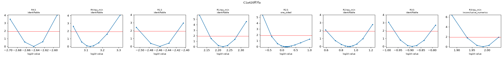
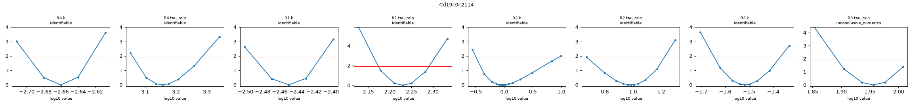
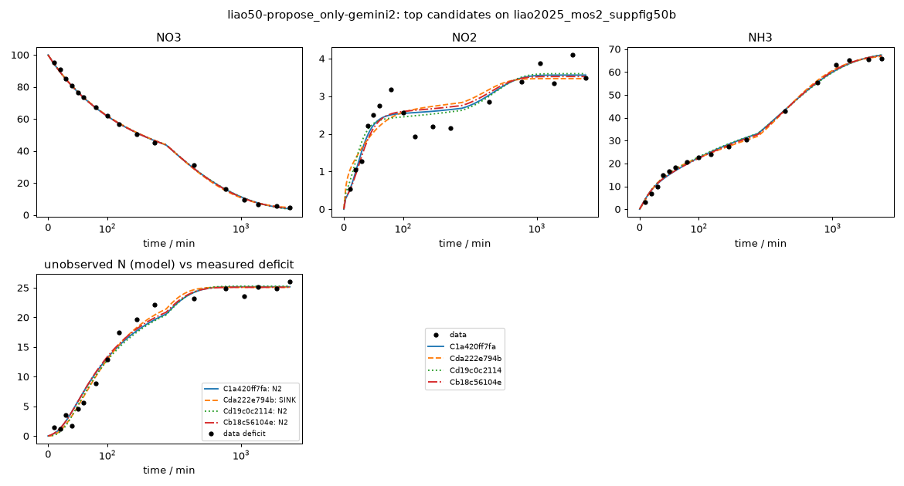

# Investigation report: liao50-propose_only-gemini2

- Investigation: `liao50`; arm: `propose_only`; phase: `final_evaluated`
- Protocol: `mle-profiled-v1` (sha256 `9d2cfcb0a1255b8c`); manifest sha256 `76cdbce7cb548123`; evaluator code sha256 `65c1ac7c107bb1ff` ({'python': '3.12.13', 'numpy': '2.5.4', 'scipy': '1.18.1'})
- Development data: `liao2025_mos2_suppfig50b` (sha256 `c291be31813c41e1`, source_data); 51 observations (NO3: t=0 point treated as initial condition, not as an observation; NO2: t=0 point treated as initial condition, not as an observation; NH3: t=0 point treated as initial condition, not as an observation; temperature not reported; 25.0 C assumed (matters only for potential dependence))

## Question
Which reaction networks and rate laws are supported by the 48 h H-cell nitrate-reduction time courses of Liao et al. 2025 (MoS2-family catalysts, -0.6 V vs RHE), what do the data leave ambiguous (in particular where the missing nitrogen goes and why the rates slow down), and which feasible measurement would best separate the surviving explanations?

## System boundary
Catholyte of an H-cell at fixed potential. Measured: NO3-, NO2- and NH4+/NH3 (lumped as NH3) in mM-N. Not measured: gas phase (N2, N2O, NH3 escape), anolyte (crossover), adsorbed or hidden species, pH, charge. Any nitrogen that leaves the measured channels must be represented by an explicit model species (an unmeasured product, a hidden intermediate, or a reservoir for transport out of the catholyte); the model as a whole must conserve N.

## Evidence status
- Partition: Complete experimental runs are reserved. Supp. Fig. 50a (other catalyst, same conditions and sampling) is the final held-out run; it is not read by any development-phase command, tool or evidence file. The final evaluation tests structure transfer: frozen candidate structures are refit on the held-out run with the same protocol (catalysts differ, so parameters are not transferred).
- Contamination: Retrospective analysis with literature-informed priors, not blind discovery: the proposer sees the development run, its derived N-closure series and a curated metadata note, and its pretraining may include general NO3RR mechanism knowledge.

## Ranked candidates (development data, computed in code)

Delta aicc <= 2.0: not distinguished by these data; <= 4.0: still supported. Akaike weights are relative support within this candidate set (one weight per distinct dynamics) under the stated noise model, not probabilities that a mechanism is true. Residual correlation from misspecification makes these differences optimistic.

| candidate | name | source | v | k | AICc | dAICc | weight | band | adequacy | RMSE NH3 | RMSE NO2 | RMSE NO3 | unobserved N end | in declared space | flags |
|---|---|---|---|---|---|---|---|---|---|---|---|---|---|---|
| C1a420ff7fa | c06_ser_par_no2_branch | agent | 1 | 11 | 143.01 | 0.00 | 0.373 | indistinguishable_from_best | poor | 1.3 | 0.353 | 0.871 | 25.2 | no |  |
| Cda222e794b | c10_ser_par_no2_nh3_coupling | agent | 1 | 11 | 143.51 | 0.50 | 0.291 | indistinguishable_from_best | poor | 0.969 | 0.459 | 0.925 | 25.1 | no |  |
| Cd19c0c2114 | c07_ser_par_no2_dimer_n2 | agent | 1 | 11 | 143.89 | 0.88 | 0.240 | indistinguishable_from_best | poor | 1.3 | 0.361 | 0.882 | 25.3 | no |  |
| Cb18c56104e | c08_ser_par_langmuir_nh3 | agent | 1 | 12 | 145.74 | 2.73 | 0.095 | supported | poor | 1.19 | 0.383 | 0.856 | 25.1 | no |  |
| C1f153a9ecb | c09_ser_par_hidden_nh2oh | agent | 1 | 11 | 154.65 | 11.64 | 0.001 | less_supported | poor | 1.16 | 0.557 | 0.876 | 25 | no |  |
| Cd8c284585a | c05_ser_par_pow_nh3_tied | agent | 1 | 10 | 168.74 | 25.73 | 0.000 | less_supported | poor | 2.33 | 0.407 | 1.01 | 25 | no |  |
| C69571aab6a | c03_parallel_pow_nh3 | agent | 1 | 9 | 169.80 | 26.79 | 0.000 | less_supported | poor | 1.97 | 0.556 | 0.99 | 25.6 | no |  |
| Cec5d62ed8d | c02_parallel_ind_tau | agent | 1 | 9 | 176.35 | 33.33 | 0.000 | less_supported | poor | 2.49 | 0.556 | 0.947 | 24.2 | no |  |
| Cb5f469d09f | c04_nh3_alkaline_partition | agent | 1 | 8 | 221.18 | 78.17 | 0.000 | less_supported | poor | 3.33 | 0.893 | 1.8 | 27.4 | no |  |
| C4d82a17858 | c01_series_sink_shared_tau | agent | 1 | 7 | 247.00 | 103.99 | 0.000 | less_supported | poor | 3.36 | 2.06 | 1.79 | 30.5 | liao-core-v1, liao-extended-v1 |  |

## Top candidates in detail

### C1a420ff7fa `c06_ser_par_no2_branch` (source agent, version 1)

Rationale (proposer): Tests whether sequential switching of bulk NO2 selectivity (from NH3 at t < 30 min to N2 at t = 40-180 min) alongside sustained direct NO3 -> NH3 reduction explains all four empirical regimes of the 48 h trajectory.

    R1: NO3 -> NO2 [mass_action, deactivation(tau); e=2]; R1.k=0.0035 (95% Wald 0.00317-0.00387, well_determined); R1.tau_min=166 (95% Wald 145-191, well_determined)
    R2: NO2 -> NH3 [mass_action, deactivation(tau); e=6]; R2.k=1.42 (95% Wald 0.224-9.04, moderately_determined); R2.tau_min=8.08 (95% Wald 3.81-17.1, moderately_determined)
    R3: NO2 -> N2 [mass_action, deactivation(tau); e=3]; R3.k=0.129 (95% Wald 0.106-0.158, well_determined); R3.tau_min=96.8 (95% Wald 85.1-110, well_determined)
    R4: NO3 -> NH3 [mass_action, deactivation(tau); e=8]; R4.k=0.00227 (95% Wald 0.00209-0.00247, well_determined); R4.tau_min=1.33e+03 (95% Wald 1.07e+03-1.67e+03, well_determined)

- Support entries: {'literature': 4, 'data': 4, 'speculative': 0}; reactions without support: []
  - R1: literature -- Katsounaros et al., Electrochim. Acta 71, 270 (2012) doi:10.1016/j.electacta.2012.03.154, Table 1 Two-electron reduction of nitrate to solution-phase nitrite
  - R2: literature -- Katsounaros et al., Electrochim. Acta 71, 270 (2012) doi:10.1016/j.electacta.2012.03.154, Table 1 Six-electron reduction of nitrite to ammonia
  - R3: literature -- Liao et al., Nat. Commun. (2025) doi:10.1038/s41467-025-60671-y, Methods / main text DEMS paragraph [L11] Reduction of nitrite to gaseous N2 (detected by DEMS)
  - R4: literature -- Liao et al., Nat. Commun. (2025) doi:10.1038/s41467-025-60671-y, main text ATR-IR/DEMS/DFT paragraph [L14] Direct eight-electron interfacial reduction of NO3 to NH3 (*NO3 -> *NH3)
  - R1.time_modulation: data -- liao2025_mos2_suppfig50b: NO2 trajectory NO2 generation slows over ~166 min
  - R2.time_modulation: data -- liao2025_mos2_suppfig50b: NH3 and n_closure trajectories Rapid shutdown of NO2 -> NH3 diverts NO2 to N2 between 40 and 180 min
  - R3.time_modulation: data -- liao2025_mos2_suppfig50b: NO2 and n_closure trajectories Intermediate deactivation explains the NO2 dip at 120-180 min and the arrest of N loss after 180 min
  - R4.time_modulation: data -- liao2025_mos2_suppfig50b: NO3 and NH3 trajectories Slow deactivation of direct interfacial NO3 -> NH3 conversion over 48 h
- Assumptions (proposer): ['Desorbed NO2 initially reduces rapidly to NH3 under neutral pH, then diverts to N2 as local pH increases, before the NO2 branch deactivates.', 'Direct surface reduction of enriched NO3 to NH3 operates in parallel and dominates after 180 min.']
- sigma (profiled): NO3=1, NO2=0.353, NH3=1.3; adequacy: poor ['NH3: residual signs cluster (runs test p=0.038)', 'NH3: residuals are serially correlated (lag-1 r=0.54)']
- Profile likelihood: R4.k: identifiable (95% 0.0021-0.00245); R4.tau_min: identifiable (95% 1.1e+03-1.73e+03); R1.k: identifiable (95% 0.00316-0.00383); R1.tau_min: identifiable (95% 146-192); R2.k: one_sided (95% 0.407-10); R2.tau_min: identifiable (95% 4.05-14.5); R3.k: identifiable (95% 0.108-0.156); R3.tau_min: inconclusive_numerics (95% 85.7-109)
  

### Cda222e794b `c10_ser_par_no2_nh3_coupling` (source agent, version 1)

Rationale (proposer): Tests whether the simultaneous slowdown of NH3 accumulation, dip in NO2, and surge in missing N between 40 and 180 min is driven by bimolecular coupling of NO2 and NH3.

    R1: NO3 -> NO2 [mass_action, deactivation(tau); e=2]; R1.k=0.00268 (95% Wald 0.00228-0.00315, well_determined); R1.tau_min=130 (95% Wald 113-150, well_determined)
    R2: NO2 -> NH3 [mass_action, deactivation(tau); e=6]; R2.k=0.287 (95% Wald 0.145-0.571, moderately_determined); R2.tau_min=18.6 (95% Wald 11.7-29.6, well_determined)
    R3: NO2 + NH3 -> 2 SINK [mass_action, deactivation(tau); e=2]; R3.k=0.00548 (95% Wald 0.0041-0.00732, well_determined); R3.tau_min=65.2 (95% Wald 57.3-74.2, well_determined)
    R4: NO3 -> NH3 [mass_action, deactivation(tau); e=8]; R4.k=0.00307 (95% Wald 0.00283-0.00333, well_determined); R4.tau_min=931 (95% Wald 799-1.09e+03, well_determined)

- Support entries: {'literature': 3, 'data': 5, 'speculative': 0}; reactions without support: []
  - R1: literature -- Katsounaros et al., Electrochim. Acta 71, 270 (2012) doi:10.1016/j.electacta.2012.03.154, Table 1 Two-electron reduction of nitrate to nitrite
  - R2: literature -- Katsounaros et al., Electrochim. Acta 71, 270 (2012) doi:10.1016/j.electacta.2012.03.154, Table 1 Six-electron reduction of nitrite to ammonia
  - R3: data -- liao2025_mos2_suppfig50b: NO2, NH3, and n_closure trajectories Bimolecular coupling of NO2 and NH3 explains why N loss is near zero at t=0-40 min and surges at t=40-180 min while depressing both [NO2] and d[NH3]/dt
  - R4: literature -- Liao et al., Nat. Commun. (2025) doi:10.1038/s41467-025-60671-y, main text ATR-IR/DEMS/DFT paragraph [L14] Direct eight-electron interfacial reduction of NO3 to NH3
  - R1.time_modulation: data -- liao2025_mos2_suppfig50b: NO2 trajectory Deactivation of NO3 -> NO2
  - R2.time_modulation: data -- liao2025_mos2_suppfig50b: NH3 trajectory Fast deactivation of NO2 -> NH3
  - R3.time_modulation: data -- liao2025_mos2_suppfig50b: n_closure trajectory Deactivation of NO2 + NH3 coupling after ~180 min
  - R4.time_modulation: data -- liao2025_mos2_suppfig50b: NO3 and NH3 trajectories Slow deactivation of direct NO3 -> NH3 pathway
- Assumptions (proposer): ['Accumulating NH3 and NO2 undergo a bimolecular surface-mediated coupling reaction (R3) during the intermediate time window (40-180 min) before deactivating.']
- sigma (profiled): NO3=1, NO2=0.459, NH3=0.969; adequacy: poor ['NO2: residuals are serially correlated (lag-1 r=0.52)']
- Profile likelihood: not computed (identifiability beyond the local Fisher screen is unassessed)

### Cd19c0c2114 `c07_ser_par_no2_dimer_n2` (source agent, version 1)

Rationale (proposer): Tests whether N2 formation from NO2 is second-order (2 NO2 -> 2 N2, Polatides & Kyriacou 2005) rather than first-order (c06), naturally suppressing N2 evolution at t < 30 min when [NO2] is small.

    R1: NO3 -> NO2 [mass_action, deactivation(tau); e=2]; R1.k=0.00355 (95% Wald 0.00322-0.00392, well_determined); R1.tau_min=170 (95% Wald 148-195, well_determined)
    R2: NO2 -> NH3 [mass_action, deactivation(tau); e=6]; R2.k=0.926 (95% Wald 0.215-3.99, moderately_determined); R2.tau_min=9.65 (95% Wald 4.81-19.4, moderately_determined)
    R3: 2 NO2 -> 2 N2 [mass_action, deactivation(tau); e=6]; R3.k=0.0303 (95% Wald 0.0223-0.0413, well_determined); R3.tau_min=90.4 (95% Wald 78.2-105, well_determined)
    R4: NO3 -> NH3 [mass_action, deactivation(tau); e=8]; R4.k=0.00219 (95% Wald 0.00199-0.0024, well_determined); R4.tau_min=1.43e+03 (95% Wald 1.11e+03-1.85e+03, well_determined)

- Support entries: {'literature': 4, 'data': 4, 'speculative': 0}; reactions without support: []
  - R1: literature -- Katsounaros et al., Electrochim. Acta 71, 270 (2012) doi:10.1016/j.electacta.2012.03.154, Table 1 Two-electron reduction of nitrate to nitrite
  - R2: literature -- Katsounaros et al., Electrochim. Acta 71, 270 (2012) doi:10.1016/j.electacta.2012.03.154, Table 1 Six-electron reduction of nitrite to ammonia
  - R3: literature -- Polatides & Kyriacou, J. Appl. Electrochem. 35, 421 (2005) doi:10.1007/s10800-004-8349-z, Fig. 3 Second-order N-N coupling of nitrite to N2 (r = k [NO2]^2)
  - R4: literature -- Liao et al., Nat. Commun. (2025) doi:10.1038/s41467-025-60671-y, main text ATR-IR/DEMS/DFT paragraph [L14] Direct eight-electron interfacial reduction of NO3 to NH3
  - R1.time_modulation: data -- liao2025_mos2_suppfig50b: NO2 trajectory Deactivation of NO3 -> NO2
  - R2.time_modulation: data -- liao2025_mos2_suppfig50b: NH3 trajectory Fast deactivation of NO2 -> NH3
  - R3.time_modulation: data -- liao2025_mos2_suppfig50b: n_closure trajectory Deactivation of nitrite dimerization to N2
  - R4.time_modulation: data -- liao2025_mos2_suppfig50b: NO3 and NH3 trajectories Slow deactivation of direct NO3 -> NH3 pathway
- Assumptions (proposer): ['Formation of N2 from NO2 requires bimolecular N-N coupling that is second-order in solution-phase [NO2].']
- sigma (profiled): NO3=1, NO2=0.361, NH3=1.3; adequacy: poor ['NH3: residual signs cluster (runs test p=0.028)', 'NH3: residuals are serially correlated (lag-1 r=0.53)']
- Profile likelihood: R4.k: identifiable (95% 0.002-0.00237); R4.tau_min: identifiable (95% 1.15e+03-1.92e+03); R1.k: identifiable (95% 0.00323-0.00387); R1.tau_min: identifiable (95% 149-195); R2.k: identifiable (95% 0.32-9.13); R2.tau_min: identifiable (95% 4.67-16.7); R3.k: identifiable (95% 0.0226-0.0426); R3.tau_min: inconclusive_numerics (95% 78.2-102)
  

### Cb18c56104e `c08_ser_par_langmuir_nh3` (source agent, version 1)

Rationale (proposer): Tests whether Langmuir site saturation on the direct NO3 -> NH3 pathway (representing interfacial reactant enrichment) improves the fit at high vs low [NO3] relative to first-order mass action (c06).

    R1: NO3 -> NO2 [mass_action, deactivation(tau); e=2]; R1.k=0.00388 (95% Wald 0.00327-0.00462, well_determined); R1.tau_min=151 (95% Wald 125-181, well_determined)
    R2: NO2 -> NH3 [mass_action, deactivation(tau); e=6]; R2.k=1.42 (95% Wald 0.297-6.81, moderately_determined); R2.tau_min=9.39 (95% Wald 4.72-18.7, moderately_determined)
    R3: NO2 -> N2 [mass_action, deactivation(tau); e=3]; R3.k=0.14 (95% Wald 0.11-0.178, well_determined); R3.tau_min=91.1 (95% Wald 78.2-106, well_determined)
    R4: NO3 -> NH3 [langmuir_saturation, deactivation(tau), K; e=8]; R4.k=0.0029 (95% Wald 0.00178-0.00474, well_determined); R4.K=197 (95% Wald 21.9-1.77e+03, moderately_determined); R4.tau_min=1.07e+03 (95% Wald 697-1.65e+03, well_determined)

- Support entries: {'literature': 4, 'data': 4, 'speculative': 0}; reactions without support: []
  - R1: literature -- Katsounaros et al., Electrochim. Acta 71, 270 (2012) doi:10.1016/j.electacta.2012.03.154, Table 1 Two-electron reduction of nitrate to nitrite
  - R2: literature -- Katsounaros et al., Electrochim. Acta 71, 270 (2012) doi:10.1016/j.electacta.2012.03.154, Table 1 Six-electron reduction of nitrite to ammonia
  - R3: literature -- Liao et al., Nat. Commun. (2025) doi:10.1038/s41467-025-60671-y, Methods / main text DEMS paragraph [L11] Nitrite reduction to N2
  - R4: literature -- Liao et al., Nat. Commun. (2025) doi:10.1038/s41467-025-60671-y, main text ATR-IR/DEMS/DFT paragraph [L14] Langmuir saturation models reactant enrichment and site saturation at the solid-liquid interface proposed by Liao et al. 2025
  - R1.time_modulation: data -- liao2025_mos2_suppfig50b: NO2 trajectory Deactivation of NO3 -> NO2
  - R2.time_modulation: data -- liao2025_mos2_suppfig50b: NH3 trajectory Fast deactivation of NO2 -> NH3
  - R3.time_modulation: data -- liao2025_mos2_suppfig50b: n_closure trajectory Deactivation of NO2 -> N2
  - R4.time_modulation: data -- liao2025_mos2_suppfig50b: NO3 and NH3 trajectories Deactivation of Langmuir-saturated NO3 -> NH3 pathway
- Assumptions (proposer): ['Enrichment of NO3 at the MoS2 interface follows a Langmuir adsorption isotherm r = k [NO3] / (1 + [NO3]/K).']
- sigma (profiled): NO3=1, NO2=0.383, NH3=1.19; adequacy: poor ['NH3: residual signs cluster (runs test p=0.028)', 'NH3: residuals are serially correlated (lag-1 r=0.50)']
- Profile likelihood: not computed (identifiability beyond the local Fisher screen is unassessed)

## Discrimination analysis (discrimination-1.json)

A design is {"name", "c0_mM_N": {...}, "t_end_min", optional "observe": [species ids to measure]}. Predictions use
    each candidate's development MLE; parameter uncertainty is not propagated, so large disagreement is a lead for an
    experiment, not a quantified expected information gain.

- Design `nitrite_feed_20mM` {"observe": ["NO3", "NO2", "NH3"], "c0_mM_N": {"NO2": 20}, "t_end_min": 360, "name": "nitrite_feed_20mM"}:
  - NO2: max spread 13.2 mM-N at 1.81 min (37.4 dev sigma); {'C1a420ff7fa': 1.58, 'Cda222e794b': 11.72, 'Cd19c0c2114': 2.08, 'Cb18c56104e': 1.5, 'C1f153a9ecb': 14.69}
  - species:NO2: max spread 13.2 mM-N at 1.81 min (- dev sigma); {'C1a420ff7fa': 1.58, 'Cda222e794b': 11.72, 'Cd19c0c2114': 2.08, 'Cb18c56104e': 1.5, 'C1f153a9ecb': 14.69}
  - NH3: max spread 13 mM-N at 1.81 min (9.99 dev sigma); {'C1a420ff7fa': 16.79, 'Cda222e794b': 7.15, 'Cd19c0c2114': 10.69, 'Cb18c56104e': 16.76, 'C1f153a9ecb': 3.76}
  - species:NH3: max spread 13 mM-N at 1.81 min (- dev sigma); {'C1a420ff7fa': 16.79, 'Cda222e794b': 7.15, 'Cd19c0c2114': 10.69, 'Cb18c56104e': 16.76, 'C1f153a9ecb': 3.76}
  - unmeasured_N_total: max spread 6.7 mM-N at 54.3 min (- dev sigma); {'C1a420ff7fa': 1.8, 'Cda222e794b': 5.98, 'Cd19c0c2114': 7.4, 'Cb18c56104e': 1.91, 'C1f153a9ecb': 0.7}
- Design `nitrite_10mM_ammonia_30mM_cofeed` {"t_end_min": 180, "observe": ["NO3", "NO2", "NH3"], "c0_mM_N": {"NH3": 30, "NO2": 10}, "name": "nitrite_10mM_ammonia_30mM_cofeed"}:
  - unmeasured_N_total: max spread 7.55 mM-N at 56.1 min (- dev sigma); {'C1a420ff7fa': 0.9, 'Cda222e794b': 7.9, 'Cd19c0c2114': 2.39, 'Cb18c56104e': 0.95, 'C1f153a9ecb': 0.35}
  - NH3: max spread 7.55 mM-N at 180 min (5.78 dev sigma); {'C1a420ff7fa': 39.1, 'Cda222e794b': 32.1, 'Cd19c0c2114': 37.61, 'Cb18c56104e': 39.05, 'C1f153a9ecb': 39.65}
  - species:NH3: max spread 7.55 mM-N at 180 min (- dev sigma); {'C1a420ff7fa': 39.1, 'Cda222e794b': 32.1, 'Cd19c0c2114': 37.61, 'Cb18c56104e': 39.05, 'C1f153a9ecb': 39.65}
  - NO2: max spread 6.59 mM-N at 1.81 min (18.7 dev sigma); {'C1a420ff7fa': 0.79, 'Cda222e794b': 4.51, 'Cd19c0c2114': 1.4, 'Cb18c56104e': 0.75, 'C1f153a9ecb': 7.34}
  - species:NO2: max spread 6.59 mM-N at 1.81 min (- dev sigma); {'C1a420ff7fa': 0.79, 'Cda222e794b': 4.51, 'Cd19c0c2114': 1.4, 'Cb18c56104e': 0.75, 'C1f153a9ecb': 7.34}
- Design `high_nitrate_500mM` {"c0_mM_N": {"NO3": 500}, "t_end_min": 1440, "observe": ["NO3", "NO2", "NH3"], "name": "high_nitrate_500mM"}:
  - NH3: max spread 81.3 mM-N at 535 min (62.3 dev sigma); {'C1a420ff7fa': 253.28, 'Cda222e794b': 223.08, 'Cd19c0c2114': 244.14, 'Cb18c56104e': 171.93, 'C1f153a9ecb': 252.38}
  - species:NH3: max spread 81.3 mM-N at 535 min (- dev sigma); {'C1a420ff7fa': 253.28, 'Cda222e794b': 223.08, 'Cd19c0c2114': 244.14, 'Cb18c56104e': 171.93, 'C1f153a9ecb': 252.38}
  - NO3: max spread 65.9 mM-N at 550 min (65.9 dev sigma); {'C1a420ff7fa': 102.48, 'Cda222e794b': 99.06, 'Cd19c0c2114': 103.1, 'Cb18c56104e': 164.92, 'C1f153a9ecb': 103.55}
  - species:NO3: max spread 65.9 mM-N at 550 min (- dev sigma); {'C1a420ff7fa': 102.48, 'Cda222e794b': 99.06, 'Cd19c0c2114': 103.1, 'Cb18c56104e': 164.92, 'C1f153a9ecb': 103.55}
  - unmeasured_N_total: max spread 47.1 mM-N at 261 min (- dev sigma); {'C1a420ff7fa': 113.11, 'Cda222e794b': 160.24, 'Cd19c0c2114': 128.42, 'Cb18c56104e': 124.69, 'C1f153a9ecb': 113.53}
- Design `low_nitrate_10mM` {"name": "low_nitrate_10mM", "c0_mM_N": {"NO3": 10}, "t_end_min": 360, "observe": ["NO3", "NO2", "NH3"]}:
  - unmeasured_N_total: max spread 1.7 mM-N at 360 min (- dev sigma); {'C1a420ff7fa': 2.42, 'Cda222e794b': 0.72, 'Cd19c0c2114': 1.72, 'Cb18c56104e': 2.29, 'C1f153a9ecb': 2.42}
  - NH3: max spread 1.03 mM-N at 360 min (0.788 dev sigma); {'C1a420ff7fa': 4.36, 'Cda222e794b': 5.37, 'Cd19c0c2114': 4.47, 'Cb18c56104e': 4.96, 'C1f153a9ecb': 4.34}
  - species:NH3: max spread 1.03 mM-N at 360 min (- dev sigma); {'C1a420ff7fa': 4.36, 'Cda222e794b': 5.37, 'Cd19c0c2114': 4.47, 'Cb18c56104e': 4.96, 'C1f153a9ecb': 4.34}
  - NO2: max spread 0.755 mM-N at 360 min (2.14 dev sigma); {'C1a420ff7fa': 0.3, 'Cda222e794b': 1.03, 'Cd19c0c2114': 0.88, 'Cb18c56104e': 0.27, 'C1f153a9ecb': 0.3}
  - species:NO2: max spread 0.755 mM-N at 360 min (- dev sigma); {'C1a420ff7fa': 0.3, 'Cda222e794b': 1.03, 'Cd19c0c2114': 0.88, 'Cb18c56104e': 0.27, 'C1f153a9ecb': 0.3}
- Design `nitrate_100mM_ammonia_40mM_cofeed` {"observe": ["NO3", "NO2", "NH3"], "c0_mM_N": {"NO3": 100, "NH3": 40}, "name": "nitrate_100mM_ammonia_40mM_cofeed", "t_end_min": 360}:
  - unmeasured_N_total: max spread 9.6 mM-N at 194 min (- dev sigma); {'C1a420ff7fa': 20.31, 'Cda222e794b': 29.75, 'Cd19c0c2114': 20.15, 'Cb18c56104e': 20.62, 'C1f153a9ecb': 20.44}
  - NH3: max spread 8.35 mM-N at 183 min (6.4 dev sigma); {'C1a420ff7fa': 71.55, 'Cda222e794b': 63.31, 'Cd19c0c2114': 71.66, 'Cb18c56104e': 71.12, 'C1f153a9ecb': 71.62}
  - species:NH3: max spread 8.35 mM-N at 183 min (- dev sigma); {'C1a420ff7fa': 71.55, 'Cda222e794b': 63.31, 'Cd19c0c2114': 71.66, 'Cb18c56104e': 71.12, 'C1f153a9ecb': 71.62}
  - NO2: max spread 1.49 mM-N at 90.5 min (4.23 dev sigma); {'C1a420ff7fa': 2.53, 'Cda222e794b': 1.08, 'Cd19c0c2114': 2.44, 'Cb18c56104e': 2.57, 'C1f153a9ecb': 2.13}
  - species:NO2: max spread 1.49 mM-N at 90.5 min (- dev sigma); {'C1a420ff7fa': 2.53, 'Cda222e794b': 1.08, 'Cd19c0c2114': 2.44, 'Cb18c56104e': 2.57, 'C1f153a9ecb': 2.13}

## Investigator conclusion (conclusion-1.json; an interpretation, numbers above are authoritative)

Across the 10 evaluated candidate mechanisms on liao2025_mos2_suppfig50b (100 mM-N NO3-, MoS2, -0.6 V vs RHE, 48 h), four candidates remain empirically supported (dAICc <= 2.73): C1a420ff7fa (c06_ser_par_no2_branch, AICc = 143.01, dAICc = 0.00), Cda222e794b (c10_ser_par_no2_nh3_coupling, AICc = 143.51, dAICc = 0.50), Cd19c0c2114 (c07_ser_par_no2_dimer_n2, AICc = 143.89, dAICc = 0.88), and Cb18c56104e (c08_ser_par_langmuir_nh3, AICc = 145.74, dAICc = 2.73, lowest NLL = 56.77). None of these four surviving models lies in the pre-declared baseline enumeration spaces (liao-core-v1, liao-extended-v1), whereas the standard sequential baseline in the declared space (C4d82a17858, c01_series_sink_shared_tau) is decisively rejected by the data (AICc = 247.00, dAICc = 103.99).

1. What the data strongly support:
All four surviving mechanisms share a specific series-parallel (dual-pathway) architecture with pathway-specific deactivation timescales:
- A direct interfacial 8-electron pathway (R4: NO3 -> NH3) that deactivates slowly (tau = 931-1431 min, k = 0.0022-0.0031 min^-1) and drives the high-selectivity (~89%) conversion of NO3- to NH3 between 180 and 1440 min, consistent with the interfacial reactant-enrichment mechanism of Liao et al. [L14].
- A parallel 2-electron branch forming solution-phase nitrite (R1: NO3 -> NO2, k = 0.0027-0.0039 min^-1, tau = 130-170 min) in which desorbed NO2- is an active intermediate whose fate switches over time: at t < 30 min (when the unbuffered K2SO4 electrolyte is near its initial neutral pH of 6.71 [L5]), NO2- reduces rapidly to NH3 (R2: NO2 -> NH3, tau = 8.1-18.6 min), producing the fast initial NH3 burst (15.05 mM-N by 40 min) with negligible N loss (1.71 mM-N at 40 min); as R2 shuts down, NO2- is diverted between t = 40 and 180 min into an unmeasured sink reaction (R3, tau = 65-97 min), simultaneously accounting for the 22.1 mM-N surge in missing N and the local maximum and dip in [NO2-] (3.19 mM-N at 80 min dropping to 1.92 mM-N at 120 min); finally, after R1 and R3 deactivate by ~180-360 min, missing N plateaus at ~25.1-25.3 mM-N and residual NO2- remains frozen at ~3.5-3.6 mM-N through 2880 min.

2. Adequacy assessment:
Under the evaluator's strict adequacy heuristic (runs test p < 0.05 or lag-1 autocorrelation > 0.50 on any channel), all 10 candidates are formally flagged as adequacy = 'poor' (hence adequacy is recorded as none_adequate). However, the four supported series-parallel models eliminate almost all systematic error: C1a420ff7fa, Cd19c0c2114, and Cb18c56104e pass all adequacy diagnostics on both NO3 (RMSE = 0.86-0.88 mM-N, runs p = 0.25-0.33, lag-1 r = 0.12-0.14; sigma_NO3 hits the 1% relative floor of 0.9995 mM-N) and NO2 (RMSE = 0.35-0.38 mM-N, runs p = 0.25-0.46, lag-1 r = 0.30-0.41), with only borderline serial correlation on NH3 (RMSE = 1.19-1.30 mM-N, runs p = 0.028-0.038 [5 runs vs 6 required for p >= 0.05], lag-1 r = 0.502-0.537). Conversely, Cda222e794b achieves RMSE < 1.0 mM-N and passes the runs test on all three channels simultaneously (NO3: RMSE = 0.93 mM-N, runs p = 0.094, lag-1 r = 0.18; NH3: RMSE = 0.97 mM-N, runs p = 0.214, lag-1 r = 0.32; NO2: RMSE = 0.46 mM-N, runs p = 0.094), missing the lag-1 threshold on NO2 by only 0.016 (r = 0.516 vs 0.500).

3. Why the other six candidates are rejected:
- Purely sequential shared-tau reduction (C4d82a17858, dAICc = 103.99) fails because shared deactivation merely rescales time, forcing [NO2-] to decay to 0.19 mM-N at 2880 min (vs 3.48 mM-N observed) and forcing missing N and NH3 to form in a constant ratio.
- Non-electrochemical NH3 escape/partitioning (Cb5f469d09f, dAICc = 78.17) fails because physical volatilization/crossover (electrons = 0, no catalyst deactivation) scales with bulk [NH3], forcing missing N to grow mainly when [NH3] is large (180-1440 min) rather than arresting at 180 min.
- Purely parallel branches from NO3 (Cec5d62ed8d, dAICc = 33.33; C69571aab6a, dAICc = 26.79) and tied side-branch power-law reduction (Cd8c284585a, dAICc = 25.73) lack the fast NO2 -> NH3 + NO2 -> sink relay needed to capture the 0-40 min NH3 burst and 40-180 min N-loss window (NH3 RMSE = 1.97-2.49 mM-N, lag-1 r = 0.70-0.82).
- Sequential hidden NH2OH accumulation (C1f153a9ecb, dAICc = 11.64) is less supported because routing early NH3 through NH2OH requires rapid NO2 -> NH2OH conversion at t = 0-30 min, overpredicting early [NO2-] (1.67 vs 0.54 mM-N at 10 min; NO2 lag-1 r = 0.62, RMSE = 0.56 mM-N).

- Plausible: ['C1a420ff7fa', 'Cda222e794b', 'Cd19c0c2114', 'Cb18c56104e']
- Adequacy: none_adequate
- Rejected: [{'reason': 'Less supported (AICc = 154.65, dAICc = 11.64 vs C1a420ff7fa; NLL = 62.94 vs 57.12). Routing early NH3 formation sequentially through hidden NH2OH (NO3 -> NO2 -> NH2OH -> NH3) requires rapid NO2 accumulation and consumption that overpredicts early [NO2] (1.67 vs 0.54 mM-N at 10 min) and leaves strong serial correlation in NO2 residuals (lag-1 r = 0.62, RMSE = 0.557 mM-N vs r = 0.31, RMSE = 0.353 mM-N in C1a420ff7fa).', 'candidate_id': 'C1f153a9ecb'}, {'candidate_id': 'Cd8c284585a', 'reason': 'Strongly disfavored (AICc = 168.74, dAICc = 25.73; NLL = 71.62). Tying the deactivation of NO3 -> NO2 and NO3 -> N2 (tau_side = 239.7 min) and using a power-law direct NO3 -> NH3 step (order = 1.48) fails to reproduce the rapid 0-40 min NH3 burst (residual -4.64 mM-N at 40 min) and the 40-180 min N-loss surge, resulting in severe NH3 misfit (RMSE = 2.33 mM-N, runs test p = 0.007, lag-1 r = 0.75).'}, {'candidate_id': 'C69571aab6a', 'reason': 'Strongly disfavored (AICc = 169.80, dAICc = 26.79; NLL = 73.70). Purely parallel branches from NO3 with power-law NO3 -> NH3 (order = 1.57) omit NO2 consumption, producing monotonic NO2 accumulation (NO2 lag-1 r = 0.63, RMSE = 0.556 mM-N) and missing the two-phase NH3 trajectory (NH3 RMSE = 1.97 mM-N, runs test p = 0.025, lag-1 r = 0.70).'}, {'candidate_id': 'Cec5d62ed8d', 'reason': 'Strongly disfavored (AICc = 176.35, dAICc = 33.33; NLL = 76.98). Purely parallel first-order branches from NO3 with independent deactivation (tau = 69.4, 978.7, and 174.4 min) underpredict NH3 at 40 min by 5.26 mM-N (NH3 RMSE = 2.49 mM-N, runs test p = 0.009, lag-1 r = 0.82) and fail to capture the non-monotonic NO2 profile (NO2 lag-1 r = 0.63).'}, {'reason': 'Decisively rejected (AICc = 221.18, dAICc = 78.17; NLL = 100.87). Non-electrochemical reversible NH3 escape/partitioning (electrons = 0, no catalyst deactivation) scales with bulk [NH3], forcing missing N to accumulate mainly at late times when [NH3] is high rather than plateauing after 180 min; all three channels fail adequacy (NO3 RMSE = 1.80 mM-N, NO2 RMSE = 0.89 mM-N, NH3 RMSE = 3.33 mM-N; runs test p <= 0.013 and lag-1 r = 0.52-0.83 on all channels), and R3.k/R4.k are locally unidentifiable (r = 1.0).', 'candidate_id': 'Cb5f469d09f'}, {'reason': 'Decisively rejected (AICc = 247.00, dAICc = 103.99; NLL = 115.20). The classical series network (NO3 -> NO2 -> NH3 / N2) with one shared catalyst deactivation constant (tau_cat = 539 min) rescales time uniformly for all steps, forcing [NO2] to decay to 0.19 mM-N at 2880 min (vs 3.48 mM-N observed; NO2 RMSE = 2.06 mM-N, runs test p = 0.0003, lag-1 r = 0.95) and forcing missing N and NH3 to accumulate in a fixed ratio throughout the 48 h run (NH3 RMSE = 3.36 mM-N, lag-1 r = 0.83).', 'candidate_id': 'C4d82a17858'}]
- Ambiguities: ['Reaction order and molecularity of the nitrite-consuming sink step: first-order NO2 -> N2 reduction (C1a420ff7fa, AICc = 143.01), bimolecular NO2 + NH3 -> 2 SINK coupling (Cda222e794b, AICc = 143.51, dAICc = 0.50), and second-order nitrite dimerization 2 NO2 -> 2 N2 (Cd19c0c2114, AICc = 143.89, dAICc = 0.88) are statistically indistinguishable (dAICc < 2.0) on a single 100 mM NO3 trajectory because bulk [NO2] remains within a narrow 2-4 mM-N band during the t = 40-180 min N-loss window.', 'Interfacial site saturation vs first-order kinetics on the direct NO3 -> NH3 pathway: Langmuir saturation (Cb18c56104e, NLL = 56.77, AICc = 145.74, dAICc = 2.73) achieves slightly lower NLL than first-order mass action (C1a420ff7fa, NLL = 57.12, AICc = 143.01), but the Langmuir constant R4.K = 197 mM-N (Wald 95% CI [21.9, 1770] mM-N) is strongly correlated with R4.k (r = -0.984) and R4.tau_min (r = -0.957) when fitted to a single initial nitrate concentration.', 'Chemical identity and phase of the ~25 mM-N unmeasured nitrogen: because gas-phase products (N2, N2O, volatilized NH3), soluble intermediates (NH2OH), and anolyte crossover are unmeasured in liao2025_mos2_suppfig50b, the aqueousNO3/NO2/NH3 channels constrain only the stoichiometry and timing of nitrogen loss from the measured pools, not the oxidation state or phase of the sink species (chem_hash differs while dynamics_hash would be identical for any terminal sink of the same stoichiometry, e.g., N2 vs N2O).', 'Physical origin of the multi-timescale deactivation (tau ~ 8-19 min on NO2 -> NH3, tau ~ 65-97 min on the sink step, tau ~ 130-170 min on NO3 -> NO2, and tau ~ 930-1430 min on direct NO3 -> NH3): because electrolyte pH is unbuffered and unmeasured during the 48 h H-cell run (drifting from ~6.71 to ~11.87 in related K2SO4 tests [L5]), time-dependent catalyst fouling/reconstruction cannot be separated from pH-drift-induced rate changes or uncompensated iR drop [L7].', 'Rate constant R2.k of the fast initial NO2 -> NH3 branch is only one-sidedly or moderately identifiable from 10-min sampling (profile 95% CI [0.41, 10.0] min^-1 in C1a420ff7fa; correlated with R2.tau_min, r = -0.957) because R2 deactivates with tau_min = 8.1-9.6 min, comparable to the first sampling interval (t = 10 min).', 'Unresolved dataset metadata: bulk and local pH vs time, temperature, anolyte composition/volume, H-cell membrane type, replicate variance, and Faradaic efficiency/charge passed are not reported for Supplementary Fig. 50b [L5, L7-L9, L12, L13, L15].']
- Experiment: nitrite_feed_20mM: H-cell chronoamperometry at -0.6 V vs RHE starting from 20 mM-N KNO2 (0 mM NO3-, 0 mM NH3) over 360 min with dense early sampling (1, 2, 5, 10, 20, 40, 60, 120, 180, 360 min) and on-line GC/DEMS + 1H NMR/oximation for NH2OH. -- discriminates ['C1a420ff7fa', 'Cda222e794b', 'Cd19c0c2114', 'Cb18c56104e', 'C1f153a9ecb']: nw_discriminate shows a 13.19 mM-N spread in [NO2] (37.4 dev-sigma) and a 13.04 mM-N spread in [NH3] (10.0 dev-sigma) at t = 1.8 min, plus a 6.70 mM-N spread in unmeasured N at t = 54 min: second-order 2 NO2 -> 2 N2 (Cd19c0c2114) produces 7.40 mM-N of unmeasured N2 vs only 1.80 mM-N for first-order NO2 -> N2 (C1a420ff7fa), while bimolecular NO2 + NH3 coupling (Cda222e794b) exhibits slower initial NO2 depletion (11.72 mM-N remaining at 1.8 min vs 1.58 mM-N in C1a420ff7fa) until product NH3 accumulates.
- Experiment: nitrite_10mM_ammonia_30mM_cofeed: Co-feed 10 mM-N KNO2 + 30 mM-N 15NH4+ (or NH4+) at t = 0 (0 mM NO3-) at -0.6 V vs RHE for 180 min. -- discriminates ['Cda222e794b', 'C1a420ff7fa', 'Cd19c0c2114', 'Cb18c56104e']: Directly tests whether NH3 is an active reactant in the N-loss step (R3: NO2 + NH3 -> 2 SINK in Cda222e794b). nw_discriminate predicts that at t = 56 min, Cda222e794b generates 7.90 mM-N of unmeasured N (consuming pre-loaded NH3 down to 32.10 mM-N at 180 min), whereas C1a420ff7fa, Cb18c56104e, and Cd19c0c2114 predict only 0.90, 0.95, and 2.39 mM-N of unmeasured N and net NH3 rising to 37.6-39.1 mM-N (a 7.55 mM-N / 5.78 dev-sigma spread in NH3). Using 15NH4+ additionally tests for 14N15N/14N15NO coupling products by DEMS/GC-MS.
- Experiment: high_nitrate_500mM: Initial 500 mM-N KNO3 (0 mM NO2-, 0 mM NH3) at -0.6 V vs RHE over 1440 min. -- discriminates ['Cb18c56104e', 'C1a420ff7fa', 'Cd19c0c2114', 'Cda222e794b']: Separates Langmuir site saturation on the direct NO3 -> NH3 pathway (Cb18c56104e, K = 197 mM-N) from first-order mass-action kinetics (C1a420ff7fa, Cd19c0c2114, Cda222e794b). At 500 mM-N (> 2.5 K), Langmuir saturation caps the direct NO3 -> NH3 rate: nw_discriminate shows an 81.34 mM-N spread in [NH3] (62.3 dev-sigma, 171.9 mM-N for Cb18c56104e vs 253.3 mM-N for C1a420ff7fa at t = 535 min) and a 65.86 mM-N spread in [NO3] (65.9 dev-sigma) at t = 550 min, plus an 18.38 mM-N spread in [NO2] (52.1 dev-sigma) at t = 1440 min.
- Experiment: nitrate_100mM_ammonia_40mM_cofeed: Co-feed 100 mM-N KNO3 + 40 mM-N NH4+ at t = 0 at -0.6 V vs RHE for 360 min. -- discriminates ['Cda222e794b', 'C1a420ff7fa', 'Cd19c0c2114', 'Cb18c56104e']: Under nitrate reduction conditions, pre-loading 40 mM-N NH3 accelerates R3 (NO2 + NH3 -> 2 SINK) in Cda222e794b without requiring prior NH3 buildup: nw_discriminate predicts 29.75 mM-N unmeasured N and 63.31 mM-N NH3 at t = 183-194 min for Cda222e794b vs 20.15-20.62 mM-N unmeasured N and 71.12-71.66 mM-N NH3 for C1a420ff7fa, Cd19c0c2114, and Cb18c56104e (an 8.35 mM-N / 6.40 dev-sigma spread in NH3 and a 4.23 dev-sigma spread in NO2 at t = 90 min).

## Frozen selection

- Rule: lowest AICc among fitted candidates without a hidden-pool plausibility violation, plus every such candidate within delta AICc <= 2.0
- Selected: ['C1a420ff7fa', 'Cda222e794b', 'Cd19c0c2114']
- Agent-concluded plausible: ['C1a420ff7fa', 'Cda222e794b', 'Cd19c0c2114', 'Cb18c56104e']
- Frozen at 2026-10-21T17:07:16.920Z

## Final held-out evaluation: liao2025_wmos2_suppfig50a

Version: current evaluator code.

Structure transfer: each frozen structure is refit on the held-out run (different catalyst) with the development protocol; parameters are not transferred. Rank is among all members of the declared enumeration spaces fitted to the same run.
Sensitivity: AICc at the lowest NLL any start reached (flags fits whose reported optimum is beaten by replicated unconverged starts). See docs/examples/arm_comparison.md for ranks in a shared reference set.

- Cb18c56104e: fitted; AICc 154, delta to best 0, rank 1/688 among this run's declared-space members; numerically unreliable: False; sensitivity AICc 154 (rank 1); adequacy poor; RMSE {'NO3': 1.99, 'NO2': 0.36, 'NH3': 0.71}
- Cda222e794b: fitted; AICc 160, delta to best 5.93, rank 1/688 among this run's declared-space members; numerically unreliable: False; sensitivity AICc 160 (rank 1); adequacy poor; RMSE {'NO3': 1.92, 'NO2': 0.36, 'NH3': 0.98}
- Cd19c0c2114: fitted; AICc 167, delta to best 12.7, rank 1/688 among this run's declared-space members; numerically unreliable: False; sensitivity AICc 167 (rank 1); adequacy poor; RMSE {'NO3': 1.84, 'NO2': 0.47, 'NH3': 0.96}
- C1a420ff7fa: fitted; AICc 161, delta to best 7.17, rank 1/688 among this run's declared-space members; numerically unreliable: False; sensitivity AICc 161 (rank 1); adequacy poor; RMSE {'NO3': 1.85, 'NO2': 0.39, 'NH3': 0.98}
- Best declared-space members on the held-out run: [('S:enum-2ed1b3b4a8', 179.17, 'enumerated: NO3>NO2,NO3>NH3,NO3>X,NO2>X,X>NH3 | mass_action | shared_deactivation'), ('S:enum-3c7318acc7', 179.3, 'enumerated: NO3>NO2,NO3>NH3,NO2>NH3,NO3>X,X>NH3 | mass_action | shared_deactivation'), ('S:enum-21d5c8b0d8', 179.41, 'enumerated: NO3>NO2,NO3>NH3,NO2>SINK,NO3>X,X>NH3 | mass_action | shared_deactivation')]

## Cost and runtime

- Numerics: 6 fits run, 4 reused from the shared cache, 160 CPU s fitting, 230 s profiles (current evaluator code only; earlier code versions' records are excluded)
- LLM: openrouter/google/gemini-4-argon; sessions: 1 investigator; tokens in 883,555, out 140,117, cache read 8,135,233, cache write 0; $3.98 (list prices from the Pi model table); 5190 s wall; 116 tool calls

## Unresolved assumptions and metadata

- liao2025_mos2_suppfig50b: verified_against_figure=False
- [L3] catalyst assignment: unresolved discrepancy
- [L4] selectivity numbers: unresolved
- [L5] pH: stated for a related experiment; not measured for these runs
- [L6] NH3 escape: stated (qualitative)
- [L7] reference and iR: stated (flow cell)
- [L8] membrane: not found for the H-cell
- [L9] volume: stated for 0.5 h tests
- [L11] gas and crossover: not measured for these runs
- [L12] N balance: not found
- [L13] charge: not found for these runs
- [L14] mechanism (authors): stated (surface pathway, not a solution-phase kinetic model)
- [L15] replicates: no replicate information for these runs
- Noise model: independent Gaussian errors per channel (profiled sigma); no replicate information exists for these runs, so sigma is estimated from misfit and includes model error.
- AICc differences assume independent errors; clustered residual signs (adequacy 'poor') make them optimistic.

