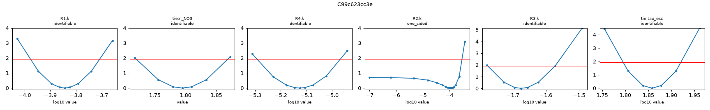
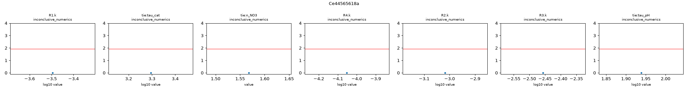
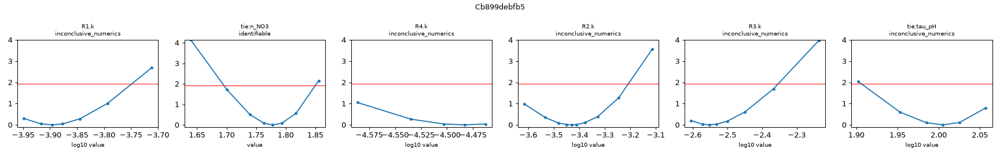
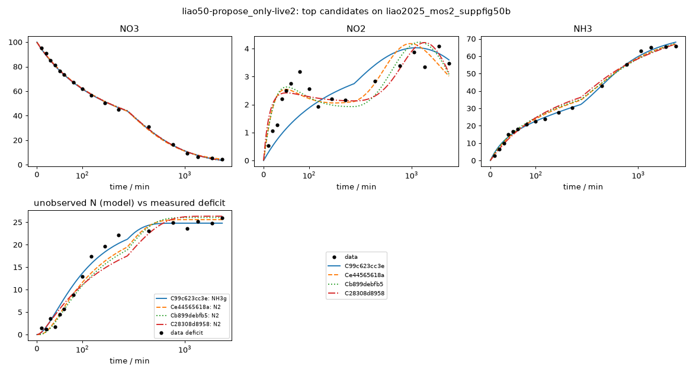

# Investigation report: liao50-propose_only-live2

- Investigation: `liao50`; arm: `propose_only`; phase: `final_evaluated`
- Protocol: `mle-profiled-v1` (sha256 `9d2cfcb0a1255b8c`); manifest sha256 `387136c91943e11c`; evaluator code sha256 `396a76ab80769a09` ({'python': '3.12.13', 'numpy': '2.5.4', 'scipy': '1.18.1'})
- Development data: `liao2025_mos2_suppfig50b` (sha256 `c291be31813c41e1`, source_data); 51 observations (NO3: t=0 point treated as initial condition, not as an observation; NO2: t=0 point treated as initial condition, not as an observation; NH3: t=0 point treated as initial condition, not as an observation; temperature not reported; 25.0 C assumed (matters only for potential dependence))

## Question
Which reaction networks and rate laws are supported by the 48 h H-cell nitrate-reduction time courses of Liao et al. 2025 (MoS2-family catalysts, -0.6 V vs RHE), what do the data leave ambiguous (in particular where the missing nitrogen goes and why the rates slow down), and which feasible measurement would best separate the surviving explanations?

## System boundary
Catholyte of an H-cell at fixed potential. Measured: NO3-, NO2- and NH4+/NH3 (lumped as NH3) in mM-N. Not measured: gas phase (N2, N2O, NH3 escape), anolyte (crossover), adsorbed or hidden species, pH, charge. Any nitrogen that leaves the measured channels must be represented by an explicit model species (an unmeasured product, a hidden intermediate, or a reservoir for transport out of the catholyte); the model as a whole must conserve N.

## Evidence status
- Partition: Complete experimental runs are reserved. Supp. Fig. 50a (other catalyst, same conditions and sampling) is the final held-out run; it is not read by any development-phase command, tool or evidence file. The final evaluation tests structure transfer: frozen candidate structures are refit on the held-out run with the same protocol (catalysts differ, so parameters are not transferred).
- Contamination: Retrospective analysis with literature-informed priors, not blind discovery: the proposer sees the development run, its derived N-closure series and a curated metadata note, and its pretraining may include general NO3RR mechanism knowledge.

## Ranked candidates (development data, computed in code)

Delta aicc <= 2.0: not distinguished by these data; <= 4.0: still supported. Akaike weights are relative support within this candidate set (one weight per distinct dynamics) under the stated noise model, not probabilities that a mechanism is true. Residual correlation from misspecification makes these differences optimistic.

| candidate | name | source | v | k | AICc | dAICc | weight | band | adequacy | RMSE NH3 | RMSE NO2 | RMSE NO3 | unobserved N end | in declared space | flags |
|---|---|---|---|---|---|---|---|---|---|---|---|---|---|---|
| C99c623cc3e | powerlaw_direct_NH3escape_deact | agent | 1 | 9 | 166.25 | 0.00 | 0.602 | indistinguishable_from_best | poor | 1.29 | 0.785 | 0.96 | 24.8 | no | R3: catalyst-state time modulation on a non-electrochemical step (electrons = 0), e.g. crossover or volatilization would not deactivate with the catalyst |
| Ce44565618a | powerlaw_deact_direct_comprop | agent | 1 | 10 | 168.27 | 2.02 | 0.219 | supported | poor | 1.75 | 0.521 | 1.04 | 25.6 | no | R3: catalyst-state time modulation on a non-electrochemical step (electrons = 0), e.g. crossover or volatilization would not deactivate with the catalyst |
| Cb899debfb5 | powerlaw_direct_comprop | agent | 1 | 9 | 168.74 | 2.49 | 0.173 | supported | poor | 2.06 | 0.515 | 0.987 | 26 | no | R3: catalyst-state time modulation on a non-electrochemical step (electrons = 0), e.g. crossover or volatilization would not deactivate with the catalyst |
| C28308d8958 | powerlaw_direct_NO2toN2_deact | agent | 1 | 9 | 175.70 | 9.45 | 0.005 | less_supported | poor | 2.43 | 0.545 | 0.973 | 26.3 | no |  |
| C4c5ed52b1e | deact_direct_comprop | agent | 1 | 9 | 181.76 | 15.51 | 0.000 | less_supported | poor | 1.84 | 0.443 | 1.89 | 25.7 | no | R3: catalyst-state time modulation on a non-electrochemical step (electrons = 0), e.g. crossover or volatilization would not deactivate with the catalyst |
| C6e50a01619 | powerlaw_hidden_NH2OH_deact | agent | 1 | 9 | 189.44 | 23.20 | 0.000 | less_supported | poor | 2.35 | 0.848 | 0.967 | 26.6 | no |  |
| C16485a6bd6 | powerlaw_series_comprop | agent | 1 | 8 | 199.04 | 32.79 | 0.000 | less_supported | poor | 1.24 | 2.34 | 0.96 | 28.7 | no | R3: catalyst-state time modulation on a non-electrochemical step (electrons = 0), e.g. crossover or volatilization would not deactivate with the catalyst |
| C71585ba240 | powerlaw_direct_NO3crossover | agent | 1 | 8 | 216.20 | 49.95 | 0.000 | less_supported | poor | 5.1 | 0.72 | 1.26 | 32.7 | no |  |
| C736e059092 | powerlaw_direct_NH3escape_const | agent | 1 | 8 | 236.89 | 70.64 | 0.000 | less_supported | poor | 11.4 | 0.773 | 0.961 | 38.6 | no |  |
| C4b09d55ec9 | deact_direct_NO2toN2_sharedtau | agent | 1 | 8 | 274.76 | 108.51 | 0.000 | less_supported | poor | 2.64 | 0.715 | 13.7 | 6.63 | liao-core-v1, liao-extended-v1 | R2.k at a protocol bound (1e-07) |

## Top candidates in detail

### C99c623cc3e `powerlaw_direct_NH3escape_deact` (source agent, version 1)

Rationale (proposer): Tests whether the missing N is volatilized/transported ammonia rather than N2; competes directly with the comproportionation sink at equal parameter count.

    R1: NO3 -> NO2 [power_law; e=2]; R1.k=7.48e-06 (95% Wald 5.17e-06-1.08e-05, well_determined)
    R4: NO3 -> NH3 [power_law; e=8]; R4.k=0.000143 (95% Wald 0.000106-0.000195, well_determined)
    R2: NO2 -> NH3 [mass_action; e=6]; R2.k=0.000112 (95% Wald 2.69e-05-0.000468, moderately_determined)
    R3: NH3 -> NH3g [mass_action, deactivation(tau tie=tau_esc); e=0]; R3.k=0.0211 (95% Wald 0.0168-0.0266, well_determined)
    shared: tie:n_NO3=1.79 (95% Wald 1.72-1.87, well_determined); tie:tau_esc=72.1 (95% Wald 62.4-83.4, well_determined)

- Support entries: {'literature': 3, 'data': 2, 'speculative': 1}; reactions without support: []
  - R1: literature -- Liao et al. 2025 Nat. Commun. doi 10.1038/s41467-025-60671-y, main text ATR-IR/DFT paragraph (NO2 band ~1530 cm-1 read as deoxygenation of NO3-; *NO3->*NO2 first step) [evidence note L14] 
  - R4: data -- liao2025_mos2_suppfig50b: NH3 rises at ~0.3 mM/min within the first 10-20 min while NO2 stays <1.1 mM, so NH3 formation does not wait for NO2 accumulation; lumped direct NO3->NH3 (surface *NO2 not released, consistent with L14 surface pathway) 
  - R2: literature -- Liao et al. 2025 Nat. Commun. doi 10.1038/s41467-025-60671-y, DFT pathway *NO2->*NO->...->*NH3 [evidence note L14]; NO2- is the observed intermediate in liao2025_mos2_suppfig50b 
  - R3: literature -- Liao et al. 2025 Nat. Commun. doi 10.1038/s41467-025-60671-y, SI p.55: 'alkaline environment was conducive to the escape of NH3' [evidence note L6]; transport out of catholyte, electrons 0 
  - R3.time_modulation: speculative --  escape assumed to stop with time constant tau_esc (e.g. headspace saturation or change in gas sweep); motivated only by the missing-N plateau in liao2025_mos2_suppfig50b
  - R1.orders/R4.orders: data -- liao2025_mos2_suppfig50b: 1/[NO3] grows nearly linearly in time (apparent k2 ~5e-5 to 1e-4 /mM/min across 10-2880 min), i.e. apparent order ~2 in NO3; interpreted as lumped effect of pH drift/site loss, order tied across the two NO3 branches 
- Assumptions (proposer): ['Lumped solution-phase kinetics in mM-N, single run, no pH or charge data', 'Measured NH3 channel = NH4+/NH3 in catholyte', 'Missing N is NH3 lost from the catholyte (gas or crossover), first order in NH3, with a decaying transfer coefficient']
- sigma (profiled): NO3=1, NO2=0.785, NH3=1.29; adequacy: poor ['NO2: residual signs cluster (runs test p=0.006)', 'NO2: residuals are serially correlated (lag-1 r=0.79)', 'NH3: residual signs cluster (runs test p=0.038)']
- Profile likelihood: R1.k: identifiable (95% 0.000105-0.000196); tie:n_NO3: identifiable (95% 1.72-1.87); R4.k: identifiable (95% 5.1e-06-1.08e-05); R2.k: one_sided (95% 1e-07-0.000295); R3.k: identifiable (95% 0.0167-0.0268); tie:tau_esc: identifiable (95% 62.5-83.2)
  

### Ce44565618a `powerlaw_deact_direct_comprop` (source agent, version 1)

Rationale (proposer): Nests deact_direct_comprop and powerlaw_direct_comprop; tests whether the data need both slowdown mechanisms or whether they trade off.

    R1: NO3 -> NO2 [power_law, deactivation(tau tie=tau_cat); e=2]; R1.k=8.88e-05 (95% Wald 3.68e-05-0.000214, moderately_determined)
    R4: NO3 -> NH3 [power_law, deactivation(tau tie=tau_cat); e=8]; R4.k=0.00032 (95% Wald 0.000137-0.000745, moderately_determined)
    R2: NO2 -> NH3 [mass_action, deactivation(tau tie=tau_cat); e=6]; R2.k=0.000959 (95% Wald 0.000499-0.00184, well_determined)
    R3: NO2 + NH3 -> 2 N2 [mass_action, deactivation(tau tie=tau_pH); e=0]; R3.k=0.0035 (95% Wald 0.00252-0.00486, well_determined)
    shared: tie:tau_cat=1.97e+03 (95% Wald 828-4.7e+03, moderately_determined); tie:n_NO3=1.57 (95% Wald 1.38-1.76, well_determined); tie:tau_pH=86.8 (95% Wald 73.1-103, well_determined)

- Support entries: {'literature': 2, 'data': 4, 'speculative': 1}; reactions without support: []
  - R1: literature -- Liao et al. 2025 Nat. Commun. doi 10.1038/s41467-025-60671-y, main text ATR-IR/DFT paragraph (NO2 band ~1530 cm-1 read as deoxygenation of NO3-; *NO3->*NO2 first step) [evidence note L14] 
  - R4: data -- liao2025_mos2_suppfig50b: NH3 rises at ~0.3 mM/min within the first 10-20 min while NO2 stays <1.1 mM, so NH3 formation does not wait for NO2 accumulation; lumped direct NO3->NH3 (surface *NO2 not released, consistent with L14 surface pathway) 
  - R2: literature -- Liao et al. 2025 Nat. Commun. doi 10.1038/s41467-025-60671-y, DFT pathway *NO2->*NO->...->*NH3 [evidence note L14]; NO2- is the observed intermediate in liao2025_mos2_suppfig50b 
  - R3: speculative --  chemical NH4+/NO2- comproportionation to N2 (electrons 0); no source in the evidence pack quantifies it here. Motivated by data: missing N appears with a lag (~2 mM at 40 min) and grows while both NO2 and NH3 are present (liao2025_mos2_suppfig50b n_closure).
  - R3.time_modulation: data -- liao2025_mos2_suppfig50b: missing N (initial minus measured) rises 50-200 min then plateaus at ~23-26 mM from 360 to 2880 min while NH3 doubles; pH drift to alkaline (L5: 6.71->11.87 in a related run) would suppress a nitrous-acid-dependent step. Separate tau (tau_pH), not the catalyst tau. 
  - R1.orders/R4.orders: data -- liao2025_mos2_suppfig50b: 1/[NO3] grows nearly linearly in time (apparent k2 ~5e-5 to 1e-4 /mM/min across 10-2880 min), i.e. apparent order ~2 in NO3; interpreted as lumped effect of pH drift/site loss, order tied across the two NO3 branches 
  - R1,R2,R4.time_modulation: data -- liao2025_mos2_suppfig50b: first-order rate constant of NO3 loss falls from ~0.005/min (0-10 min) to ~0.0002/min (1440-2880 min) and NO3 stalls at ~5 mM; schema note cites Liao Supp. Fig. 50 needing deactivation tau ~300-500 min 
- Assumptions (proposer): ['Lumped solution-phase kinetics in mM-N, single run, no pH or charge data', 'Measured NH3 channel = NH4+/NH3 in catholyte', 'Both an apparent NO3 order and a catalyst deactivation act']
- sigma (profiled): NO3=1.04, NO2=0.521, NH3=1.75; adequacy: poor ['NO2: residuals are serially correlated (lag-1 r=0.51)', 'NH3: residual signs cluster (runs test p=0.028)', 'NH3: residuals are serially correlated (lag-1 r=0.67)']
- Profile likelihood: R1.k: inconclusive_numerics (95% 0.00032-0.00032); tie:tau_cat: inconclusive_numerics (95% 1.97e+03-1.97e+03); tie:n_NO3: inconclusive_numerics (95% 1.57-1.57); R4.k: inconclusive_numerics (95% 8.88e-05-8.88e-05); R2.k: inconclusive_numerics (95% 0.000959-0.000959); R3.k: inconclusive_numerics (95% 0.0035-0.0035); tie:tau_pH: inconclusive_numerics (95% 86.8-86.8)
  

### Cb899debfb5 `powerlaw_direct_comprop` (source agent, version 1)

Rationale (proposer): Same N-loss hypothesis as deact_direct_comprop but the slowdown is an apparent reaction order in nitrate rather than a time-dependent catalyst factor.

    R1: NO3 -> NO2 [power_law; e=2]; R1.k=3.29e-05 (95% Wald 2.41e-05-4.5e-05, well_determined)
    R4: NO3 -> NH3 [power_law; e=8]; R4.k=0.000127 (95% Wald 9.4e-05-0.000171, well_determined)
    R2: NO2 -> NH3 [mass_action; e=6]; R2.k=0.000371 (95% Wald 0.000244-0.000565, well_determined)
    R3: NO2 + NH3 -> 2 N2 [mass_action, deactivation(tau tie=tau_pH); e=0]; R3.k=0.0028 (95% Wald 0.00208-0.00379, well_determined)
    shared: tie:n_NO3=1.78 (95% Wald 1.71-1.85, well_determined); tie:tau_pH=101 (95% Wald 86.9-118, well_determined)

- Support entries: {'literature': 2, 'data': 3, 'speculative': 1}; reactions without support: []
  - R1: literature -- Liao et al. 2025 Nat. Commun. doi 10.1038/s41467-025-60671-y, main text ATR-IR/DFT paragraph (NO2 band ~1530 cm-1 read as deoxygenation of NO3-; *NO3->*NO2 first step) [evidence note L14] 
  - R4: data -- liao2025_mos2_suppfig50b: NH3 rises at ~0.3 mM/min within the first 10-20 min while NO2 stays <1.1 mM, so NH3 formation does not wait for NO2 accumulation; lumped direct NO3->NH3 (surface *NO2 not released, consistent with L14 surface pathway) 
  - R2: literature -- Liao et al. 2025 Nat. Commun. doi 10.1038/s41467-025-60671-y, DFT pathway *NO2->*NO->...->*NH3 [evidence note L14]; NO2- is the observed intermediate in liao2025_mos2_suppfig50b 
  - R3: speculative --  chemical NH4+/NO2- comproportionation to N2 (electrons 0); no source in the evidence pack quantifies it here. Motivated by data: missing N appears with a lag (~2 mM at 40 min) and grows while both NO2 and NH3 are present (liao2025_mos2_suppfig50b n_closure).
  - R3.time_modulation: data -- liao2025_mos2_suppfig50b: missing N (initial minus measured) rises 50-200 min then plateaus at ~23-26 mM from 360 to 2880 min while NH3 doubles; pH drift to alkaline (L5: 6.71->11.87 in a related run) would suppress a nitrous-acid-dependent step. Separate tau (tau_pH), not the catalyst tau. 
  - R1.orders/R4.orders: data -- liao2025_mos2_suppfig50b: 1/[NO3] grows nearly linearly in time (apparent k2 ~5e-5 to 1e-4 /mM/min across 10-2880 min), i.e. apparent order ~2 in NO3; interpreted as lumped effect of pH drift/site loss, order tied across the two NO3 branches 
- Assumptions (proposer): ['Lumped solution-phase kinetics in mM-N, single run, no pH or charge data', 'Measured NH3 channel = NH4+/NH3 in catholyte', 'No explicit catalyst deactivation: slowdown is an apparent NO3 order >1 (lumped pH/site effects)']
- sigma (profiled): NO3=1, NO2=0.515, NH3=2.06; adequacy: poor ['NO3: residual signs cluster (runs test p=0.025)', 'NH3: residual signs cluster (runs test p=0.038)', 'NH3: residuals are serially correlated (lag-1 r=0.69)']
- Profile likelihood: R1.k: inconclusive_numerics (95% 0.000113-0.000178); tie:n_NO3: identifiable (95% 1.7-1.85); R4.k: inconclusive_numerics (95% 2.59e-05-3.44e-05); R2.k: inconclusive_numerics (95% 0.000243-0.000619); R3.k: inconclusive_numerics (95% 0.00249-0.00443); tie:tau_pH: inconclusive_numerics (95% 80.6-114)
  

### C28308d8958 `powerlaw_direct_NO2toN2_deact` (source agent, version 1)

Rationale (proposer): Electrochemical N2 branch from nitrite (first order in NO2 only) versus the bimolecular chemical comproportionation of powerlaw_direct_comprop; differs in whether the loss rate scales with NH3.

    R1: NO3 -> NO2 [power_law; e=2]; R1.k=5.5e-05 (95% Wald 4.01e-05-7.56e-05, well_determined)
    R4: NO3 -> NH3 [power_law; e=8]; R4.k=0.0001 (95% Wald 7.43e-05-0.000135, well_determined)
    R2: NO2 -> NH3 [mass_action; e=6]; R2.k=0.000472 (95% Wald 0.000309-0.000722, well_determined)
    R3: NO2 -> N2 [mass_action, deactivation(tau tie=tau_N2); e=3]; R3.k=0.0707 (95% Wald 0.057-0.0878, well_determined)
    shared: tie:n_NO3=1.79 (95% Wald 1.71-1.86, well_determined); tie:tau_N2=169 (95% Wald 147-196, well_determined)

- Support entries: {'literature': 3, 'data': 3, 'speculative': 0}; reactions without support: []
  - R1: literature -- Liao et al. 2025 Nat. Commun. doi 10.1038/s41467-025-60671-y, main text ATR-IR/DFT paragraph (NO2 band ~1530 cm-1 read as deoxygenation of NO3-; *NO3->*NO2 first step) [evidence note L14] 
  - R4: data -- liao2025_mos2_suppfig50b: NH3 rises at ~0.3 mM/min within the first 10-20 min while NO2 stays <1.1 mM, so NH3 formation does not wait for NO2 accumulation; lumped direct NO3->NH3 (surface *NO2 not released, consistent with L14 surface pathway) 
  - R2: literature -- Liao et al. 2025 Nat. Commun. doi 10.1038/s41467-025-60671-y, DFT pathway *NO2->*NO->...->*NH3 [evidence note L14]; NO2- is the observed intermediate in liao2025_mos2_suppfig50b 
  - R3: literature -- Liao et al. 2025 Nat. Commun. doi 10.1038/s41467-025-60671-y, DEMS paragraph: N2 and N2O signals detected (separate reactor, qualitative) [evidence note L11]; lumped NO2-->N2 (3 e per N) 
  - R3.time_modulation: data -- liao2025_mos2_suppfig50b: missing-N plateau after ~360 min while NO3 reduction continues; N2 selectivity assumed to fall with its own time constant (surface or local-pH change) 
  - R1.orders/R4.orders: data -- liao2025_mos2_suppfig50b: 1/[NO3] grows nearly linearly in time (apparent k2 ~5e-5 to 1e-4 /mM/min across 10-2880 min), i.e. apparent order ~2 in NO3; interpreted as lumped effect of pH drift/site loss, order tied across the two NO3 branches 
- Assumptions (proposer): ['Lumped solution-phase kinetics in mM-N, single run, no pH or charge data', 'Measured NH3 channel = NH4+/NH3 in catholyte', 'N loss is electrochemical NO2- -> N2 first order in NO2-, deactivating with its own time constant']
- sigma (profiled): NO3=1, NO2=0.545, NH3=2.43; adequacy: poor ['NO3: residual signs cluster (runs test p=0.025)', 'NO2: residuals are serially correlated (lag-1 r=0.54)', 'NH3: residual signs cluster (runs test p=0.025)', 'NH3: residuals are serially correlated (lag-1 r=0.73)']
- Profile likelihood: not computed (identifiability beyond the local Fisher screen is unassessed)

## Discrimination analysis (discrimination-1.json)

A design is {"name", "c0_mM_N": {...}, "t_end_min", optional "observe": [species ids to measure]}. Predictions use
    each candidate's development MLE; parameter uncertainty is not propagated, so large disagreement is a lead for an
    experiment, not a quantified expected information gain.

- Design `NH3_only_blank` {"name": "NH3_only_blank", "c0_mM_N": {"NH3": 50}, "t_end_min": 600}:
  - NH3: max spread 39.1 mM-N at 600 min (30.3 dev sigma); {'C99c623cc3e': 10.9, 'Cb899debfb5': 50.0, 'C28308d8958': 50.0, 'C4c5ed52b1e': 50.0}
  - unmeasured_N_total: max spread 39.1 mM-N at 600 min (- dev sigma); {'C99c623cc3e': 39.1, 'Cb899debfb5': 0.0, 'C28308d8958': 0.0, 'C4c5ed52b1e': 0.0}
  - NO2: max spread 0 mM-N at 0 min (0 dev sigma); {'C99c623cc3e': 0.0, 'Cb899debfb5': 0.0, 'C28308d8958': 0.0, 'C4c5ed52b1e': 0.0}
  - NO3: max spread 0 mM-N at 0 min (0 dev sigma); {'C99c623cc3e': 0.0, 'Cb899debfb5': 0.0, 'C28308d8958': 0.0, 'C4c5ed52b1e': 0.0}
- Design `NO2_feed` {"name": "NO2_feed", "c0_mM_N": {"NO2": 20}, "t_end_min": 600}:
  - unmeasured_N_total: max spread 19.7 mM-N at 142 min (- dev sigma); {'C99c623cc3e': 0.1, 'Cb899debfb5': 1.33, 'C28308d8958': 19.83, 'C4c5ed52b1e': 7.87}
  - NO2: max spread 19.7 mM-N at 112 min (25.1 dev sigma); {'C99c623cc3e': 19.75, 'Cb899debfb5': 18.67, 'C28308d8958': 0.06, 'C4c5ed52b1e': 11.37}
  - NH3: max spread 5.7 mM-N at 600 min (4.41 dev sigma); {'C99c623cc3e': 1.13, 'Cb899debfb5': 2.34, 'C28308d8958': 0.15, 'C4c5ed52b1e': 5.85}
  - NO3: max spread 0 mM-N at 0 min (0 dev sigma); {'C99c623cc3e': 0.0, 'Cb899debfb5': 0.0, 'C28308d8958': 0.0, 'C4c5ed52b1e': 0.0}
- Design `NO3_plus_NH3_spike` {"name": "NO3_plus_NH3_spike", "c0_mM_N": {"NO3": 100, "NH3": 30}, "t_end_min": 600}:
  - NH3: max spread 27.2 mM-N at 241 min (21 dev sigma); {'C99c623cc3e': 42.49, 'Cb899debfb5': 67.17, 'C28308d8958': 69.65, 'C4c5ed52b1e': 66.05}
  - unmeasured_N_total: max spread 26.6 mM-N at 220 min (- dev sigma); {'C99c623cc3e': 45.0, 'Cb899debfb5': 21.85, 'C28308d8958': 18.42, 'C4c5ed52b1e': 23.85}
  - NO3: max spread 2.94 mM-N at 516 min (2.94 dev sigma); {'C99c623cc3e': 21.43, 'Cb899debfb5': 21.49, 'C28308d8958': 21.51, 'C4c5ed52b1e': 18.57}
  - NO2: max spread 1.96 mM-N at 311 min (2.49 dev sigma); {'C99c623cc3e': 3.27, 'Cb899debfb5': 1.32, 'C28308d8958': 2.22, 'C4c5ed52b1e': 1.84}
- Design `NO3_plus_NO2_spike` {"name": "NO3_plus_NO2_spike", "c0_mM_N": {"NO3": 100, "NO2": 10}, "t_end_min": 600}:
  - unmeasured_N_total: max spread 18.8 mM-N at 600 min (- dev sigma); {'C99c623cc3e': 24.88, 'Cb899debfb5': 43.72, 'C28308d8958': 35.12, 'C4c5ed52b1e': 40.86}
  - NO2: max spread 10.7 mM-N at 344 min (13.7 dev sigma); {'C99c623cc3e': 13.0, 'Cb899debfb5': 3.03, 'C28308d8958': 2.28, 'C4c5ed52b1e': 3.28}
  - NH3: max spread 10.2 mM-N at 335 min (7.91 dev sigma); {'C99c623cc3e': 42.13, 'Cb899debfb5': 34.86, 'C28308d8958': 45.09, 'C4c5ed52b1e': 39.05}
  - NO3: max spread 2.94 mM-N at 516 min (2.94 dev sigma); {'C99c623cc3e': 21.43, 'Cb899debfb5': 21.49, 'C28308d8958': 21.51, 'C4c5ed52b1e': 18.57}
- Design `low_NO3` {"name": "low_NO3", "c0_mM_N": {"NO3": 20}, "t_end_min": 1440}:
  - NO3: max spread 7.04 mM-N at 369 min (7.04 dev sigma); {'C99c623cc3e': 12.23, 'Cb899debfb5': 12.17, 'C28308d8958': 12.21, 'C4c5ed52b1e': 5.19}
  - NH3: max spread 6.22 mM-N at 550 min (4.81 dev sigma); {'C99c623cc3e': 7.39, 'Cb899debfb5': 7.68, 'C28308d8958': 6.46, 'C4c5ed52b1e': 12.68}
  - unmeasured_N_total: max spread 2.33 mM-N at 1.44e+03 min (- dev sigma); {'C99c623cc3e': 1.99, 'Cb899debfb5': 0.81, 'C28308d8958': 3.15, 'C4c5ed52b1e': 2.57}
  - NO2: max spread 1.23 mM-N at 1.19e+03 min (1.57 dev sigma); {'C99c623cc3e': 0.63, 'Cb899debfb5': 1.86, 'C28308d8958': 1.36, 'C4c5ed52b1e': 1.11}

## Investigator conclusion (conclusion-1.json; an interpretation, numbers above are authoritative)

Ten candidates were fitted to the MoS2 48 h H-cell run, which has three channels and 51 observations. No candidate is adequate: all show clustered or serially correlated residuals. The best, C99c623cc3e (NH3 escape with a decaying rate), is poor on NO2 (lag-1 r=0.79). Cb899debfb5 (NO2/NH4+ comproportionation to N2) is poor on NH3 (lag-1 r=0.69) and NO3.

The data support three features:
1. A direct NO3->NH3 route alongside NO3->NO2->NH3; pure series is dAICc +32.8.
2. A nitrate time course that fits an apparent order of ~1.78 better than an exponential catalyst-decay factor; exponential decay with the same N2 sink is dAICc +15.5.
3. A nitrogen loss of ~25 mM-N that depends on NH3, starts after a delay and stops after ~70-100 min. A constant NH3 escape (dAICc +70.6), nitrate crossover (+50.0) and a single shared catalyst time constant (+108.5) cannot produce this shape.

Two loss pathways remain within dAICc 2.5: NH3 leaving the catholyte, or comproportionation to N2. Both need a time-decay factor on a non-electrochemical step with no direct support. The nested candidate Ce44565618a has an optimizer failure, not a real fit (a better start reached NLL 71.39). Its rank says nothing about whether catalyst deactivation is needed. A no-nitrate NH4+ blank with an acid trap, or nitrite- or NH4+-spiked runs, would separate the two loss pathways by 14-30 development sigma at the fitted parameters. Gas analysis with a pH log would close the N balance.

- Plausible: ['C99c623cc3e', 'Cb899debfb5', 'Ce44565618a']
- Adequacy: none_adequate
- Rejected: [{'candidate_id': 'C736e059092', 'reason': 'Constant first-order NH3 escape: dAICc 70.6, adequacy poor. It cannot make the missing N level off at ~25 mM while NH3 doubles after 360 min. The literature remark on NH3 escape (L6) alone does not explain the loss.'}, {'candidate_id': 'C71585ba240', 'reason': 'First-order NO3 crossover to the anolyte: dAICc 50.0, adequacy poor. It gives no delay at 10-40 min and keeps losing N late. The loss tracks reduced products, not nitrate.'}, {'candidate_id': 'C16485a6bd6', 'reason': 'Pure series with no direct NO3->NH3 route: dAICc 32.8, adequacy poor. It needs NO2 to overshoot in order to feed early NH3. The direct (or surface-retained nitrite) route is supported.'}, {'candidate_id': 'C4b09d55ec9', 'reason': 'One catalyst time constant shared by all steps, including N2 formation: dAICc 108.5, R2.k at the protocol lower bound, adequacy poor. The slowdown and the end of the N loss need separate timescales (~70-100 min for the loss vs. hundreds of min or an apparent order for the slowdown).'}, {'candidate_id': 'C6e50a01619', 'reason': 'Hidden NH2OH pool frozen by deactivation of the nitrite-reduction route: dAICc 23.2, adequacy poor, and the hidden pool is ~25% of total N (close to the 0.3 plausibility limit). Less supported, though not chemically excluded; a direct NH2OH assay would settle it.'}, {'candidate_id': 'C4c5ed52b1e', 'reason': 'Exponential catalyst deactivation with comproportionation: dAICc 15.5 against the same N-loss branch with an apparent NO3 order (Cb899debfb5). The NO3 time course fits an apparent order of ~1.78 (Wald 1.71-1.85) better than an exp(-t/tau) catalyst factor. Less supported, not refuted chemically.'}, {'candidate_id': 'C28308d8958', 'reason': 'Electrochemical NO2->N2 depending on nitrite only, with its own decay: dAICc 9.4, adequacy poor. The data favour a loss term that depends on NH3 (escape or NO2*NH3) over one that depends on nitrite alone. Less supported.'}]
- Ambiguities: ["Fate of the missing ~25 mM-N (25% of initial N). NH3 loss with a decaying transfer rate (C99c623cc3e: k=0.021/min, tau=72 min, AICc 166.25) and NO2/NH4+ comproportionation to N2 with a decaying rate (Cb899debfb5: k=0.0028/mM/min, tau=101 min, AICc 168.74) differ by dAICc 2.49. That is within the 'supported' band, so the three measured channels do not separate gas-phase NH3 from N2. Both put ~25-26 mM-N in the unmeasured pool at 48 h.", 'Why the loss stops: both survivors need a decay of the loss step on a ~70-100 min clock, applied to a non-electrochemical step (flagged by the evaluator). The physical cause behind it (pH drift to alkaline, headspace saturation, change in gas sweep) is assumed and not tested. Neither pH nor gas data exist for this run (L5, L11, L12).', 'Why nitrate slows: in the survivors, a tied apparent NO3 order of ~1.78-1.79 (well determined) replaces catalyst deactivation. The order is a lumped empirical term (it may hide pH drift or loss of active sites), not a mechanistic order. Ce44565618a (order plus catalyst decay) is a numerical case: the evaluator reports that unconverged starts reached NLL 71.39 against the recorded 106.59. Its recorded AICc of 238.7 is therefore an optimizer artifact, not evidence against it. At NLL 71.39 its AICc would be about 168.3, i.e. about 1.8 NLL units better than Cb899debfb5 for one extra parameter (not compelling). With tau_cat undetermined, the data do not show whether catalyst deactivation acts in addition to the apparent order.', 'R2 (NO2->NH3) is only moderately determined in C99c623cc3e. n_NO3 and R4.k are strongly correlated (r=-0.996) in both survivors.', 'Unresolved metadata: pH not reported; temperature not reported; H-cell membrane and anolyte undescribed; values not checked against the plotted figure; no replicates.']
- Experiment: NH4+ blank: catholyte 0.5 M K2SO4 + 50 mM NH4+ (no nitrate) at -0.6 V vs RHE in the same H-cell for 10 h, sampling NH3 and the gas outlet (acid trap) and logging pH -- discriminates ['C99c623cc3e', 'Cb899debfb5', 'Ce44565618a']: nw_discriminate at the fitted parameters: the NH3-escape model predicts NH3 falling from 50 to ~11 mM-N by 600 min (spread ~39 mM, ~30 development sigma). The comproportionation models predict no change without nitrite. An acid trap measures the escaping NH3 directly.
- Experiment: Nitrate run with an added NO2- spike (100 mM-N NO3- + 10 mM-N NO2-), 10 h, measuring NO2/NH3/NO3 plus N2 by GC -- discriminates ['C99c623cc3e', 'Cb899debfb5']: Predicted NO2 at ~340 min: 13.0 mM (escape) vs 3.0 mM (comproportionation), a spread of ~13.7 dev sigma. Unmeasured N at 600 min: 24.9 vs 43.7 mM-N. GC quantification of N2 closes the balance.
- Experiment: Nitrate run with an added NH4+ spike (100 mM-N NO3- + 30 mM-N NH4+), 10 h -- discriminates ['C99c623cc3e', 'Cb899debfb5']: Predicted NH3 at ~240 min: 42.5 (escape) vs 67.2 mM-N (comproportionation), a spread of ~21 dev sigma.
- Experiment: Repeat the 48 h run with pH logged and the headspace sent to an acid trap plus GC (N2/N2O), and a final anolyte nitrate/ammonium assay -- discriminates ['C99c623cc3e', 'Cb899debfb5', 'C6e50a01619', 'C71585ba240']: Direct N-balance closure. It also tests whether the ~70-100 min shut-off of the loss coincides with the catholyte turning alkaline.
- Experiment: Lower initial nitrate (20 mM-N) for 24 h -- discriminates ['Cb899debfb5', 'C4c5ed52b1e', 'Ce44565618a']: Separates the apparent nitrate order from time-based catalyst deactivation. Predicted NO3 at ~370 min: 12.2 (order ~1.8) vs 5.2 mM-N (exponential deactivation), a spread of ~7 dev sigma.

## Frozen selection

- Rule: lowest AICc among fitted candidates without a hidden-pool plausibility violation, plus every such candidate within delta AICc <= 2.0
- Selected: ['C99c623cc3e']
- Agent-concluded plausible: []
- Frozen at 2026-10-20T16:49:07.141Z

## Final held-out evaluation: liao2025_wmos2_suppfig50a

Version: current evaluator code; the pre-registered evaluation (earlier code) is kept in final/final_evaluation.json.

Structure transfer: each frozen structure is refit on the held-out run (different catalyst) with the development protocol; parameters are not transferred. Rank is among all members of the declared enumeration spaces fitted to the same run.
Sensitivity: AICc at the lowest NLL any start reached (flags fits whose reported optimum is beaten by replicated unconverged starts). See docs/examples/arm_comparison.md for ranks in a shared reference set.

- C99c623cc3e: fitted; AICc 208, delta to best 28.5, rank 82/688 among this run's declared-space members; numerically unreliable: False; sensitivity AICc 208 (rank 83); adequacy poor; RMSE {'NO3': 2.09, 'NO2': 0.78, 'NH3': 2.02}
- Best declared-space members on the held-out run: [('S:enum-2ed1b3b4a8', 179.17, 'enumerated: NO3>NO2,NO3>NH3,NO3>X,NO2>X,X>NH3 | mass_action | shared_deactivation'), ('S:enum-3c7318acc7', 179.3, 'enumerated: NO3>NO2,NO3>NH3,NO2>NH3,NO3>X,X>NH3 | mass_action | shared_deactivation'), ('S:enum-21d5c8b0d8', 179.41, 'enumerated: NO3>NO2,NO3>NH3,NO2>SINK,NO3>X,X>NH3 | mass_action | shared_deactivation')]

## Cost and runtime

- Numerics: 7 fits run, 3 reused from the shared cache, 462 CPU s fitting, 188 s profiles (current evaluator code only; earlier code versions' records are excluded)
- LLM: anthropic/claude-opus-5-5; sessions: 1 investigator; tokens in 68, out 50,595, cache read 1,479,505, cache write 235,065; $2.48 (list prices from the Pi model table); 3439 s wall; 25 tool calls

## Unresolved assumptions and metadata

- liao2025_mos2_suppfig50b: verified_against_figure=False
- [L3] catalyst assignment: unresolved discrepancy
- [L4] selectivity numbers: unresolved
- [L5] pH: stated for a related experiment; not measured for these runs
- [L6] NH3 escape: stated (qualitative)
- [L7] reference and iR: stated (flow cell)
- [L8] membrane: not found for the H-cell
- [L9] volume: stated for 0.5 h tests
- [L11] gas and crossover: not measured for these runs
- [L12] N balance: not found
- [L13] charge: not found for these runs
- [L14] mechanism (authors): stated (surface pathway, not a solution-phase kinetic model)
- [L15] replicates: no replicate information for these runs
- Noise model: independent Gaussian errors per channel (profiled sigma); no replicate information exists for these runs, so sigma is estimated from misfit and includes model error.
- AICc differences assume independent errors; clustered residual signs (adequacy 'poor') make them optimistic.

