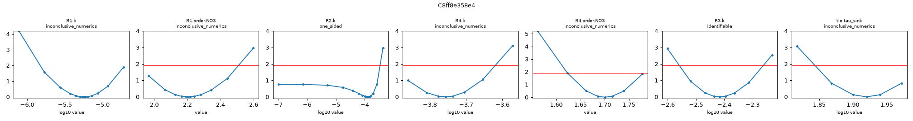
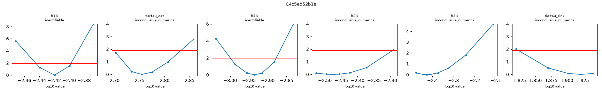
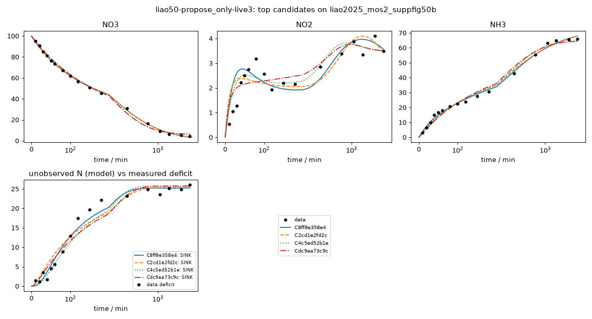

# Investigation report: liao50-propose_only-live3

- Investigation: `liao50`; arm: `propose_only`; phase: `final_evaluated`
- Protocol: `mle-profiled-v1` (sha256 `9d2cfcb0a1255b8c`); manifest sha256 `76cdbce7cb548123`; evaluator code sha256 `65c1ac7c107bb1ff` ({'python': '3.12.13', 'numpy': '2.5.4', 'scipy': '1.18.1'})
- Development data: `liao2025_mos2_suppfig50b` (sha256 `c291be31813c41e1`, source_data); 51 observations (NO3: t=0 point treated as initial condition, not as an observation; NO2: t=0 point treated as initial condition, not as an observation; NH3: t=0 point treated as initial condition, not as an observation; temperature not reported; 25.0 C assumed (matters only for potential dependence))

## Question
Which reaction networks and rate laws are supported by the 48 h H-cell nitrate-reduction time courses of Liao et al. 2025 (MoS2-family catalysts, -0.6 V vs RHE), what do the data leave ambiguous (in particular where the missing nitrogen goes and why the rates slow down), and which feasible measurement would best separate the surviving explanations?

## System boundary
Catholyte of an H-cell at fixed potential. Measured: NO3-, NO2- and NH4+/NH3 (lumped as NH3) in mM-N. Not measured: gas phase (N2, N2O, NH3 escape), anolyte (crossover), adsorbed or hidden species, pH, charge. Any nitrogen that leaves the measured channels must be represented by an explicit model species (an unmeasured product, a hidden intermediate, or a reservoir for transport out of the catholyte); the model as a whole must conserve N.

## Evidence status
- Partition: Complete experimental runs are reserved. Supp. Fig. 50a (other catalyst, same conditions and sampling) is the final held-out run; it is not read by any development-phase command, tool or evidence file. The final evaluation tests structure transfer: frozen candidate structures are refit on the held-out run with the same protocol (catalysts differ, so parameters are not transferred).
- Contamination: Retrospective analysis with literature-informed priors, not blind discovery: the proposer sees the development run, its derived N-closure series and a curated metadata note, and its pretraining may include general NO3RR mechanism knowledge.

## Ranked candidates (development data, computed in code)

Delta aicc <= 2.0: not distinguished by these data; <= 4.0: still supported. Akaike weights are relative support within this candidate set (one weight per distinct dynamics) under the stated noise model, not probabilities that a mechanism is true. Residual correlation from misspecification makes these differences optimistic.

| candidate | name | source | v | k | AICc | dAICc | weight | band | adequacy | RMSE NH3 | RMSE NO2 | RMSE NO3 | unobserved N end | in declared space | flags |
|---|---|---|---|---|---|---|---|---|---|---|---|---|---|---|
| C8ff8e358e4 | KG_powerlaw_NO2NH3_coupling | agent | 1 | 10 | 163.43 | 0.00 | 0.996 | indistinguishable_from_best | poor | 1.49 | 0.564 | 0.975 | 25.2 | no | R3: catalyst-state time modulation on a non-electrochemical step (electrons = 0), e.g. crossover or volatilization would not deactivate with the catalyst |
| C2cd1e2fd2c | G2_powerlaw_NO3_NO2toN2 | agent | 1 | 10 | 174.54 | 11.12 | 0.004 | less_supported | poor | 2.02 | 0.575 | 0.975 | 25.4 | no |  |
| C4c5ed52b1e | K_parallel_NO2NH3_coupling_deact | agent | 1 | 9 | 181.76 | 18.34 | 0.000 | less_supported | poor | 1.84 | 0.443 | 1.89 | 25.7 | no | R3: catalyst-state time modulation on a non-electrochemical step (electrons = 0), e.g. crossover or volatilization would not deactivate with the catalyst |
| Cdc9aa73c9c | J_parallel_NO2toN2_deact | agent | 1 | 9 | 193.17 | 29.75 | 0.000 | less_supported | poor | 2.49 | 0.479 | 1.8 | 25.7 | no |  |
| Cdddb7b1ae3 | M_parallel_NO2dimer_N2O_deact | agent | 1 | 9 | 196.20 | 32.78 | 0.000 | less_supported | poor | 2.41 | 0.545 | 1.79 | 25.5 | no |  |
| C0e7b7c70ab | N_langmuir_NO3_deact | agent | 1 | 10 | 196.32 | 32.89 | 0.000 | less_supported | poor | 2.49 | 0.479 | 1.8 | 25.7 | no | tie:K_NO3 at a protocol bound (1e+05) |
| Cf9b926a904 | F3_parallel_hidden_intermediate | agent | 1 | 9 | 197.94 | 34.51 | 0.000 | less_supported | poor | 2.4 | 0.577 | 1.78 | 24.1 | no |  |
| C2a579ccffe | I_strict_series_NO2toN2_septau | agent | 1 | 9 | 217.40 | 53.97 | 0.000 | less_supported | poor | 3.27 | 0.754 | 1.78 | 24.9 | no |  |
| Cd6aa459230 | A_series_directN2_sharedtau | agent | 1 | 7 | 247.57 | 84.15 | 0.000 | less_supported | poor | 3.47 | 2.04 | 1.79 | 30.2 | liao-core-v1, liao-extended-v1 |  |
| C791f3627e4 | E2_parallel_NH3_volatilization | agent | 1 | 8 | 257.89 | 94.46 | 0.000 | less_supported | poor | 11.7 | 0.728 | 1.86 | 36.3 | no |  |

## Top candidates in detail

### C8ff8e358e4 `KG_powerlaw_NO2NH3_coupling` (source agent, version 1)

Rationale (proposer): Combines the two features that the exploratory fits found most informative: order-based slowdown and bimolecular sink onset. Pairs with K (same sink, deactivation slowdown) and G2 (same slowdown, first-order NO2 sink).

    R1: NO3 -> NO2 [power_law; e=2]; R1.k=5.66e-06 (95% Wald 1.61e-06-1.99e-05, moderately_determined); R1.order.NO3=2.2 (95% Wald 1.91-2.5, moderately_determined)
    R2: NO2 -> NH3 [mass_action; e=6]; R2.k=0.000129 (95% Wald 2.82e-05-0.000587, moderately_determined)
    R4: NO3 -> NH3 [power_law; e=8]; R4.k=0.000175 (95% Wald 0.000128-0.000239, well_determined); R4.order.NO3=1.7 (95% Wald 1.63-1.77, well_determined)
    R3: NO2 + NH3 -> 2 SINK [mass_action, deactivation(tau tie=tau_sink); e=0]; R3.k=0.00383 (95% Wald 0.00278-0.00528, well_determined)
    shared: tie:tau_sink=83.2 (95% Wald 70.1-98.8, well_determined)

- Support entries: {'literature': 1, 'data': 3, 'speculative': 1}; reactions without support: []
  - R1: data -- liao2025_mos2_suppfig50b: apparent first-order rate constant falls as NO3 falls 
  - R4: data -- liao2025_mos2_suppfig50b: late NO2 rise 
  - R2: literature -- Liao et al. 2025 Nat. Commun., main text in situ ATR-IR/DEMS/DFT paragraph [L14] (NO3->NO2 deoxygenation, then hydrogenation to NH3) 
  - R3: speculative -- bimolecular N-N coupling to N2, net 0 e-; DEMS N2 [L11] consistent DS feature: sigmoidal onset of N deficit
  - tau_sink: data -- liao2025_mos2_suppfig50b: N deficit is ~5 mM-N at 60 min, rises to ~22 mM-N by 180 min, then plateaus at 23-26 mM-N to 2880 min; sink-forming route switches off after ~3 h separate clock for the sink route (catalyst-site or pH-driven selectivity switch; pH rise [L5])
- Assumptions (proposer): ['order >1 in NO3 instead of catalyst decay', 'sink = transient NO2-level + NH3-level coupling with a decaying clock']
- sigma (profiled): NO3=1, NO2=0.564, NH3=1.49; adequacy: poor ['NO3: residual signs cluster (runs test p=0.025)', 'NO2: residuals are serially correlated (lag-1 r=0.62)', 'NH3: residual signs cluster (runs test p=0.038)', 'NH3: residuals are serially correlated (lag-1 r=0.57)']
- Profile likelihood: R1.k: inconclusive_numerics (95% 1.53e-06-1.9e-05); R1.order.NO3: inconclusive_numerics (95% 1.97-2.51); R2.k: one_sided (95% 1e-07-0.000342); R4.k: inconclusive_numerics (95% 0.000138-0.00024); R4.order.NO3: inconclusive_numerics (95% 1.62-1.78); R3.k: identifiable (95% 0.00276-0.00548); tie:tau_sink: inconclusive_numerics (95% 69.7-93.8)
  

### C2cd1e2fd2c `G2_powerlaw_NO3_NO2toN2` (source agent, version 1)

Rationale (proposer): Tests the alternative explanation of the slowdown: concentration dependence (order > 1) instead of time-dependent catalyst decay.

    R1: NO3 -> NO2 [power_law; e=2]; R1.k=1.27e-05 (95% Wald 3.21e-06-5.01e-05, moderately_determined); R1.order.NO3=2.15 (95% Wald 1.82-2.48, moderately_determined)
    R2: NO2 -> NH3 [mass_action; e=6]; R2.k=0.000237 (95% Wald 8.37e-05-0.000673, moderately_determined)
    R4: NO3 -> NH3 [power_law; e=8]; R4.k=0.000183 (95% Wald 0.000112-0.000299, well_determined); R4.order.NO3=1.64 (95% Wald 1.51-1.76, well_determined)
    R3: NO2 -> SINK [mass_action, deactivation(tau tie=tau_sink); e=3]; R3.k=0.0873 (95% Wald 0.0673-0.113, well_determined)
    shared: tie:tau_sink=137 (95% Wald 111-169, well_determined)

- Support entries: {'literature': 2, 'data': 3, 'speculative': 0}; reactions without support: []
  - R1: data -- liao2025_mos2_suppfig50b: apparent first-order rate constant falls as NO3 falls (order >1 in NO3 can reproduce the slowdown without catalyst decay) 
  - R4: data -- liao2025_mos2_suppfig50b: as R1; late NO2 rise 
  - R2: literature -- Liao et al. 2025 Nat. Commun., main text in situ ATR-IR/DEMS/DFT paragraph [L14] (NO3->NO2 deoxygenation, then hydrogenation to NH3) 
  - R3: literature -- Liao et al. 2025 Nat. Commun., Methods/main text DEMS paragraph [L11] (N2, N2O, NO, NH2OH signals detected qualitatively) 
  - tau_sink: data -- liao2025_mos2_suppfig50b: N deficit is ~5 mM-N at 60 min, rises to ~22 mM-N by 180 min, then plateaus at 23-26 mM-N to 2880 min; sink-forming route switches off after ~3 h separate clock for the sink route (catalyst-site or pH-driven selectivity switch; pH rise [L5])
- Assumptions (proposer): ['no catalyst deactivation on the main path; slowdown is an apparent reaction order >1 in NO3 (e.g. interfacial enrichment or pH coupling)', 'free orders on the two NO3-consuming steps']
- sigma (profiled): NO3=1, NO2=0.575, NH3=2.02; adequacy: poor ['NO2: residuals are serially correlated (lag-1 r=0.62)', 'NH3: residual signs cluster (runs test p=0.025)', 'NH3: residuals are serially correlated (lag-1 r=0.70)']
- Profile likelihood: not computed (identifiability beyond the local Fisher screen is unassessed)

### C4c5ed52b1e `K_parallel_NO2NH3_coupling_deact` (source agent, version 1)

Rationale (proposer): Tests whether the sigmoidal onset of N loss requires both NO2 and NH3 (bimolecular N-N coupling) rather than nitrite alone.

    R1: NO3 -> NO2 [mass_action, deactivation(tau tie=tau_cat); e=2]; R1.k=0.00116 (95% Wald 0.00104-0.0013, well_determined)
    R2: NO2 -> NH3 [mass_action, deactivation(tau tie=tau_cat); e=6]; R2.k=0.00334 (95% Wald 0.0022-0.00508, well_determined)
    R4: NO3 -> NH3 [mass_action, deactivation(tau tie=tau_cat); e=8]; R4.k=0.00381 (95% Wald 0.00364-0.00398, well_determined)
    R3: NO2 + NH3 -> 2 SINK [mass_action, deactivation(tau tie=tau_sink); e=0]; R3.k=0.00374 (95% Wald 0.00264-0.0053, well_determined)
    shared: tie:tau_cat=568 (95% Wald 497-649, well_determined); tie:tau_sink=83.6 (95% Wald 68.9-101, well_determined)

- Support entries: {'literature': 2, 'data': 3, 'speculative': 1}; reactions without support: []
  - R1: literature -- Liao et al. 2025 Nat. Commun., main text in situ ATR-IR/DEMS/DFT paragraph [L14] (NO3->NO2 deoxygenation, then hydrogenation to NH3) 
  - R2: literature -- Liao et al. 2025 Nat. Commun., main text in situ ATR-IR/DEMS/DFT paragraph [L14] (NO3->NO2 deoxygenation, then hydrogenation to NH3) 
  - R4: data -- liao2025_mos2_suppfig50b: NO2 stays 2-4 mM-N and rises late while NO3 falls from 45 to 5 mM-N, so solution NO2 cannot be the sole route to NH3 (strict series predicts NO2 decaying with NO3) 
  - R3: speculative -- N-N coupling of an oxidized (nitrite-level) and a reduced (ammonia-level) N to N2, net 0 e-; DEMS N2 signal [L11] is consistent but not specific DS feature: deficit starts only after both NO2 and NH3 have built up (sigmoidal onset at 30-60 min)
  - tau_cat: data -- liao2025_mos2_suppfig50b: pseudo-first-order NO3 rate constant falls from ~0.0044 min-1 (0-180 min) to ~0.0002 min-1 (1440-2880 min) and NO3 stalls near 4.5 mM-N shared catalyst-state deactivation on electrochemical steps
  - tau_sink: data -- liao2025_mos2_suppfig50b: N deficit is ~5 mM-N at 60 min, rises to ~22 mM-N by 180 min, then plateaus at 23-26 mM-N to 2880 min; sink-forming route switches off after ~3 h separate clock for the sink route (catalyst-site or pH-driven selectivity switch; pH rise [L5])
- Assumptions (proposer): ['sink is a bimolecular surface-mediated comproportionation (NO2-level + NH3-level -> N2), not a solution thermal reaction', 'its decay clock tau_sink is separate from the catalyst clock and may reflect pH rise (NH4+ deprotonation) [L5]']
- sigma (profiled): NO3=1.89, NO2=0.443, NH3=1.84; adequacy: poor ['NO3: residuals are serially correlated (lag-1 r=0.54)', 'NH3: residual signs cluster (runs test p=0.006)', 'NH3: residuals are serially correlated (lag-1 r=0.73)']
- Profile likelihood: R1.k: identifiable (95% 0.00359-0.004); tie:tau_cat: inconclusive_numerics (95% 504-681); R4.k: identifiable (95% 0.001-0.00132); R2.k: inconclusive_numerics (95% 0.00297-0.00511); R3.k: inconclusive_numerics (95% 0.00332-0.0058); tie:tau_sink: inconclusive_numerics (95% 66.4-87.5)
  

### Cdc9aa73c9c `J_parallel_NO2toN2_deact` (source agent, version 1)

Rationale (proposer): Parallel direct NH3 route plus released nitrite; nitrite is reduced to N2 (3 e-) only during an early window. The lag of the N deficit follows NO2 build-up.

    R1: NO3 -> NO2 [mass_action, deactivation(tau tie=tau_cat); e=2]; R1.k=0.00204 (95% Wald 0.0018-0.0023, well_determined)
    R2: NO2 -> NH3 [mass_action, deactivation(tau tie=tau_cat); e=6]; R2.k=0.00518 (95% Wald 0.00324-0.0083, well_determined)
    R4: NO3 -> NH3 [mass_action, deactivation(tau tie=tau_cat); e=8]; R4.k=0.00304 (95% Wald 0.00283-0.00325, well_determined)
    R3: NO2 -> SINK [mass_action, deactivation(tau tie=tau_sink); e=3]; R3.k=0.0896 (95% Wald 0.0682-0.118, well_determined)
    shared: tie:tau_cat=544 (95% Wald 480-617, well_determined); tie:tau_sink=130 (95% Wald 104-162, well_determined)

- Support entries: {'literature': 3, 'data': 3, 'speculative': 0}; reactions without support: []
  - R1: literature -- Liao et al. 2025 Nat. Commun., main text in situ ATR-IR/DEMS/DFT paragraph [L14] (NO3->NO2 deoxygenation, then hydrogenation to NH3) 
  - R2: literature -- Liao et al. 2025 Nat. Commun., main text in situ ATR-IR/DEMS/DFT paragraph [L14] (NO3->NO2 deoxygenation, then hydrogenation to NH3) 
  - R4: data -- liao2025_mos2_suppfig50b: NO2 stays 2-4 mM-N and rises late while NO3 falls from 45 to 5 mM-N, so solution NO2 cannot be the sole route to NH3 (strict series predicts NO2 decaying with NO3) 
  - R3: literature -- Liao et al. 2025 Nat. Commun., Methods/main text DEMS paragraph [L11] (N2, N2O, NO, NH2OH signals detected qualitatively) N2 from nitrite-level intermediates
  - tau_cat: data -- liao2025_mos2_suppfig50b: pseudo-first-order NO3 rate constant falls from ~0.0044 min-1 (0-180 min) to ~0.0002 min-1 (1440-2880 min) and NO3 stalls near 4.5 mM-N shared catalyst-state deactivation on electrochemical steps
  - tau_sink: data -- liao2025_mos2_suppfig50b: N deficit is ~5 mM-N at 60 min, rises to ~22 mM-N by 180 min, then plateaus at 23-26 mM-N to 2880 min; sink-forming route switches off after ~3 h separate clock for the sink route (catalyst-site or pH-driven selectivity switch; pH rise [L5])
- Assumptions (proposer): ['direct (surface-confined) NO3->NH3 route that does not release NO2', 'sink formed from released NO2 with its own decaying activity']
- sigma (profiled): NO3=1.8, NO2=0.479, NH3=2.49; adequacy: poor ['NO3: residual signs cluster (runs test p=0.013)', 'NO3: residuals are serially correlated (lag-1 r=0.52)', 'NO2: residuals are serially correlated (lag-1 r=0.53)', 'NH3: residual signs cluster (runs test p=0.007)', 'NH3: residuals are serially correlated (lag-1 r=0.80)']
- Profile likelihood: not computed (identifiability beyond the local Fisher screen is unassessed)

## Discrimination analysis (discrimination-1.json)

A design is {"name", "c0_mM_N": {...}, "t_end_min", optional "observe": [species ids to measure]}. Predictions use
    each candidate's development MLE; parameter uncertainty is not propagated, so large disagreement is a lead for an
    experiment, not a quantified expected information gain.

- Design `baseline_observe_gas` {"name": "baseline_observe_gas", "c0_mM_N": {"NO3": 99.95}, "t_end_min": 2880, "observe": ["NO3", "NO2", "NH3", "SINK", "N2O"]}:
  - NH3: max spread 3.61 mM-N at 2.88e+03 min (2.43 dev sigma); {'C8ff8e358e4': 67.87, 'C2cd1e2fd2c': 67.9, 'C4c5ed52b1e': 64.74, 'Cdc9aa73c9c': 64.29, 'Cdddb7b1ae3': 64.49}
  - species:NH3: max spread 3.61 mM-N at 2.88e+03 min (- dev sigma); {'C8ff8e358e4': 67.87, 'C2cd1e2fd2c': 67.9, 'C4c5ed52b1e': 64.74, 'Cdc9aa73c9c': 64.29, 'Cdddb7b1ae3': 64.49}
  - NO3: max spread 3.28 mM-N at 463 min (3.28 dev sigma); {'C8ff8e358e4': 23.71, 'C2cd1e2fd2c': 23.79, 'C4c5ed52b1e': 20.72, 'Cdc9aa73c9c': 20.55, 'Cdddb7b1ae3': 20.52}
  - species:NO3: max spread 3.28 mM-N at 463 min (- dev sigma); {'C8ff8e358e4': 23.71, 'C2cd1e2fd2c': 23.79, 'C4c5ed52b1e': 20.72, 'Cdc9aa73c9c': 20.55, 'Cdddb7b1ae3': 20.52}
  - unmeasured_N_total: max spread 2.71 mM-N at 43.4 min (- dev sigma); {'C8ff8e358e4': 4.21, 'C2cd1e2fd2c': 6.01, 'C4c5ed52b1e': 3.3, 'Cdc9aa73c9c': 5.19, 'Cdddb7b1ae3': 5.44}
- Design `low_NO3_25` {"name": "low_NO3_25", "c0_mM_N": {"NO3": 25}, "t_end_min": 2880}:
  - NO3: max spread 7.78 mM-N at 333 min (7.79 dev sigma); {'C8ff8e358e4': 14.79, 'C2cd1e2fd2c': 14.84, 'C4c5ed52b1e': 7.15, 'Cdc9aa73c9c': 7.07, 'Cdddb7b1ae3': 7.05}
  - unmeasured_N_total: max spread 5.54 mM-N at 2.88e+03 min (- dev sigma); {'C8ff8e358e4': 0.9, 'C2cd1e2fd2c': 2.61, 'C4c5ed52b1e': 3.67, 'Cdc9aa73c9c': 6.44, 'Cdddb7b1ae3': 4.99}
  - NH3: max spread 5.26 mM-N at 391 min (3.54 dev sigma); {'C8ff8e358e4': 9.46, 'C2cd1e2fd2c': 8.56, 'C4c5ed52b1e': 13.82, 'Cdc9aa73c9c': 12.19, 'Cdddb7b1ae3': 12.87}
  - NO2: max spread 1.11 mM-N at 217 min (1.97 dev sigma); {'C8ff8e358e4': 0.69, 'C2cd1e2fd2c': 0.28, 'C4c5ed52b1e': 1.39, 'Cdc9aa73c9c': 0.64, 'Cdddb7b1ae3': 1.15}
- Design `NH3_spike_30` {"name": "NH3_spike_30", "c0_mM_N": {"NO3": 99.95, "NH3": 30}, "t_end_min": 2880}:
  - NH3: max spread 6.63 mM-N at 2.88e+03 min (4.46 dev sigma); {'C8ff8e358e4': 96.57, 'C2cd1e2fd2c': 97.9, 'C4c5ed52b1e': 91.27, 'Cdc9aa73c9c': 94.29, 'Cdddb7b1ae3': 94.49}
  - unmeasured_N_total: max spread 4.89 mM-N at 376 min (- dev sigma); {'C8ff8e358e4': 26.18, 'C2cd1e2fd2c': 23.27, 'C4c5ed52b1e': 28.17, 'Cdc9aa73c9c': 23.62, 'Cdddb7b1ae3': 23.87}
  - NO3: max spread 3.28 mM-N at 463 min (3.28 dev sigma); {'C8ff8e358e4': 23.71, 'C2cd1e2fd2c': 23.79, 'C4c5ed52b1e': 20.72, 'Cdc9aa73c9c': 20.55, 'Cdddb7b1ae3': 20.52}
  - NO2: max spread 1.6 mM-N at 304 min (2.83 dev sigma); {'C8ff8e358e4': 1.29, 'C2cd1e2fd2c': 2.2, 'C4c5ed52b1e': 1.81, 'Cdc9aa73c9c': 2.83, 'Cdddb7b1ae3': 2.89}
- Design `NO2_spike_10` {"name": "NO2_spike_10", "c0_mM_N": {"NO3": 99.95, "NO2": 10}, "t_end_min": 2880}:
  - NH3: max spread 12.5 mM-N at 376 min (8.42 dev sigma); {'C8ff8e358e4': 36.16, 'C2cd1e2fd2c': 46.08, 'C4c5ed52b1e': 41.27, 'Cdc9aa73c9c': 48.67, 'Cdddb7b1ae3': 48.0}
  - unmeasured_N_total: max spread 9.73 mM-N at 246 min (- dev sigma); {'C8ff8e358e4': 39.65, 'C2cd1e2fd2c': 30.58, 'C4c5ed52b1e': 36.85, 'Cdc9aa73c9c': 29.92, 'Cdddb7b1ae3': 30.69}
  - NO2: max spread 8.42 mM-N at 14.5 min (14.9 dev sigma); {'C8ff8e358e4': 10.55, 'C2cd1e2fd2c': 4.9, 'C4c5ed52b1e': 9.91, 'Cdc9aa73c9c': 4.29, 'Cdddb7b1ae3': 2.13}
  - NO3: max spread 3.28 mM-N at 463 min (3.28 dev sigma); {'C8ff8e358e4': 23.71, 'C2cd1e2fd2c': 23.79, 'C4c5ed52b1e': 20.72, 'Cdc9aa73c9c': 20.55, 'Cdddb7b1ae3': 20.52}
- Design `NO2_only_20` {"name": "NO2_only_20", "c0_mM_N": {"NO2": 20}, "t_end_min": 720}:
  - NO2: max spread 19.6 mM-N at 76 min (34.7 dev sigma); {'C8ff8e358e4': 19.67, 'C2cd1e2fd2c': 0.12, 'C4c5ed52b1e': 13.48, 'Cdc9aa73c9c': 0.08, 'Cdddb7b1ae3': 0.27}
  - unmeasured_N_total: max spread 19.6 mM-N at 83.2 min (- dev sigma); {'C8ff8e358e4': 0.29, 'C2cd1e2fd2c': 19.86, 'C4c5ed52b1e': 5.5, 'Cdc9aa73c9c': 18.78, 'Cdddb7b1ae3': 19.25}
  - NH3: max spread 6.22 mM-N at 720 min (4.19 dev sigma); {'C8ff8e358e4': 1.24, 'C2cd1e2fd2c': 0.06, 'C4c5ed52b1e': 6.28, 'Cdc9aa73c9c': 1.17, 'Cdddb7b1ae3': 0.67}
  - NO3: max spread 0 mM-N at 0 min (0 dev sigma); {'C8ff8e358e4': 0.0, 'C2cd1e2fd2c': 0.0, 'C4c5ed52b1e': 0.0, 'Cdc9aa73c9c': 0.0, 'Cdddb7b1ae3': 0.0}

## Investigator conclusion (conclusion-1.json; an interpretation, numbers above are authoritative)

Ten candidates were fitted with the shared protocol. All are adequacy = poor, so none adequately describes the MoS2 Supp. Fig. 50b time course.

The best by a wide margin is KG (C8ff8e358e4, AICc 163.4). The next is G2 at dAICc 11.1. KG has two features. First, nitrate is consumed by two parallel routes, NO3->NO2 and a direct NO3->NH3 route, with apparent orders of about 2.2 and 1.7 in NO3 and no catalyst decay term. Second, the unmeasured N comes from a bimolecular NO2+NH3 -> N2 step that switches off with tau of about 83 min. KG fits NO3 to the noise floor (RMSE 0.98 mM-N), NO2 to 0.56 and NH3 to 1.49. It ends with 25.2 mM-N unmeasured, matching the observed plateau of 23-26 mM-N.

What the comparison supports:
- A route to NH3 that does not pass through solution NO2: strict series I is dAICc 54.
- An order-like slowdown rather than exponential deactivation: KG vs K is 18.3 and G2 vs J is 18.6.
- A sink whose start lags until NO2 and NH3 have built up and which then stops.
- No NO3 saturation: the Langmuir K went to its upper bound.
- NH3 volatilization (dAICc 94) and constant-selectivity N2 (dAICc 84) cannot reproduce the plateau. A hidden stored intermediate gains nothing.

What remains unresolved:
- The apparent order of about 2 is almost certainly a lumped stand-in for unmeasured pH drift or surface change. It is not an elementary order, and it is confounded with time in a single run.
- The sink's switch-off clock is phenomenological and flagged as chemically questionable, since it sits on a step with no electron transfer.
- The sink species (N2 vs N2O) and its precursor are not identified by these three channels.

Residual structure remains in every channel (the NH3 stall at 40-180 min, the NO2 dip at 100-120 min), so the dAICc values are optimistic.

The most informative next measurements are a nitrite-only feed with headspace gas analysis (35 dev-sigma separation between coupling and nitrite-only sinks) and a lower initial nitrate concentration with pH logging (7.8 dev-sigma, order vs deactivation). Closing the N balance with gas, acid-trap, NH2OH and anolyte analyses would test the transient-sink picture directly.

- Plausible: ['C8ff8e358e4']
- Adequacy: none_adequate
- Rejected: [{'candidate_id': 'C791f3627e4', 'reason': "E2 (NH3 volatilization as sole sink): dAICc = 94.5, the worst of the set. A first-order escape from the NH3 pool predicts a deficit that keeps growing with the NH3 inventory (about 66 mM-N at late times), but the measured deficit is flat at 23-26 mM-N from 360 to 2880 min. The authors' qualitative escape remark [L6] cannot be the main sink, though a small escape term is not excluded."}, {'candidate_id': 'Cd6aa459230', 'reason': 'A (series plus constant-selectivity direct NO3->N2, one shared tau): dAICc = 84.2, poor adequacy. A constant branching ratio cannot give the delayed start (about 5 mM-N missing at 60 min) followed by a plateau while about 45 mM-N NO3 remains. With a single shared tau, the predicted NO2 also falls as NO3 falls, against the data.'}, {'candidate_id': 'C2a579ccffe', 'reason': 'I (strict series through solution NO2, three taus): dAICc = 54.0. Even with a separate deactivation clock for nitrite reduction, routing all NH3 through measured NO2 is much worse than the parallel networks. The data favour an NO3->NH3 route that does not release NO2 into solution.'}, {'candidate_id': 'Cf9b926a904', 'reason': 'F3 (hidden NH2OH-level intermediate holding the missing N): dAICc = 34.5, poor adequacy. The stored-pool explanation gives no gain over an irreversible sink and is chemically less parsimonious (it needs about 25 mM-N of an undetected, stable intermediate). It is disfavoured, not excluded: an NH2OH assay would settle it.'}, {'candidate_id': 'C0e7b7c70ab', 'reason': "N (Langmuir saturation in NO3, i.e. the paper's 'reactant enrichment' picture, on network J): the shared K_NO3 went to the upper bound (1e5 mM). That means no saturation is detectable, so the model collapses to J plus one wasted parameter (AICc 196.3 vs J 193.2). The data show the opposite of saturation: apparent order > 1."}, {'candidate_id': 'Cdc9aa73c9c', 'reason': 'J (parallel, first-order NO2->N2 sink with its own tau, catalyst exponential deactivation): dAICc = 29.8. It is dominated on both features. An exponential-decay slowdown is worse than an order > 1 (compare G2, dAICc 11), and a sink first-order in NO2 is worse than an NO2*NH3 sink (compare K, dAICc 18). Its chemistry is not excluded independently of those comparisons.'}, {'candidate_id': 'Cdddb7b1ae3', 'reason': 'M (2 NO2 -> N2O, second order, with exponential deactivation): dAICc = 32.8. A second-order nitrite coupling does not improve the onset shape over J and is clearly worse than the NO2+NH3 coupling. N2O as the dominant sink is not supported by these fits, but it is not chemically excluded.'}]
- Ambiguities: ['No candidate is adequate. KG, the best, still has clustered or serially correlated residuals in all three channels: NO3 runs-test p = 0.025, NO2 lag-1 r = 0.62, NH3 runs p = 0.038 and lag-1 r = 0.57. The data contain structure the model misses: NH3 rises fast in the first 40 min, stalls from 40 to 180 min, then rises again, and NO2 dips at 100-120 min. dAICc values are therefore optimistic.', 'Cause of the slowdown: within one run at one initial concentration, time and NO3 concentration are confounded. KG and G2 fit apparent orders of 1.7-2.2 in NO3 instead of catalyst decay (G2 beats J by 18.6; KG beats K by 18.3). An order of about 2 is unlikely to be elementary. It most plausibly stands in for something unmeasured: the pH drift from 6.7 toward about 11.9 [L5], gradual catalyst change, or interfacial effects. Each k is almost perfectly correlated with its order (r = -0.999 and -0.997), so k and order are not separately meaningful.', 'Identity and switch-off of the sink: every surviving sink model needs an empirical clock that turns the sink off with tau of about 80-140 min (KG tau_sink = 83 min, CI 70-99; G2 = 137 min). In KG this clock sits on a step that transfers no electrons, which the validator flags as chemically questionable. It is a phenomenological stand-in, probably for a pH- or surface-state-driven selectivity switch (e.g. NH4+ deprotonation once pH exceeds about 9.25). It is not an identified mechanism.', 'Sink chemistry: NO2+NH3 coupling (KG, K), first-order NO2->N2 (G2, J) and 2NO2->N2O (M) all predict the same final deficit of about 25 mM-N. They differ only in how fast the loss starts (unmeasured N at 43 min: 3.3-6.0 mM-N across models). Nothing distinguishes N2 from N2O, and no gas was quantified [L11, L12].', "G2 (dAICc 11.1) and K (dAICc 18.3) are less supported, but each shares one of KG's two features. I do not treat them as chemically excluded, since the dAICc values are inflated by misspecification.", 'Unresolved metadata: no pH-time data, temperature, membrane (H-cell), anolyte volume or composition, charge/FE, or replicates for this run. The values have not been checked against the plotted figure, and no headspace or acid-trap measurements exist. NO3 crossover to the anolyte cannot be ruled out as part of the deficit.']
- Experiment: Nitrite-only feed: 20 mM-N NO2-, no NO3-, same electrode and potential, sampled to 12 h, with headspace N2/N2O (GC) and an acid trap. -- discriminates ['C8ff8e358e4', 'C4c5ed52b1e', 'C2cd1e2fd2c', 'Cdc9aa73c9c', 'Cdddb7b1ae3']: Largest computed separation: up to 19.6 mM-N in NO2 at about 76 min (35 dev-sigma). The NO2+NH3 coupling models (KG, K) predict nitrite persists and little N is lost when NH3 is initially absent. The first-order or N2O nitrite-sink models (G2, J, M) predict nitrite is almost gone and about 19 mM-N lost within about 80 min. Gas analysis also identifies N2 vs N2O.
- Experiment: Nitrate run spiked with 10 mM-N NO2- at t=0 (100 mM-N NO3-), sampling as in Supp. Fig. 50, plus headspace gas. -- discriminates ['C8ff8e358e4', 'C2cd1e2fd2c', 'C4c5ed52b1e', 'Cdc9aa73c9c']: NO2 spread of 8.4 mM-N at about 14 min (15 dev-sigma) and NH3 spread of 12.5 mM-N at about 6 h (8.4 dev-sigma). This separates a coupling sink, which needs NH3 present, from a nitrite-only sink in a near-standard experiment.
- Experiment: Lower initial nitrate, 25 mM-N NO3-, otherwise identical, 48 h, ideally with logged pH. -- discriminates ['C8ff8e358e4', 'C2cd1e2fd2c', 'C4c5ed52b1e', 'Cdc9aa73c9c']: Separates the cause of the slowdown. The order > 1 models (KG, G2) predict much slower NO3 loss at low concentration (about 14.8 mM-N left at about 5.5 h), while the exponential-deactivation models (K, J) predict about 7.1 (7.8 dev-sigma). Logging pH tests whether the apparent order is really a pH effect.
- Experiment: Repeat the baseline run with quantified headspace N2/N2O and an acid NH3 trap, an NH2OH assay of the catholyte, and NO3- analysis of the anolyte. -- discriminates ['C8ff8e358e4', 'C791f3627e4', 'Cf9b926a904']: Closes the N balance directly: gas (sink models), escaped NH3 (E2), stored NH2OH (F3), or crossover. It also tests the predicted pattern of gas evolution peaking at 1-2 h and stopping after about 4 h, which is the core feature all surviving models need.

## Frozen selection

- Rule: lowest AICc among fitted candidates without a hidden-pool plausibility violation, plus every such candidate within delta AICc <= 2.0
- Selected: ['C8ff8e358e4']
- Agent-concluded plausible: ['C8ff8e358e4']
- Frozen at 2026-10-20T19:14:15.264Z

## Final held-out evaluation: liao2025_wmos2_suppfig50a

Version: current evaluator code.

Structure transfer: each frozen structure is refit on the held-out run (different catalyst) with the development protocol; parameters are not transferred. Rank is among all members of the declared enumeration spaces fitted to the same run.
Sensitivity: AICc at the lowest NLL any start reached (flags fits whose reported optimum is beaten by replicated unconverged starts). See docs/examples/arm_comparison.md for ranks in a shared reference set.

- C8ff8e358e4: fitted; AICc 193, delta to best 13.9, rank 33/688 among this run's declared-space members; numerically unreliable: False; sensitivity AICc 193 (rank 33); adequacy poor; RMSE {'NO3': 2.09, 'NO2': 0.55, 'NH3': 1.72}
- Best declared-space members on the held-out run: [('S:enum-2ed1b3b4a8', 179.17, 'enumerated: NO3>NO2,NO3>NH3,NO3>X,NO2>X,X>NH3 | mass_action | shared_deactivation'), ('S:enum-3c7318acc7', 179.3, 'enumerated: NO3>NO2,NO3>NH3,NO2>NH3,NO3>X,X>NH3 | mass_action | shared_deactivation'), ('S:enum-21d5c8b0d8', 179.41, 'enumerated: NO3>NO2,NO3>NH3,NO2>SINK,NO3>X,X>NH3 | mass_action | shared_deactivation')]

## Cost and runtime

- Numerics: 5 fits run, 5 reused from the shared cache, 162 CPU s fitting, 135 s profiles (current evaluator code only; earlier code versions' records are excluded)
- LLM: anthropic/claude-opus-5-5; sessions: 1 investigator; tokens in 50, out 34,087, cache read 961,837, cache write 94,096; $1.34 (list prices from the Pi model table); 566 s wall; 25 tool calls

## Unresolved assumptions and metadata

- liao2025_mos2_suppfig50b: verified_against_figure=False
- [L3] catalyst assignment: unresolved discrepancy
- [L4] selectivity numbers: unresolved
- [L5] pH: stated for a related experiment; not measured for these runs
- [L6] NH3 escape: stated (qualitative)
- [L7] reference and iR: stated (flow cell)
- [L8] membrane: not found for the H-cell
- [L9] volume: stated for 0.5 h tests
- [L11] gas and crossover: not measured for these runs
- [L12] N balance: not found
- [L13] charge: not found for these runs
- [L14] mechanism (authors): stated (surface pathway, not a solution-phase kinetic model)
- [L15] replicates: no replicate information for these runs
- Noise model: independent Gaussian errors per channel (profiled sigma); no replicate information exists for these runs, so sigma is estimated from misfit and includes model error.
- AICc differences assume independent errors; clustered residual signs (adequacy 'poor') make them optimistic.

