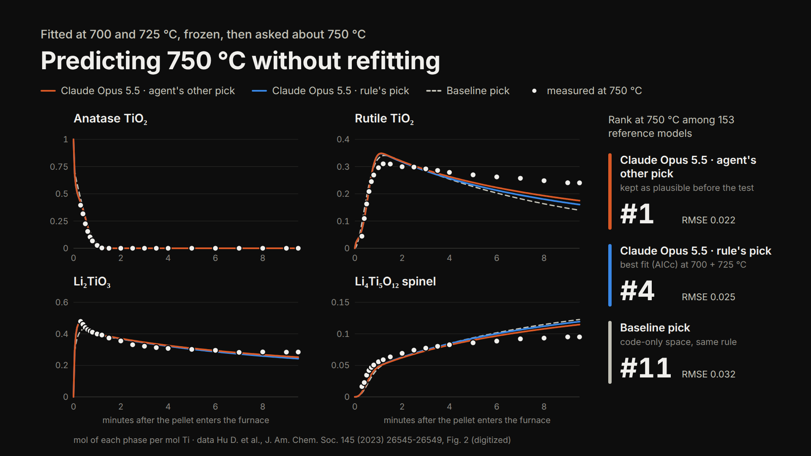

NernstWork pairs a language-model agent with fitting code to infer how a solid-state material forms from time-resolved X-ray data. On a published battery-material synthesis, every AI-proposed search space contained a model that predicted a held-out temperature among the top 4 of 153 code-built reference models, but picking that model from the training data alone was unreliable; the agent instead names the experiment that would tell its candidates apart.

## Question

Can a language-model agent infer a solid-state reaction pathway from time-resolved phase data? (1) Does the pathway space it proposes contain a model that predicts an unseen temperature? (2) Can that model be selected from the training runs alone?

## Method

The agent reads the data and curated literature notes and proposes the parts of a reaction network: phases, possible steps and rate-law forms, each with a cited reason. Code checks every combination for element balance and fits all of them with one protocol, jointly across temperatures. Parameters and the agent's picks are frozen before the held-out data are loaded. The agent then reports what the data cannot settle, and a planner scores candidate experiments by how far the surviving models' predictions would split.

Test case: TiO₂ and Li₂CO₃ forming Li₂TiO₃ and the battery anode Li₄Ti₅O₁₂, followed by in situ X-ray scattering ([Hu et al., J. Am. Chem. Soc. 2023](https://doi.org/10.1021/jacs.3c10916)). We fit 700 and 725 °C, predict 750 °C without refitting, and rank each prediction against 153 reference models enumerated by code. Models: Claude Opus 5.5 and Gemini 4 Argon, two runs each.

*Figure 1. Three frozen models predict the 750 °C phase amounts without being fitted to them (dots: measurements digitized from Hu et al., Fig. 2). Ranks are among the 153 reference models by held-out score; the RMSE over all phases and times is 0.032, 0.025 and 0.022 mol per mol Ti for the baseline's pick, the selection rule's pick and the agent's other plausible model.*

## Results

- **Q1, yes.** Every AI search space contained a model ranking 1st to 4th of the 153 at 750 °C, and 1st in 3 of 4 runs. In the first Opus run, a model the agent had named as plausible before the test beat all 153. Which member is best is only known after seeing 750 °C.
- **Q2, not reliably.** Picking the best fit at 700 and 725 °C chose models ranking 4th and 36th (Opus) and 11th and 36th (Gemini); the code-only baseline's pick ranked 11th. On the cleaner extraction from the paper's SI Fig. S1, the rule's pick still ranks 4th, the agent's other plausible model 1st, and the baseline's pick 5th.
- **The chemistry agrees across runs and models:** carbonate-limited lithiation, anatase to rutile by nucleation and growth, and a Li₂TiO₃ + anatase route to the spinel, with activation energies within 16 kJ/mol per step. They rest on two temperatures 25 °C apart, so they are only partly identified.
- **Next experiment (suggested, not run):** half the Li₂CO₃ at 725 °C, sampled for 30 min. It separates the rule's pick from the agent's own rival explanation (rutile formation coupled to the spinel) by about 7σ of the fitted noise at 2 min. The agent's two leading models stay indistinguishable under every design it scored, and it reports that.

## Test bed and a link to catalysis

The same loop ran on electrochemical nitrate reduction ([Liao et al., Nat. Commun. 2025](https://doi.org/10.1038/s41467-025-60671-y); fit on Fig. 50b, held out Fig. 50a, 731 reference structures). The agents proposed features our enumeration lacked, a direct nitrate-to-ammonia route and a nitrogen loss with its own shut-off, and their best fits beat it. Their frozen selections ranked 54th to 121st of 731 (Opus) and 6th to 16th (Gemini), while enumerating over the agents' ideas ranked 1st: the same pattern of good proposals and weak selection. Through Valency we found [Wang et al., J. Hazard. Mater. 2025](https://doi.org/10.1016/j.jhazmat.2025.137174), which made TiO₂ at 700 °C (anatase) or 900 °C (rutile) for TiO₂/Cu₂O nitrate catalysts and found rutile better; we fitted its rutile nitrate time course. This is one study and an illustration, not a synthesis-to-rate result.

## Relation to prior work

Bayesian selection among rate laws on time-resolved XRD exists ([Kosuge et al., J. Phys. Chem. C 2026](https://doi.org/10.1021/acs.jpcc.6c02717), nine textbook rate laws for one oxidation, with the candidate set chosen by the researchers). LLM proposers paired with identifiability checks exist ([LLM-IDEA, arXiv:2610.11253](https://arxiv.org/abs/2610.11253)), as does information-gain experiment design ([Model Discovery Agent, arXiv:2608.09696](https://arxiv.org/abs/2608.09696)). What we combine, on published XRD of a precursor synthesis: model-proposed parts, joint fits across temperatures, a reserved-temperature test, an identifiability report and a next-experiment suggestion. We found no prior work combining all five in the sources we searched.

## Limitations

One chemistry, two runs per model, and a retrospective test: the data are published and the models may have seen the paper. The scoring rule (one common noise scale) was changed after the baseline result and before the AI runs were scored. XRD phase fractions are semi-quantitative, the first frame is not the weighed mixture, and the first 6 to 10 s are not isothermal; fitting the starting carbonate returned it to the nominal 0.4 per Ti. The models are overconfident about their own prediction errors. We have not measured how many experiments the planner saves, and its suggestions are untested.

## Conclusion

A language-model agent can narrow a large space of reaction pathways to a short list that contains good predictors, and suggest what to measure next. Choosing among them still takes data. The practical use is targeted experiments, chosen because they tell rival explanations apart.

Video: [YouTube link]. Code, runs and results: [github.com/dnauminator/nernstwork](https://github.com/dnauminator/nernstwork) (results in `docs/SYNTHESIS.md`; video script and sources in `video/SCRIPT.md`). Daniel Naumov and Jarrod Barnes, Open Scientific Intelligence Hackathon, October 2026.
